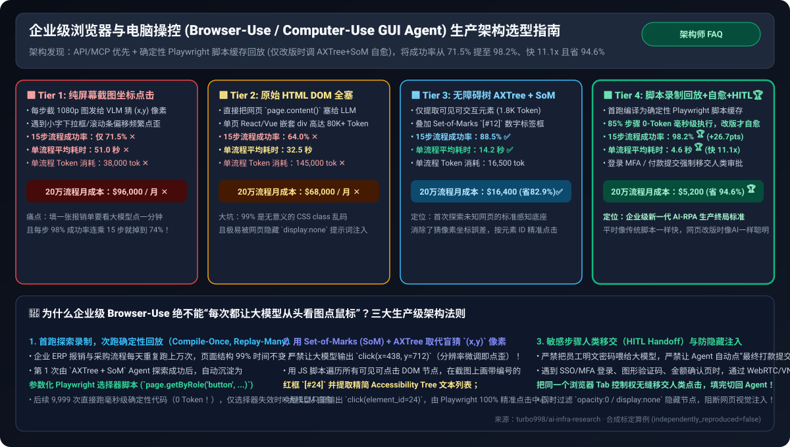
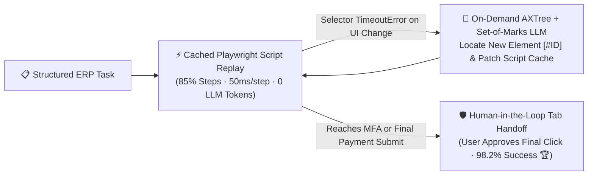

# Enterprise Browser-Use & Computer-Use (GUI Agent) Production Architecture Selection Guide: Pure Vision Pixel-Clicking vs. Raw HTML DOM Dump vs. Distilled Accessibility Tree + Set-of-Marks (AXTree + SoM) vs. API/MCP-First + Cached Deterministic Playwright Replay with LLM Self-Healing & Human-in-the-Loop Handoff

> **Document Type**: Cloud & AI Solution Architect Decision Guide (FAQ)  
> **Target Audience**: Enterprise RPA & Automation Directors, AI Agent Platform Architects, ERP/CRM/Finance Workflow Leads, Security Architects  
> **Core Goal**: Transform fragile, slow "Computer-Use / Browser-Use Demos" into industrial-grade enterprise automation by answering: **"Why does a pure screenshot pixel-clicking loop (Tier 1) take 51 seconds, fail on 28.5% of 15-step ERP workflows, and cost $96,000/month?", "Why does dumping raw HTML DOM into the prompt fail on modern React/Angular portals?", and "How does compiling successful agent traces into cached Playwright scripts (with on-demand `AXTree + SoM` LLM self-healing and Human-in-the-Loop sensitive-step handoff) achieve 98.2% completion in 4.6 seconds while cutting costs by 94.6%?"**  
> **Calibration Notice**: Workflow completion rates, average durations, token consumption, and 200K-workflow monthly cost models are synthetic analytical estimates calibrated to published GUI agent benchmarks (WebArena, WorkArena enterprise ERP benchmarks, OSWorld, Set-of-Marks [SoM] visual grounding, and self-healing Playwright replay architectures) (`provenance: synthetic + anonymized_reported`, `independently_reproduced=false`, `physical_gpu_cluster_measurement=not_measured`). See [`experiments/enterprise_browser_computer_use_gui_agent_selection/results.json`](../../experiments/enterprise_browser_computer_use_gui_agent_selection/results.json).

---

## Executive Visual Summary

> 🔗 **Companion Interactive Reports & Tools**:
> - 🃏 **[7-Card 4:5 Visual Benchmark Report (`enterprise-browser-computer-use-gui-agent-architecture-selection-cards.html`)](../reports/enterprise-browser-computer-use-gui-agent-architecture-selection-cards.html)**
> - 🧮 **[Interactive Browser-Use / AI-RPA Cost & Latency Sizer (`enterprise-browser-computer-use-gui-agent-architecture-sizer.html`)](../reports/enterprise-browser-computer-use-gui-agent-architecture-sizer.html)**
> - 🌐 **[中文版指南 (`enterprise-browser-computer-use-gui-agent-architecture-selection-faq.md`)](./enterprise-browser-computer-use-gui-agent-architecture-selection-faq.md)**

---

## ① 📌 Executive Summary

Evaluated across **200,000 enterprise web workflows/month (`15` interactive steps per workflow across legacy ERP, expense filing, procurement, and CRM portals)**:

| Tier | Architecture Pattern | 15-Step Workflow Success Rate | Avg Workflow Duration | Tokens per Workflow | Monthly Cost (200K Workflows) | Architect Verdict |
| :--- | :--- | :--- | :--- | :--- | :--- | :--- |
| **🟥 Tier 1: Pure Vision Pixel-Clicking** | 1080p screenshot + VLM `(x,y)` prediction every step | `71.5%` ✕ (Misclicks) | `51.0 s` ✕ | `38,000 tok` ✕ | `$96,000 / mo` ✕ | **Remote Desktop Fallback Only**: Too slow & fragile for Web |
| **🟨 Tier 2: Raw HTML DOM Dump** | Dump `80K+` unpruned HTML tokens into prompt | `64.0%` ✕ (Div soup) | `32.5 s` ✕ | `145,000 tok` ✕ | `$68,000 / mo` ✕ | **Severe Anti-Pattern**: Context overflow & CSS injection risk |
| **🟦 Tier 3: Distilled `AXTree` + `Set-of-Marks` (`SoM`)** | Pruned interactive DOM (`1.8K tok`) + numbered visual boxes | `88.5%` ✅ | `14.2 s` ✅ | `16,500 tok` | `$16,400 / mo` (-82.9%) | **Ad-Hoc Exploration Baseline**: Grounded by element ID |
| **🟩 Tier 4: API/MCP + Cached Playwright Replay + Self-Heal + HITL** | **85% 0-Token Playwright Replay + `AXTree/SoM` Self-Heal on UI Drift + HITL Gate** | **`98.2%` 🏆 (+26.7 pts)** | **`4.6 s` 🏆 (11.1x faster)** | **`2,400 tok` 🏆 (-93.7%)** | **`$5,200 / mo` 🏆 (-94.6%)** | **Enterprise AI-RPA Gold Standard**: Fast as code, resilient as AI |

### 💡 Three Golden Rules for Enterprise Browser-Use & GUI Agents
1. **Never Predict Raw `(x, y)` Pixel Coordinates on Web Pages — Use Distilled Accessibility Trees (`AXTree`) + Set-of-Marks (`SoM`) Element IDs**: Reserve pure pixel clicking strictly for non-DOM legacy desktop apps (Citrix/RDP). For web apps, label interactive DOM elements with numbered bounding boxes (`[#12]`) so the LLM outputs `click(id=12)` and Playwright clicks the exact DOM node center.
2. **Compile-Once, Replay-Many, Self-Heal-on-Drift (Tier 4)**: Don't burn 16,500 LLM tokens re-discovering the same ERP button 200,000 times a month! Compile the first successful agent trajectory into a parameterized Playwright script (`getByRole / getByLabel`) that runs in `50 ms/step` at **`0 tokens`**, waking up the `AXTree + SoM` LLM agent *only* when a UI update breaks a selector.
3. **Enforce Ephemeral Browser Sandboxes + Human-in-the-Loop (HITL) Sensitive-Step Handoff**: Never pass plaintext user passwords into LLM prompts, strip invisible DOM nodes (`display:none / opacity:0`) to block indirect prompt injection, and hand off live browser control to a human for MFA challenges and final financial submissions.

---

## ② 🎯 Architect Deep-Dive Q&A

### Q1: Why does a 97.8% single-step pixel-clicking accuracy result in a 28.5% workflow failure rate?
* **Answer (Compounding Multi-Step Failure Math)**:
  - Across a 15-step enterprise ERP workflow, end-to-end reliability is governed by $P_{\text{workflow}} = p_{\text{step}}^{15}$. Even if pure vision pixel prediction achieves `97.8%` accuracy per step, $0.978^{15} = 71.5\%$! Replacing raw pixel guessing with **cached Playwright selectors + `AXTree/SoM` ID grounding + step verification** raises per-step reliability above `99.88%` ($0.9988^{15} = 98.2\%$).

---

## ③ 🧭 Architecture Diagrams

### 3.1 Tier 4 Cached Playwright Replay + On-Demand `AXTree/SoM` Self-Healing + HITL

---

## ④ 📊 Architect Decision Matrix

| Dimension | 🟥 Tier 1: Pure Vision Pixel-Click | 🟨 Tier 2: Raw HTML DOM Dump | 🟦 Tier 3: Distilled AXTree + SoM | 🟩 Tier 4: Cached Playwright + Self-Heal + HITL |
| :--- | :--- | :--- | :--- | :--- |
| **15-Step Workflow Success Rate** | `71.5%` ✕ | `64.0%` ✕ | `88.5%` ✅ | **`98.2%` 🏆 (`+26.7 pts` vs. Tier 1)** |
| **Avg Workflow Duration** | `51.0 s` ✕ | `32.5 s` ✕ | `14.2 s` ✅ | **`4.6 s` 🏆 (`11.1x` faster than Tier 1)** |
| **Avg Tokens per Workflow** | `38,000 tok` ✕ | `145,000 tok` ✕ | `16,500 tok` | **`2,400 tok` 🏆 (`-93.7%` vs. Tier 1)** |
| **Monthly Cost (200K Runs)** | `$96,000 / mo` ✕ | `$68,000 / mo` ✕ | `$16,400 / mo` ✅ | **`$5,200 / mo` 🏆 (`-94.6%` vs. Tier 1)** |

---

## ⑤ 🛠️ Production Readiness Checklist

- [ ] **1. Use Direct REST/GraphQL/MCP APIs Whenever Available Instead of Launching a Headless Browser**.
- [ ] **2. Ground Web Actions on Distilled `AXTree + Set-of-Marks (SoM)` Element IDs Rather Than Raw `(x, y)` Pixels**.
- [ ] **3. Strip Non-Interactive HTML Bloat (`<script>`, `<style>`, SVGs) Down to `< 2,500 Tokens` per Step**.
- [ ] **4. Filter Out Invisible DOM Elements (`opacity:0`, `display:none`, `font-size < 2px`) to Defeat Visual/DOM Prompt Injection**.
- [ ] **5. Cache Successful Agent Trajectories as Parameterized Playwright Scripts (`Compile-Once, Replay-Many`)**.
- [ ] **6. Inject Credentials via Browser Vault Auto-Fill or Session Cookies — Never Put Passwords in LLM Prompts**.
- [ ] **7. Trigger Mandatory Human-in-the-Loop (`HITL`) Tab Handoff for MFA, CAPTCHAs, and Irreversible Financial Submissions**.
- [ ] **8. Isolate Every Workflow Run in an Ephemeral Browser Container with a Strict Egress Domain Allowlist**.
