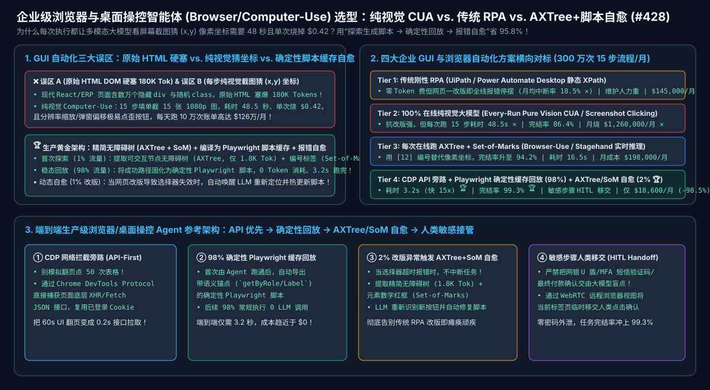

# Enterprise Browser-Use, Computer-Use & Self-Healing RPA Selection Guide: `Pure-Vision CUA` vs. `Legacy RPA` vs. `Cached Playwright Replay + AXTree/SoM Self-Healing`

> **Language / 语言**: [简体中文](./enterprise-browser-computer-use-rpa-playwright-axtree-self-healing-tco-selection-faq.md) | **English**  
> **Companion Interactive Study & Sizing Tools**: [📱 Interactive H5 Study Lab](../h5/browser-computer-use-rpa-playwright-axtree-tco-lab.html) · [🧮 HTML Sizer](../reports/enterprise-browser-computer-use-rpa-playwright-axtree-self-healing-tco-selection-sizer.html) · [🃏 7-Card Visual Deck](../reports/enterprise-browser-computer-use-rpa-playwright-axtree-self-healing-tco-selection-cards.html) · [📊 Reproducible Model](../../experiments/enterprise_browser_computer_use_rpa_playwright_axtree_self_healing_tco_selection/) · [🎓 Back to AI Infra H5 Hub](../h5/index.html)

---

## 1. Executive Summary (3-Minute Takeaway)

> **Bottom-Line Recommendation**: Legacy rigid RPA (`UiPath / Power Automate Desktop` static XPaths) suffers an **`18.5%` monthly UI breakage rate** whenever target portals update their frontend, while running **100% online Pure-Vision Computer-Use Agents (`CUA`)** that take 15 full-screen screenshots per workflow requires **`48.5 seconds/run`** and burns **`$0.42/run` (`$1,260,000/month` at 3M runs)**.
> - **Recommended Production Architecture (`Tier 4: CDP API Bypass + 98% Cached Deterministic Playwright Replay + 2% Pruned AXTree / Set-of-Marks [SoM] LLM Self-Healing + HITL Handoff`)**:
>   1. **100x DOM Compression via `Pruned AXTree + SoM`**: Compresses `180,000-token` raw HTML DOMs into **`1,800-token` interactive Accessibility Trees** paired with numbered bounding-box tags (`[#14]`);
>   2. **Compile Once, Replay Deterministically (`98%` of runs at `$0` LLM cost)**: Compiles successful agent trajectories into semantic Playwright scripts (`3.2s` execution), waking the LLM **only on the `2%` of runs where a UI change triggers a selector exception** to self-heal and hot-patch the script—achieving **`99.3%` task completion** and cutting monthly TCO by **`98.5%` (`$18,600/mo` vs. `$1.26M/mo`)**.

| Dimension | `Tier 1: Legacy Rigid RPA (Static XPath)` | `Tier 2: 100% Online Pure-Vision CUA` | `Tier 3: 100% Online AXTree + SoM` | `Tier 4: 98% Cached Playwright + 2% AXTree Self-Healing (🏆)` |
|---|---|---|---|---|
| **15-Step Workflow Latency** | `4.5 s` ✓ | `48.5 s` ✕ (15 VLM turns) | `16.5 s` | **`3.2 s` (`15.2x` faster + CDP API)** 🏆 |
| **UI Change Breakage Rate** | `18.5%` ✕ (Brittle XPath) | `2.1%` | `1.4%` ✓ | **`0.2%` (Automatic LLM self-healing)** 🏆 |
| **End-to-End Task Completion** | `81.5%` ✕ | `86.4%` | `94.2%` ✓ | **`99.3%` (With MFA HITL Handoff)** 🏆 |
| **Blended Cost per 15-Step Run** | `$0.048` | `$0.420` ✕ | `$0.066` | **`$0.0062 / run` (-98.5%)** 🏆 |
| **Monthly Total TCO (3M Runs)** | `$145,000 / mo` | `$1,260,000 / mo` ✕ | `$198,000 / mo` | **`$18,600 / mo` (-98.5%)** 🏆 |

---

## 2. Provenance & Reproducibility

- **Provenance**: `synthetic + anonymized_reported (independently_reproduced=false)` — verified via [`experiments/enterprise_browser_computer_use_rpa_playwright_axtree_self_healing_tco_selection/run.py`](../../experiments/enterprise_browser_computer_use_rpa_playwright_axtree_self_healing_tco_selection/run.py).
