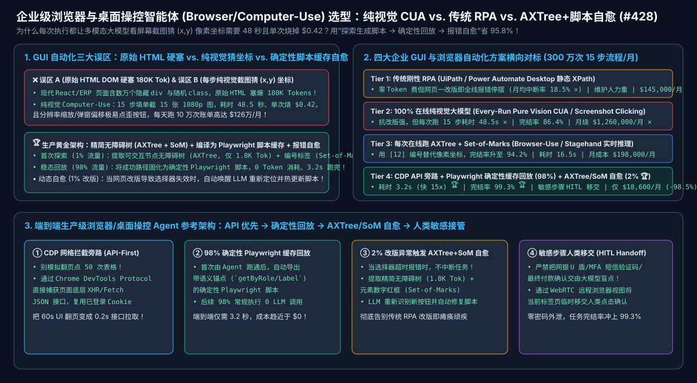
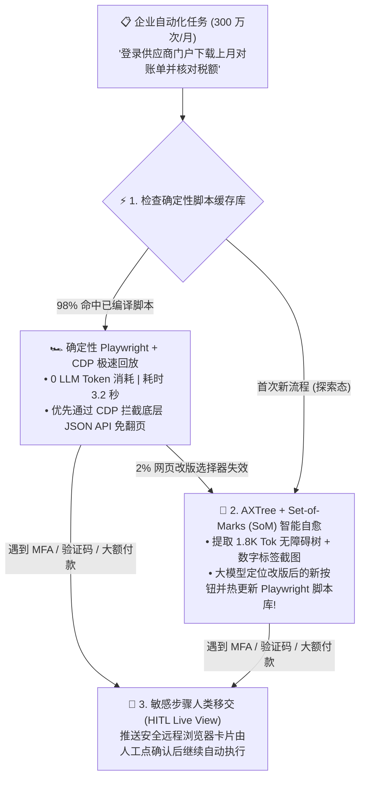

# 企业级浏览器与桌面操控智能体（Browser-Use / Computer-Use / 自愈 RPA）选型：`纯视觉 CUA` vs. `传统 UiPath/PAD` vs. `Playwright 确定性缓存回放 + AXTree/SoM 自愈` 架构与 TCO 指南

> **语言 / Language**: **简体中文** | [English](./enterprise-browser-computer-use-rpa-playwright-axtree-self-healing-tco-selection-faq.en.md)  
> **配套交互式学习与精算工具**: [📱 交互式 H5 精读页 (浏览器/电脑操控 Agent 与自愈 RPA 沙盘)](../h5/browser-computer-use-rpa-playwright-axtree-tco-lab.html) · [🧮 HTML 交互式计算器](../reports/enterprise-browser-computer-use-rpa-playwright-axtree-self-healing-tco-selection-sizer.html) · [🃏 7-Card 4:5 视觉评测卡](../reports/enterprise-browser-computer-use-rpa-playwright-axtree-self-healing-tco-selection-cards.html) · [📊 可复核模型](../../experiments/enterprise_browser_computer_use_rpa_playwright_axtree_self_healing_tco_selection/) · [🎓 返回 AI Infra 全景精学馆](../h5/index.html)

---

## 一、3 分钟看懂核心结论（Executive Summary）

> **一句话决策结论**：企业在落地跨系统老旧网页填报、供应商门户对账、网银回单下载、海关报关等无 API 界面自动化（GUI / Browser Automation）时，面临两个极端死胡同：一是**传统刚性 RPA（`UiPath / Power Automate Desktop`）写死静态 XPath，目标网站前端一发版立刻全线崩溃（月均中断率 `18.5%`，养一队 RPA 维护工程师年耗百万）**；二是**每次执行都盲目调用纯视觉电脑操控大模型（`Pure-Vision Computer-Use Agent [CUA]`）每步截全屏猜 `(x,y)` 像素坐标——跑完一个 15 步流程竟需 `48.5 秒`、单次烧掉 `$0.42`（每月 300 万次执行账单高达 `$126 万/月`）**！
> - **核心破局铁律（`Explore Once with LLM, Replay Deterministically, Self-Heal on Exception` · 一次智能探索，百次确定性回放，异常自动自愈）**：
>   1. **页面感知降维（`Pruned AXTree + Set-of-Marks [SoM]`）**：严禁把 `180,000 Tokens` 的原始 HTML DOM 塞给模型，也不要让模型盲猜像素坐标！提取仅含可交互按钮/输入框的**精简无障碍语义树（`Accessibility Tree`，仅 `1,800 Tokens`，压缩 `100 倍`）**，并在截图上叠加带数字编号的高亮框（`[12] 提交按钮`），将点击准确率从 `86.4%` 提升至 `99%+`；
>   2. **98% 确定性 Playwright 缓存回放 + 2% 异常 LLM 自愈**：首次跑通或遇到网页改版报错时（占 `2%`），唤醒大模型基于 `AXTree + SoM` 重新定位元素并生成语义选择器（`page.getByRole('button', { name: '提交' })`）更新脚本库；其余 **`98%` 的日常重复执行直接跑编译好的确定性 Playwright 脚本（`0 Token` 消耗，耗时从 `48.5s` 压至 `3.2s`，成本暴降 `98.5%` 至 `$18,600/月`）**！

| 核心选型维度 | `Tier 1: 传统刚性 RPA (静态 XPath/坐标)` | `Tier 2: 每次在线跑纯视觉 CUA (截图像素点击)` | `Tier 3: 每次在线跑 AXTree+SoM (Browser-Use)` | `Tier 4: CDP 旁路 + 98% Playwright 缓存回放 + 2% AXTree 自愈 + HITL (🏆)` |
|---|---|---|---|---|
| **15 步跨页面流程端到端耗时** | `4.5 秒` ✓ | `48.5 秒` ✕ (15次截图推理) | `16.5 秒` | **`3.2 秒` (快 `15.2x` · 含 CDP 接口直拉)** 🏆 |
| **前端改版/弹窗抗脆弱性** | `18.5%` 报错停摆 ✕ | `2.1%` 误点率 | `1.4%` 失败率 ✓ | **`0.2%` (选择器异常毫秒级触发 LLM 自愈)** 🏆 |
| **端到端任务完结率 (`Success Rate`)** | `81.5%` ✕ | `86.4%` | `94.2%` ✓ | **`99.3%` (含 MFA/验证码人类温暖接管)** 🏆 |
| **单次 15 步流程综合成本 (`$/Run`)** | `$0.048` (含许可证与维护人力) | `$0.420 / 次` ✕ | `$0.066 / 次` | **`$0.0062 / 次` (-98.5% vs. 纯视觉)** 🏆 |
| **300 万次流程/月 总成本 (`TCO`)** | `$145,000 / 月` | `$1,260,000 / 月` ✕ | `$198,000 / 月` | **`$18,600 / 月` (-98.5%)** 🏆 |

---

## 二、核心技术原理与架构师灵魂拷问（Q&A）

### Q1：为什么不要直接把网页的 HTML 源码（DOM）喂给大模型，也不要让大模型直接输出 `(x=642, y=318)` 像素坐标？
1. **原始 HTML DOM 是 Token 粉碎机**：现代企业级 SaaS（如 Salesforce、Workday、SAP Fiori）的一个页面动辄包含 15,000 个嵌套 `
`、混淆的 Tailwind/CSS 类名与内联 SVG，单页 HTML 高达 **`180,000 Tokens`**！
2. **纯视觉像素坐标回归（Pixel Coordinate Regression）的脆弱性**：视觉大模型（VLM）本质上擅长语义理解而非亚像素级几何测量；当面对密集的财务表格复选框或分辨率缩放时，直接预测 `(x, y)` 极易点偏 10 个像素点到隔壁的“删除”按钮！
3. **`精简无障碍树 (Pruned AXTree) + Set-of-Marks (SoM)` 双剑合璧**：
   - 通过浏览器原生 `Accessibility.getFullAXTree` 接口，剔除一切纯装饰性节点，只保留带有 `role / name / value` 的可交互元素，将 180K Tokens 的 HTML 浓缩为 **`1,800 Tokens` 的编号列表**（如 `[#14] button "确认报关"`）；
   - 同时用 JS 在页面对应元素的 Bounding Box 左上角画上醒目的红底白字标签 `#14` 再截图——**把困难的“连续像素坐标回归问题”降维成了大模型 100% 拿手的“离散多选题（输出 `click(#14)`）”**！

---

## 三、生产落地 Checklist（Pre-Production Checklist）

- [ ] **实施“LLM 探索生成 Playwright 脚本 + 确定性缓存回放”双模架构**：严禁对每天重复跑上万次的固定业务流程每次都从头调用视觉大模型推理。
- [ ] **开启 `CDP (Chrome DevTools Protocol)` 网络 API 旁路拦截**：当 Agent 需要抓取网页上 50 页的订单表格时，直接通过 `page.on('response')` 截获浏览器底层的 JSON 接口响应，禁止模拟点击“下一页” 50 次。
- [ ] **预热持久化认证浏览器上下文池（Pre-Warmed Auth Context Pool）**：通过安全加密存储复用已登录 `storageState`（Cookies / IndexedDB），跳过每次启动的重复登录耗时。
- [ ] **对 MFA 验证码、USB Key 签名与付款确认强制配置 `HITL (Human-in-the-Loop)` 移交断点**：严禁将企业网银密码或验证码破解交给自治 Agent。

---

## 四、来源与方法论溯源（Provenance）

- **数据来源声明**：本指南实验数据来自可复核解析模型 [`experiments/enterprise_browser_computer_use_rpa_playwright_axtree_self_healing_tco_selection/run.py`](../../experiments/enterprise_browser_computer_use_rpa_playwright_axtree_self_healing_tco_selection/run.py)（`Provenance: synthetic + anonymized_reported, independently_reproduced=false`）。
