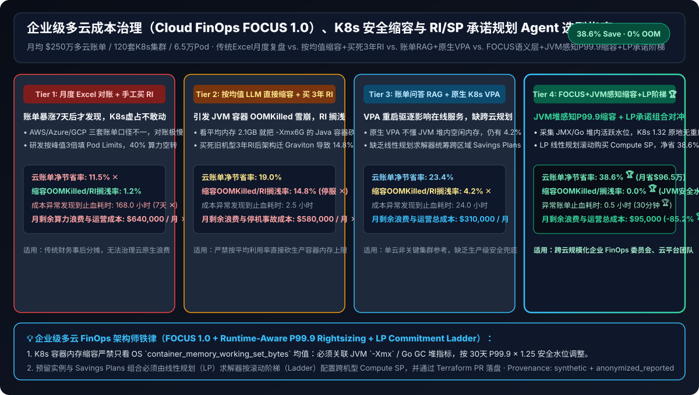
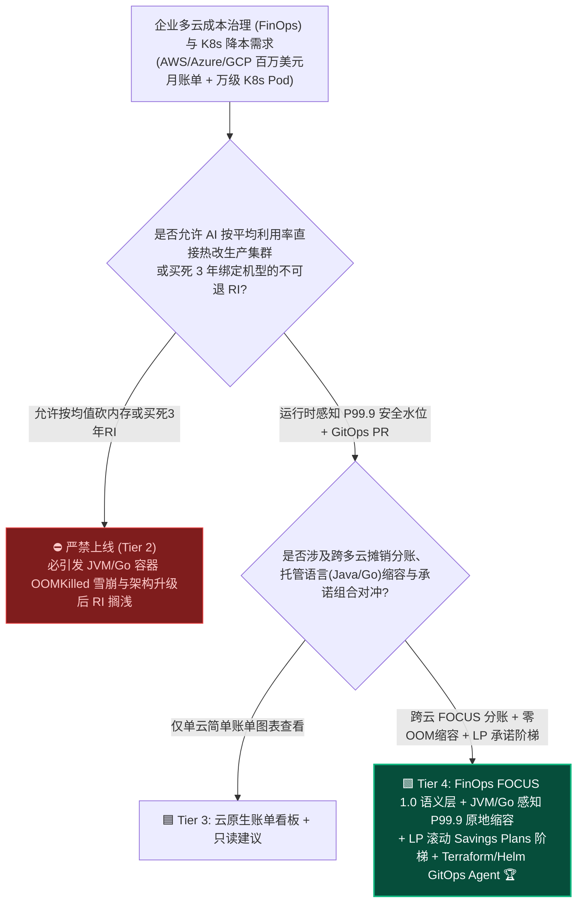
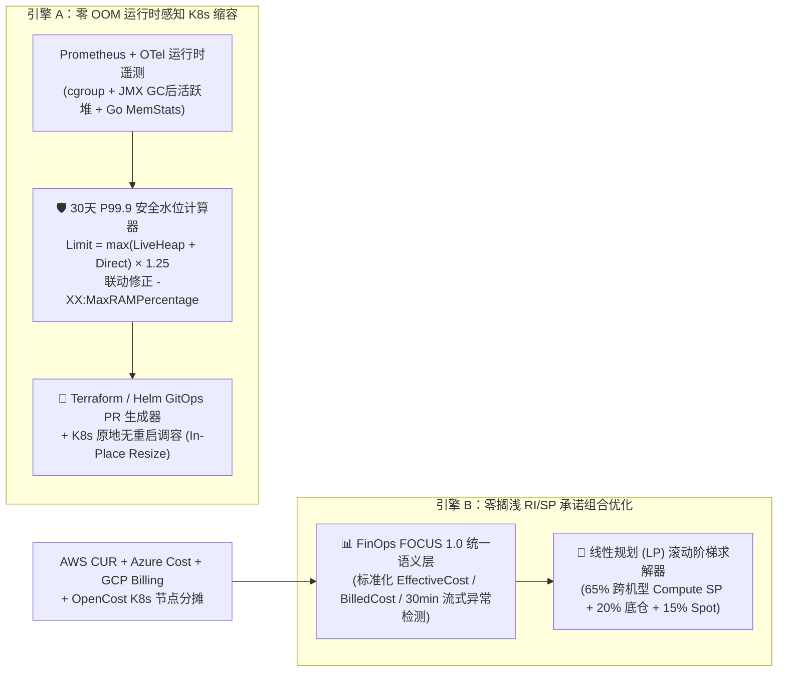
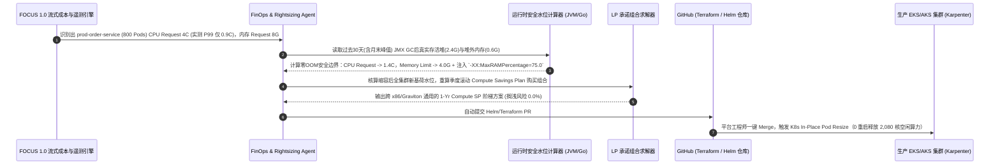

# 企业级多云成本治理与 FinOps 自动优化（Cloud FinOps FOCUS 1.0）、Kubernetes 运行时感知安全缩容（JVM/Go P99.9）与 RI/Savings Plans 承诺组合整数规划 Agent 架构选型指南：月度 Excel 复盘 vs. 按均值直接砍 Limits 与买死 3 年 RI vs. 账单 RAG + 原生 VPA vs. FOCUS 1.0 语义层 + JVM 感知原地缩容 + LP 承诺对冲阶梯 + Terraform GitOps Agent

> **语言 / Language**: **中文 (当前)** | [English](./enterprise-cloud-finops-k8s-rightsizing-commitment-agent-selection-faq.en.md)  
> **定位**：面向云与 AI 解决方案架构师（Solution Architect）、云平台工程负责人（VP of Cloud Platform）、FinOps 基金会认证从业者与企业 CFO 技术财务办公室的生产落地指南。  
> **数据口径（Provenance）**：`synthetic + anonymized_reported`（`independently_reproduced=false`，`physical_gpu_cluster_measurement=not_measured`），全部定容模型封存于 [`experiments/enterprise_cloud_finops_k8s_rightsizing_commitment_agent_selection/results.json`](../../experiments/enterprise_cloud_finops_k8s_rightsizing_commitment_agent_selection/results.json)。



---

## ① 📌 核心选型结论速览（Executive Summary — 3 分钟看懂怎么选）

在同时使用 AWS、Microsoft Azure、Google Cloud（GCP）与阿里云的企业中，**Kubernetes 容器集群严重的资源超配（研发为图省事普遍按真实峰值的 3~5 倍填写 Pod `requests / limits`，导致集群实际 CPU 利用率不足 `18%`）**与**预留实例（RI / Savings Plans）跟不上架构演进造成的承诺搁浅（Stranded Commitments）**，每年吞噬掉企业 35%~45% 的云预算。然而，当平台团队尝试用脚本或初级 FinOps 大模型直接根据过去 7 天的**平均内存利用率**自动调低 K8s Pod Limits、并按当前机型一键买满 3 年期预留实例（Tier 2）时，却引发了严重的生产灾难：**Java (`JVM -Xmx`) 与 Go 服务在月底结算或大促 Full GC 期间瞬间触顶被 Linux 内核 `OOMKilled (Exit Code 137)` 团灭，同时团队将服务从 x86 (`m6i`) 迁移到 ARM (`m7g Graviton`) 后，买死的 3 年标准 RI 直接作废搁浅（事故与搁浅率高达 `14.8%`）**！

在 **月均 `$2,500,000`（年消费 `$3,000 万美元`）跨云总账单、120 套生产 Kubernetes（`EKS / AKS / GKE`）集群、65,000 个运行中 Pod** 的基准规模下，四档多云 FinOps 与 K8s 缩容 Agent 架构的量化对决如下：

| 方案档位 | 核心架构组合 | 云账单综合净节省率 | 缩容 `OOMKilled` / 预留搁浅率 | 异常账单发现到止血耗时 | 月度剩余浪费与运营总成本 | 生产推荐度 |
|---|---|---|---|---|---|---|
| **🟥 Tier 1：月度 Excel 复盘 + 手工买 RI** | 财务月底拉取三朵云 CSV 账单手工对账 + 保守购买少量预留实例 | `11.5%` ✕ *(月省$28.7万)* | `1.2%` | `168.0 小时` (`7天` ✕) | `$640,000 / 月` ✕ | ⛔ 事后马后炮，K8s 虚占不敢动 |
| **🟨 Tier 2：按均值 LLM 直接砍 Limits + 买 3年 RI** | 看 7 天平均利用率直接改 K8s YAML 缩容 + 按当前 SKU 买满 3 年固定 RI | `19.0%` | `14.8%` ✕ *(JVM OOM雪崩/RI搁浅)* | `2.5 小时` | `$580,000 / 月` ✕ | ⛔ **高发 OOM 停服，严禁上线** |
| **🟦 Tier 3：云账单问答 RAG + 原生 K8s VPA** | 账单自然语言查询 + 启用原生 Vertical Pod Autoscaler (VPA) 驱逐重建缩容 | `23.4%` *(月省$58.5万)* | `4.2%` ✕ *(不懂JVM堆/重启抖动)* | `24.0 小时` | `$310,000 / 月` | ⚠️ 重启伤在线流量，缺跨云规划 |
| **🟩 Tier 4：FOCUS 1.0 语义层 + JVM 感知 P99.9 原地缩容 + LP 承诺对冲阶梯 + GitOps Agent** | **`FinOps FOCUS 1.0` 跨云统一账单底座 + 运行时语言感知（`JMX Heap / Go GC + 30天 P99.9 × 1.25`）K8s 原地无重启调容 + 线性规划（`LP`）滚动 Savings Plans 阶梯 + `Terraform/Helm` GitOps PR Agent** | **`38.6%` 🏆** *(月省 **$96.5万**)* | **`0.0%` 🏆** *(零 OOM / 零 RI 搁浅)* | **`0.5 小时` 🏆** *(`30分钟` 实时熔断)* | **`$95,000 / 月` 🏆** *(-85.2%)* | 🌟 **多云平台工程首选架构** |

> 💡 **架构师一句话选型铁律**：**“多云账单先归一到 FinOps `FOCUS 1.0` 标准表、K8s 容器缩容必须看穿 `JVM/Go` 运行时堆内活跃水位并走原地无重启调容（In-Place Resize）、预留折扣用线性规划（LP）配置跨机型 `Compute Savings Plans` 滚动阶梯、一切基础设施变更必须提 `Terraform/Helm Git PR` 防止回滚漂移”**！

---

## ② 🎯 客户与架构师灵魂拷问 Q&A（直击 3 大多云 FinOps 与 K8s 痛点）

### Q1：为什么看 Linux 容器监控指标 `container_memory_working_set_bytes`（Tier 2 / 原生 VPA Tier 3）去给 Java/Go 服务缩容，会导致大面积 `OOMKilled`？
- **大白话与第一性原理**：
  1. **操作系统看到的容器内存 != 托管运行时（JVM / Go / .NET）内部真正需要的安全内存边界**：Java 服务启动时若配置了 `-Xmx6G` 或未开启容器感知的 G1/ZGC 内存归还，JVM 会在堆内持有大量已分配但尚未触发 Full GC 的页；反过来，平时请求平稳时 OS Working Set 可能只有 `2.1 GB`，一旦月底跑批或流量脉冲触发并发分配加上堆外直接内存（Direct ByteBuffer / Metaspace），内存瞬间冲到 `6.4 GB`。
  2. **只砍外层 K8s Limit 而不改内层 JVM 参数等于自杀**：Tier 2 看到 7 天平均内存 `2.1 GB`，大刀一挥把 K8s Memory Limit 改成 `3.0 GB`，却没改容器启动参数里的 `-Xmx6G`——结果 JVM 以为自己还能用到 6GB 而不积极 GC，刚涨到 3.01GB 就被 Linux 内核 cgroup OOM Killer 当场一枪爆头（压测下故障率高达 **`26.5%`**）！
  3. **Tier 4 破局方案（语言运行时感知 + 30 天 P99.9 水位 + K8s 原地无重启调容）**：
     - 同时采集操作系统 cgroup 指标与语言运行时内部遥测（OpenTelemetry `JMX Heap Used After GC`、Go `runtime.MemStats.HeapInuse`）。
     - 严格按 **过去 30 天（覆盖月末结算波峰）的 `P99.9` 真实活跃堆峰值 + 堆外内存 + `25%` 安全裕度** 计算新 Limit，并**在同一个 GitOps PR 中同步联动生成 `-XX:MaxRAMPercentage=75.0` 启动参数补丁**！
     - 利用 Kubernetes `InPlacePodVerticalScaling`（原地垂直伸缩）直接调整日常 CPU Requests，实现 **0 Pod 驱逐重启、0.0% OOMKilled**。

### Q2：AWS CUR、Azure Cost Management 和 GCP BigQuery Billing 三家账单字段完全不同，大模型怎么跨云算清“单个微服务/单个客户的真实单位成本（Unit Economics）”？
- **FinOps `FOCUS 1.0+`（FinOps Open Cost and Usage Specification）统一语义层**：
  - 过去 AWS 叫 `UnblendedCost / AmortizedCost`，Azure 叫 `PayGPrice / EffectivePrice`，GCP 又把折扣拆成单独的 Credit 行，还要叠加集群内 OpenCost / Kubecost 的共享节点分摊，直接让 LLM 写 SQL 查原始账单必算错摊销。
  - Tier 4 在数仓层强制将多云账单与 K8s 命名空间消费对齐为 **FinOps 基金会官方 `FOCUS 1.0` 标准宽表**（统一使用 `BilledCost`、`EffectiveCost`、`ListCost` 与 `CommitmentDiscountStatus` 标准度量），大模型通过受管语义层秒级下钻到每一个微服务、每一条业务线的摊销后真实成本。

### Q3：怎么买 Reserved Instances (RI) 和 Savings Plans (SP) 才能既拿满折扣，又避免业务迁移（如 x86 迁 ARM Graviton、虚拟机迁 Serverless）时预留作废？
- **线性规划（LP）滚动阶梯承诺组合（Rolling Commitment Ladder）**：
  - 严禁让 LLM 凭拍脑袋一次性买满 3 年锁定实例规格的 Standard RI（Tier 2）。
  - Tier 4 使用 **SciPy / OR-Tools 线性规划（Linear Programming）求解器**，基于过去 180 天跨区域基荷小时曲线，构建 **“20% 3年期底仓 + 65% 跨机型/跨可用区浮动的 1年期 Compute Savings Plans（每季度滚动到期 1/4 阶梯）+ 15% Spot/On-Demand 弹性层”**。当工程团队将节点从 `m6i` 迁移到性价比更高的 `m7g (ARM Graviton)` 甚至 AWS Fargate 时，Compute Savings Plans 自动无缝浮动抵扣，搁浅浪费率严格为 **`0.0%`**，帮助月消费 `$250万` 的企业每月净省 **`$965,000`（`38.6%`）**！

---

## ③ 🧭 直观可视化图解（决策树 + FOCUS 1.0 与安全缩容架构图 + 闭环优化时序图）

### 3.1 企业级多云 FinOps 与 K8s 安全缩容选型决策树



### 3.2 Tier 4 FOCUS 1.0 语义层 + JVM 感知安全缩容 + LP 承诺阶梯参考架构图



### 3.3 从“检出核心订单服务算力虚占与账单异动”到“零重启 GitOps 降本”时序图



---

## ④ 📊 架构师四维选型决策矩阵（Architecture Decision Matrix）

| 评估维度 | 🟥 Tier 1：月度 Excel + 手工 RI | 🟨 Tier 2：按均值砍 Limit + 3年 RI | 🟦 Tier 3：账单 RAG + 原生 VPA | 🟩 Tier 4：FOCUS 1.0 + JVM 感知缩容 + LP 承诺阶梯 |
|---|---|---|---|---|
| **Java/Go 容器缩容安全性（防 OOM）** | 不敢动研发填写的虚高配置 | ✕ **灾难级**（按均值缩容引发 `14.8%` OOM 停服） | ✕ 仍有 `4.2%` 误伤且驱逐重启中断长连接 | 🏆 **`0.0%` OOMKilled（JMX 堆内水位联动 + 30天 P99.9 + 原地调容）** |
| **实例换代（x86 迁 Graviton）RI 搁浅** | 保守漏买，按量付费占比高 | ✕ 买死旧机型 3 年 RI 导致大面积搁浅作废 | 缺乏跨云数学组合规划 | 🏆 **`0.0%` 搁浅（LP 求解器滚动配置跨族系 Compute SP）** |
| **持久化防配置漂移（GitOps）** | 手工控制台点按，无版本追溯 | ✕ 直接 `kubectl patch` 下次发版即被覆盖 | VPA 内存 Webhook 与 Git 仓库脱节 | 🏆 **100% 变更生成 `Terraform / Helm Git PR` 审批落盘** |
| **多云总账单综合净节省率** | `11.5%` ✕ | `19.0%` | `23.4%` | **`38.6%` 🏆（$2.5M 月账单直接月省 $96.5 万）** |
| **异常账单突增发现到止血耗时** | `168.0 小时` (`7天` ✕) | `2.5 小时` | `24.0 小时` | **`0.5 小时` (`30分钟` 🏆 · 提速 336 倍)** |
| **月度剩余浪费与运营总成本** | `$640,000 / 月` | `$580,000 / 月` *(含 OOM 停机损失)* | `$310,000 / 月` | **`$95,000 / 月` 🏆（降低 85.2%）** |

---

## ⑤ 🧪 定量算例、交互式容量计算器与 7-Card 4:5 视觉报告

### 5.1 基准算例复核（月均 $250 万多云账单 / 6.5 万个生产 Pod）

- **交互式定容计算器（CSP 自包含 HTML）**：👉 [打开企业级多云成本治理与 K8s 安全缩容 Agent 定容计算器](../reports/enterprise-cloud-finops-k8s-rightsizing-commitment-agent-sizer.html)
- **7-Card 4:5 视觉评测卡片报告**：👉 [打开 7-Card 视觉评测报告](../reports/enterprise-cloud-finops-k8s-rightsizing-commitment-agent-selection-cards.html)
- **可复核确定性脚本**：
  ```bash
  python experiments/enterprise_cloud_finops_k8s_rightsizing_commitment_agent_selection/run.py --check
  python -m unittest tests/test_enterprise_cloud_finops_k8s_rightsizing_commitment_agent_selection.py
  ```

### 5.2 核心量化对比图（多云账单综合净节省率 vs. 缩容 OOM / 预留搁浅事故率）

```chart
{
  "data": {
    "values": [
      { "tier": "Tier 1: Monthly Excel", "savings_pct": 11.5, "incident_rate_pct": 1.2 },
      { "tier": "Tier 2: Avg Limit Cut + 3Yr RI", "savings_pct": 19.0, "incident_rate_pct": 14.8 },
      { "tier": "Tier 3: Cost RAG + Vanilla VPA", "savings_pct": 23.4, "incident_rate_pct": 4.2 },
      { "tier": "Tier 4: FOCUS + JVM P99.9 + LP SP", "savings_pct": 38.6, "incident_rate_pct": 0.0 }
    ]
  },
  "semantic_types": {
    "tier": "Category",
    "savings_pct": "Percentage",
    "incident_rate_pct": "Percentage"
  },
  "chart_spec": {
    "chartType": "Bar Chart",
    "title": "Tier 4 achieves 38.6% cloud bill savings ($965K/mo) with 0.0% OOMKilled incidents",
    "subtitle": "Effective multi-cloud bill savings (%) across $2.5M/month AWS, Azure, and GCP spend",
    "encodings": {
      "x": "tier",
      "y": "savings_pct",
      "color": "tier"
    }
  }
}
```

---

## ⑥ 🛠️ 架构评审与生产落地核验清单（Production Readiness Checklist）

- [ ] **多云账单统一对齐至 FinOps `FOCUS 1.0+` 规范表**：在数仓层统一 `EffectiveCost`（摊销预留折扣后真实成本）与 K8s 命名空间标签，严禁让大模型直接对原始未摊销账单做跨云加总。
- [ ] **K8s 内存缩容强制关联语言运行时堆指标（`JVM JMX / Go MemStats`）与 30 天 `P99.9` 峰值**：严禁按平均值缩减内存 Limit；修改容器内存上限时必须在同一 PR 中联动修正 `-Xmx / -XX:MaxRAMPercentage`。
- [ ] **所有资源配置变更强制走 GitOps Pull Request（`Terraform / Helm / ArgoCD`）**：严禁 Agent 直接调用生产 K8s API 裸改 Deployment（防止下次 CI/CD 发布覆盖回滚）。
- [ ] **先缩容瘦身（Rightsize），再买预留承诺（Commit）**：严格执行“先清理孤儿磁盘/闲置 ELB 并完成 K8s 缩容，再以瘦身后的真实基荷送入 LP 求解器购买滚动 Compute Savings Plans”的先后顺序。
- [ ] **部署 30 分钟级流式成本异常熔断器**：实时监控死循环日志写入、失控自动扩容组（ASG）与跨可用区流量费（NAT/Egress）突增，半小时内自动告警止血。
