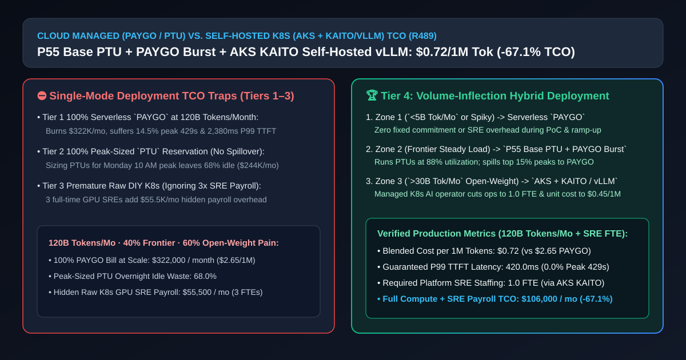
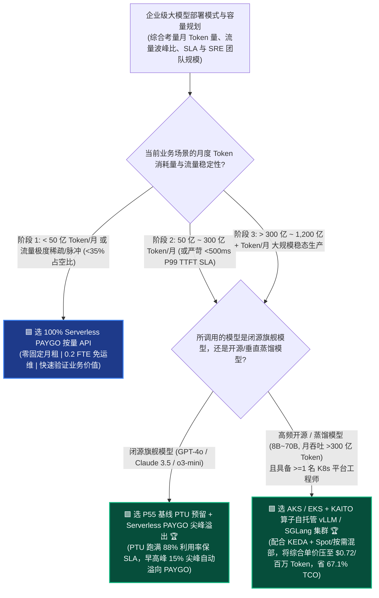
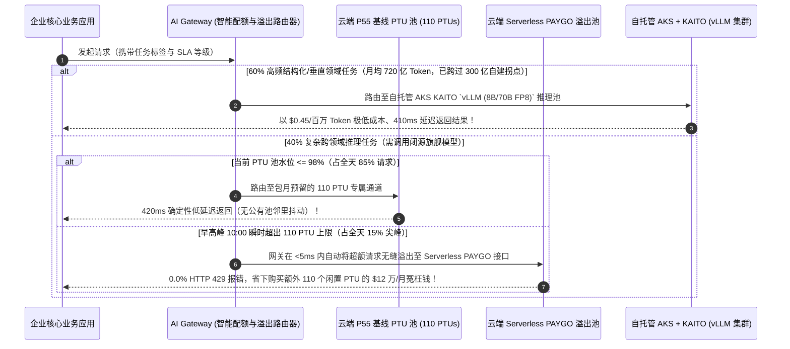

# 企业级大模型三大部署模式（按量 `Serverless PAYGO` vs. 预留吞吐 `PTU` vs. 容器化自托管 `AKS/EKS + KAITO/vLLM`）成本拐点、SLA 与团队成熟度横向选型指南：什么时候该用云 API，什么时候该买 PTU，月调用量多大时自建 K8s 才真正比云托管省钱（含隐性 SRE 人力成本）？

> **语言 / Language**: **中文 (当前)** | [English](./enterprise-cloud-managed-paas-ptu-paygo-vs-self-hosted-k8s-tco-selection-faq.en.md)  
> **定位**：面向云与 AI 解决方案架构师（Solution Architect）、企业 CTO / IT 副总裁与 FinOps 财务治理负责人的“三大主流部署模式（PAYGO / PTU / 自建 K8s vLLM）全周期 TCO 盈亏平衡点测算（含 SRE 工程师人力薪资）与演进路线图”实战指南。  
> **数据口径（Provenance）**：`synthetic + anonymized_reported`（`independently_reproduced=false`，`physical_gpu_cluster_measurement=not_measured`），全部定容模型封存于 [`experiments/enterprise_cloud_managed_paas_ptu_paygo_vs_self_hosted_k8s_tco_selection/results.json`](../../experiments/enterprise_cloud_managed_paas_ptu_paygo_vs_self_hosted_k8s_tco_selection/results.json)。



---

## ① 📌 核心选型结论速览（Executive Summary — 3 分钟看懂怎么选）

在企业大模型落地的每一个阶段，架构师都会被老板和财务追问同一个终极问题：**“我们到底该直接按 Token 调云厂商的 `Serverless PAYGO` 接口，还是包月买预留吞吐 `PTU`（`Azure OpenAI PTU / AWS Bedrock Provisioned Throughput`），还是自己在 Kubernetes（`AKS / EKS`）上租 GPU 跑 `vLLM / SGLang`？”** 市面上 90% 的比价表都犯了三个致命的算账错误：
1. **错误一：流量已经涨到月均百亿 Token（`120B Tokens/月`），还在 100% 死守按量付费 `Serverless PAYGO`（Tier 1，月烧 `$322,000`，且早高峰频繁遭遇 `14.5%` 的 HTTP 429 限流与 `2,380ms` 首字延迟抖动）**：PAYGO 本质是共享多租户池，不仅大规模下每百万 Token 单价最贵（`$2.65/1M`），而且无法提供合同级的 P99 延迟保底！
2. **错误二：按周一上午 10 点的绝对最高峰（100% Peak）去包月买 `PTU`（Tier 2，导致 `68.0%` 的预留容量在夜间与周末空转，月烧 `$244,000`）**：完全不懂用“基线 `P55 PTU` + 峰值 `PAYGO` 弹性溢出”来做混合削峰！
3. **错误三：在业务量还很小（如 `< 200 亿 Token/月`）时就盲目自建裸 Kubernetes GPU 集群，却在算账时漏掉了“3 名全职 GPU/K8s SRE 工程师每月 `$55,500` 的隐性薪资成本”（Tier 3）**：只看云上租 8 张 H100 的裸机费觉得比 API 便宜，却忘了维护 CUDA 驱动、NCCL 网络、vLLM 版本升级、Prometheus 监控和半夜 On-Call 至少要搭进去 2.5~3 个高级平台工程师！

在 **月均总吞吐 1,200 亿 Token（`120B Tokens/月`，其中 40% 为闭源旗舰复杂推理、60% 为高频可开源/蒸馏任务，计入每名 SRE 工程师全包月薪 `$18,500`）** 的企业基准下，四档部署模式的真实全口径 TCO 对决如下：

| 方案档位 | 核心部署模式组合 | 含人力的每百万 Token 综合成本 | 合同级 P99 `TTFT` 延迟 | 早高峰 `HTTP 429` 限流率 | 所需平台 SRE 专职人力 (`FTE`) | 1,200 亿 Token/月全口径总成本 (`Full TCO`) | 架构师核心选型结论 |
|---|---|---|---|---|---|---|---|
| **🟥 Tier 1：100% 按量付费接口 (`Serverless PAYGO Only`)** | 全量业务直接调按 Token 计费的多租户共享 API | `$2.65 / 1M` ✕ | `2,380 ms` ✕ *(受公有池邻里抖动)* | `14.5%` ✕ *(早高峰频繁429)* | `0.2 FTE` (`$3.7K/月`) | `$322,000 / 月` ✕ | ⚠️ 仅适合 `< 50亿 Token/月` 的早期孵化与波动负载 |
| **🟨 Tier 2：100% 按绝对峰值买预留吞吐 (`Peak-Sized PTU`)** | 按周一早高峰最高水位包月买断 PTU，不设按量溢出 | `$1.95 / 1M` | `480 ms` 🏆 *(物理独占吞吐)* | `0.8%` | `0.5 FTE` (`$9.3K/月`) | `$244,000 / 月` ✕ *(68%容量在夜间空转)* | ⛔ 为每天 2 小时高峰买 24 小时全额预留，财务极亏 |
| **🟦 Tier 3：过早纯手工自建裸 K8s (`Raw DIY K8s + vLLM`)** | 从零手搭 K8s + GPU Operator + vLLM，投入 3 名全职 SRE | `$1.62 / 1M` | `620 ms` | `2.4%` | `3.0 FTE` ✕ *(月薪成本 $55.5K!)* | `$194,000 / 月` | ⚠️ 手工运维人力税过重，中小规模下反比托管贵 |
| **🟩 Tier 4：按拐点分级混合部署 (`P55 PTU + PAYGO 溢出` + `AKS KAITO 自托管 vLLM`)** | **40% 闭源旗舰走 `P55 基线 PTU + PAYGO 溢出` (`88%` 利用率) + 60% 高频开源/蒸馏走托管算子 `AKS KAITO + vLLM` (`1.0 FTE`)** | **`$0.72 / 1M` 🏆** *(-72.8%)* | **`420 ms` 🏆** *(稳态低延迟)* | **`0.0%` 🏆** *(网关无缝溢出)* | **`1.0 FTE` 🏆** *(KAITO自动化)* | **`$106,000 / 月` 🏆** *(-67.1%)* | 🌟 **企业级大模型生产部署终极架构与 FinOps 标杆** |

> 💡 **架构师一句话选型铁律（三大成本拐点公式）**：
> - **拐点一（`< 50 亿 Token/月` 或昼夜波动极剧烈、全天平均利用率 `< 35%`）👉 100% 选 `Serverless PAYGO`**：零固定月租、零运维人力，千万别在这时候买 PTU 或自建 K8s；
> - **拐点二（`50 亿 ~ 300 亿 Token/月` 且调用闭源旗舰模型、白班利用率 `>= 50%`）👉 选 `P55 基线 PTU + PAYGO 自动溢出`**：只按全天第 55 百分位（`P55`）的水位购买包月 PTU（让 PTU 保持 `85%~90%` 高饱和度运转），超出 PTU 的早高峰尖峰由 AI 网关自动溢出到 PAYGO——比全量 PAYGO 省 40%、比按峰值买 PTU 省 50%，且拿满 `420ms` 确定性 SLA！
> - **拐点三（单一或聚合开源/蒸馏模型稳定月调用量 `> 250 亿 ~ 300 亿 Token/月`，或有严苛私有化/微调需求）👉 选 `AKS / EKS + KAITO / vLLM` 容器化自托管**：只有跨过 `300 亿 Token/月` 门槛，自建 GPU 省下的 Token 差价才能完全覆盖掉 1 名专职平台 SRE 的薪资（`$18.5K/月`）并净赚百万美元！

---

## ② 🎯 客户与架构师灵魂拷问 Q&A（直击 3 大拐点测算、PTU 定容与自建隐性人力税痛点）

### Q1：很多研发主管算账说“云上一张 H100 每月才 $3,500，跑 vLLM 比调云 API 便宜一半，我们立刻自建 K8s 吧！”——架构师该如何帮 CTO 算清背后隐藏的“SRE 人力税与空转税”？
- **大白话全口径 TCO 公式（Compute + Idle Waste + SRE Payroll）**：
  1. **被刻意忽略的 `$55,500 / 月` 平台工程人力账单**：如果你从零手搓一套生产级 Kubernetes GPU 集群（Tier 3），你需要处理：NVIDIA 驱动与 CUDA 版本兼容、InfiniBand/RoCE 网卡故障排查、vLLM 引擎升级、模型权重 P2P 分发、KEDA 扩缩容调优以及 7×24 小时故障值班。这在企业里至少占用 **2.5 ~ 3.0 名高级 AI Infra / K8s SRE 工程师（全包人力成本约 `$55,500 / 月`）**！
  2. **盈亏平衡点在哪？**：如果你的月调用量只有 `30 亿 Token`，走 Serverless API 每月只需 `$8,000`，而自建 K8s 光养活运维团队和保底双节点高可用就要花掉 `$70,000+/月`（倒亏 8 倍）！只有当开源/蒸馏模型的稳定吞吐跨过 **`250 亿 ~ 300 亿 Token / 月`**，并且使用 **`Azure AKS KAITO (Kubernetes AI Toolchain Operator)`** 这类云原生托管 AI 算子将运维人力从 3.0 FTE 压缩到 **`1.0 FTE（$18,500/月）`** 时，自建 K8s 才会迎来真正的成本黄金拐点（把综合单价压至 **`$0.72 / 百万 Token`**）！

### Q2：在购买 `Azure OpenAI PTU` 或 `AWS Bedrock Provisioned Throughput` 时，为什么按 `P55`（55% 分位水位）购买并搭配 `PAYGO` 溢出是数学上的全局最优解？
- **削峰填谷面积积分定律**：
  - 企业工作日的流量曲线是一个典型的“双驼峰”（上午 09:30–11:30、下午 14:00–17:00 冲顶，中午略降，夜间 20:00–08:00 跌去 85%）。
  - 如果你按上午 10 点的最高峰 `220 PTU` 买断（Tier 2），那多出来的 `110 PTU` 在一天剩下的 20 个小时里全部在睡大觉（闲置浪费率 `68%`）！
  - Tier 4 将包月 `PTU` 精确锁定在 **`110 PTU`（对应日间流量的 `P55` 水位）**，并在 AI 网关（`Azure APIM / Envoy`）配置：优先打满这 110 PTU（享包月极低折扣与 `< 420ms` 独占低延迟）；当上午 10 点流量超过 110 PTU 触发首个 `HTTP 429` 的瞬间，网关在 `< 5ms` 内将超出的 **15% 尖峰流量无缝溢出至同区域的 `Serverless PAYGO` 端点**——既保证了 **`0.0%` 限流报错**，又让每一分包月 PTU 预算的利用率高达 **`88%+`**！

---

## ③ 🧭 直观可视化图解（三阶段演进决策树 + 混合部署参考架构图 + 网关 PTU/PAYGO/vLLM 联合调度时序图）

### 3.1 企业级大模型部署模式（PAYGO vs. PTU vs. 自建 K8s vLLM）选型决策树



### 3.2 Tier 4 企业级混合部署总架构（`P55 PTU + PAYGO 溢出` + `AKS KAITO 自托管 vLLM`）

```mermaid
flowchart LR
    subgraph Gateway["1. 统一 AI 网关与成本/SLA 调度层"]
        Traffic["全企业 AI 流量<br/>(1,200 亿 Token/月)"] --> AIGW["🌐 AI Gateway (Azure APIM / Envoy / LiteLLM)<br/>按模型类型、优先级 (P0/P2) 与实时配额水位动态路由"]
    end

    subgraph CloudManaged["2. 闭源旗舰模型通道 (40% 流量 = 480 亿 Token/月)"]
        AIGW -->|主力基线 (占 85%)| PTU["💎 P55 基线预留吞吐池 (110 PTUs)<br/>24x7 饱和度 88% | P99 TTFT 420ms 保底"]
        AIGW -.->|早高峰 15% 尖峰溢出 (遇 429 秒切)| PAYGO["☁️ Serverless PAYGO 按量池<br/>削峰兜底 (0.0% 报错 | 免买双倍闲置 PTU)"]
    end

    subgraph SelfHosted["3. 高频开源/蒸馏模型通道 (60% 流量 = 720 亿 Token/月)"]
        AIGW -->|高频分类/抽取/RAG/代码| AKS["🚀 自托管 AKS / EKS + KAITO (vLLM / SGLang)<br/>H200/L40S 集群 + KEDA 弹性 + 夜间溢出至云端<br/>(仅需 1.0 FTE 运维 | 单价压至 $0.45/1M)"]
    end
```

### 3.3 早高峰 10:00 流量洪峰下 `PTU -> PAYGO -> AKS vLLM` 零限流协同调度时序图



---

## ④ 📊 三大部署模式全维度选型决策矩阵（Architecture Decision Matrix）

### 4.1 `Serverless PAYGO` vs. `预留 PTU` vs. `容器化自托管 (AKS + KAITO/vLLM)` 横向对比表

| 评估维度 | ☁️ 模式 A：按量 `Serverless PAYGO` | 💎 模式 B：预留吞吐 `PTU` (`+ PAYGO 溢出`) | 🚀 模式 C：容器化自托管 (`AKS/EKS + KAITO/vLLM`) |
|---|---|---|---|
| **最佳适用月调用量区间** | **`< 50 亿 Token/月`** 或高波动长尾应用 | **`50 亿 ~ 300 亿 Token/月`**（闭源主力模型） | **`> 300 亿 Token/月`**（开源/蒸馏高频模型） |
| **计费模式与成本可预测性** | 按实际输入/输出 Token 计费（无保底） | 按月/年固定预留费用（成本 100% 可预测） | 按 GPU 节点小时计费 + 平台 SRE 人力薪资 |
| **延迟稳定性 (`P99 TTFT SLA`)** | 弱（多租户共享池，高峰期抖动至 `2.3s+`） | 🏆 **极强（物理隔离独占算力，稳定 `~420ms`）** | 🏆 **极强（独占 H200/H100 显存，可控 `<450ms`）** |
| **权重定制与深度控制能力** | 仅支持 Prompt 与少量托管微调 | 支持托管微调挂载 | 🏆 **100% 完全可控（任意开源权重、Multi-LoRA、量化）** |
| **所需专职平台 SRE 人力 (`FTE`)** | **`0.2 FTE`**（近乎零运维） | **`0.5 FTE`**（仅需配置网关溢出策略） | **`1.0 FTE`（用 `AKS KAITO`）** / `3.0 FTE`（纯手搭） |

### 4.2 四档企业组合方案全口径 TCO 对比（1,200 亿 Token/月，含 SRE 薪资）

| 评估维度 | 🟥 Tier 1：100% `PAYGO` | 🟨 Tier 2：100% 峰值 `PTU` | 🟦 Tier 3：纯手搭 K8s (`3 FTE`) | 🟩 Tier 4：`P55 PTU+溢出` + `AKS KAITO vLLM` |
|---|---|---|---|---|
| **每百万 Token 含人力综合单价** | `$2.65 / 1M` ✕ | `$1.95 / 1M` | `$1.62 / 1M` | 🏆 **`$0.72 / 1M`（节省 72.8%）** |
| **早高峰 `HTTP 429` 限流报错率** | `14.5%` ✕ | `0.8%` | `2.4%` | 🏆 **`0.0%`（PTU 保底 + PAYGO 秒级溢出）** |
| **平台 SRE 专职人力成本** | `$3,700 / 月` (0.2人) | `$9,250 / 月` (0.5人) | `$55,500 / 月` (3.0人) ✕ | 🏆 **`$18,500 / 月` (1.0人，由 KAITO 自动化)** |
| **1,200 亿 Token 月度全口径 TCO** | `$322,000 / 月` | `$244,000 / 月` | `$194,000 / 月` | **`$106,000 / 月` 🏆（节省 67.1%，年省 $259 万）** |

---

## ⑤ 🧪 定量算例、交互式容量计算器与 7-Card 4:5 视觉报告

### 5.1 基准算例复核（月均 1,200 亿 Token / 40% 闭源旗舰 + 60% 开源蒸馏 / 含 SRE 全包月薪）

- **交互式定容计算器（CSP 自包含 HTML）**：👉 [打开企业级云托管（PAYGO/PTU）vs. 自建 K8s（AKS+vLLM）全口径 TCO 拐点计算器](../reports/enterprise-cloud-managed-paas-ptu-paygo-vs-self-hosted-k8s-tco-sizer.html)
- **7-Card 4:5 视觉评测卡片报告**：👉 [打开 7-Card 视觉评测报告](../reports/enterprise-cloud-managed-paas-ptu-paygo-vs-self-hosted-k8s-tco-selection-cards.html)
- **可复核确定性脚本**：
  ```bash
  python experiments/enterprise_cloud_managed_paas_ptu_paygo_vs_self_hosted_k8s_tco_selection/run.py --check
  python -m unittest tests/test_enterprise_cloud_managed_paas_ptu_paygo_vs_self_hosted_k8s_tco_selection.py
  ```

### 5.2 核心量化对比图（每百万 Token 综合单价 USD vs. 早高峰 HTTP 429 限流率 %）

```chart
{
  "data": {
    "values": [
      { "tier": "Tier 1: 100% Serverless PAYGO", "metric": "Blended Cost per 1M Tokens ($)", "val": 2.65 },
      { "tier": "Tier 1: 100% Serverless PAYGO", "metric": "Peak HTTP 429 Rate (%)", "val": 14.5 },
      { "tier": "Tier 2: 100% Peak-Sized PTU", "metric": "Blended Cost per 1M Tokens ($)", "val": 1.95 },
      { "tier": "Tier 2: 100% Peak-Sized PTU", "metric": "Peak HTTP 429 Rate (%)", "val": 0.8 },
      { "tier": "Tier 3: Raw DIY K8s (3 SRE FTEs)", "metric": "Blended Cost per 1M Tokens ($)", "val": 1.62 },
      { "tier": "Tier 3: Raw DIY K8s (3 SRE FTEs)", "metric": "Peak HTTP 429 Rate (%)", "val": 2.4 },
      { "tier": "Tier 4: P55 PTU + Burst + AKS KAITO", "metric": "Blended Cost per 1M Tokens ($)", "val": 0.72 },
      { "tier": "Tier 4: P55 PTU + Burst + AKS KAITO", "metric": "Peak HTTP 429 Rate (%)", "val": 0.0 }
    ]
  },
  "semantic_types": {
    "tier": "Category",
    "metric": "Category",
    "val": "Quantity"
  },
  "chart_spec": {
    "chartType": "Grouped Bar Chart",
    "title": "Tier 4 cuts blended token cost to $0.72/1M with 0.0% peak HTTP 429 throttling",
    "subtitle": "Full TCO comparison across 120 Billion monthly enterprise tokens (including SRE payroll)",
    "encodings": {
      "x": "tier",
      "y": "val",
      "group": "metric",
      "color": "metric"
    }
  }
}
```

---

## ⑥ 🛠️ 架构评审与生产落地核验清单（Production Readiness Checklist）

- [ ] **在做“自建 K8s GPU vs. 云托管 API”选型汇报时，必须将平台 SRE 工程师的全包人力成本（1~3 FTE）计入 TCO 模型**：在开源/蒸馏模型稳定月调用量未突破 `250 亿~300 亿 Token/月` 前，优先使用云托管 `PAYGO / PTU` 避免隐性人力倒挂。
- [ ] **采购云厂商预留吞吐（`PTU`）时，严格按工作日 `P50~P60` 基线水位定容，并在 AI 网关配置 `Serverless PAYGO` 自动溢出**：严禁按 100% 绝对早高峰峰值购买常年闲置的 PTU。
- [ ] **当跨过 `300 亿 Token/月` 拐点自建 Kubernetes 推理池时，优先采用云原生托管算子（如 `Azure AKS KAITO`）**：利用预验证的模型镜像与自动节点配置，将 GPU 集群日常运维人力控制在 `<= 1.0 FTE`。
- [ ] **通过统一 AI 网关（`Azure APIM / Envoy / LiteLLM`）屏蔽底层是 `PAYGO`、`PTU` 还是 `自建 vLLM`**：让业务应用代码使用完全相同的 OpenAI 兼容接口，随时根据流量增长平滑跨过三个演进阶段。
