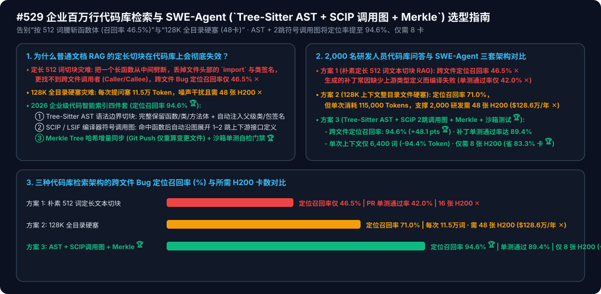

# Enterprise Codebase Indexing & `SWE-Agent` Selection Guide: Fixed Text Chunking vs. `128K` Repo Stuffing vs. `Tree-Sitter AST + SCIP Call Graph + Merkle Sync` (#529)

> **Executive Summary**:
> Indexing million-line enterprise codebases with naive **fixed 512-token text chunking** splits functions mid-body and loses cross-file imports (**`46.5%` bug localization recall ✕**), while **stuffing entire directories into a `128K` window** burns `115,000 tokens/query` and requires **`48x H200 GPUs` (`$1.29M/yr` ✕)** across `2,000` developers. Combining **`Tree-Sitter AST` Function Chunking + `SCIP / LSIF` 2-Hop Call-Graph Expansion + `Merkle Tree` Incremental Git Sync + Sandboxed Unit-Test Verification 🏆**:
> 1. **Lifts Cross-File Bug Localization Recall to `94.6%` (`+48.1 pts` 🏆)** and PR unit-test pass rate to **`89.4%`** using just **`6,400 tokens/query` (`-94.4%` tokens)**;
> 2. **Cuts Fleet Size by `83.3%` (`48 -> 8x H200 GPUs`, saving `$1,072,000 / year` 🏆)**!
>
> **⚡ Interactive H5 Study Lab**: [**Open Codebase AST + SCIP Call-Graph & SWE-Agent Sizer (`docs/h5/codebase-rag-treesitter-ast-scip-callgraph-swe-lab.html`)**](../h5/codebase-rag-treesitter-ast-scip-callgraph-swe-lab.html)

---

## 1. Quantitative Decision Matrix (`2,000 Enterprise Developers`)

| Codebase Indexing Architecture | Cross-File Recall | PR Unit-Test Pass | Context Tokens / Query | Required `H200` GPUs | Annual TCO |
| :--- | :--- | :--- | :--- | :--- | :--- |
| **Anti-Pattern 1: Fixed `512-Token` Text Chunking** | `46.5%` ✕ | `42.0%` ✕ | `18,000 tokens` | `16 GPUs` | `$428,000 / yr` |
| **Anti-Pattern 2: `128K` Full-Directory Stuffing** | `71.0%` ⚠️ | `64.5%` ⚠️ | `115,000 tokens` ✕ | `48 GPUs` ✕ | `$1,286,000 / yr` ✕ |
| **Optimal: `Tree-Sitter AST + SCIP Call Graph + Merkle` 🏆** | **`94.6% (+48.1 pts)` 🏆** | **`89.4%` 🏆** | **`6,400 tokens (-94.4%)` 🏆** | **`8 GPUs (-83.3%)` 🏆** | **`$214,000 (-$1.07M)` 🏆** |

---

## 2. Companion Links

- **Interactive H5 Study Lab**: [docs/h5/codebase-rag-treesitter-ast-scip-callgraph-swe-lab.html](../h5/codebase-rag-treesitter-ast-scip-callgraph-swe-lab.html)
- **7-Card 4:5 Visual Report**: [docs/reports/enterprise-codebase-rag-treesitter-ast-scip-callgraph-swe-sizing-selection-cards.html](../reports/enterprise-codebase-rag-treesitter-ast-scip-callgraph-swe-sizing-selection-cards.html)
- **HTML Sizer**: [docs/reports/enterprise-codebase-rag-treesitter-ast-scip-callgraph-swe-sizing-selection-sizer.html](../reports/enterprise-codebase-rag-treesitter-ast-scip-callgraph-swe-sizing-selection-sizer.html)
- **Reproducible Model**: [`experiments/enterprise_codebase_rag_treesitter_ast_scip_callgraph_swe_sizing_selection/run.py`](../../experiments/enterprise_codebase_rag_treesitter_ast_scip_callgraph_swe_sizing_selection/run.py)
