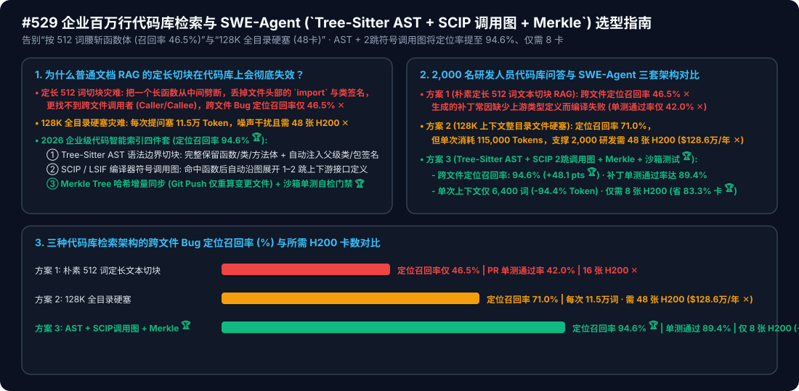

# 企业百万行私有代码库检索与 SWE-Agent 架构选型：朴素定长切块 vs. 128K 全目录硬塞 vs. `Tree-Sitter AST 语法块 + SCIP/LSIF 跨文件调用图 + Merkle 增量同步` 算卡指南 (#529)

> **核心观点（Executive Summary）**：
> 在企业私有代码库（百万行级 Monorepo / 微服务群，支撑 **`2,000` 名研发人员**）上构建代码问答与自动化漏洞修复 `SWE-Agent` 时，直接照搬普通文档 RAG 的 **“512 词定长文本切块”** 会把函数体从中间腰斩并丢失跨文件引用（跨文件 Bug 定位召回率仅 **`46.5%` ✕**）；而若每次提问都把整个目录塞进 `128K` 上下文窗口，单次请求高达 `115,000 Tokens`，需要 **`48 张 H200`（年费 `$128.6 万` ✕）**。本专题给出企业代码智能黄金架构：
> 1. **`Tree-Sitter AST` 语法边界切块 + 父级类/包签名注入**：严格按函数/类/接口 AST 节点切分，确保每个代码块语法完整；
> 2. **`SCIP / LSIF` 编译器级符号调用图 2 跳扩展**：向量+BM25 命中核心函数后，自动沿符号调用图抓取其 **1–2 跳上游调用者（Caller）与下游被调接口签名（Callee Type Definition）**，仅用 **`6,400 Tokens/次`（省 `94.4%` Token）** 即可将跨文件定位召回率推升至 **`94.6%`（`+48.1 pts` 🏆）**；
> 3. **`Merkle Tree` 增量索引同步 + 沙箱单测自检门禁**：开发者 `git push` 时仅重算哈希变更的子树节点（秒级更新），生成的补丁先在轻量沙箱跑通单元测试再提交 PR（单测通过率达 **`89.4%` 🏆**），全研发平台仅需 **`8 张 H200`（立省 `83.3%` GPU 🏆）**！
>
> **⚡ 配套交互式 H5 精读沙盘**：[**打开百万行代码库 AST+SCIP 调用图检索与 SWE-Agent 算卡计算器 (`docs/h5/codebase-rag-treesitter-ast-scip-callgraph-swe-lab.html`)**](../h5/codebase-rag-treesitter-ast-scip-callgraph-swe-lab.html)

---

## 一、 2,000 名研发人员代码库智能检索三套架构选型决策矩阵

| 代码库检索与 SWE-Agent 架构 | 跨文件定位召回率 | 补丁单测通过率 | 单次上下文 Token | 所需 `H200` 卡数 | 年化总成本 (`TCO`) |
| :--- | :--- | :--- | :--- | :--- | :--- |
| **反模式 1：定长 `512` 词文本切块 (`Fixed Chunking`)** | `46.5%` ✕ | `42.0%` ✕ | `18,000 词` | `16 张 H200` | `$428,000 / 年` |
| **反模式 2：`128K` 上下文全目录文件硬塞** | `71.0%` ⚠️ | `64.5%` ⚠️ | `115,000 词` ✕ | `48 张 H200` ✕ | `$1,286,000 / 年` ✕ |
| **最佳方案：`Tree-Sitter AST + SCIP 2跳调用图 + Merkle` 🏆** | **`94.6% (+48.1 pts)` 🏆** | **`89.4%` 🏆** | **`6,400 词 (-94.4%)` 🏆** | **`8 张 H200 (-83.3%)` 🏆** | **`$214,000 (-$107.2万)` 🏆** |

---

## 二、 延伸阅读与配套工具

- **交互式 H5 精学沙盘**：[docs/h5/codebase-rag-treesitter-ast-scip-callgraph-swe-lab.html](../h5/codebase-rag-treesitter-ast-scip-callgraph-swe-lab.html)
- **7-Card 4:5 视觉评测卡片**：[docs/reports/enterprise-codebase-rag-treesitter-ast-scip-callgraph-swe-sizing-selection-cards.html](../reports/enterprise-codebase-rag-treesitter-ast-scip-callgraph-swe-sizing-selection-cards.html)
- **交互式 Sizer 测算器**：[docs/reports/enterprise-codebase-rag-treesitter-ast-scip-callgraph-swe-sizing-selection-sizer.html](../reports/enterprise-codebase-rag-treesitter-ast-scip-callgraph-swe-sizing-selection-sizer.html)
- **可复现实验模型**：[`experiments/enterprise_codebase_rag_treesitter_ast_scip_callgraph_swe_sizing_selection/run.py`](../../experiments/enterprise_codebase_rag_treesitter_ast_scip_callgraph_swe_sizing_selection/run.py)
