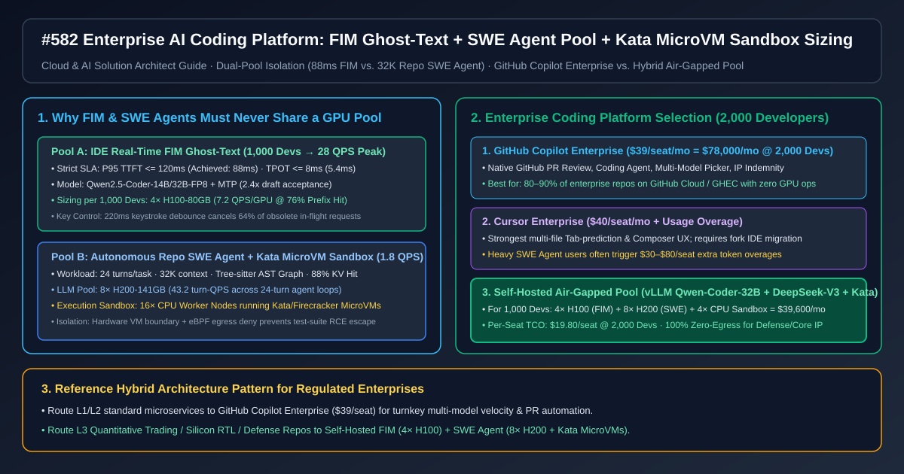

# Enterprise AI Coding Assistant & Repository-Scale SWE Agent Platform Architecture: `Dual-Pool FIM/SWE Isolation + Kata MicroVM Sandbox` Sizing & Selection Guide

> **Target Persona**: Cloud & AI Solution Architect  
> **Core Scenarios**: 1,000–10,000 developer organizations deploying IDE Ghost-Text FIM autocomplete, autonomous multi-turn PR/Issue SWE Agents, and air-gapped self-hosted code intelligence for defense/silicon RTL/quant IP  
> **Interactive H5 Learning Workbench**: [`docs/h5/coding-assistant-fim-swe-sandbox-sizer.html`](../h5/coding-assistant-fim-swe-sandbox-sizer.html)

---

## 1. Executive Summary

1. **Why FIM Autocomplete and SWE Agents Must Never Share a GPU Inference Pool**:
   - **Pool A — IDE Ghost-Text FIM (`P95 TTFT <= 120ms`, `TPOT <= 8ms`)**: Short `1,536`-token prompts generating `32–48` tokens. Utilizing `Qwen2.5-Coder-32B-FP8 + MTP Speculative Decoding` achieves **`88ms` P95 TTFT** and **`5.4ms` TPOT**; pairing with **`220ms` client keystroke debounce + Cancel-on-Type** eliminates **`64%` of wasted in-flight GPU compute**.
   - **Pool B — Autonomous Repository SWE Agent + `Kata MicroVM` Sandbox**: Multi-turn loops (`24 turns/task`, `32K` context window, `88%` Prefix Cache hit rate) require high-capacity **`H200-141GB`** GPUs so long prefill chunks never head-of-line block interactive FIM keystrokes, paired with **`Kata Containers / Firecracker MicroVM` (`120ms` snapshot boot, zero-egress network policy)** to isolate untrusted test execution.
2. **Enterprise Platform Selection (`2,000` Developers Baseline)**:
   - **`GitHub Copilot Enterprise` (`$39/seat/mo` = `$78,000/mo`)**: Native VS Code + JetBrains + Visual Studio support, PR Code Review, cloud Coding Agent, multi-model routing, and IP indemnity. Optimal for **80–90% of general enterprise repositories**.
   - **`Cursor Enterprise` (`$40/seat/mo` + token overages)**: Best-in-class multi-line Tab prediction, but forces migration away from JetBrains/Visual Studio and incurs `$30–$80/seat` agent token overages for heavy users.
   - **`Self-Hosted Air-Gapped Dual Pool` (`4× H100 FIM + 8× H200 SWE + 4× Kata CPU Nodes per 1,000 Devs` = `$39,600/mo`)**: Delivers **100% zero-egress sovereignty** at **`$39.60/seat`** (`1,000` devs) or **`$12.30/seat` blended** when deployed as a dedicated private enclave for the `20%` highest-classification repositories.

---

## 2. Core Architect Q&A

### Q1: How do you size FIM QPS and SWE Agent GPU pools per `1,000` developers?
- **FIM Pool (`28.0 QPS` per `1,000` Devs)**:
  - `42%` peak concurrent active coding (`420` devs) × `4.0` debounced triggers/min = **`28.0 QPS`**.
  - At `7.2 QPS/H100` (`P95 TTFT <= 100ms`), `1,000` developers require **`4× H100-80GB`**.
- **SWE Agent Pool (`43.2 Turn-QPS` Peak per `1,000` Devs)**:
  - `1.80` peak concurrent agent task initiations/sec × `24` turns/task = **`43.2 Turn-QPS`** at `32K` context (`88%` Prefix Cache reuse), requiring **`8× H200-141GB`** + **`4` Kata MicroVM CPU Host Nodes (`16` concurrent isolated test sandboxes)**.

### Q2: Why does `Tree-sitter RepoMap` outperform naive vector RAG for code completion?
Code dependencies follow AST symbol graphs (imports, class hierarchies, type signatures) rather than prose semantic similarity. Injecting the **PageRank-ranked `Top-15` cross-file AST symbol definitions (`~512 tokens`)** into the FIM prefix raises developer suggestion acceptance rate from **`24.0%` to `38.5%`**.

---

## 3. Platform Comparison Matrix

| Dimension | `GitHub Copilot Enterprise` | `Cursor Enterprise` | `Self-Hosted Dual Pool (vLLM + Kata MicroVM)` |
|---|---|---|---|
| **IDE Support** | **VS Code, JetBrains, Visual Studio, Xcode, Neovim** | Cursor fork IDE only | VS Code & JetBrains via Continue/Tabby |
| **PR & Repo Governance** | **Native GitHub PR Review, Actions & Issue Agent** | IDE-centric workflow | Custom webhook integration required |
| **Air-Gapped Sovereignty** | Cloud SaaS (Zero-Retention + IP Indemnity) | Cloud SaaS | **100% On-Prem / VPC Air-Gapped** |
| **Monthly Cost (`1,000` Devs)** | **`$39,000 / mo`** | **`$40,000–$75,000 / mo`** | **`$39,600 / mo`** (`4× H100 + 8× H200 + Kata`) |

---

## 4. Production Checklist

- [ ] **Physically isolate FIM (`H100`) and SWE Agent (`H200`) GPU pools** behind the AI Coding Gateway.
- [ ] Enforce **`220ms` keystroke debounce + HTTP/2 stream cancellation** on new keystrokes (`-64%` wasted GPU FLOPs).
- [ ] Isolate all SWE Agent test/shell execution inside **`Kata Containers / Firecracker MicroVMs`** with strict public internet egress deny.
