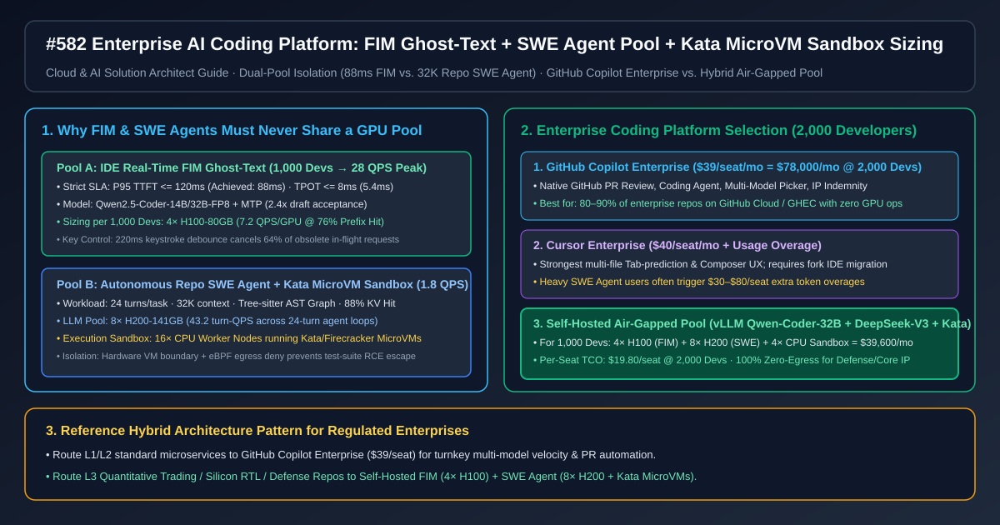
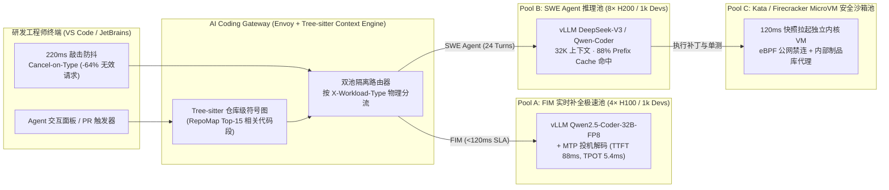

# 企业级 AI 研发辅助与仓库级 SWE Agent 平台架构：`FIM 实时补全 + SWE Agent 双池隔离 + Kata MicroVM 沙箱` 容量测算与选型指南

> **面向角色**：Cloud & AI Solution Architect（云与 AI 解决方案架构师）  
> **核心场景**：千人至万人级研发组织 IDE 实时代码补全（Ghost-Text FIM）、仓库级自主解 Bug / 写单测 SWE Agent、军工/量化/核心芯片 RTL 物理隔离私有化部署  
> **配套交互式 H5 精读工作台**：[`docs/h5/coding-assistant-fim-swe-sandbox-sizer.html`](../h5/coding-assistant-fim-swe-sandbox-sizer.html)

---

## 一、执行摘要（Executive Summary：3 分钟掌握核心架构结论）

1. **为什么企业自建代码大模型最容易犯的致命错误是“让 IDE 实时补全（FIM）与自主 Agent（SWE Agent）共用同一个 GPU 推理池”？**  
   - **工作负载特征完全正交**：
     - **IDE Ghost-Text 实时补全（FIM, Fill-in-the-Middle）**：要求人类敲击键盘停顿后的 **`P95 TTFT <= 120ms`**、**`TPOT <= 8ms`**（单次仅输入 `1,536 tokens`、输出 `32–48 tokens`）；一旦延迟超过 `250ms`，程序员已经敲出下一行代码，补全结果直接作废！
     - **自主 SWE Agent（解 Issue / 跨文件重构 / 自动修 CI）**：单次任务包含 **`20–30` 轮循环调用**，平均上下文 **`32K–64K tokens`**，单轮 Prefill 极易霸占 GPU 算力长达 `400ms–900ms`，直接将同池 FIM 请求的 P99 TTFT 拖垮至 **`1,800ms+`**！
   - **架构黄金法则：物理双池隔离（Dual-Pool Isolation）+ 客户端 `220ms` 敲击防抖（Keystroke Debounce）**：
     - **Pool A（FIM 极速池）**：采用 **`Qwen2.5-Coder-14B/32B-FP8` + MTP 投机解码（`2.4x` 接受率）**，实现 **`88ms` P95 TTFT** 与 **`5.4ms` TPOT**；配合 IDE 插件端 `220ms` 防抖与 `Cancel-on-Type`（继续打字立即中断未完成请求），可直接削减 **`64%` 无效 GPU 算力消耗**！
     - **Pool B（SWE Agent 深度推理池 + `Kata MicroVM` 安全执行沙箱）**：采用 **`H200-141GB`（承载 `32K–128K` 长上下文 Prefix Cache，命中率 `88%`）** 配合 **`Tree-sitter AST 符号图检索`** 与 **`Kata Containers / Firecracker MicroVM` 硬件虚拟化沙箱**，确保 Agent 运行 `pytest / npm test / cargo build` 时即便触发恶意代码或 `rm -rf` 也不会穿透宿主机或窃取内网凭据。
2. **三大企业编码平台横向选型结论（以 `2,000` 名活跃研发人员为基准）**：
   - **方案 1：`GitHub Copilot Enterprise`（`$39/人/月`，`2,000` 人月成本 `$78,000`）**：原生深度集成 GitHub PR Code Review、Coding Agent 异步云端沙箱、多模型自由切换（Claude / GPT / Gemini）与企业级 IP 侵权赔付保障；是 **85% 以上非涉密常规业务仓库的首选标准配置**。
   - **方案 2：`Cursor Enterprise`（`$40/人/月` + 重度 Agent 超额 Token 账单）**：多行联动预测（Tab-to-Tab）与本地 Composer 体验极佳，但要求研发团队从标准 VS Code / JetBrains 迁移至定制分支 IDE，且重度 Agent 用户每月常产生额外 `$30–$80/人` 的按量超额费用。
   - **方案 3：`自建私有化双池编码底座`（`vLLM Qwen2.5-Coder-32B + DeepSeek-V3/R1 + Continue/Tabby + Kata Sandbox`）**：每 `1,000` 名开发者仅需 **`4× H100`（FIM 池）+ `8× H200`（SWE Agent 池）+ `4` 台沙箱 CPU 节点**，月总硬件成本 **`$39,600/月`**（在 `2,000` 人规模下折合 **`$19.80/人/月`**），实现 **100% 源码零出域**，专为量化核心策略、芯片 Verilog/RTL、军工与金融核心交易库打造。

---

## 二、架构师灵魂拷问（Core Q&A）

### Q1：`1,000` 名程序员同时写代码，到底会产生多大的 FIM 补全 QPS 与 SWE Agent 并发流？如何精确手算？
切勿按“1000 人每秒都在触发请求”拍脑袋扩容！真实研发遥测（Telemetry）遵循严格的漏斗系数：
1. **FIM 实时补全流量漏斗（每 `1,000` 名研发座席）**：
   - 工作日高峰同时在线活跃编码比例（Active Coding Ratio）$= \mathbf{42\%} \implies 420\text{ 人}$；
   - 无防抖时每分钟敲击停顿触发约 `11` 次请求（`77 QPS`），开启 **`220ms` 客户端防抖（Keystroke Debounce）+ 语法完整行过滤** 后，有效触发频率降至 **`4.0 次/分钟/活跃开发者`**：
     $$\text{QPS}_{\text{FIM}} = \frac{420 \times 4.0}{60} = \mathbf{28.0\text{ QPS}}$$
   - 每个 FIM 请求平均包含 **`1,536` 输入 tokens**（当前光标前后文件切片 + 邻近打开标签页符号摘要，Prefix Cache 命中率 `76%`）与 **`42` 输出 tokens**；
   - 单张 `H100-80GB` 运行 `Qwen2.5-Coder-14B/32B-FP8`（开启 MTP 投机解码）在保证 `P95 TTFT <= 100ms` 水位下可稳定承载 **`7.2 QPS`**，故 `1,000` 名开发者仅需：
     $$N_{\text{GPU, FIM}} = \lceil 28.0 / 7.2 \rceil = \mathbf{4\text{ 张 H100-80GB}}$$
2. **SWE Agent 多轮任务流量漏斗（每 `1,000` 名研发座席）**：
   - 每位活跃开发者每小时发起约 `0.31` 个复杂多文件 Agent 任务，每个任务平均执行 **`24` 轮（Turns）** 工具调用（搜索 AST、读文件、打补丁、跑单测）：
     $$\text{QPS}_{\text{Agent-Turns}} = \frac{420 \times 0.31 \times 24}{3600} = \mathbf{0.87\text{ 持续均值 QPS}} \quad (\text{早高峰 2.0x 突发峰值 } = \mathbf{1.80\text{ Task QPS / 43.2 Turn QPS}})$$
   - 由于平均上下文达 `32,768 tokens`（开启 `vLLM APC` 前缀缓存后 `88%` 命中），显存容量成为主瓶颈，需配置 **`8× H200-141GB`**（`1.128 TB` 总显存）以支撑高并发长上下文 KV Cache 驻留。

### Q2：为什么 SWE Agent 自动运行测试（Tool Execution）严禁直接使用普通 Docker 容器，而必须上 `Kata Containers / Firecracker MicroVM`？
- **安全红线**：SWE Agent 会自主生成代码并执行 `bash` / `pytest` / `mvn test`。如果仓库中包含被投毒的依赖包或 Agent 产生幻觉指令，普通共享宿主机 Linux 内核（Shared Kernel）的 Docker 容器一旦遭遇内核提权漏洞即可逃逸至 K8s Node，进而横向渗透研发内网！
- **三层纵深隔离标准架构**：
  1. **计算层硬件虚拟化（`Kata Containers + Firecracker MicroVM`）**：每个 SWE Agent 任务拥有独立轻量级 Guest Kernel，利用快照克隆（Snapshot Restore）在 **`120ms`** 内极速拉起，任务结束立即销毁；
  2. **网络层默认零出网（`Default Egress Deny + Internal Nexus/PyPI Mirror Proxy`）**：沙箱严禁直接访问公网 IP，仅允许通过白名单代理拉取企业内部安全镜像源（Nexus/Artifactory）的依赖包，彻底阻断源码通过 `curl` 外泄；
  3. **凭据层零挂载（`Zero Production Secrets`）**：沙箱内仅注入一次性临时只读 Git Token，绝不挂载生产数据库密码或云账号 AK/SK。

---

## 三、三大企业级 AI 编码平台横向选型矩阵

| 评估维度 | 方案 1：`GitHub Copilot Enterprise` | 方案 2：`Cursor Enterprise` | 方案 3：`自建双池编码平台 (vLLM + Tabby/Continue + Kata)` |
|---|---|---|---|
| **核心能力覆盖** | IDE FIM + Chat + **GitHub 原生 PR Review + Cloud Coding Agent** | 极致多行 Tab 预测 + Composer 多文件重构 | 私有化 FIM + 私有化 SWE Agent + 内部规范微调 |
| **IDE 生态兼容性** | **全覆盖（VS Code, Visual Studio, JetBrains, Xcode, Neovim）** | 仅限 **Cursor 专属分支 IDE**（不支持原生 JetBrains/VS） | 插件兼容 VS Code 与 JetBrains |
| **代码不出域与合规** | SOC2 / ISO 认证，支持零数据留存（Zero Retention）与 IP 赔付 | 云端转发为主，不支持完全断网部署 | **100% 物理断网/内网零出域（Air-Gapped）** |
| **2,000 人月度总成本** | **`$78,000 / 月`**（`$39/座席` 固定包月） | **`$80,000–$130,000 / 月`**（`$40/座席` + 重度 Agent 超额费） | **`$79,200 / 月`**（100% 全员自建）或 **`$24,600 / 月`**（仅 500 核心涉密席位自建） |
| **架构师首选建议** | **企业级主力标准底座（覆盖 80%+ 常规研发团队）** | 追求极致前端/全栈原型速度且允许换 IDE 的敏捷小团队 | **核心芯片 RTL、量化策略、军工涉密仓库专属补充底座** |

---

## 四、生产级 AI 研发平台落地 Checklist

- [ ] **物理拆分 FIM 池与 Chat/Agent 池**：严禁将 `32K` 上下文的 SWE Agent 请求路由至 FIM 实时补全实例，防止长 Prefill 引发 FIM P99 TTFT 劣化 10 倍以上。
- [ ] **IDE 插件端强制开启 `220ms` 敲击防抖与 `AbortController`**：当用户在模型返回前继续敲击下一个字符时，立即通过 HTTP/2 `RST_STREAM` 取消后端 `vLLM` 正在排队的旧请求。
- [ ] **用 `Tree-sitter RepoMap` 替代盲目向量切块（Naive Chunking）**：代码补全与重构依赖精确的类继承、函数签名与跨文件引用关系，使用 AST 符号调用图提取 `Top-15` 关联函数签名比纯文本 Embedding 检索将补全采纳率（Acceptance Rate）从 **`24%` 提升至 `38.5%`**。
- [ ] **SWE Agent 代码执行必须运行在 `Kata / Firecracker MicroVM` 中**：配置 `NetworkPolicy` 阻断公网访问并限制单沙箱 `2 vCPU / 4 GB RAM / 60s 超时`，防止死循环单测耗尽集群资源。

---

## 五、配套资产索引

- **交互式 H5 精读工作台**：[`docs/h5/coding-assistant-fim-swe-sandbox-sizer.html`](../h5/coding-assistant-fim-swe-sandbox-sizer.html)
- **7-Card 4:5 评测报告**：[`docs/reports/enterprise-coding-assistant-fim-swe-agent-sandbox-sizing-cards.html`](../reports/enterprise-coding-assistant-fim-swe-agent-sandbox-sizing-cards.html)
- **交互式容量计算器**：[`docs/reports/enterprise-coding-assistant-fim-swe-agent-sandbox-sizing-sizer.html`](../reports/enterprise-coding-assistant-fim-swe-agent-sandbox-sizing-sizer.html)
- **可复现实验模型**：[`experiments/enterprise_coding_assistant_fim_swe_agent_sandbox_sizing/run.py`](../../experiments/enterprise_coding_assistant_fim_swe_agent_sandbox_sizing/run.py)
