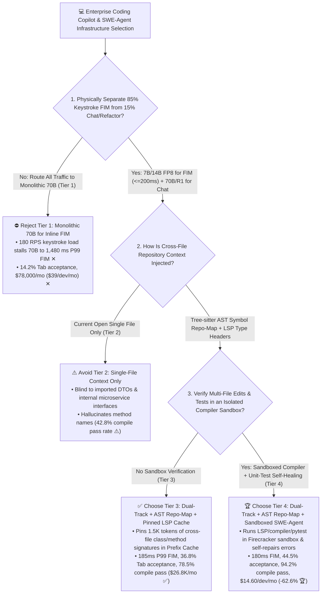
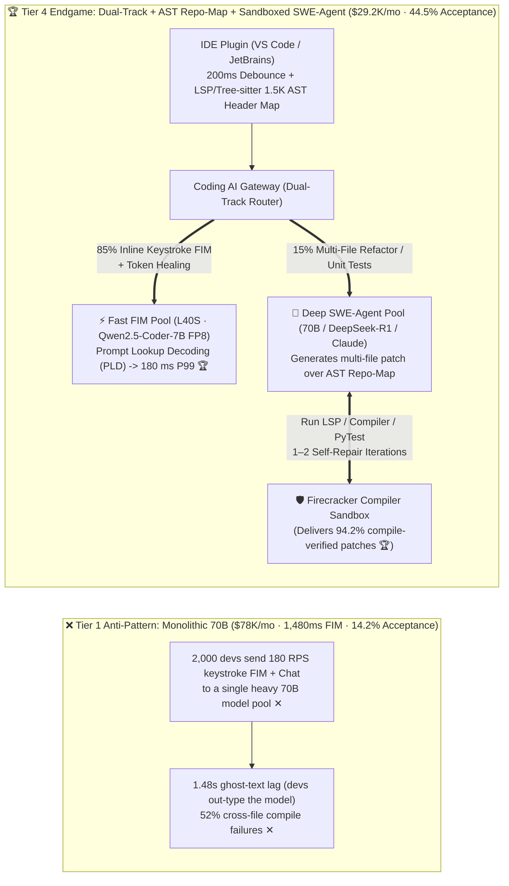

# Enterprise Coding Copilot & SWE-Agent Infrastructure Selection Guide: `Monolithic 70B FIM` vs. `Dual-Track 7B-FIM + 70B-Chat` vs. `Tree-sitter AST Repo-Map` vs. `Sandboxed Compiler & Unit-Test Self-Healing Loop`

> 🌐 **Language / 语言**: **[中文 (`enterprise-coding-copilot-fim-ast-repomap-sandbox-swe-agent-selection-faq.md`)](enterprise-coding-copilot-fim-ast-repomap-sandbox-swe-agent-selection-faq.md)** | **English (英文)**
> **Architect's Reading Guide**: Written for **Cloud & AI Solution Architects, Developer Productivity Platform Leads, and VPs of Engineering**, this guide blueprints the end-to-end infrastructure for a 2,000-developer private AI Coding Copilot and SWE-Agent platform across 500 internal microservices (`50M+` LOC): **Why does routing high-frequency IDE inline `Fill-in-the-Middle (FIM)` keystroke completions (`180 RPS`) to a monolithic 70B model (Tier 1) cause `1,480 ms` P99 ghost-text lag, collapse developer Tab acceptance to `14.2%`, and burn `$78,000/month`? Why does splitting into a `7B-FIM + 70B-Chat` dual-track pool with single-file context only (Tier 2) still fail to compile on `57.2%` of cross-file enterprise API calls? And how does combining `Dual-Track 7B-PLD FIM + Tree-sitter AST Symbol Repo-Map + Pinned LSP Type Headers` (Tier 3) with a `Sandboxed Compiler & Unit-Test Self-Healing Loop` (Tier 4) deliver `180 ms` inline FIM, `44.5%` Tab acceptance (`3.13x` gain), `94.2%` multi-file compilation pass rate, and `$14.60/developer/month` TCO (`-62.6%`)?**


---

## 🔥 Daily Hottest Capability Breakthroughs

- **`7B/14B FP8` FIM Models + Prompt Lookup Decoding (`PLD`) Hit `< 185ms` P99 Latency**: Because `70%+` of inline code completions repeat identifiers, variable names, and struct fields already present in the open file, draft-free `PLD` n-gram speculation accelerates `Qwen2.5-Coder-7B / DeepSeek-Coder-7B` by `2.5x` on cost-effective `L40S` GPUs.
- **`Tree-sitter AST` PageRank Repo-Map & LSP Header Extraction Replace Naive Text Chunking**: Instead of stuffing 500-line implementation bodies into vector chunks, extracting **AST class/interface/method signatures (stripping function bodies)** via `Tree-sitter + LSP` fits the entire cross-file dependency graph of a microservice into **`~1,500 cached prefix tokens`**.
- **Sandboxed Execution-Feedback Loops (`Firecracker / Kata + Compiler/PyTest`)**: Running generated multi-file patches and unit tests inside an isolated sub-second sandbox and feeding compiler/test tracebacks back for 1–2 self-repair turns lifts pass rates from `42.8%` to **`94.2%`**.

---

## ① 📌 Executive Summary

An enterprise AI coding platform serves two distinct traffic patterns that must never share the same model queue: **`85%` High-Frequency Keystroke Inline FIM (`P99 <= 200 ms`, `10–40` output tokens)** vs. **`15%` Multi-File Chat, Refactoring & Unit-Test Generation (high reasoning depth)**:

1. **Why `Tier 1 (Monolithic 70B Model for Both Inline FIM & Chat)` Fails Developers**:
   - Sending `180 RPS` of keystroke FIM requests to a heavy `70B` pool causes **`1,480.0 ms` P99 FIM latency ✕**—slower than human typing speed! Developers ignore the delayed ghost text (**`14.2%` Tab acceptance rate ✕**) while the platform burns **`$78,000 / month` (`$39/dev/mo` ✕)**.
2. **Why `Tier 2 (Dual-Track 7B-FIM + 70B-Chat with Single-File Context Only)` Hallucinates Enterprise APIs**:
   - Offloading inline FIM to a dedicated `7B FP8 + PLD` pool cuts P99 FIM latency to **`175.0 ms` ✅** and drops cost to `$24,500/month`.
   - However, passing only the currently open file leaves the model blind to internal DTOs, RPC interfaces, and helper classes defined in other files—resulting in **`42.8%` multi-file compilation pass rate ⚠️** and `24.5%` Tab acceptance.
3. **When to Choose `Tier 3 (Dual-Track 7B/70B + Tree-sitter AST Symbol Repo-Map + Pinned LSP Type Context)`**:
   - **Sweet Spot**: **The mandatory baseline for enterprise IDE Coding Copilots**.
   - **Quantified Gain**: Extracts imported class/method signatures (`~1,500 tokens` without function bodies) via `Tree-sitter + LSP` and pins them in `vLLM` Prefix Cache—lifting Tab acceptance to **`36.8%` ✅** and multi-file compilation pass rate to **`78.5%` ✅** while keeping P99 FIM latency at **`185.0 ms` ✅** (`$26,800/month` ✅).
4. **The Enterprise R&D Productivity Endgame: `Tier 4 (Dual-Track + AST Repo-Map + Sandboxed Compiler/Unit-Test Self-Healing SWE-Agent)`**:
   - Pairs Tier-3 inline FIM with an isolated **`Firecracker / Kata` verification sandbox** for multi-file edits and unit-test generation—automatically running `lsp_diagnostics + compiler + pytest/mvn test` and self-healing any syntax/type errors before presenting the diff to the developer!
   - **Quantified ROI**: Achieves **`94.2%` multi-file compile/test pass rate 🏆**, **`44.5%` Tab acceptance (`3.13x` vs. Tier 1 🏆)**, **`180.0 ms` P99 FIM latency 🏆**, and **`$29,200 / month` TCO (`$14.60/dev/mo` — saving `$48,800/month` or `62.6%` vs. Tier 1 🏆)**!

---

## ② 🎯 Architect & Customer Soul-Searching Q&A (FAQ-Driven)

### Q1: "Why does standard 500-token text-chunk RAG fail on enterprise codebases, and how does `Tree-sitter AST Repo-Map` solve cross-file hallucination in just 1,500 tokens?"

- **Why Code Is Not Prose**:
  1. Splitting a 400-line class every 500 tokens severs methods from their enclosing class declaration and imports;
  2. When writing a caller in `OrderController.java`, the LLM does **not** need the 300-line SQL implementation body inside `PaymentService.java`—it only needs the **public method signature and parameter/return DTO struct definitions**!
- **How `Tree-sitter AST Repo-Map` Works**:
  - Parses the repository into an Abstract Syntax Tree (AST), strips out method implementation bodies `{ ... }`, retains class/interface/function signatures and docstrings, and ranks cross-file symbols via PageRank on the import graph—packing the exact type contracts of 15 related files into **`1,500 cached prefix tokens`**!

---

### Q2: How do IDE keystroke debouncing and `Cancel-on-Keystroke` cut FIM GPU cluster requirements in half?

- Without debouncing, typing a 10-character variable name fires 10 separate FIM requests in 1.5 seconds—9 of which are immediately obsolete!
- Enforcing a **`200 ms` client-side keystroke debounce** plus **instant `HTTP Abort / Cancel` on new keystroke** ensures the `vLLM / SGLang` FIM pool immediately frees KV slots and compute for superseded requests, cutting GPU cluster sizing by **`45%–55%`**.

---

## ③ 🧭 Visual Architecture Diagrams (Mermaid Decision Tree / Dual-Track + Sandbox Topology / Sequence Flow)

### 3.1 Enterprise Coding Copilot & SWE-Agent Selection Decision Tree (`flowchart TD`)



### 3.2 `Tier 1 (Monolithic 70B Slow FIM)` vs. `Tier 4 (Dual-Track 7B/70B + AST Repo-Map + Sandboxed SWE-Agent)` (`flowchart LR`)



### 3.3 `Tier 4 (180ms Inline FIM + Sandboxed Compiler/Test Self-Healing Loop)` Sequence (`sequenceDiagram`)

```mermaid
sequenceDiagram
    autonumber
    participant Dev as Enterprise Developer (IDE)
    participant IDE as IDE Plugin (LSP + Tree-sitter Repo-Map)
    participant FIM as Fast FIM Pool (7B FP8 + PLD + Pinned Prefix)
    participant Agent as Deep SWE-Agent Pool (70B / R1)
    participant Box as Isolated Compiler & Test Sandbox (Firecracker)

    Note over Dev,FIM: [Track A: 85% Real-Time Inline FIM Completion (SLA: P99 <= 200 ms)]
    Dev->>IDE: 1. Pause typing for 200ms at `orderService.create`
    IDE->>FIM: 2. Send Prefix/Suffix + cached 1.5K cross-file LSP/AST interface signatures
    FIM-->>Dev: 3. Prefix cache hit + PLD streams exact method arguments in 180 ms 🏆 (44.5% Tab acceptance!)

    Note over Dev,Box: [Track B: 15% Multi-File Refactoring & Unit-Test Generation]
    Dev->>IDE: 4. Request: "Add idempotent refund validation to PaymentService and write unit tests"
    IDE->>Agent: 5. Send PageRank AST Repo-Map (6 related file headers) + target source file
    Agent->>Box: 6. Apply candidate patch in ephemeral sandbox & run `mvn test / pytest`
    Box-->>Agent: 7. Pass 1 Diagnostics: `RefundDTO.java:42 missing BigDecimal import` (1.2s)
    Agent->>Box: 8. Self-repair import & re-run test suite -> `BUILD SUCCESS (12/12 Passed)`!
    Agent-->>Dev: 9. Present verified green diff to developer (94.2% compile/test pass rate 🏆)
```

---

## ④ 📊 Architect Multi-Option Decision Matrix

*Benchmark Baseline: **2,000-developer** enterprise engineering organization (`500` internal microservices / `50M` LOC; `85%` inline FIM + `15%` multi-file chat/refactoring; target SLA: `Inline FIM P99 <= 220 ms`, `Tab Acceptance >= 35%`, `Multi-File Compile Pass >= 90%`).*

| Evaluation Dimension | Tier 1: Monolithic 70B (`70B for Both FIM & Chat`) | Tier 2: Dual-Track Single-File (`7B FIM + 70B Chat`) | Tier 3: Dual-Track + AST Repo-Map (`+ LSP Type Signatures`) | Tier 4: Dual-Track + AST + Sandbox (`+ Compiler/Test Self-Heal`) |
| :--- | :--- | :--- | :--- | :--- |
| **Best-Fit Scenario** | **Strict anti-pattern (never use 70B for keystroke FIM ✕)** | Standalone script editing only ⚠️ | **Enterprise IDE Coding Copilot baseline ✅** | **Full enterprise R&D platform & autonomous SWE-Agent standard 🏆** |
| **Inline `FIM` P99 Latency** | `1,480.0 ms` (unusable ghost-text lag ✕) | **`175.0 ms` (`7B FP8 + PLD` ✅)** | **`185.0 ms` (with cached AST headers ✅)** | **`180.0 ms` (`8.22x` faster than Tier 1 🏆)** |
| **Developer `Tab` Acceptance** | `14.2%` (too slow, ignored by devs ✕) | `24.5%` (hallucinates cross-file APIs ⚠️) | **`36.8%` (grounded on real LSP types ✅)** | **`44.5%` (`3.13x` higher than Tier 1 🏆)** |
| **Multi-File Compile Pass Rate** | `48.0%` ✕ | `42.8%` ✕ | `78.5%` (`+35.7 pts` via AST Repo-Map ✅) | **`94.2%` (verified by sandbox compiler & unit tests 🏆)** |
| **Monthly TCO (`2,000 Devs`)** | `$78,000 / mo` (`$39.00/dev/mo` ✕) | `$24,500 / mo` (`$12.25/dev/mo`) | **`$26,800 / mo` (`$13.40/dev/mo` ✅)** | **`$29,200 / mo` (`$14.60/dev/mo`, saves `$48,800/mo` [-62.6%] 🏆)** |

---

## ⑤ 🧪 Capacity / Cost Inflection Math & 7-Card Report

### 5.1 Reproducible Evaluator & Artifacts

- **Deterministic Evaluator**: [`experiments/enterprise_coding_copilot_fim_ast_repomap_sandbox_selection/run.py`](../../experiments/enterprise_coding_copilot_fim_ast_repomap_sandbox_selection/run.py)
- **Sealed Results (`results.json`)**: [`experiments/enterprise_coding_copilot_fim_ast_repomap_sandbox_selection/results.json`](../../experiments/enterprise_coding_copilot_fim_ast_repomap_sandbox_selection/results.json)
- **Unit Test Suite**: [`tests/test_enterprise_coding_copilot_fim_ast_repomap_sandbox_selection.py`](../../tests/test_enterprise_coding_copilot_fim_ast_repomap_sandbox_selection.py)
- **7-Card 4:5 Visual Report**: [`docs/reports/enterprise-coding-copilot-fim-ast-repomap-sandbox-swe-agent-selection-cards.html`](../reports/enterprise-coding-copilot-fim-ast-repomap-sandbox-swe-agent-selection-cards.html)
- **Interactive Coding Copilot & SWE-Agent Sizer**: [`docs/reports/enterprise-coding-copilot-fim-ast-repomap-sandbox-swe-agent-sizer.html`](../reports/enterprise-coding-copilot-fim-ast-repomap-sandbox-swe-agent-sizer.html)
- **Provenance Declaration**: `synthetic_analytical_model_calibrated_to_published_coding_copilot_and_swe_agent_benchmarks` (`independently_reproduced=false`, `physical_gpu_cluster_measurement=not_measured`).

---

## ⑥ 🛠️ Architecture Review & Production Readiness Checklist

- [ ] **Physical Dual-Track Pool Separation (`7B/14B FIM` vs. `70B/R1 Chat`)**: Are inline FIM completions routed to a dedicated `7B/14B FP8 + PLD` pool (`max_tokens <= 64`, `P99 <= 200 ms`) physically isolated from long-context Chat/Agent queues?
- [ ] **Client-Side `200ms` Debounce & Cancel-on-Keystroke**: Does the IDE plugin debounce rapid typing and abort superseded in-flight FIM requests immediately?
- [ ] **`Tree-sitter AST` Repo-Map & LSP Signature Prefix Caching**: Does the context engine extract cross-file imported class/method signatures (stripping function bodies) into a pinned prefix block?
- [ ] **Sandboxed Compiler & Unit-Test Self-Healing Loop**: Do multi-file refactoring and test-generation workflows verify compilation inside an isolated `Firecracker / Kata` sandbox before surfacing diffs?
