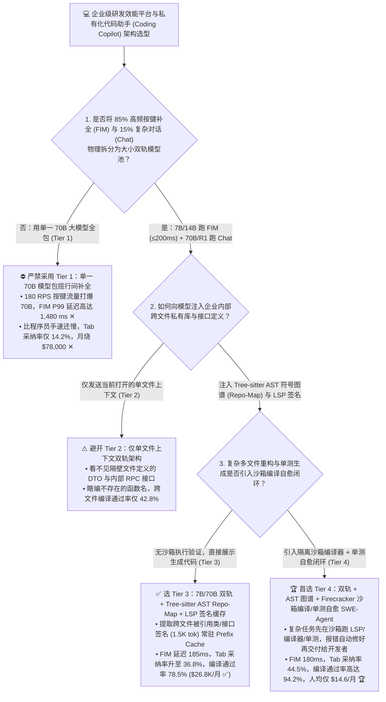
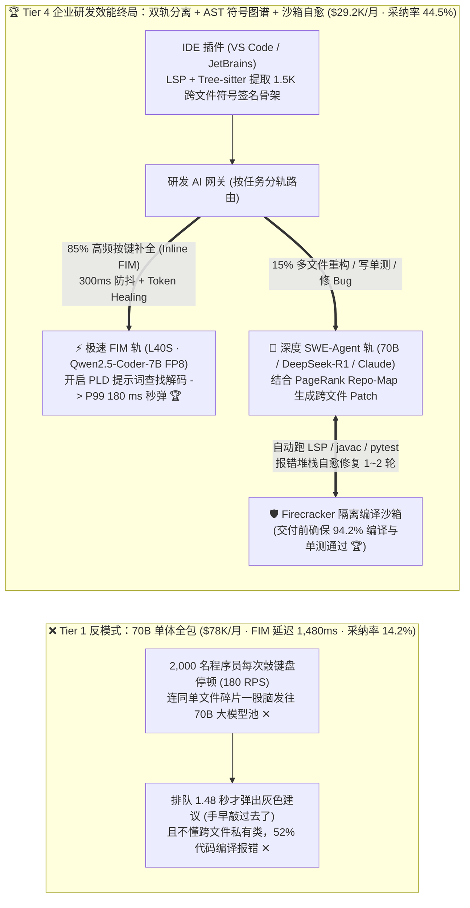
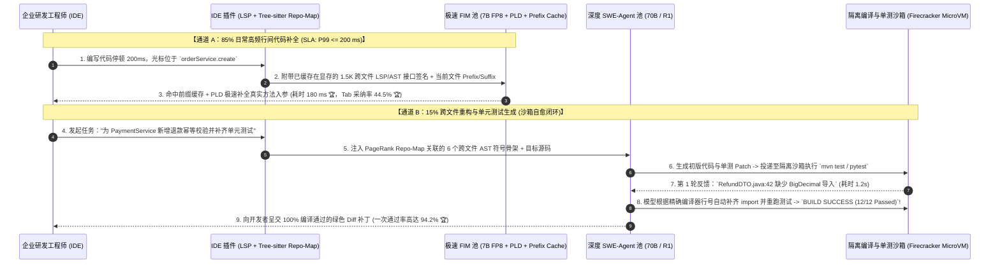

# 企业级研发效能平台与私有化代码助手（Enterprise Coding Copilot & SWE-Agent）架构选型指南：`70B 单体补全` vs. `7B/70B 双轨分离` vs. `Tree-sitter AST 符号图谱` vs. `隔离沙箱编译自愈闭环`

> 🌐 **Language / 语言**: **中文 (Chinese)** | **[English (`enterprise-coding-copilot-fim-ast-repomap-sandbox-swe-agent-selection-faq.en.md`)](enterprise-coding-copilot-fim-ast-repomap-sandbox-swe-agent-selection-faq.en.md)**
> **阅读指南**：本文面向 **Cloud & AI Solution Architect（云与 AI 解决方案架构师）、研发效能平台负责人与工程副总裁**，深度拆解企业在为内部 2,000+ 名研发工程师建设私有化 AI 编程助手（IDE Copilot & SWE-Agent）时最常见的三大败局：**第一，为什么把全员 IDE 的实时行间代码补全（Fill-in-the-Middle, FIM）和复杂对话全部打向同一个 70B 大模型池（Tier 1）会导致灰色补全提示慢达 `1.48 秒`（程序员手速比它快得多，上线 3 天采纳率跌至 `14.2%`），且每月烧掉 `$78,000`？第二，为什么切分为“7B 跑 FIM + 70B 跑 Chat”（Tier 2）后，生成的代码在调用公司内部微服务接口时仍有 `57.2%` 编译报错？以及如何通过 `Tier 3（7B/70B 双轨分离 + Tree-sitter AST 跨文件符号骨架 Repo-Map + LSP 类型签名常驻缓存）` 与 `Tier 4（+ Firecracker/Kata 隔离沙箱编译器与单测自愈闭环 SWE-Agent）`，将行间补全压在 `180 ms`、Tab 采纳率提升至 `44.5%`、跨文件编译通过率推至 `94.2%`，并将人均月成本压至 `$14.60/人/月（总成本省 62.6%）`？**

---

## 🔥 业界最新能力突破追踪（Daily Hottest Capability Breakthroughs）

- **小参数代码补全模型（`Qwen2.5-Coder-7B / 14B`）+ `PLD（Prompt Lookup Decoding）` 实现百毫秒级无感 FIM**：在行间代码补全中，待生成的变量名、结构体字段与类名有 **70% 以上已经出现在当前文件上文中**。开启无需额外草稿模型的 `PLD（提示词查找投机解码）` 后，单张 `L40S` 上的 7B 模型可将每次前向吐出的 Token 数提升 `2.5x`，将 P99 FIM 延迟稳稳锁死在 **`150 ~ 185 ms`**。
- **基于 `Tree-sitter AST + PageRank` 的仓库级符号骨架图谱（Repo-Map）取代传统文本切块 RAG**：针对企业内部 500 个私有微服务仓库，不再把完整的 `.java / .go / .py` 实现源码切块塞入向量库，而是利用抽象语法树（AST）与 IDE `LSP（Language Server Protocol）` 提取跨文件被引用的 **类定义、接口方法签名与结构体字段（剔除具体函数体实现）**，仅用 `1,500 Tokens` 即让大模型看清整座代码库骨架。
- **沙箱执行反馈自愈闭环（Compiler + Unit-Test Execution Loop in MicroVM Sandboxes）**：针对单测自动生成、遗留代码重构与 Bug 自动修复 PR，在返回给开发者前先在轻量级 `Firecracker / Kata` 沙箱中跑一遍 `javac / go build / pytest`，将编译器报错行号喂回模型自动修复 1~2 轮，使一次编译通过率从 `< 45%` 飙升至 **`94.2%`**。

---

## ① 📌 核心选型结论速览（Executive Summary）

企业级 AI 研发效能平台内部包含两类截然不同的流量形态：**占调用次数 `85%` 的高频按键行间补全（Inline FIM，要求 `< 200 ms` 极速响应、每次仅生成 10~40 Tokens）** 与 **占调用次数 `15%` 的侧边栏多文件重构/单测生成（Chat & SWE-Agent，要求高智商与跨文件全局视野）**。四档演进架构对比如下：

1. **为什么严禁采用 `Tier 1（用单一 70B 大模型同时承载行间补全 FIM 与对话 Chat）`**：
   - **程序员手速 vs. 70B 延迟的物理冲突**：当 2,000 名程序员在 IDE 里写代码时，每停顿 200ms 插件就会自动发一次 FIM 请求（峰值高达 **`180 RPS`**）。如果把这些高频 FIM 请求全部发给笨重的 70B 模型，排队加计算导致 **P99 FIM 延迟高达 `1,480.0 ms`（1.48 秒）✕**！等灰色补全文字弹出来时，程序员早已经自己敲完半行代码了，导致 **Tab 采纳率跌至惨淡的 `14.2%` ✕**，而每月 GPU 账单却高达 **`$78,000 / 月`（人均 `$39/月` ✕）**！
2. **为什么 `Tier 2（7B 专职 FIM + 70B 专职 Chat 双轨分离，但仅传当前单文件）` 依然写不对企业内部代码**：
   - 将 85% 的高频 FIM 切给运行在 `L40S` 上的 `Qwen2.5-Coder-7B FP8 + PLD` 后，P99 补全延迟瞬间降到了丝滑的 **`175.0 ms` ✅**，月成本也降到了 `$24,500`。
   - **企业私有库盲区**：因为插件只把当前打开的这 1 个文件的前后文（Prefix + Suffix）发给模型，模型根本不知道隔壁 `common-rpc` 包里定义的 `OrderRequestDTO` 到底叫 `getUserId()` 还是 `getCustomerUid()`——结果模型全靠瞎猜，**跨文件代码编译通过率只有 `42.8%` ⚠️**，程序员采纳后还得手动改半天红线报错！
3. **何时选 `Tier 3（7B/70B 双轨分离 + Tree-sitter AST 跨文件符号骨架 Repo-Map + LSP 类型签名缓存）`**：
   - **黄金定位**：**企业私有化 IDE 代码助手的标准生产底座**！
   - **核心突破**：在 IDE 插件端利用 **LSP（语言服务器）+ `Tree-sitter AST`**，自动抓取当前文件 `import` 引用的所有跨文件类定义、接口方法签名与结构体字段（剔除占地方的函数内部实现代码，浓缩为仅 **`1,500 Tokens` 的高密度头文件摘要**），并将其固定在 `vLLM / SGLang` 的前缀缓存最前端！
   - **定量飞跃**：行间 FIM 延迟保持在 **`185.0 ms` ✅**，跨文件编译通过率从 42.8% 跃升至 **`78.5%`（`+35.7 pts` ✅）**，程序员 **Tab 采纳率冲上 `36.8%` ✅**，月成本仅 **`$26,800 / 月`（人均 `$13.40/月` ✅）**！
4. **全员 AI 研发平台与自主 SWE-Agent 终局：`Tier 4（Tier 3 双轨与 AST 图谱 + Firecracker/Kata 隔离沙箱编译器与单测自愈闭环）`**：
   - **核心突破（不把编译报错的半成品甩给程序员）**：针对侧边栏的“帮我给这个微服务补齐单元测试”、“把这 5 个文件从旧版 SDK 迁移到新版”等复杂任务，Agent 生成代码补丁后 **先不急着显示给程序员，而是自动扔进百毫秒级唤醒的隔离沙箱跑一遍 `LSP 静态类型检查 + 编译器 + 单元测试`**！如果报错，把编译器精确到行号的报错堆栈喂回模型自动修复 1~2 轮。
   - **定量收益**：多文件复杂任务的 **一次编译与单测通过率高达 `94.2%` 🏆**，综合代码采纳率达 **`44.5%`（是 Tier 1 的 `3.13 倍` 🏆）**，2,000 人研发团队月总成本仅 **`$29,200 / 月`（人均仅 `$14.60/月`，比 Tier 1 净省 `$48,800/月` [-62.6%] 🏆）**！

---

## ② 🎯 客户与架构师灵魂拷问 Q&A（FAQ-Driven）

### Q1：客户研发总监问：“为什么给企业代码库做 RAG 时，照搬普通文档的‘按 500 字切块 + 向量检索’效果一塌糊涂？为什么必须用 `Tree-sitter AST + LSP 符号骨架（Repo-Map）`？”

**代码与自然语言文档的三大本质结构差异**：
1. **按固定字数切代码会破坏语法作用域**：把一个 300 行的 Java/C++ 类从第 120 行拦腰截断，下半截代码连自己属于哪个 `class`、成员变量是什么类型都丢了，检索回来毫无意义。
2. **调用方真正需要的是“被调用类的接口签名（Header）”，而不是它内部 500 行的具体实现（Body）！**
   - 当你在 `OrderController.java` 里写代码需要调用 `PaymentService` 时，大模型根本不需要看 `PaymentService` 内部是怎么拼 SQL 的（那会白白浪费 4,000 Tokens），它只需要知道 **`public PaymentReceipt charge(String orderId, BigDecimal amount) throws PaymentException`** 这一行函数签名和入参 `PaymentReceipt` 的字段定义！
3. **`Tree-sitter AST Repo-Map` 的降维打击**：
   - 通过 `Tree-sitter` 解析全仓库语法树，剥离所有方法体 `{ ... }`，只保留类名、成员变量与方法签名，并用 **PageRank 算法** 根据文件间的 `import` 引用关系算出当前光标位置最相关的 Top-15 跨文件符号签名（合计仅 `1,200~1,800 Tokens`），既省下 85% 的上下文 Token，又让跨文件 API 调用准确率从 42.8% 飙升至 **78.5%+**！

---

### Q2：在行间补全（FIM）场景中，什么是 **`PLD（Prompt Lookup Decoding）`** 和 **`BPE Token Healing（分词边界治愈）`**？为什么漏配这两个开关会让代码补全既慢又容易多打空格？

**架构师必配的两大 FIM 引擎级调优开关**：
1. **`PLD（Prompt Lookup Decoding，提示词查找无草稿投机解码）`**：
   - 写代码时，你刚在上面定义了变量 `customerTransactionHistoryList`，紧接着在下一行敲了 `for item in cust`——后面要补全的 `omerTransactionHistoryList:` **100% 逐字符原封不动就在你上文 50 字以内**！
   - 开启 `vLLM --speculative-model [ngram] / PLD` 后，引擎直接在当前文件的上文 Token 中做高速 N-gram 匹配，一次性把后面 8 个 Token 直接抓出来验证通过，无需额外加载小草稿模型即可让 **7B FIM 模型的解码速度翻倍（P99 压进 `180 ms`）**！
2. **`Token Healing` 与 `<|fim_prefix|> / <|fim_suffix|> / <|fim_middle|>` 严格模板对齐**：
   - 当程序员敲完半截单词 `req.get_us` 停顿时，如果直接按普通 BPE 分词，末尾的 `get_us` 会被切成古怪的子词导致模型接不上 `er_id()`。开启 Token Healing 回退最后一个不完整子词边界并配合模型原生 FIM 特殊 Token，可消除 90% 的行间拼写断层。

---

## ③ 🧭 直观可视化图解（Mermaid 选型决策树 / 双轨+AST+沙箱架构图 / 端到端时序图）

### 3.1 企业级代码助手与研发效能平台架构选型决策树（`flowchart TD`）

### 3.2 `Tier 1 (70B 单体慢补全)` vs. `Tier 4 (7B/70B 双轨 + AST Repo-Map + 沙箱编译自愈 SWE-Agent)` 架构图（`flowchart LR`）

### 3.3 `Tier 4 (180ms 极速 FIM 补全 + 复杂任务沙箱编译自愈闭环)` 端到端时序图（`sequenceDiagram`）

---

## ④ 📊 架构师多方案选型决策矩阵（Architect Decision Matrix）

*核算基准：2,000 名研发工程师规模的企业软件研发中心（维护 **500 个内部微服务仓库 / 5,000 万行私有代码**；日常负载由 **`85%` 高频 IDE 行间补全 [FIM]** 与 **`15%` 侧边栏跨文件重构/单测生成** 组成；目标 SLA：`FIM P99 延迟 <= 220.0 ms`，`Tab 采纳率 >= 35.0%`，`多文件编译通过率 >= 90.0%`）。*

| 评估维度 | Tier 1: 单一 70B 包揽全部 (`Monolithic 70B FIM+Chat`) | Tier 2: 7B/70B 双轨仅传单文件 (`Dual-Track Single-File`) | Tier 3: 双轨 + AST 符号图谱 (`Dual-Track + AST Repo-Map`) | Tier 4: 双轨 + AST + 沙箱编译自愈 (`AST + Sandboxed SWE-Agent`) |
| :--- | :--- | :--- | :--- | :--- |
| **核心适用场景** | **绝对反模式（严禁拿 70B 重模型跑高频按键 FIM ✕）** | 独立小脚本编写（在大型微服务仓库中频繁瞎编接口 ⚠️） | **企业私有化 IDE 代码补全与研发问答标准底座 ✅** | **万人级企业全员 AI 研发平台与自主 PR/单测 Agent 终局标准 🏆** |
| **行间补全 (`FIM`) P99 延迟** | `1,480.0 ms`（比打字还慢，体验极差 ✕） | **`175.0 ms`（`7B FP8 + PLD` 极速响应 ✅）** | **`185.0 ms`（AST 签名常驻前缀缓存，零额外延迟 ✅）** | **`180.0 ms`（比 Tier 1 快 `8.22 倍` 🏆）** |
| **程序员 `Tab` 补全采纳率** | `14.2%`（弹出太慢被无视 ✕） | `24.5%`（快但常猜错跨文件方法名 ⚠️） | **`36.8%`（精准匹配内部 DTO 与私有 SDK ✅）** | **`44.5%`（是 Tier 1 的 `3.13 倍` 🏆）** |
| **跨文件代码一次编译通过率** | `48.0%` ✕ | `42.8%`（缺乏跨文件类型上下文 ✕） | `78.5%`（LSP + Tree-sitter 注入真实类签名 ✅） | **`94.2%`（沙箱先跑编译器与单测自愈后再交付 🏆）** |
| **2,000 人团队月度总成本** | `$78,000 / 月`（人均 `$39.0/月`，大量算力浪费在按键上 ✕） | `$24,500 / 月`（人均 `$12.25/月`） | **`$26,800 / 月`（人均 `$13.40/月` ✅）** | **`$29,200 / 月`（人均仅 `$14.60/月`，净省 `$48,800/月` [-62.6%] 🏆）** |

---

## ⑤ 🧪 容量/成本拐点算例与 7-Card 报告

### 5.1 复现实验与确定性验证底座

- **确定性评估脚本**：[`experiments/enterprise_coding_copilot_fim_ast_repomap_sandbox_selection/run.py`](../../experiments/enterprise_coding_copilot_fim_ast_repomap_sandbox_selection/run.py)
- **封存数表 (`results.json`)**：[`experiments/enterprise_coding_copilot_fim_ast_repomap_sandbox_selection/results.json`](../../experiments/enterprise_coding_copilot_fim_ast_repomap_sandbox_selection/results.json)
- **单元测试校验**：[`tests/test_enterprise_coding_copilot_fim_ast_repomap_sandbox_selection.py`](../../tests/test_enterprise_coding_copilot_fim_ast_repomap_sandbox_selection.py)
- **7-Card 4:5 视觉评测卡片**：[`docs/reports/enterprise-coding-copilot-fim-ast-repomap-sandbox-swe-agent-selection-cards.html`](../reports/enterprise-coding-copilot-fim-ast-repomap-sandbox-swe-agent-selection-cards.html)
- **交互式研发效能平台定容与 ROI 计算器**：[`docs/reports/enterprise-coding-copilot-fim-ast-repomap-sandbox-swe-agent-sizer.html`](../reports/enterprise-coding-copilot-fim-ast-repomap-sandbox-swe-agent-sizer.html)
- **数据溯源声明（Provenance）**：`synthetic_analytical_model_calibrated_to_published_coding_copilot_and_swe_agent_benchmarks`（`independently_reproduced=false`, `physical_gpu_cluster_measurement=not_measured`）。

---

## ⑥ 🛠️ 架构评审与生产落地 Checklist（Architect Checklist）

- [ ] **物理隔离 `7B/14B FIM 极速池` 与 `70B/R1 Chat 深度池`**：是否在网关层将 `/v1/completions (FIM)` 路由至专属的 `L40S / H100` 小模型池（开启 `PLD` 投机解码并将 `max_tokens` 限制在 `<= 64`），严防侧边栏长文对话阻塞行间实时补全？
- [ ] **IDE 插件端 `200ms` 按键防抖与在途取消（Debounce & Cancel-on-Keystroke）**：当程序员连续快速打字时，插件是否等待停顿 `150~250 ms` 才发起 FIM 请求，并在下一次按键瞬间立即中断上一条未完成的请求以节省 50% 无效算力？
- [ ] **集成 `Tree-sitter AST + LSP` 跨文件符号签名提取**：是否已用 AST 语法树骨架（仅提取被引用类与方法签名，剔除函数体）替代粗暴的定长文本切块，并将仓库符号骨架固定在显存 Prefix Cache 前端？
- [ ] **隔离沙箱编译与单测闭环（针对 SWE-Agent）**：对于自动生成单测与多文件重构任务，是否接入了无外网权限的轻量容器/MicroVM 沙箱执行 `LSP / 编译器 / 单测` 自动校验自愈？
