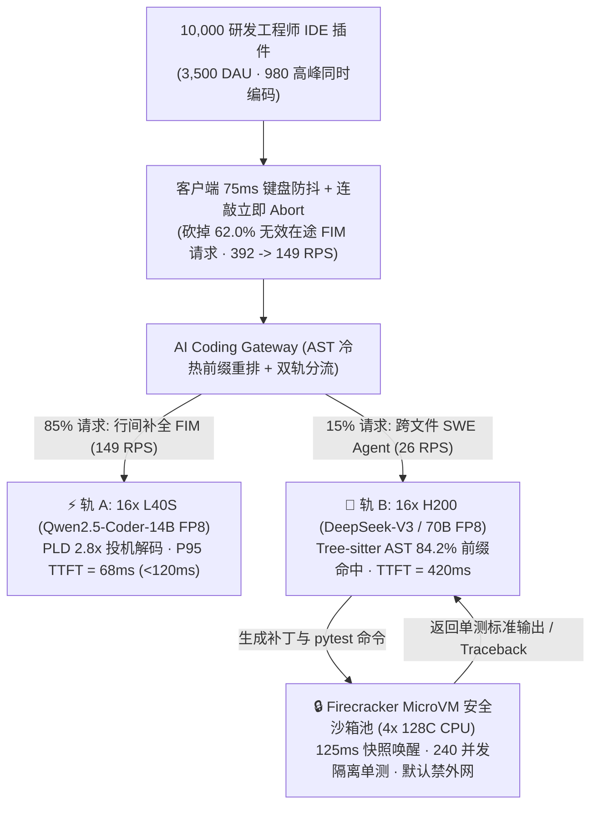

# 企业万人研发代码助手（`Coding Copilot FIM <150ms` + `SWE Agent 自主编码沙箱`）双轨异构配比、`Tree-sitter AST` 仓库级前缀缓存与 `Firecracker MicroVM` 容量规划指南

> **语言 / Language**: **简体中文** | [English](./enterprise-coding-copilot-fim-swe-agent-sandbox-sizer-faq.en.md) · [📱 打开交互式 H5 精读页](../h5/coding-copilot-fim-swe-agent-sandbox-sizer-lab.html) · [🧮 打开交互式容量计算器](../reports/enterprise-coding-copilot-fim-swe-agent-sandbox-sizer.html) · [🃏 查看 7-Card 4:5 评测报告](../reports/enterprise-coding-copilot-fim-swe-agent-sandbox-sizer-cards.html)

---

## 0. 3 分钟执行摘要（Executive Summary）

当大型银行、车企或科技公司为 **`10,000` 名研发工程师**规划私有化 AI 研发辅助平台（对标 GitHub Copilot + Cursor Composer / Claude Code / Devin SWE Agent）时，架构师面临的核心问题是：**到底需要采购多少张 GPU、多少台代码测试沙箱服务器？为什么把实时代码补全（`FIM`）和多文件重构（`SWE Agent`）混在同一个 `70B/671B` 池子里会导致补全延迟飙破 `450 ms` 且預算爆炸？**
1. **双轨异构模型与硬件解耦铁律（`Track A: 16× L40S FIM` + `Track B: 16× H200 SWE Agent`）**：
   - **轨 A（IDE 行间幽灵文本补全 `Fill-in-the-Middle, FIM`，占请求总数 `85%`）**：心理舒适阈值要求 **`P95 TTFT <= 120 ms`、端到端 `<= 220 ms`**。若使用 `70B/671B` 大模型，仅 Prefill + 跨卡通信就超过 `250 ms`；采用 **`16 张 L40S` 部署 `Qwen2.5-Coder-14B / DeepSeek-Coder-V2-Lite FP8` + `PLD`（Prompt Lookup Decoding `2.8×` 加速）**，配合 **IDE 插件 `75 ms` 键盘防抖 + 继续打字立即 `Abort` 在途请求（直接削减 `62.0%` 无效 GPU 算力）**，即可将 `P95 TTFT` 压至 **`68 ms`**！
   - **轨 B（自主 `SWE Agent` 多文件编辑与修 Bug，占请求总数 `15%`，却占 Token 总量 `72%`）**：每次任务包含平均 `8.5` 轮长上下文（`32K–64K`）工具调用（搜索代码、修改文件、跑 `pytest`）。采用 **`16 张 H200`（`2` 台整机）部署 `DeepSeek-V3 / Qwen2.5-Coder-72B FP8`**。
2. **`Tree-sitter AST` 冷热分层前缀排布将仓库级 KV Cache 命中率从 `31.0%` 拉升至 `84.2%`**：
   - 若将易变的“当前光标行”或“最新报错日志”放在 Prompt 开头，程序员每改一行代码都会导致后续 `32K` 仓库上下文 KV Cache 全部失效；
   - 按 **`[L1 仓库规范与依赖签名] → [L2 跨文件 Import AST 符号表] → [L3 当前文件未改动类骨架] → [L4 末尾当前函数/报错]`** 严格从冷到热排布，使多轮 SWE Agent 与连续 FIM 补全复用 **`84.2%`** 的前缀 KV，单轮 `32K` Prefill TTFT 从 `2,450 ms` 骤降至 **`420 ms`（`-82.9%`）**。
3. **`Firecracker MicroVM` 快照沙箱池（`4 台 128-Core CPU` 承载 `240` 路并发安全单测）与 TCO 收益**：
   - 万人团队（`3,500 DAU`）全套自建月度总成本仅 **`$38,400/月`**（`16× L40S $11.5K + 16× H200 $24.5K + 4× CPU 沙箱机 $2.4K`），折合每位工程师 **`$3.84/人/月`**，对比按席位采购商业 SaaS（`$19/人/月 × 10,000 = $190,000/月`），**每年净省 `$181.9万`（节省 `79.8%`），且核心源码 `100%` 不出企业内网**！

---

## 1. 灵魂拷问 Q&A（Cloud & AI Solution Architect 核心决策拆解）

### Q1：万人研发团队（`10,000 Seats`）在工作日的真实峰值 RPS 是多少？如何用键盘防抖（Debounce）砍掉 `62%` 的无效算力？

- **并发漏斗手算**：
  - `10,000` 名授权工程师 → 工作日活跃率 `35%`（`3,500 DAU`） → 高峰时段同时在 IDE 编码比例 `28%`（`980` 名并发活跃程序员）；
  - 若每次敲击键盘都立即发请求，峰值高达 `392 RPS`，其中 **`62.0%` 的请求在返回前用户就已经敲下了下一个字母（被废弃的过期补全）**！
  - **IDE 网关双层节流**：① 客户端插件设置 **`75 ms` 停顿防抖（Typing Debounce）**；② 用户一旦继续按键，客户端立即断开 HTTP/2 流并触发引擎侧 `abort_request()` 释放 KV 块，使真正进入 GPU 跑完的 FIM 峰值请求精准收敛在 **`149 RPS`**！

### Q2：为什么 SWE Agent 执行单元测试绝不能直接跑在 K8s 普通 Docker 容器里？

当 SWE Agent 自动修复代码并执行 `pytest` 或 `mvn test` 时，LLM 生成的测试脚本可能包含恶意/幻觉指令（如读取环境变量密钥、扫描内网端口、Fork 炸弹耗尽宿主 PID）：
- **必须采用 `Firecracker MicroVM`（或 `Kata Containers / gVisor`）**：每个 Agent 会话分配独立微内核 MicroVM，通过内存快照（Memory Snapshot Restore）在 **`125 ms`** 内带齐仓库依赖环境启动，借助 `CoW + KSM` 将单沙箱物理内存压至 **`1.4 GB`**，并实施 **默认拒绝出网（Default-Deny Egress，仅放行内网只读制品库）**。

---

## 2. 万人研发代码平台四套架构横向选型矩阵

| 架构方案 (`10,000` 授权研发 · `3,500 DAU`) | FIM 补全 `P95 TTFT` | SWE Agent `32K TTFT` | 代码安全与沙箱隔离 | 硬件配置与月度总成本 (TCO) | 每人每月成本 & 架构师裁决 |
| :--- | :--- | :--- | :--- | :--- | :--- |
| **1. 纯公有云商业 SaaS 席位采购** | `140 ms`（受公网抖动影响） | `950 ms` | 源码出境至公有云，无内网单测环境 | 无需自建 GPU（按 `10,000 × $19` 订阅） | `$19.00/人/月` (`$19.0万/月`) · ⚠️ **核心金融/军工源码禁出网** |
| **2. 单一 `70B` 混部池（无防抖 + 普通拼接）** | `385 ms`（严重卡手） | `2,450 ms`（前缀命中 `31%`） | 普通 Docker 容器（高逃逸风险） | `48× H200` (`$7.34万/月`) | `$7.34/人/月` · ⛔ **FIM 延迟超标且浪费大卡** |
| **3. 双轨 GPU 池 + 普通上下文拼接** | `75 ms` | `1,820 ms`（前缀频繁失效） | `gVisor` 容器沙箱 | `16× L40S + 24× H200` (`$4.82万/月`) | `$4.82/人/月` · ✅ **可用，但 Agent Prefill 算力偏高** |
| **4. 双轨异构 (`16×L40S + 16×H200`) + AST 缓存 + MicroVM（推荐）** | **`68 ms`**（丝滑零感） | **`420 ms`**（`84.2%` AST 命中） | **`Firecracker MicroVM` (`125ms` 唤醒)** | **`16× L40S + 16× H200 + 4× CPU`** (**`$3.84万/月`**) | **`$3.84/人/月`（年省 `$181.9万` / `-79.8%`）** 🏆 |

---

## 3. 生产落地核对清单（Pre-Production Checklist）

- [ ] **实施 Track A (`7B/14B FIM`) 与 Track B (`70B/671B SWE Agent`) 物理分池**：严禁让 `32K` 仓库级 Agent 请求阻塞 `<120ms` 的行间代码补全；
- [ ] **IDE 插件强制开启 `75 ms` 防抖 + 连敲 `Cancel-on-Keystroke` + FIM 模型开启 `PLD` 投机解码**；
- [ ] **使用 `Tree-sitter` 按冷热四层组装上下文**：确保同一仓库跨轮次编辑的 `L3 Radix` 前缀命中率 `>= 80%`；
- [ ] **SWE Agent 单测环境强制运行在 `Firecracker MicroVM` 快照池**，并封禁沙箱除内网只读包管理器外的一切公网/生产网访问。
