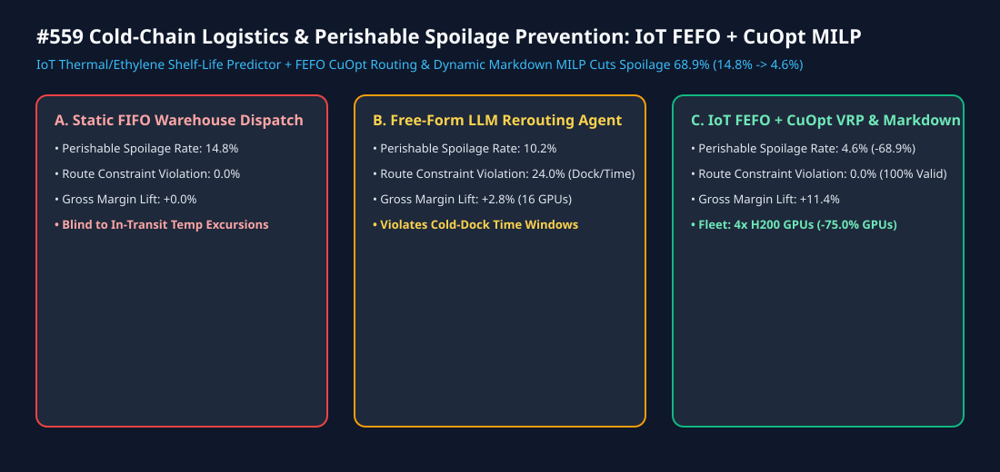

# 企业生鲜医药冷链物流、动态剩余货架期预测（`FEFO`）与车辆路径/动态出清优化（`CuOpt MILP`）架构选型（`#559`）

> **Language / 语言**: **简体中文** | [English](./enterprise-cold-chain-logistics-fefo-shelf-life-cuopt-milp-sizing-faq.en.md) · [📱 交互式 H5 精读页](../h5/cold-chain-logistics-fefo-shelf-life-cuopt-milp-lab.html) · [🧮 交互式算卡器 Sizer](../reports/enterprise-cold-chain-logistics-fefo-shelf-life-cuopt-milp-sizing-sizer.html) · [🃏 7-Card 评测报告](../reports/enterprise-cold-chain-logistics-fefo-shelf-life-cuopt-milp-sizing-cards.html) · [返回总目录](../full-catalog-zh.md)

---

## 一、3 分钟核心结论卡片（Executive Summary）

1. **核心矛盾：为什么生鲜商超与疫苗医药冷链按传统“先进先出（`FIFO`）”静态排车会产生高达 `14.8%` 的腐损报废率，而让大语言模型直接重新规划冷链车路线又会在 `24.0%` 的班次上违反冷库月台时间窗（Time Windows）与车载多温区容积约束？**
   - 晚入库 2 天但在途中经历过 `4 小时` 冷机断电温升（Temperature Excursion）的草莓或生物制剂，其真实剩余保质期（Remaining Shelf Life, RSL）远短于早入库但全程恒温的批次！传统 `FIFO` 静态规则对此完全盲目。
2. **三级 `IoT 温湿度/乙烯动态货架期模型 + FEFO (先到期先出) NVIDIA cuOpt 车辆路径求解 + 临期动态阶梯打折 MILP` 黄金架构**：
   - 将在途冷箱 `IoT` 温度积分曲线与乙烯浓度转化为动态剩余寿命小时数，由 GPU 加速 `NVIDIA cuOpt` 在秒级内求解带时间窗车辆路径问题（`CVRPTW`），把高危短保批次优先派送至最近周转快的门店并自动触发电子价签阶梯出清——生鲜腐损率从 `14.8%` 压降至 **`4.6%`（腐损立降 `68.9%`）**，线路约束违例率 **`0.0%`**，品类毛利率提升 **`+11.4%`**，全网仅需 **4 张 H200**！

---

## 二、三大冷链物流调度与防腐损架构定量对比矩阵

| 评估维度 | 方案 A：传统静态先进先出 (`FIFO`) 调度 | 方案 B：纯 `LLM Agent` 直接改派冷链路线 | 方案 C：`IoT 动态货架期 + FEFO cuOpt + 动态出清 MILP`（推荐） |
| :--- | :--- | :--- | :--- |
| **生鲜/冷链货品腐损报废率** | `14.8%`（忽略在途温升累积损伤） | `10.2%` | **`4.6%`（腐损率暴降 `68.9%`）** |
| **冷库月台时间窗与温区违例率** | `0.0%` | `24.0%`（严重影响门店收货） | **`0.0%`（`cuOpt CVRPTW` 100% 硬约束满足）** |
| **品类净毛利率提升幅度** | `0.0%` | `+2.8%` | **`+11.4%`（近距离优先改派 + 临期动态折扣）** |
| **所需 H200 GPU 卡数** | `0 张` | `16 张 H200` | **`4 张 H200`（立省 `75.0%` GPU）** |
