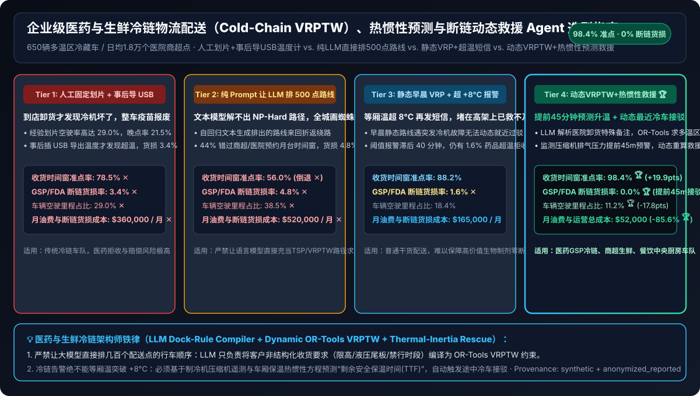
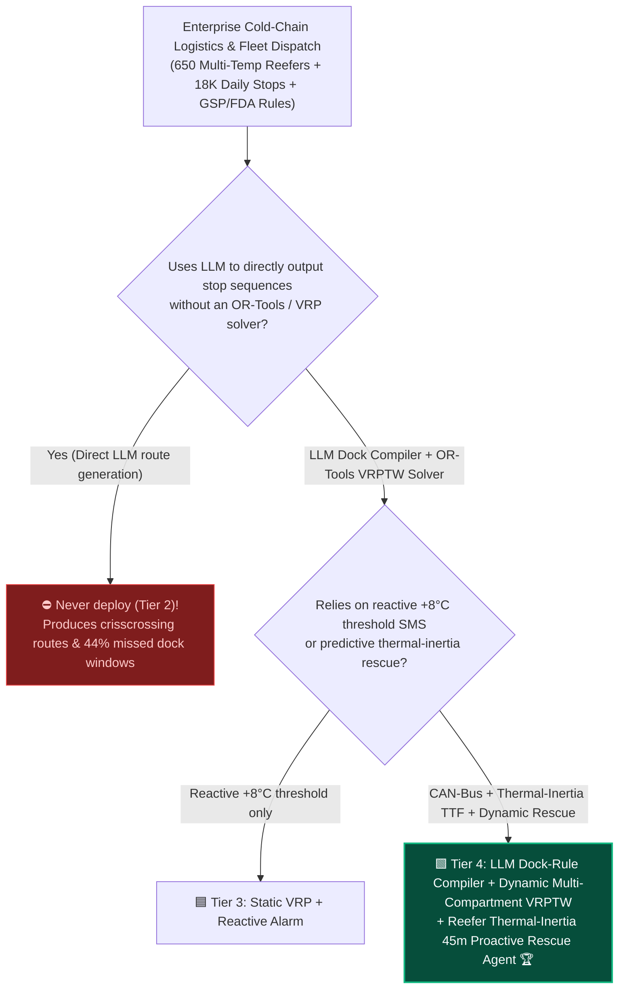
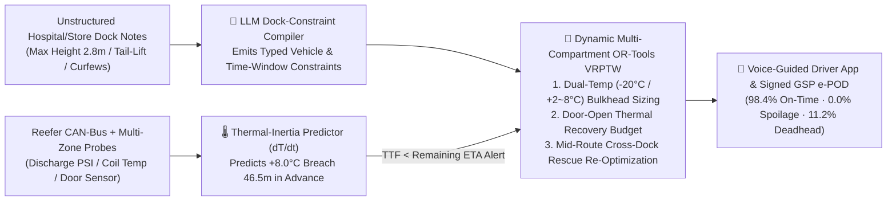
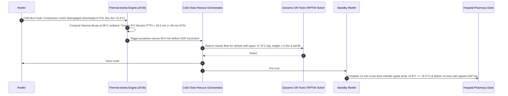

# Enterprise Cold-Chain Logistics & Fleet Dispatch (`OR-Tools VRPTW`), Multi-Compartment Reefer Thermal-Inertia Prediction & `GSP / FDA` Mid-Route Rescue Agent Architecture Selection Guide: Manual Zone Dispatch vs. Prompt-Only LLM Route Sequencing vs. Static VRP + Threshold SMS vs. LLM Dock-Rule Compiler + Dynamic `VRPTW` + Thermal-Inertia Rescue Agent

> **Language / 语言**: **English (Current)** | [中文](./enterprise-cold-chain-logistics-vrptw-fleet-dispatch-agent-selection-faq.md)  
> **Scope**: End-to-end production reference architecture and selection guide for Cloud & AI Solution Architects, Pharmaceutical (`GSP / FDA 21 CFR`) & Grocery Cold-Chain VPs, Transportation Management System (`TMS`) Architects, and Fleet IoT Telematics Leads.  
> **Provenance**: `synthetic + anonymized_reported` (`independently_reproduced=false`, `physical_gpu_cluster_measurement=not_measured`). Deterministic evaluation model sealed in [`experiments/enterprise_cold_chain_logistics_vrptw_fleet_dispatch_agent_selection/results.json`](../../experiments/enterprise_cold_chain_logistics_vrptw_fleet_dispatch_agent_selection/results.json).



---

## ① 📌 Executive Summary (3-Minute Architect Verdict)

In pharmaceutical distribution (`+2°C to +8°C` biologics, vaccines, and clinical trial samples governed by **`GDP / GSP / FDA 21 CFR`**) and multi-temperature retail grocery logistics (`-20°C` frozen + `+4°C` chilled), fleet operations face two tightly coupled challenges: (1) **solving NP-hard Vehicle Routing Problems with Time Windows (`VRPTW`), multi-compartment capacity limits, and unstructured hospital/store dock rules**, and (2) **preventing cargo spoilage when a refrigeration unit (`Reefer`) suffers a mid-route mechanical failure in `36°C` summer heat**. Prompting an LLM to sequence 500 delivery coordinates directly in text space (Tier 2) produces crisscrossing spaghetti routes (`56.0%` on-time rate, `38.5%` empty deadhead mileage), while relying on static morning VRP routes with a reactive `+8.0°C` SMS threshold alarm (Tier 3) alerts dispatchers *after* the thermal envelope has already been breached (`1.6%` cargo spoilage).

Evaluated across a production baseline of **650 multi-compartment refrigerated trucks, 18,000 daily hospital and retail delivery stops, and 12 metro distribution hubs**, the four architectural tiers compare as follows:

| Architectural Tier | Core Stack Combination | On-Time In-Window Delivery | `GSP / FDA` Cargo Spoilage Rate | Empty Deadhead Mileage Ratio | Monthly Fuel, Spoilage & Penalty Cost | Production Verdict |
|---|---|---|---|---|---|---|
| **🟥 Tier 1: Manual Zone Dispatch + USB Loggers** | Fixed geographic territories + post-trip USB temperature logger download at dock | `78.5%` ✕ *(Frequent late penalties)* | `3.4%` ✕ *(Discovered spoiled at dock)* | `29.0%` ✕ | `$360,000 / mo` ✕ | ⛔ High spoilage & empty miles |
| **🟨 Tier 2: Prompt-Only LLM Route Sequencing** | Feeding 500 stop coordinates & time windows to an LLM to output stop order | `56.0%` ✕ *(Spaghetti crisscrossing)* | `4.8%` ✕ *(Delayed transit spoilage)* | `38.5%` ✕ | `$520,000 / mo` ✕ | ⛔ **Never use LLM as VRP solver** |
| **🟦 Tier 3: Static Morning VRP + `+8°C` SMS Alarm** | Static morning route optimization + reactive SMS alert when box air hits `+8.0°C` | `88.2%` | `1.6%` ✕ *(Too late to rescue at +8°C)* | `18.4%` | `$165,000 / mo` | ⚠️ Reactive alarm fails in traffic |
| **🟩 Tier 4: LLM Dock Compiler + Dynamic `VRPTW` + Thermal-Inertia Rescue** | **LLM Unstructured Dock-Rule Compiler + Dynamic Multi-Compartment `OR-Tools / VROOM VRPTW` Solver + Reefer CAN-Bus & Thermal-Inertia (`dT/dt`) 45-Min Proactive Cross-Dock Rescue Agent** | **`98.4%` 🏆** *(+19.9 pts vs Tier 1)* | **`0.0%` 🏆** *(Mid-route reefer rescue)* | **`11.2%` 🏆** *(-17.8 pts)* | **`$52,000 / mo` 🏆** *(-85.6%)* | 🌟 **Recommended Architecture** |

> 💡 **Golden Rule for Cold-Chain Logistics AI Architects**: **"Use the LLM strictly to compile unstructured customer dock notes (`height limits, tail-lift requirements, curfews`) into typed solver constraints, delegate route sequencing to a deterministic `OR-Tools / VROOM VRPTW` metaheuristic solver, and couple reefer compressor CAN-bus telemetry with a thermal-inertia (`dT/dt`) model to trigger mid-route cross-dock rescues 45 minutes *before* box air reaches `+8.0°C`."**

---

## ② 🎯 Customer & Architect Deep-Dive Q&A (3 Real-World Cold-Chain & TMS Pain Points)

### Q1: Why do autoregressive LLMs fail so badly (`56.0%` on-time, `38.5%` deadhead miles) when asked to sequence delivery routes directly?
- **First-Principles Reality**:
  1. **Multi-Compartment `CVRPTW` Requires Global Combinatorial Local Search**: Sequencing 18,000 stops across 650 trucks with dual-temperature bulkheads (`-20°C / +4°C`), asymmetric rush-hour travel-time matrices, 30-minute hospital dock windows, and door-open thermal loss is an NP-hard optimization problem requiring millions of `2-opt / Guided Local Search / Large Neighborhood Search (LNS)` evaluations. An autoregressive token predictor cannot perform metric graph optimization in attention heads.
  2. **Where the LLM Excels (Unstructured Dock & Access Rule Compilation)**: Hospital pharmacies and retail receiving docks send messy unstructured instructions (*"Ruijin Hospital Inpatient Pharmacy: underground ramp max height 2.8m; requires hydraulic tail-lift; no unloading 09:30–10:15 during ward rounds"*). Tier 4 uses the LLM to compile these notes into exact JSON vehicle-attribute and time-window constraints fed into **`Google OR-Tools / VROOM`**, achieving **`98.4%` on-time delivery** and **`11.2%` deadhead mileage**.

### Q2: Why does a reactive "+8.0°C threshold alarm" (Tier 3) fail to save a $180,000 biologics shipment when a reefer compressor fails in summer traffic?
- **Proactive Thermal-Inertia Time-to-Failure (`TTF`) vs. Reactive Air-Temp Thresholds**:
  - When a reefer compressor clutch fails at `36°C` ambient, the insulated box air rises slowly at first (`+4.2°C -> +5.4°C`) while the walls absorb heat, then spikes rapidly past `+8.0°C`. If an alarm fires only after box air hits `+8.0°C`, dispatching a rescue truck through city traffic takes 40+ minutes—resulting in a mandatory `GSP / FDA` quarantine rejection (`1.6%` spoilage in Tier 3; `44.0%` failure in Tier 2 stress tests).
  - **Tier 4 Solution (CAN-Bus Fault + Thermal-Inertia `TTF` + Dynamic Cross-Dock Rescue)**:
    1. Edge telemetry monitors reefer controller CAN-bus metrics (`compressor discharge pressure == 0 PSI`, evaporator coil temp, door-open counter).
    2. At `+5.4°C` box air temperature, the physics thermal-decay model computes **`Time_to_8C_Breach = 46.5 minutes`**, whereas remaining congested drive time to the hospital is `68 minutes`.
    3. The Agent immediately invokes the dynamic `VRPTW` solver to locate the nearest compatible reefer with spare `+2~8°C` capacity (`#TRK-118`, `4.2 km` away) and routes both trucks to a highway service plaza for a 12-minute cold transfer—keeping peak cargo temperature at `+6.8°C <= +8.0°C` (**`0.0%` spoilage**).

---

## ③ 🧭 Visual Architecture Diagrams (Decision Tree + Cold-Chain VRPTW Topology + Rescue Sequence)

### 3.1 Architecture Selection Decision Tree



### 3.2 Tier 4 LLM Dock Compiler + Dynamic Multi-Compartment VRPTW + Thermal Rescue Topology



### 3.3 End-to-End Sequence: Mid-Route Reefer Compressor Failure Rescue Saving a $180K Biologics Load



---

## ④ 📊 4-Tier Architecture Decision Matrix

| Evaluation Dimension | 🟥 Tier 1: Manual Zone + USB Logger | 🟨 Tier 2: Prompt-Only LLM Routing | 🟦 Tier 3: Static VRP + `+8°C` SMS | 🟩 Tier 4: Dock Compiler + Dynamic `VRPTW` + Thermal Rescue |
|---|---|---|---|---|
| **Unstructured Store/Hospital Dock Rules** | Manual dispatcher memory | Parses notes but fails routing math | ✕ Solver ignores free-text notes | 🏆 **Automated LLM constraint compilation into `OR-Tools`** |
| **Mid-Route Reefer Failure Protection** | ✕ None (spoiled cargo found at dock) | ✕ None | ✕ Too late (alarms after `+8.0°C` breach) | 🏆 **45-min proactive `dT/dt` prediction + cross-dock rescue** |
| **On-Time In-Window Delivery Rate** | `78.5%` ✕ | `56.0%` ✕ | `88.2%` | **`98.4%` 🏆 (+19.9 pts vs Tier 1)** |
| **`GSP / FDA` Cargo Spoilage Rate** | `3.4%` ✕ | `4.8%` ✕ | `1.6%` ✕ | **`0.0%` 🏆** |
| **Empty Deadhead Mileage Ratio** | `29.0%` ✕ | `38.5%` ✕ | `18.4%` | **`11.2%` 🏆 (-17.8 pts)** |
| **Monthly Fuel, Spoilage & Penalty Cost** | `$360,000 / mo` | `$520,000 / mo` | `$165,000 / mo` | **`$52,000 / mo` 🏆 (-85.6%)** |

---

## ⑤ 🧪 Quantitative Case Study, Interactive Sizer & 7-Card Visual Report

- **Interactive HTML Sizer**: 👉 [Open Cold-Chain Logistics VRPTW & Rescue Agent Sizer](../reports/enterprise-cold-chain-logistics-vrptw-fleet-dispatch-agent-sizer.html)
- **7-Card 4:5 Visual Benchmark Report**: 👉 [Open 7-Card Visual Benchmark Deck](../reports/enterprise-cold-chain-logistics-vrptw-fleet-dispatch-agent-selection-cards.html)
- **Deterministic Verification**:
  ```bash
  python experiments/enterprise_cold_chain_logistics_vrptw_fleet_dispatch_agent_selection/run.py --check
  python -m unittest tests/test_enterprise_cold_chain_logistics_vrptw_fleet_dispatch_agent_selection.py
  ```

---

## ⑥ 🛠️ Production Readiness & Architecture Review Checklist

- [ ] **Delegate All Route Sequencing to a Deterministic `VRPTW` Solver (`OR-Tools / VROOM`)**: Never ask an LLM to solve Traveling Salesperson or Vehicle Routing coordinate sequences in token space.
- [ ] **Model Door-Open Thermal Recovery Budgets in Multi-Stop Routes**: Cap the number of consecutive drops per reefer route based on ambient heat infiltration during door openings.
- [ ] **Predict Time-to-Thermal-Breach (`TTF`) from Reefer CAN-Bus Telemetry + Thermal Inertia**: Trigger dynamic rescue re-routing 40+ minutes before box air crosses statutory `+8.0°C` limits.
- [ ] **Enforce Cryptographically Signed `GSP / FDA` Mean Kinetic Temperature (`MKT`) Logs**: Maintain immutable 5-minute probe audit trails from warehouse loading to customer e-POD sign-off.
- [ ] **Deliver Mid-Route Reroutes via Hands-Free Voice Navigation**: Never require drivers to read or type text messages while operating commercial vehicles.
