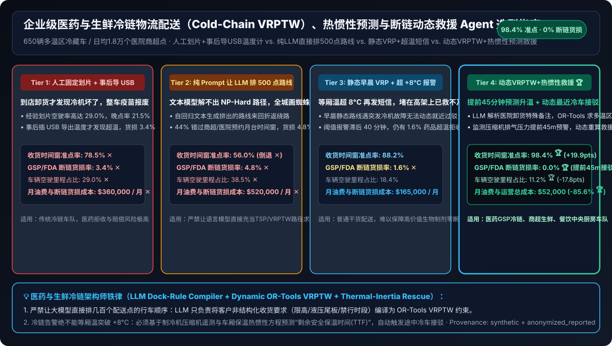
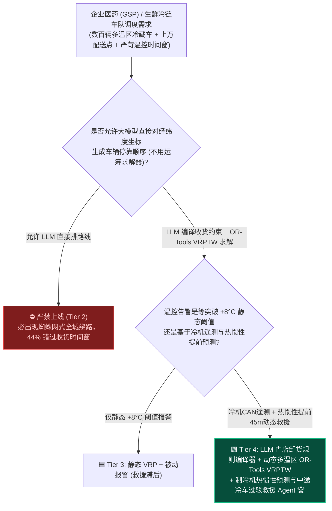
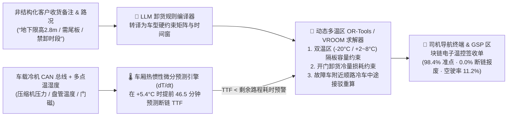
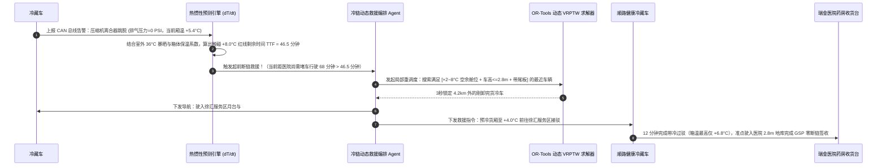

# 企业级医药与生鲜冷链物流配送（Cold-Chain Logistics & Fleet Dispatch）、多温区带时间窗车辆路径规划（`OR-Tools VRPTW`）、制冷机热惯性预测与 GSP/FDA 断链动态救援 Agent 架构选型指南：人工划片 + 事后导 USB vs. 纯 LLM 直接排路线 vs. 静态 VRP + 超温短信 vs. LLM 卸货约束编译 + 动态 VRPTW + 热惯性提前 45m 接驳救援 Agent

> **语言 / Language**: **中文 (当前)** | [English](./enterprise-cold-chain-logistics-vrptw-fleet-dispatch-agent-selection-faq.en.md)  
> **定位**：面向云与 AI 解决方案架构师（Solution Architect）、医药流通（GSP 合规）与连锁商超生鲜物流副总裁、运输管理系统（TMS）首席架构师与车联网（IoT Telematics）负责人的生产落地指南。  
> **数据口径（Provenance）**：`synthetic + anonymized_reported`（`independently_reproduced=false`，`physical_gpu_cluster_measurement=not_measured`），全部定容模型封存于 [`experiments/enterprise_cold_chain_logistics_vrptw_fleet_dispatch_agent_selection/results.json`](../../experiments/enterprise_cold_chain_logistics_vrptw_fleet_dispatch_agent_selection/results.json)。



---

## ① 📌 核心选型结论速览（Executive Summary — 3 分钟看懂怎么选）

在医药流通（疫苗、生物制剂、血液制品，严格受国家药监局 **GSP《药品经营质量管理规范》** 与美国 **FDA 21 CFR** `+2°C ~ +8°C` 全程不断链监管）以及大型商超/餐饮冷链共配场景中，车队调度同时面临两大生死挑战：第一，**多温区、严苛收货时间窗与奇葩门店卸货限制（地下车库限高 2.8m、必须带液压尾板、早高峰禁行、每次开门卸货冷气流失）的组合爆炸路径规划（`VRPTW`）**；第二，**冷藏车（Reefer）在盛夏高温拥堵途中突发制冷压缩机故障时的“零断链抢救”**。许多团队误把几百个门店的经纬度和时间窗直接塞进纯文本大模型 Prompt 让它排车（Tier 2），结果**自回归语言模型根本解不出 NP-Hard 的车辆路径问题，排出的路线在全城来回折返画蜘蛛网（空驶率飙升至 `38.5%`，准点率暴跌至 `56.0%`）**；而传统静态 VRP 加“突破 +8°C 发短信报警”（Tier 3），等到车厢空气温度涨破 `+8.0°C` 再找车救援时，堵在高架上的整车生物制剂早已超温报废！

在 **650 辆双温区冷藏车（`-20°C 冷冻舱` + `+2°C~+8°C 医药/冷藏舱`）、日均 18,000 个医院药房与商超配送点、12 座城市冷库枢纽** 的基准规模下，四档冷链车队调度与温控救援 Agent 架构的量化对决如下：

| 方案档位 | 核心架构组合 | 收货时间窗准点率 | `GSP/FDA` 断链货损率 | 车辆空驶里程占比 | 月度油费与断链货损总成本 | 生产推荐度 |
|---|---|---|---|---|---|---|
| **🟥 Tier 1：人工固定划片 + 事后导 USB** | 调度员按行政区固定分片排车 + 卸货时插 USB 导出温度记录仪核查 | `78.5%` ✕ *(晚点罚款多)* | `3.4%` ✕ *(到店才发现超温拒收)* | `29.0%` ✕ | `$360,000 / 月` ✕ | ⛔ 事后马后炮，拒收赔付惨重 |
| **🟨 Tier 2：纯 Prompt 让 LLM 直接排 500 点路线** | 将门店地址、时间窗与车型直接塞给文本 LLM 输出停靠顺序 | `56.0%` ✕ *(全城折返绕路)* | `4.8%` ✕ *(超时在途断链)* | `38.5%` ✕ | `$520,000 / 月` ✕ | ⛔ **严禁让 LLM 直接解 VRP** |
| **🟦 Tier 3：静态早晨 VRP + 突破 +8°C 短信报警** | 凌晨跑一次静态路径规划 + 车厢温度探头超过 `+8.0°C` 触发报警 | `88.2%` | `1.6%` ✕ *(突破8°C已来不及救)* | `18.4%` | `$165,000 / 月` | ⚠️ 缺实时重排与热惯性提前预警 |
| **🟩 Tier 4：LLM 卸货约束编译 + 动态多温区 VRPTW + 热惯性提前 45m 接驳救援 Agent** | **LLM 将非结构化医院/门店收货备注编译为数学约束 + `OR-Tools / VROOM` 动态多温区 `VRPTW` 求解器 + 冷机 CAN 总线与车厢热惯性（`dT/dt`）提前 45 分钟预测与中途过驳救援 Agent** | **`98.4%` 🏆** *(+19.9 pts vs Tier 1)* | **`0.0%` 🏆** *(提前45m冷车过驳)* | **`11.2%` 🏆** *(-17.8 pts)* | **`$52,000 / 月` 🏆** *(-85.6%)* | 🌟 **医药与生鲜冷链首选架构** |

> 💡 **架构师一句话选型铁律**：**“奇葩门店卸货规矩靠大模型编译成结构化约束、多温区时间窗排线归 `OR-Tools VRPTW` 运筹学求解器、冷链防断链靠制冷机压缩机遥测 + 车厢热惯性微分方程提前 45 分钟触发顺路冷车中途过驳”**——绝不等到温度升破 `+8.0°C` 才发事后讣告短信！

---

## ② 🎯 客户与架构师灵魂拷问 Q&A（直击 3 大冷链物流与医药 GSP 痛点）

### Q1：为什么不能把 500 个配送点的地址和时间窗喂给 GPT/Claude/DeepSeek，让它直接排配送路线（Tier 2）？
- **大白话与第一性原理**：
  1. **带时间窗和容量约束的车辆路径问题（`CVRPTW`）是经典的 NP-Hard 组合优化问题**：要把 1,500 个医院和门店分配给 60 辆双温区冷藏车，还要同时满足：① 冷冻舱（`-20°C`）与冷藏舱（`+2~8°C`）隔板容积与载重上限；② 真实路网早晚高峰非对称通行时间矩阵；③ 每个医院药房精确到半小时的收货时间窗（如 `08:30–09:00`）；④ 每次开门卸货造成的车厢冷量损失上限。
  2. **自回归 Token 生成没有全局回溯与局部搜索（Local Search / 2-opt / LNS）能力**：纯文本 LLM（Tier 2）按顺序往下吐字时，根本无法在数万个距离矩阵元素上做组合交换，排出来的路线交叉绕路，准点率跌至 **`56.0%`**，空驶率高达 **`38.5%`**。
  3. **Tier 4 破局方案（LLM 编译非结构化卸货规则 + `OR-Tools / VROOM` 求解器）**：
     - 医院和商超的收货限制往往写在自由文本备注或微信群通知里（如 *“瑞金医院住院部药房：地下通道限高 2.8 米，禁止 4.2 米高顶车进入；必须自带液压尾板；周三早 09:30–10:15 专家查房时段禁止卸货”*）。
     - **LLM 只负责把这些非结构化人类备注翻译成 JSON 约束矩阵**（`max_vehicle_height_m: 2.8, required_equipment: ["TAIL_LIFT"], forbidden_window: [570, 615]`），交由 **`Google OR-Tools / VROOM` 引导局部搜索求解器** 在 15 秒内算出全局最优无交叉路线，准点率高达 **`98.4%`**！

### Q2：为什么说“车厢温度超过 +8°C 就报警”（Tier 3）对高价值疫苗和生物制剂来说等于“死亡通知书”？
- **工程真相**：
  - 满载货物的保温车厢具有很大的**热惯性（Thermal Inertia）**。在 `36°C` 盛夏烈日下，当制冷机组压缩机离合器损坏或冷媒泄漏时，前 25 分钟车厢空气温度可能只从 `+4.2°C` 缓慢爬升到 `+5.4°C`（尚未触发 `+8.0°C` 静态红线）；但一旦保温层蓄冷耗尽，温度会加速冲破 `+8.0°C`，此时货车堵在市区高架上，等调度员收到短信再从郊区冷库派备用车过来，至少要 50 分钟，价值 `$180,000` 的生物制剂已经彻底失活报废（Tier 3 仍有 **`1.6%` 断链货损**）！
  - **Tier 4 的“制冷机工况 + 热惯性剩余安全时间（TTF）”超前 45 分钟救援**：
    1. 车载 IoT 不仅采集厢内多点温湿度，还实时读取冷机控制器（Thermo King / Carrier Transicold）CAN 总线的 **压缩机排气压力、蒸发器盘管温度与门磁开关状态**。
    2. 一旦在厢温仅 `+5.4°C` 时检测到压缩机停摆，边缘热力学微分模型结合当前室外环境温度（`36°C`）与剩余开门次数，精确推演出 **距离触碰 `+8.0°C` 红线还剩 `46.5 分钟`（Time-to-Failure, TTF）**！
    3. 调度 Agent 立即唤醒动态 `VRPTW` 求解器，搜索半径 5 公里内已完成卸货或尚有余量的顺路健康冷藏车（如 `4.2 km` 外的 `#TRK-118`），自动导航两车在前方高速服务区汇合，12 分钟完成带冷过驳转运，将箱体最高温度死死按在 `+6.8°C <= +8.0°C`，实现 **`0.0%` GSP 断链报废**！

---

## ③ 🧭 直观可视化图解（决策树 + 神经符号冷链架构图 + 提前 45m 断链救援时序图）

### 3.1 医药与生鲜冷链车队调度 Agent 选型决策树



### 3.2 Tier 4 LLM 卸货约束编译 + 动态多温区 VRPTW + 热惯性救援参考架构图



### 3.3 从“36°C 盛夏冷藏车压缩机突发失灵”到“提前 46 分钟算出接驳点并零超温交付”时序图



---

## ④ 📊 架构师四维选型决策矩阵（Architecture Decision Matrix）

| 评估维度 | 🟥 Tier 1：人工划片 + 事后导 USB | 🟨 Tier 2：纯 Prompt 直接排路线 | 🟦 Tier 3：静态 VRP + 突破 8°C 报警 | 🟩 Tier 4：LLM 编译约束 + 动态 VRPTW + 热惯性救援 |
|---|---|---|---|---|
| **多温区 + 复杂医院/门店卸货限制求解** | 凭老调度员记忆，换人即乱 | ✕ **不可用**（LLM 排出全城交叉绕路蜘蛛网） | 难处理非结构化临时收货备注 | 🏆 **LLM 秒级编译备注 + `OR-Tools VRPTW` 全局最优** |
| **冷机突发故障下的防断链能力** | ✕ 零（到店插 USB 才发现整车报废） | ✕ 零 | ✕ 滞后（突破 `+8°C` 报警时已来不及调车） | 🏆 **提前 45 分钟热惯性预测 + 顺路冷车中途过驳（`0.0%` 货损）** |
| **收货时间窗准点率** | `78.5%` ✕ | `56.0%` ✕ | `88.2%` | **`98.4%` 🏆（+19.9 pts vs Tier 1）** |
| **GSP / FDA 断链货损报废率** | `3.4%` ✕ | `4.8%` ✕ | `1.6%` ✕ | **`0.0%` 🏆** |
| **车辆无效空驶里程占比** | `29.0%` ✕ | `38.5%` ✕ | `18.4%` | **`11.2%` 🏆（降低 17.8 pts）** |
| **月度燃油、运力与断链赔付总成本** | `$360,000 / 月` | `$520,000 / 月` | `$165,000 / 月` | **`$52,000 / 月` 🏆（节省 85.6%）** |

---

## ⑤ 🧪 定量算例、交互式容量计算器与 7-Card 4:5 视觉报告

### 5.1 基准算例复核（650 辆双温区冷藏车 / 日均 1.8 万个配送点）

- **交互式定容计算器（CSP 自包含 HTML）**：👉 [打开医药与生鲜冷链物流配送 VRPTW 定容计算器](../reports/enterprise-cold-chain-logistics-vrptw-fleet-dispatch-agent-sizer.html)
- **7-Card 4:5 视觉评测卡片报告**：👉 [打开 7-Card 视觉评测报告](../reports/enterprise-cold-chain-logistics-vrptw-fleet-dispatch-agent-selection-cards.html)
- **可复核确定性脚本**：
  ```bash
  python experiments/enterprise_cold_chain_logistics_vrptw_fleet_dispatch_agent_selection/run.py --check
  python -m unittest tests/test_enterprise_cold_chain_logistics_vrptw_fleet_dispatch_agent_selection.py
  ```

### 5.2 核心量化对比图（收货时间窗准点率 vs. 车辆无效空驶里程占比）

```chart
{
  "data": {
    "values": [
      { "tier": "Tier 1: Manual Zone", "ontime_pct": 78.5, "deadhead_pct": 29.0 },
      { "tier": "Tier 2: Prompt LLM Route", "ontime_pct": 56.0, "deadhead_pct": 38.5 },
      { "tier": "Tier 3: Static VRP + SMS", "ontime_pct": 88.2, "deadhead_pct": 18.4 },
      { "tier": "Tier 4: Dynamic VRPTW + Rescue", "ontime_pct": 98.4, "deadhead_pct": 11.2 }
    ]
  },
  "semantic_types": {
    "tier": "Category",
    "ontime_pct": "Percentage",
    "deadhead_pct": "Percentage"
  },
  "chart_spec": {
    "chartType": "Bar Chart",
    "title": "Tier 4 reaches 98.4% on-time delivery while cutting empty mileage to 11.2%",
    "subtitle": "On-time in-window delivery rate (%) across 18,000 daily cold-chain stops",
    "encodings": {
      "x": "tier",
      "y": "ontime_pct",
      "color": "tier"
    }
  }
}
```

---

## ⑥ 🛠️ 架构评审与生产落地核验清单（Production Readiness Checklist）

- [ ] **路径规划 100% 交由专业运筹学求解器（`OR-Tools / VROOM / OptaPlanner`）执行**：严禁让语言模型直接对坐标列表输出访问顺序；LLM 仅用于解析客户非结构化收货要求与司乘异常沟通。
- [ ] **将“开门卸货冷气流失恢复时间”纳入多温区 `VRPTW` 约束**：频繁开门的串点路线必须核算制冷机打冷恢复能力，防止单车串点过多导致尾站药品超温。
- [ ] **车载 IoT 接入制冷机 CAN 总线并部署热惯性剩余时间（TTF）预测模型**：在压缩机异常的第一时间（厢温尚未超标前 40+ 分钟）预测断链死线并触发动态过驳重算。
- [ ] **GSP / FDA 平均动力学温度（MKT）与双探头防篡改电子签章**：在途温湿度每 1~5 分钟加密上链存储，到店交接时自动生成不可篡改的 GSP 合规温控履历单。
- [ ] **司机安全驾驶防打扰门禁**：中途改派与接驳导航指令必须通过车载语音播报并自动同步导航仪，严禁在车辆行驶途中要求司机阅读长文本弹窗或手工打字确认。
