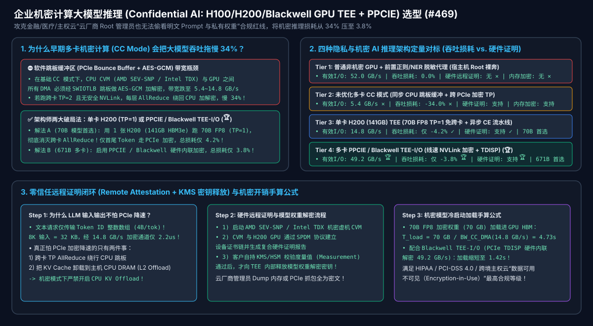

# Enterprise Confidential AI Computing (`NVIDIA H100/H200/Blackwell GPU TEE` + `PPCIE`) Overhead & Compliance Selection Guide (#469)

> **Executive Summary**:
> Regulated banking, healthcare (`HIPAA`), defense, and sovereign cloud deployments increasingly mandate **Encryption-in-Use**: even a compromised cloud hypervisor, root administrator, or physical PCIe bus analyzer must never access plaintext prompts, KV Cache, or proprietary fine-tuned weights. Naively running multi-GPU Tensor Parallelism across basic CPU-GPU bounce buffers (`SWIOTLB AES-GCM`) degrades inference throughput by **`34.0%`**. For **Cloud & AI Solution Architects**, two production patterns eliminate this tax:
> 1. **`70B` Workhorse Models (Recommended Tier 3)**: Fit the entire `70B FP8` model and KV Cache onto a **single `141GB H200 GPU TEE` (`TP=1`)**, eliminating inter-GPU AllReduce encryption traffic and holding end-to-end throughput overhead to **`4.2%`**;
> 2. **`405B / 671B` Frontier Models (Recommended Tier 4)**: Enable **multi-GPU `PPCIE` (Protected PCIe / Encrypted NVLink) or `Blackwell B200 TEE-I/O` (`49.2 GB/s` inline hardware encryption)**, keeping 8-GPU confidential inference overhead at **`3.8%`** with cryptographic remote attestation (`SPDM + NRAS`) gating customer-managed KMS key release.
>
> **⚡ Interactive H5 Study Lab**: [**Open the Confidential AI GPU TEE Overhead & Remote Attestation Sizer (`docs/h5/confidential-ai-gpu-tee-ppcie-overhead-sizer-lab.html`)**](../h5/confidential-ai-gpu-tee-ppcie-overhead-sizer-lab.html)

---

## 1. Core Q&A: Why Text LLMs Run at 96% Native Speed Inside GPU TEEs (If You Avoid Two Traps)

### Q1: Why is token-in/token-out LLM inference naturally suited for GPU TEEs, and what causes the 34% slowdown in naive setups?
- An 8,192-token prompt transfers only **`32 KB`** of `int32` token IDs over PCIe (`2.2 microseconds` at `14.8 GB/s`), while all matrix multiplications stay inside GPU HBM.
- **Two Fatal Traps in Confidential Mode**:
  1. **Running `TP >= 2` without `PPCIE` (Encrypted NVLink)**: Every layer's AllReduce detours through CPU bounce buffers for software AES-GCM encryption/decryption (**-34.0% throughput**). Fix: run `70B FP8` on a single `141GB H200` (`TP=1`) or enable 8-GPU `PPCIE`.
  2. **Enabling L2 Host DRAM KV Cache Offload**: Moving multi-gigabyte KV tensors across encrypted bounce buffers saturates CPU encryption cores. Fix: keep all KV Cache inside GPU HBM.

---

## 2. Quantitative Decision Matrix

| Confidential AI Architecture Tier | Effective Encrypted Host-GPU BW | Multi-GPU AllReduce Penalty | End-to-End Throughput Penalty | Cryptographic Attestation | Weights & KV Encrypted in Use |
| :--- | :--- | :--- | :--- | :--- | :--- |
| **Tier 1: Non-TEE GPU + PII Redaction Proxy** | `52.0 GB/s` | `0.0%` | `0.0%` | No ✕ | No (Host root exposed) ✕ |
| **Tier 2: Naive Multi-GPU CC (Sync Bounce Buffer TP)** | `5.4 GB/s` ✕ | `+48.5%` ✕ | `-34.0%` ✕ | Yes ✓ | Yes ✓ |
| **Tier 3: Single-GPU `H200 (141GB) TEE` (`70B FP8 TP=1`)** | `14.8 GB/s` | **`0.0%` 🏆** | **`-4.2%` ✓** | **Yes 🏆** | **Yes (Best for 70B 🏆)** |
| **Tier 4: Multi-GPU `PPCIE / Blackwell TEE-I/O` (Encrypted NVLink)** | **`49.2 GB/s` 🏆** | **`+4.8%` 🏆** | **`-3.8%` 🏆** | **Yes 🏆** | **Yes (Best for 671B 🏆)** |
