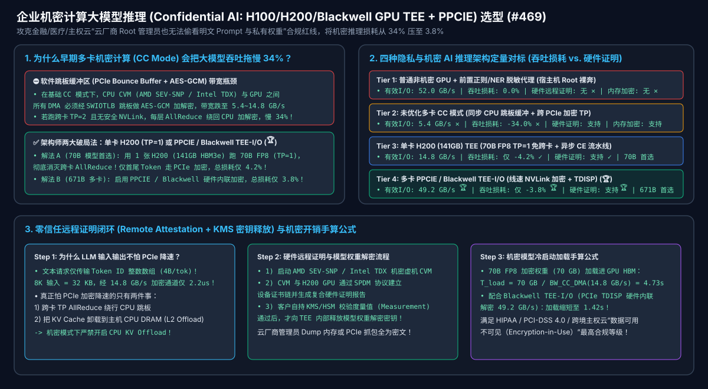
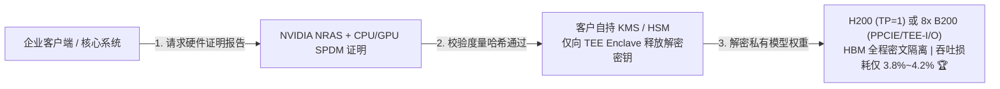

# 企业机密计算大模型推理（`Confidential AI / GPU TEE`）基础设施选型：软件层 PII 脱敏 vs. 单卡 `H200 TEE` vs. 多卡 `PPCIE / Blackwell TEE-I/O` 吞吐损耗手算与金融合规指南 (#469)

> **核心观点（Executive Summary）**：
> 在银行核心账务、医疗病历（`HIPAA`）、军工及跨国主权云（`Sovereign Cloud`）场景中，安全审计团队往往提出终极红线：**“即便公有云宿主机被 Root 提权、或云厂商内部人员物理接触服务器并挂载 PCIe 逻辑分析仪，也绝对不能看到明文 Prompt、明文 KV Cache 与企业私有微调权重（使用中加密 Encryption-in-Use）”**。如果盲目开启早期未优化的多卡机密计算模式（通过 CPU 软件跳板缓冲区 `SWIOTLB Bounce Buffer` 同步加解密每次跨卡通信），推理吞吐会暴跌 **`34.0%`**。作为 **Cloud & AI Solution Architect**，生产级机密 AI 基础设施应采取两条黄金路径：
> 1. **`70B` 级主力模型（推荐 Tier 3）**：选用 **`141GB HBM3e` 的单张 `NVIDIA H200`（`TP=1` 机密模式）**，将整颗 `70B FP8` 模型与 KV Cache 全部锁在单卡受保护显存内，**彻底归零跨卡 AllReduce 加密通信**，端到端吞吐损耗压至仅 **`4.2%`**；
> 2. **`405B / 671B` 巨型多卡模型（推荐 Tier 4）**：启用 **`NVIDIA H200 PPCIE`（Protected PCIe / NVLink 硬件加密）或 `Blackwell B200 TEE-I/O`（硬件内联线速加解密 `49.2 GB/s`）**，将 8 卡机密推理损耗压至 **`3.8%`**，并通过远程证明（Remote Attestation）实现客户自持 KMS 密钥零信任释放。
>
> **⚡ 配套交互式 H5 精读沙盘**：[**打开机密计算 GPU TEE 性能损耗与零信任远程证明手算器 (`docs/h5/confidential-ai-gpu-tee-ppcie-overhead-sizer-lab.html`)**](../h5/confidential-ai-gpu-tee-ppcie-overhead-sizer-lab.html)

---

## 一、 灵魂拷问：为什么文本大模型在 GPU TEE 里几乎不掉速，但一旦踩错两个开关就会掉速 34%？

### Q1：CPU 机密虚机（`AMD SEV-SNP / Intel TDX`）与 GPU TEE（`H100/H200/B200`）之间的数据是怎么加密传输的？
1. **为什么 PCIe 总线是攻击者的高危窃听点？**
   - CPU 内存由 `SEV-SNP / TDX` 硬件内存控制器加密，GPU HBM 显存由 GPU 内部安全处理器（`GSP`）隔离保护；但连接两者的 **物理 PCIe 总线与宿主机 Hypervisor** 默认处于不可信域（Untrusted Host）。
2. **Bounce Buffer（跳板缓冲）与 Copy Engine 加密机制**：
   - 在 Hopper（`H100/H200`）单卡 CC 模式下，CPU 机密虚机先在受保护内存中用 `AES-GCM-256` 加密数据，再拷贝到共享未加密跳板缓冲区（`SWIOTLB Bounce Buffer`），由 GPU 硬件拷贝引擎（`CE`）拉取并在卡内硬件解密：
     $$\text{BW}_{\text{CC\_PCIe}} = \begin{cases} 5.4\text{ GB/s} & (\text{同步单流未流水化}) \\ 14.8\text{ GB/s} & (\text{异步双緩衝 DMA 流水化}) \\ 49.2\text{ GB/s} & (\text{Blackwell TEE-I/O 硬件内联 TDISP}) \end{cases}$$

### Q2：为什么纯文本 LLM 推理在单卡 `H200 TEE` 上只慢 `4.2%`，一旦踩中哪两个坑就会暴跌 `34%+`？
- **文本 LLM 的天然优势（I/O 极度稀疏）**：
  - 一次 8,192 Token 的输入 Prompt，从 CPU 传给 GPU 的只是 `8192` 个 `int32` Token ID（仅 **`32 KB`**！），即便按 `14.8 GB/s` 加密传输也只需 **`2.2 微秒`**！整个 Prefill 与 Decode 的万亿次矩阵乘法全部在 GPU HBM 内部闭环完成，根本不走 PCIe！
- **绝对不能踩的两个性能深坑**：
  - **深坑 1（无 `PPCIE` 时跑多卡 `TP`）**：如果在未开启安全 NVLink（`PPCIE`）的情况下用 2 张 `80GB H100` 跑 `70B`（`TP=2`），每层 2 次 AllReduce 激活张量必须先在卡 0 加密 $\rightarrow$ 经 PCIe 传回 CPU $\rightarrow$ 再经 PCIe 传给卡 1 解密，直接把吞吐拖垮 **`34.0%`**！**解法：直接用单张 `141GB H200` 跑 `70B FP8 (TP=1)`，或开启 8 卡 `PPCIE` 安全 NVLink 域！**
  - **深坑 2（在机密模式下开启 L2 CPU DRAM KV Cache Offload）**：把几 GB 的 KV Cache 频繁通过加密 Bounce Buffer 往返搬运，会瞬间打爆 CPU AES 加解密核！**解法：机密模式下强制关闭 CPU KV Offload，全部 KV 驻留 HBM。**

---

## 二、 四种隐私与机密 AI 推理架构选型决策矩阵（Decision Matrix）

| 机密计算架构档位 | 主机至 GPU 有效加密带宽 | 多卡 AllReduce 额外开销 | 端到端推理吞吐折损 (%) | 密码学远程证明 (Attestation) | 权重与 KV 使用中加密 |
| :--- | :--- | :--- | :--- | :--- | :--- |
| **Tier 1: 普通非机密 GPU + 前置正则/NER 脱敏代理** | `52.0 GB/s` | `0.0%` | `0.0%` | 不支持 ✕ | 不支持（宿主机可 Dump）✕ |
| **Tier 2: 未优化多卡 CC 模式（同步 Bounce Buffer + 跨 PCIe TP）** | `5.4 GB/s` ✕ | `+48.5%` ✕ | `-34.0%` ✕ | 支持 ✓ | 支持 ✓ |
| **Tier 3: 单卡 `H200 (141GB) TEE`（`70B FP8 TP=1` 免跨卡 + 异步 DMA）** | `14.8 GB/s` | **`0.0%` 🏆** | **`-4.2%` ✓** | **支持 🏆** | **支持（70B 性价比首选 🏆）** |
| **Tier 4: 多卡 `PPCIE / Blackwell TEE-I/O`（线速安全 NVLink）** | **`49.2 GB/s` 🏆** | **`+4.8%` 🏆** | **`-3.8%` 🏆** | **支持 🏆** | **支持（671B 旗舰首选 🏆）** |

---

## 三、 生产落地核对清单（SA Production Checklist）

- [ ] **单卡 H200 消除跨卡税**：对于 `70B/72B` 模型机密推理，优先选用单张 `141GB H200`（如 Azure `NCC H100/H200 v5` 机密实例）以 `TP=1` 运行，避免多卡通信加密开销。
- [ ] **严禁开启 CPU KV Offload**：在机密计算 Pod 的 `vLLM / SGLang` 启动参数中显式禁用 `--cpu-offload-gb` 与 L2 DRAM KV 缓存卸载，防止加密 PCIe 跳板成为瓶颈。
- [ ] **模型镜像先加密再落盘**：容器镜像中严禁打包明文权重，模型文件必须使用 `AES-GCM` 预加密存储在对象存储中；容器启动后必须先通过 `SPDM / NRAS` 远程证明校验，才从客户自管 KMS 拉取解密密钥直接解密进受保护内存。

---

## 四、 延伸阅读与配套工具

- **交互式 H5 精学沙盘**：[docs/h5/confidential-ai-gpu-tee-ppcie-overhead-sizer-lab.html](../h5/confidential-ai-gpu-tee-ppcie-overhead-sizer-lab.html)
- **7-Card 4:5 视觉评测卡片**：[docs/reports/enterprise-confidential-ai-gpu-tee-h200-blackwell-ppcie-overhead-selection-cards.html](../reports/enterprise-confidential-ai-gpu-tee-h200-blackwell-ppcie-overhead-selection-cards.html)
- **交互式 Sizer 测算器**：[docs/reports/enterprise-confidential-ai-gpu-tee-h200-blackwell-ppcie-overhead-selection-sizer.html](../reports/enterprise-confidential-ai-gpu-tee-h200-blackwell-ppcie-overhead-selection-sizer.html)
- **可复现实验模型**：[`experiments/enterprise_confidential_ai_gpu_tee_h200_blackwell_ppcie_overhead_selection/run.py`](../../experiments/enterprise_confidential_ai_gpu_tee_h200_blackwell_ppcie_overhead_selection/run.py)
