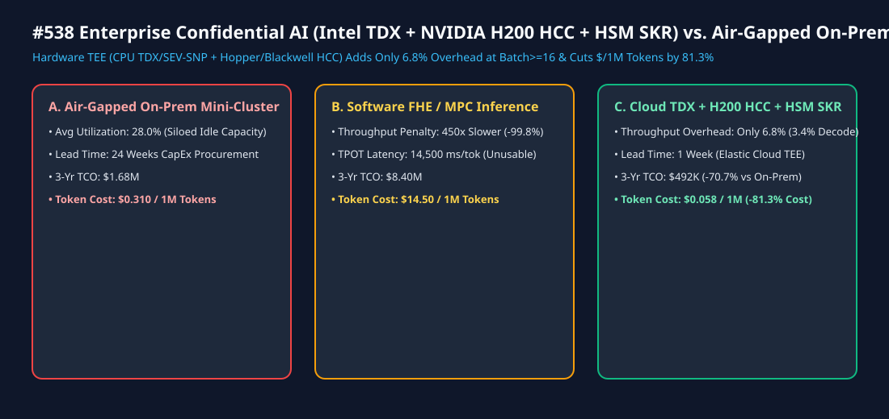

# Enterprise Sovereign & Confidential AI (`Intel TDX / AMD SEV-SNP + NVIDIA H200 HCC + NRAS Attestation + HSM SKR`) vs. Air-Gapped On-Prem TCO Selection Guide (`#538`)

> **Language / 语言**: [简体中文](./enterprise-confidential-gpu-tdx-h200-hcc-attestation-tco-sizing-faq.md) | **English** · [📱 Interactive H5 Study Lab](../h5/confidential-gpu-tdx-h200-hcc-attestation-lab.html) · [🧮 Interactive Sizer](../reports/enterprise-confidential-gpu-tdx-h200-hcc-attestation-tco-sizing-sizer.html) · [🃏 7-Card Deck](../reports/enterprise-confidential-gpu-tdx-h200-hcc-attestation-tco-sizing-cards.html) · [Back to Catalog](../full-catalog-en.md)

---

## 1. Executive Summary (3-Minute Read)

1. **Why Siloed Air-Gapped On-Prem Mini-Clusters Suffer `28.0%` Utilization and `$0.310 / 1M Tokens` TCO**:
   - Regulated workloads (sovereign government, defense, core banking, pharma IP) require cryptographic guarantees that cloud hypervisor operators cannot inspect model weights or plaintext prompts. Building dedicated air-gapped on-prem mini-clusters takes **24 weeks** and averages **`28.0%` utilization**, driving 3-year TCO to **`$1.68M` (`$0.310 / 1M tokens`)**, while software FHE/MPC incurs a **`450x` latency penalty**.
2. **Hardware Confidential GPU (`Intel TDX / AMD SEV-SNP + NVIDIA H100/H200 HCC + NRAS + HSM SKR`)**:
   - Encryption overhead occurs only on PCIe bounce-buffer transfers between the CPU TEE and GPU TEE, while HBM3e and Tensor Cores run at full native speed. At `Batch >= 16` on a 70B LLM, end-to-end throughput overhead is just **`6.8%` (`3.4%` in Decode)**, cutting 3-year TCO by **`-70.7%` (`$492K`)** and token cost by **`-81.3%` (`$0.058 / 1M tokens`)** with **1-week** deployment.

---

## 2. Quantitative Architecture Decision Matrix

| Metric | Scheme A: Air-Gapped On-Prem Mini-Cluster | Scheme B: Software FHE / MPC Inference | Scheme C: Cloud Confidential GPU (`TDX + H200 HCC + SKR`) |
| :--- | :--- | :--- | :--- |
| **Throughput Overhead** | `0.0%` | `-99.78%` (`450x` slower) | **`6.8%` (`3.4%` for 70B Decode)** |
| **Average Cluster Utilization** | `28.0%` | `95.0%` | **`78.5%` (Elastic Cloud TEE)** |
| **Deployment Lead Time** | `24 weeks` | `4 weeks` | **`1 week`** |
| **3-Year TCO** | `$1,680,000` | `$8,400,000` | **`$492,000` (`-70.7%` vs. On-Prem)** |
| **Cost per 1M Tokens (`$/1M`)** | `$0.310` | `$14.500` | **`$0.058` (`-81.3%` cost)** |
