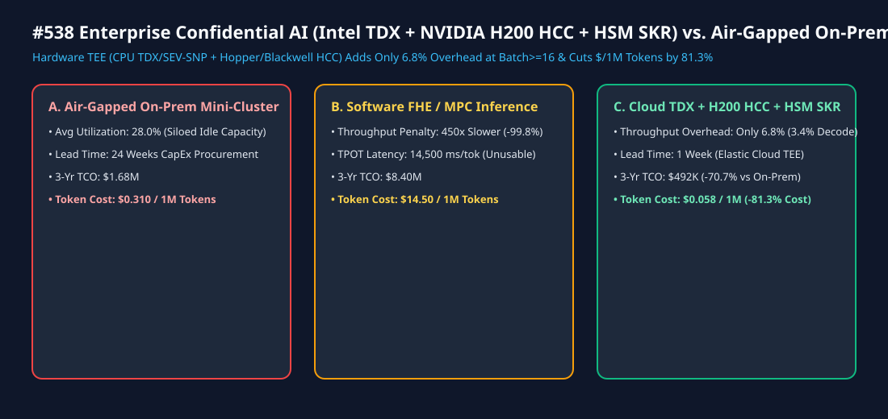
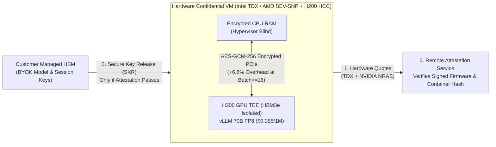

# 企业主权云与机密计算大模型推理（`Intel TDX / AMD SEV-SNP + NVIDIA H100/H200 HCC + NRAS 远程证明 + HSM SKR`）架构与 TCO 选型指南（`#538`）

> **Language / 语言**: **简体中文** | [English](./enterprise-confidential-gpu-tdx-h200-hcc-attestation-tco-sizing-faq.en.md) · [📱 交互式 H5 精读页](../h5/confidential-gpu-tdx-h200-hcc-attestation-lab.html) · [🧮 交互式算卡器 Sizer](../reports/enterprise-confidential-gpu-tdx-h200-hcc-attestation-tco-sizing-sizer.html) · [🃏 7-Card 评测报告](../reports/enterprise-confidential-gpu-tdx-h200-hcc-attestation-tco-sizing-cards.html) · [返回总目录](../full-catalog-zh.md)

---

## 一、3 分钟核心结论卡片（Executive Summary）

1. **核心矛盾：当银行核心风控、军工制造、跨国药企或政府主权部门要求“云厂商宿主机管理员（Hypervisor Root）也绝不能窥探模型权重与明文 Prompt”时，必须花 24 周自建低利用率（`28%`）物理隔离小机房吗？**
   - 过去由于 GPU 缺乏硬件级可信执行环境（TEE），涉密业务上云面临两难：若自建物理断网小集群（`Air-Gapped On-Prem`），不仅采购交付长达 **24 周**，且因单部门潮汐流量导致日均 GPU 利用率仅 **`28.0%`**，三年 TCO 高达 **`$1.68M`（折合 `$0.310 / 1M Tokens`）**；而纯软件全同态加密（`FHE / MPC`）会有 **`450 倍` 延迟惩罚**，完全无法用于交互式大模型。
2. **硬件机密计算（`Confidential GPU: Intel TDX / AMD SEV-SNP + NVIDIA Hopper/Blackwell HCC + 远程证明 SKR`）颠覆性选型结论**：
   - **仅 `6.8%` 的端到端吞吐损耗（70B Decode 阶段仅 `3.4%`）**：在 `NVIDIA H100 / H200 / B200` 硬件机密计算模式（`HCC`）下，GPU 显存（HBM3e）内部计算完全保持原生 Tensor Core 速度，性能损耗仅发生在 **CPU TEE 与 GPU TEE 之间跨越 PCIe 总线时的 Bounce Buffer AES-GCM-256 硬件加解密**。对于 70B 大模型 `Batch >= 16` 的生产负载，PCIe 仅传输极小的 Token IDs，端到端吞吐损耗仅 **`6.8%`（Decode 阶段仅 `3.4%`）**；
   - **密码学零信任证明与密钥释放（`NRAS + MAA + HSM SKR`）**：客户端与模型镜像启动时，先由硬件芯片签发 `CPU TDX Quote + GPU SPDM/NRAS 证明报告`，仅当度量哈希（Measurement Hash）完全匹配经审计的无日志固件与容器镜像时，企业自有硬件加密机（`Azure Managed HSM / BYOK`）才通过 **安全密钥释放（SKR）** 将模型权重解密密钥与请求会话密钥直接注入 TEE 内存，云厂商宿主机 Root 只能看到密文乱码——**1 周极速上线**，三年 TCO 降至 **`$492K`（降低 `70.7%`）**，每百万 Token 成本降至 **`$0.058`（立省 `81.3%`）**！

---

## 二、典型业务场景与灵魂拷问 Q&A

### Q1：为什么机密 GPU（`Confidential GPU`）在跑小模型单并发（`Batch = 1`）时损耗可能达到 `20%+`，而在 70B 生产连续批处理（`Batch >= 16`）下损耗骤降至 `3.4%–6.8%`？
- **答**：机密 GPU 的加解密发生在 **CPU-GPU PCIe 传输边界（DMA Bounce Buffer）**。当 `Batch=1` 或频繁在 CPU 与 GPU 之间拷贝大张量（如未优化的多模态原始大图）时，PCIe 加密拷贝占比较高；而在 `vLLM / TensorRT-LLM` 运行 70B 大模型且 `Batch >= 16` 时，`99.9%` 的数据移动发生在 GPU 芯片内部受硬件保护的 HBM3e 与 SRAM 之间，跨 PCIe 的只有几十字节的 Token IDs，因此硬件 TEE 开销几乎被完全摊薄！

### Q2：多卡张量并行（如 `8×H200 TP=8`）在机密计算模式下，跨 NVLink 的通信安全如何保障？
- **答**：`NVIDIA Hopper / Blackwell Confidential Computing (PPCIE / Multi-GPU TEE)` 支持通过 NVLink 硬件加密引擎（NVLink Encryption）与 SPDM 双向设备身份认证，在机内 8 卡 NVSwitch 域内建立硬件加密通道，既保护跨卡 AllReduce 激活值不被物理探针窃听，又保留高带宽多卡并行能力。

---

## 三、三大涉密/主权大模型部署方案定量对比矩阵

| 评估维度 | 方案 A：自建物理断网小集群（`Air-Gapped On-Prem`） | 方案 B：纯软件同态加密 / 多方安全计算（`FHE / MPC`） | 方案 C：云端硬件机密计算（`TDX/SEV-SNP + H200 HCC + SKR`） |
| :--- | :--- | :--- | :--- |
| **硬件/算法推理吞吐损耗** | `0.0%`（原生硬件） | `-99.78%`（慢 `450 倍`，TPOT `14.5s`） | **`6.8%`（70B Decode 仅 `3.4%`）** |
| **集群平均有效利用率** | `28.0%`（烟囱式孤岛闲置严重） | `95.0%`（算力全耗在密码学膨胀） | **`78.5%`（云端弹性扩缩容）** |
| **交付上线周期** | `24 周`（机房改造+招投标+上架） | `4 周` | **`1 周`（云端现成机密实例如 Azure NCC H100/H200 v5）** |
| **3 年总拥有成本 (`3-Yr TCO`)** | `$1,680,000` | `$8,400,000` | **`$492,000`（比自建省 `70.7%`）** |
| **每百万 Token 综合成本 (`$/1M`)** | `$0.310 / 1M Tokens` | `$14.500 / 1M Tokens` | **`$0.058 / 1M Tokens`（立省 `81.3%`）** |

---

## 四、生产落地核对清单（Pre-Production Checklist）

- [ ] **开启容器镜像完整性度量（`dm-verity` / Confidential Containers `CoCo`）并禁用容器内 SSH 与标准输出明文日志**，确保远程证明策略具备密码学不可篡改性。
- [ ] **模型权重盘采用加密镜像，解密密钥托管在客户独占的硬件 HSM（`BYOK + SKR` 策略绑定 `x-ms-sevsnpvm-hostdata` 与 `NVIDIA NRAS` 状态）**。
- [ ] **在 `vLLM` 中启用 CUDA Graphs 与批量 Token 传输优化**，减少小包 PCIe 往返次数，将机密计算损耗稳定控制在 `< 7%`。
