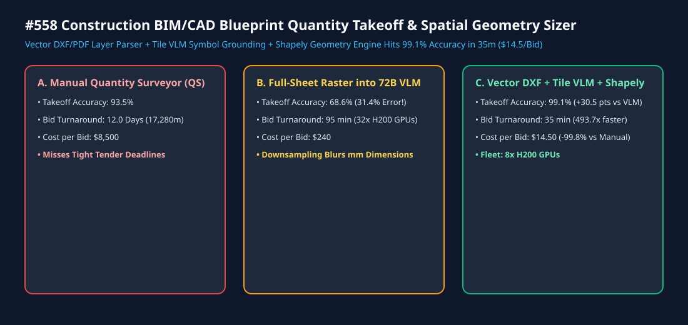

# Enterprise Construction & Infrastructure BIM/CAD Quantity Takeoff: `Manual QS` vs. `Full-Sheet Raster 72B VLM` vs. `Vector DXF/PDF Parser + Tile VLM + Deterministic Shapely Geometry Engine` (`#558`)

> **Language / 语言**: [简体中文](./enterprise-construction-bim-cad-quantity-takeoff-geometry-sizing-faq.md) | **English** · [📱 Interactive H5 Study Lab](../h5/construction-bim-cad-quantity-takeoff-geometry-lab.html) · [🧮 Interactive Sizer](../reports/enterprise-construction-bim-cad-quantity-takeoff-geometry-sizing-sizer.html) · [🃏 7-Card Deck](../reports/enterprise-construction-bim-cad-quantity-takeoff-geometry-sizing-cards.html) · [Back to Catalog](../full-catalog-en.md)

---

## 1. Executive Summary (3-Minute Read)

1. **Why Rasterizing Full `A0` Blueprints into a `72B VLM` Causes `31.4%` Quantity Errors While Manual Quantity Surveying (`QS`) Takes `12 Days` (`$8,500 / Bid`)**:
   - Downsampling an `A0` architectural/MEP blueprint (`1189mm × 841mm`) into a VLM vision encoder blurs millimeter-scale dimension callouts and yields only **`68.6%` takeoff accuracy**.
2. **The `Vector DXF/PDF Layer Parser + Sliding-Tile VLM Symbol Grounding + Deterministic Shapely/PostGIS Geometry Engine` Architecture**:
   - Extracts exact vector polylines and scale bars from native `DXF / DWG / Vector-PDF` layers, applies high-resolution sliding-window `YOLOv11-OBB + 7B VLM` symbol/legend matching on scanned sheets, and computes exact wall/slab/duct areas and window cutouts via **deterministic `Shapely / PostGIS` computational geometry** — achieving **`99.1%` quantity takeoff accuracy (`+30.5 pts`)** and finishing bids in **`35 minutes` (`493.71x` faster than manual)** at **`$14.50 / bid` (`-99.8%` cost)** on **8x H200 GPUs**!

---

## 2. Quantitative Architecture Decision Matrix

| Metric | Scheme A: Manual Quantity Surveyor (`QS`) | Scheme B: Full-Sheet Raster `72B VLM` | Scheme C: `Vector DXF + Tile VLM + Shapely Geometry` |
| :--- | :--- | :--- | :--- |
| **Quantity Takeoff Accuracy** | `93.5%` | `68.6%` (`31.4%` error) | **`99.1%` (`+30.5 pts` vs. Raster VLM)** |
| **Bid Turnaround Time** | `17,280 min (12d)` | `95.0 min` | **`35.0 min` (`493.71x` faster vs. Manual)** |
| **Cost per Commercial Bid** | `$8,500.00` | `$240.00` | **`$14.50` (`-99.8%` vs. Manual)** |
| **Required H200 GPUs** | `0 GPUs` | `32 GPUs` | **`8 GPUs` (`-75.0%` vs. Raster 72B)** |
