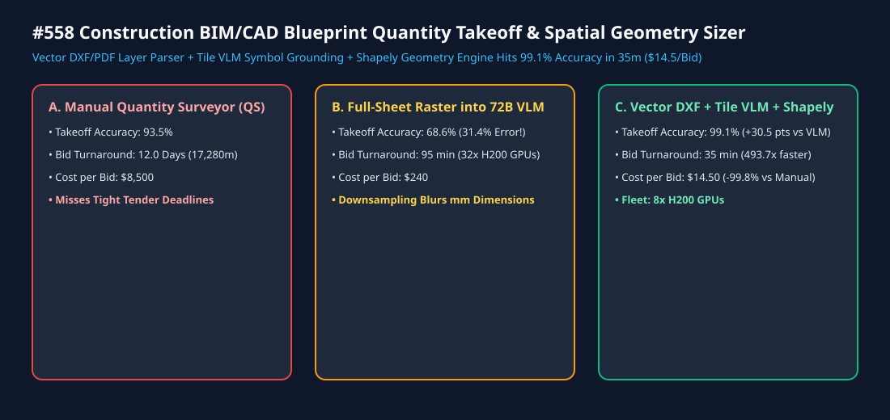

# 企业工程建设、地产基建 `BIM/CAD` 招投标算量与工程造价清单（`Quantity Takeoff`）架构选型：人工造价师 vs. 整图光栅化喂 `72B VLM` vs. `DXF/矢量 PDF 解析 + 切片 VLM 图例识别 + Shapely 确定性几何引擎`（`#558`）

> **Language / 语言**: **简体中文** | [English](./enterprise-construction-bim-cad-quantity-takeoff-geometry-sizing-faq.en.md) · [📱 交互式 H5 精读页](../h5/construction-bim-cad-quantity-takeoff-geometry-lab.html) · [🧮 交互式算卡器 Sizer](../reports/enterprise-construction-bim-cad-quantity-takeoff-geometry-sizing-sizer.html) · [🃏 7-Card 评测报告](../reports/enterprise-construction-bim-cad-quantity-takeoff-geometry-sizing-cards.html) · [返回总目录](../full-catalog-zh.md)

---

## 一、3 分钟核心结论卡片（Executive Summary）

1. **核心矛盾：为什么把一张 `A0` 建筑施工图直接转成一张图片塞进 `72B VLM` 算钢筋混凝土面积与暖通管线长度会产生 `31.4%` 的致命工程量误差（准确率仅 `68.6%`），而传统造价工程师（QS）手工扒图算量一份标书要花 `12 天`（`$8,500/标`）？**
   - 一张 `A0` 建筑结构或机电（MEP）蓝图尺寸达 `1189mm × 841mm`，包含数千处 `2mm` 字高的毫米级尺寸标注与图例符号。若整图光栅化缩放进 VLM 视觉编码器（通常限制在 `1024–2048px`），毫米标注全部糊成马赛克，且让 VLM 用肉眼估算多边形房间面积误差高达 **`31.4%`**！
2. **三级矢量优先 + 高清滑动切片 VLM 图例对齐 + `Shapely/PostGIS` 确定性空间几何算量黄金架构**：
   - **第一阶段（原生 `DXF / DWG / 矢量 PDF` 图层与折线顶点提取）**：直接读取矢量图层（如 `A-WALL`、`M-DUCT`）的精确 `(x, y)` 浮点坐标与比例尺（Scale Bar）；
   - **第二阶段（对扫描版蓝图采用滑动高分辨率图块 `Tile VLM + YOLOv11-OBB` 识别阀门/灯具/消防喷头图例并对齐图纸文字说明）**；
   - **第三阶段（确定性 `Shapely / PostGIS` 空间多边形面积/周长/扣减门窗洞口几何计算 + 国标工程量清单计价定额映射）**：算量准确率高达 **`99.1%`（比整图 VLM 高 `+30.5 pts`）**，单份大型标书算量耗时从 `12 天（17,280 分钟）` 缩短至 **`35 分钟`（提速 `493.71x`）**，单标成本从 `$8,500` 暴降至 **`$14.50`（降低 `99.8%`）**，仅需 **8 张 H200**！

---

## 二、三大建筑工程 BIM/CAD 招投标算量架构定量对比矩阵

| 评估维度 | 方案 A：传统造价师（QS）手工扒图算量 | 方案 B：整张 A0 蓝图光栅化直喂 `72B VLM` | 方案 C：`矢量解析 + 高清切片 VLM + Shapely 几何引擎`（推荐） |
| :--- | :--- | :--- | :--- |
| **工程量计算准确率 (`Takeoff Accuracy`)** | `93.5%`（人工漏数图例/疲劳误差） | `68.6%`（缩放模糊 + 视觉估面积失真） | **`99.1%`（比整图 VLM 提升 `+30.5 pts`）** |
| **单份大型工程标书算量耗时** | `17,280 分钟（12.0 天）` | `95.0 分钟` | **`35.0 分钟`（比人工快 `493.71x`）** |
| **单份标书算量综合成本** | `$8,500.0 / 标` | `$240.0 / 标` | **`$14.5 / 标`（比人工省 `99.8%`）** |
| **所需 H200 GPU 卡数** | `0 张` | `32 张 H200` | **`8 张 H200`（立省 `75.0%` GPU）** |
