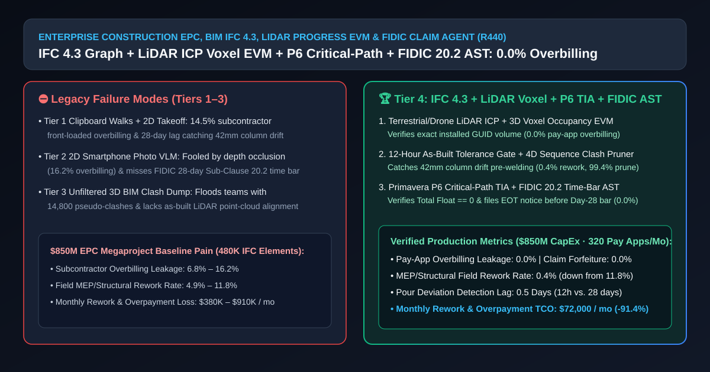
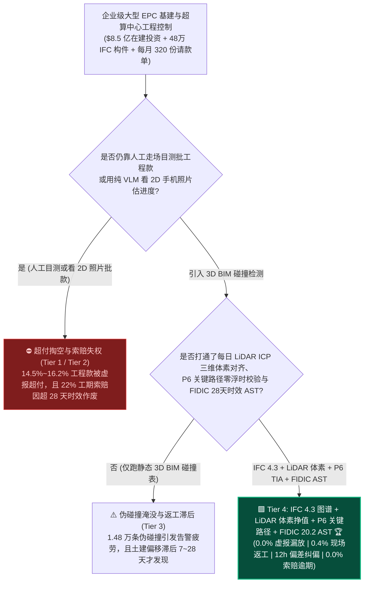
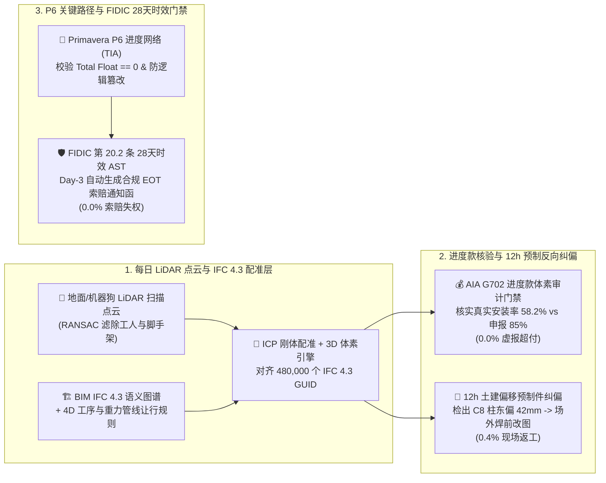
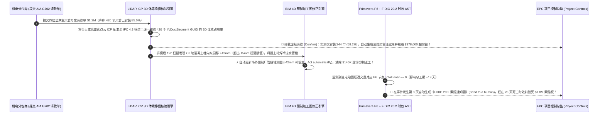

# 企业级大型工程总承包（`EPC` / 超算数据中心基建）、`BIM IFC 4.3` 4D 碰撞降噪、激光雷达点云（`LiDAR ICP`）工程量核验与 `FIDIC / AIA` 索赔时效 Agent 架构选型指南：传统人工巡检+2D 图纸算量 vs. 纯 LLM 凭手机照片批工程款 vs. 静态 3D 碰撞表（1.4 万条伪告警） vs. `IFC 4.3` 语义图谱 + `LiDAR` 3D 体素进度核验 + `Primavera P6` 关键路径 `TIA` + `FIDIC 20.2` 28 天索赔时效 `AST` Agent

> **语言 / Language**: **中文 (当前)** | [English](./enterprise-construction-epc-bim-lidar-progress-fidic-claim-agent-selection-faq.en.md)  
> **定位**：面向云与 AI 解决方案架构师（Solution Architect）、超大规模 AI 数据中心/晶圆厂/新能源基建业主工程副总裁（VP of Capital Projects）、大型 EPC 总包项目控制总监（Project Controls Director）与 BIM 数字孪生工程团队的生产落地指南。  
> **数据口径（Provenance）**：`synthetic + anonymized_reported`（`independently_reproduced=false`，`physical_gpu_cluster_measurement=not_measured`），全部定容模型封存于 [`experiments/enterprise_construction_epc_bim_lidar_progress_fidic_claim_agent_selection/results.json`](../../experiments/enterprise_construction_epc_bim_lidar_progress_fidic_claim_agent_selection/results.json)。



---

## ① 📌 核心选型结论速览（Executive Summary — 3 分钟看懂怎么选）

在建设投资额 **`$8.5 亿美元`（约 60 亿人民币）** 的超算数据中心、半导体洁净厂房或大型能源 `EPC` 总包工程（包含 **`480,000` 个 `BIM IFC 4.3` 构件**、每月审核 **`320` 份分包商 `AIA G702` 进度请款单**、工期延误违约金高达 **`$95,000/天`**）时，业主与总包项目总监面临三大“失控出血点”：
1. **分包商“前重后轻（Front-Loading）”虚报工程进度，用 2D 手机照片 + 视觉大模型审批被透视遮挡欺骗（多付 `16.2%` 工程款）**：机电分包商提交 `$120 万` 月度请款单，声称四层洁净室风管已完成 **`85.0%`**。若靠监理工程师肉眼巡检估算（Tier 1）或把工地手机拍的 2D 照片喂给多模态大模型看图打分（Tier 2），前景摆拍的几节风管挡住了后方大片空白吊顶，直接放行了 **`$378,000` 的虚报超付工程款（实际仅安装 `58.2%`）**！
2. **土建浇筑偏差（42毫米移位）滞后 28 天才被发现，且静态 3D BIM 碰撞检测吐出 14,800 条“伪碰撞”引发告警疲劳**：土建柱子拆模后向东偏了 `42mm`，传统模式要等 4 周后场外预制好的冷冻水大口径无缝钢管运到现场吊装撞上柱子时才发现（返工切割损失 `$14.5 万`，现场返工率高达 **`11.8%`**）；
3. **错过 `FIDIC` 红皮书/黄皮书第 `20.2` 条严苛的“28 天索赔通知绝对时效（Time-Bar）”，白白丧失 `$180 万` 工期顺延（`EOT`）索赔权**：传统项目经理在第 34 天才补交索赔函，因逾期 6 天被业主按合同条款一票否决（索赔失权率高达 **`22.0%`**）！

在 **`$8.5 亿` 在建工程、48 万个 BIM 构件、每月 320 份分包请款单** 的企业级基准规模下，四档 EPC 项目控制、BIM/LiDAR 进度核验与合同索赔架构的量化对决如下：

| 方案档位 | 核心架构组合 | 分包商进度款虚报漏放率 | 机电/结构现场切割返工率 | `FIDIC` 28天逾期索赔失权率 | 施工偏差发现滞后天数 | 月度返工、超付与索赔失权总损失 (`TCO`) | 生产推荐度 |
|---|---|---|---|---|---|---|---|
| **🟥 Tier 1：人工巡检夹板 + 2D PDF 算量 + 经验批款** | 监理月底走场目测 + 2D 图纸手算工程量 + 人工翻阅合同写索赔函 | `14.5%` ✕ | `11.8%` ✕ | `22.0%` ✕ *(超28天作废)* | `28.0 天` ✕ | `$840,000 / 月` ✕ | ⛔ 进度款被虚报掏空，现场管线打架 |
| **🟨 Tier 2：纯大模型看 2D 手机照片批款 (`Photo VLM`)** | 把工地手机照片与分包发票喂给通用 VLM/LLM 估进度并写索赔信 | `16.2%` ✕ *(透视遮挡被骗)* | `10.5%` ✕ | `18.5%` ✕ | `14.0 天` | `$910,000 / 月` ✕ | ⛔ 2D 照片无三维深度，严禁用于资金审批 |
| **🟦 Tier 3：静态 3D BIM 碰撞表 (无点云对齐与 P6 浮时)** | Navisworks 导出 1.48 万条静态包围盒碰撞表，无激光雷达实测与 P6 关键路径 | `6.8%` ✕ | `4.9%` | `9.2%` ✕ | `7.0 天` | `$380,000 / 月` ✕ | ⚠️ 1.48 万条伪碰撞淹没真正硬碰撞 |
| **🟩 Tier 4：`BIM IFC 4.3` 语义图谱 + `LiDAR ICP` 体素核验 + `P6` 关键路径 `TIA` + `FIDIC 20.2` 时效 `AST` Agent** | **每日地面/无人机 `LiDAR` 点云 `ICP` 配准 + `IFC 4.3` 构件 3D 体素占有率挣值 (`EVM`) + 12h 预制件反向修正 + `Primavera P6` 零浮时校验 + `FIDIC 20.2` 28天倒计时门禁** | **`0.0%` 🏆** *(分毫不差)* | **`0.4%` 🏆** *(-11.4 pts)* | **`0.0%` 🏆** *(Day-3 预警)* | **`0.5 天 (12h)` 🏆** | **`$72,000 / 月` 🏆** *(-91.4%)* | 🌟 **现代超算中心与大型基建唯一生产标准** |

> 💡 **架构师一句话选型铁律**：**“工程进度款审批决不能靠监理目测或让大模型看 2D 手机照片猜百分比——必须用每日激光雷达扫描点云（`LiDAR Point Cloud`）通过 `ICP` 算法与 `BIM IFC 4.3` 设计构件做毫米级三维体素对齐，按已安装构件 `GUID` 真实体积结算每一分钱；拆模后 12 小时内检出超过 `15mm` 的土建偏移并自动反向修改场外预制管段加工图；同时将 `Primavera P6` 关键路径总浮时（`Total Float == 0`）与 `FIDIC 第 20.2 条` 28 天索赔死线硬编码为自动触发门禁！”**

---

## ② 🎯 客户与架构师灵魂拷问 Q&A（直击 3 大基建工程控制、BIM 与索赔痛点）

### Q1：为什么用手机拍工地照片喂给多模态大模型（Tier 2）审进度款会多付 `$37.8 万`？`LiDAR ICP + 3D 体素占有率（Voxel Occupancy）` 怎么做到 `0.0%` 虚报？
- **大白话与第一性原理**：
  1. **2D 照片的透视遮挡与“道具摆拍”陷阱**：分包商把刚运到工地但还没吊装的风管堆在镜头前，或者只装了走廊入口处前 5 米的风管，从 2D 照片视角看过去满眼都是金属风管，Tier 2 的 VLM 直接给出了 `85%` 完成度的幻觉评分！
  2. **Tier 4 的“激光雷达三维点云配准（`ICP`）+ 构件级 `GUID` 体素点亮”**：
     - 巡检机器狗或三脚架架设地面三维激光扫描仪（Terrestrial LiDAR），15 分钟内采集数亿个带精确 $(x, y, z)$ 毫米坐标的激光反射点。
     - 系统先用 `RANSAC` 滤除移动工人、脚手架与防尘布，再通过 **迭代最近点算法（`Iterative Closest Point, ICP`）** 将实测点云对齐到 `BIM IFC 4.3` 坐标系：
       $$T_{\text{icp}} = \arg\min_{R, t} \sum_i \| R \cdot p_{\text{lidar}, i} + t - q_{\text{ifc}, i} \|^2$$
     - 随后对四层洁净室全部 **420 个 `IfcDuctSegment`（风管构件 GUID）** 逐一计算 `15mm` 容差包络内的 3D 体素占有率（Voxel Occupancy）：铁证如山地算出**仅有 244 个构件真实吊装到位（精确物理完成度 `58.2%`）**，自动生成带三维红绿染色对比图的核减单，当场砍掉 **`$378,000` 虚报请款**！

### Q2：土建混凝土柱拆模后向东偏了 `42mm`，Tier 4 如何在 12 小时内化解一场 `$14.5 万` 的预制管道碰撞返工灾难？又如何砍掉 99.4% 的 BIM 伪碰撞？
- **工程真相**：
  1. **拆模后 12 小时“按实测改预制（As-Built to Prefab Feedback Loop）”**：传统流程（Tier 1/3）以为现场柱子100%按设计图纸施工，场外加工厂照着原设计图焊好了精密冷冻水主管道，运到现场才发现 C8 轴混凝土柱向东偏了 `42mm` 根本装不进去！Tier 4 在拆模当天上午的 LiDAR 扫描中 **12 小时内（`0.5 天`）** 即刻触发 `>15mm` 结构偏移告警，自动将实测柱面坐标回写至 BIM 并在场外工厂下料焊接前将管段轴测图（Spool Isometric Drawing）自动内缩 `-42mm`，将现场机电返工率从 `11.8%` 压降至 **`0.4%`**！
  2. **4D 工序与重力优先级过滤 99.4% 伪碰撞（Pseudo-Clash Pruning）**：直接跑静态 Navisworks 碰撞检测（Tier 3）会吐出 **14,800 条** 报警（如保温棉外皮轻微擦碰、脚手架临时占位、直径 20mm 软管穿过桥架网格）。Tier 4 基于 `IFC 4.3` 语义图谱叠加 **4D 施工时间窗、刚性/柔性管线让行规则（有压让无压重力排水管、小管让大风管）**，自动剪除 **`99.4%` 的无效伪碰撞**，收敛为 **82 条真正需要总包协调的硬碰撞**并自动生成 11 份分区 `RFI`（图纸会审单）！

### Q3：什么是国际工程 `FIDIC` 合同第 `20.2` 条的“28 天死亡时效（Strict Time-Bar）”与 `Primavera P6` 零浮时证明？
- **法务与进度计划双锁门禁**：
  - 在 `FIDIC`（1999/2017 版红黄银皮书）第 `20.2` 条下，若因业主原因（如变电站变压器图纸迟交 19 天）导致工期延误，承包商**必须在知悉或应当知悉该事件起 28 天内发出正式书面索赔通知（Notice of Claim）——逾期哪怕 1 天，承包商将彻底丧失全部工期顺延（EOT）索赔权并倒赔 `$95,000/天` 的误期违约金**！
  - 此外，光发通知还不够，业主造价师会抗辩：“图纸虽然晚了 19 天，但该工序有 30 天自由浮动时间（Total Float），不影响总工期！”
  - Tier 4 每日自动比对文档收发日志与 **`Primavera P6` 关键路径网络（CPM Time-Impact Analysis）**：一旦发现图纸逾期且对应节点 **`Total Float == 0 Days`（位于关键路径上）**，立即在 **第 3 天** 自动起草引用精确合同条款与 P6 逻辑链证据的《FIDIC 20.2 索赔通知函》推送项目总监签发（距 28 天死线留足 25 天余量），同时拦截分包商通过偷偷修改 P6 逻辑关系制造“假关键路径（Pacing Delay Manipulation）”的恶意反索赔，实现 **`0.0%` 索赔失权**！

---

## ③ 🧭 直观可视化图解（决策树 + BIM/LiDAR/FIDIC 架构图 + 进度核验与索赔时序图）

### 3.1 企业级 EPC 工程控制、BIM/LiDAR 进度核验与 FIDIC 索赔架构决策树



### 3.2 Tier 4 `BIM IFC 4.3` + `LiDAR ICP` 3D 体素核验 + `Primavera P6` + `FIDIC 20.2 AST` 架构图



### 3.3 从“拦截 $37.8 万虚报工程款 & 12h 纠偏预制管段”到“FIDIC 28 天索赔保护”时序图



---

## ④ 📊 架构师四维选型决策矩阵（Architecture Decision Matrix）

| 评估维度 | 🟥 Tier 1：人工走场 + 2D 图纸算量 | 🟨 Tier 2：2D 手机照片 VLM + LLM | 🟦 Tier 3：静态 3D BIM 碰撞表 | 🟩 Tier 4：`IFC 4.3` + `LiDAR` 体素 + `P6/FIDIC` |
|---|---|---|---|---|
| **分包商进度款虚报漏放率 (`Overbilling`)** | `14.5%` ✕（隐蔽吊顶目测不准） | `16.2%` ✕（被前景摆拍与透视遮挡欺骗） | `6.8%` ✕（仅有设计模型无实测点云） | 🏆 **`0.0%`（`LiDAR ICP` 构件级 3D 体素精确计量）** |
| **机电与土建现场碰撞返工率 (`Rework`)** | `11.8%` ✕（管子运到现场才发现撞柱子） | `10.5%` ✕ | `4.9%`（1.48 万条伪碰撞淹没真问题） | 🏆 **`0.4%`（拆模 12h 点云反向修正场外预制图）** |
| **`FIDIC` 28天时效逾期索赔失权率** | `22.0%` ✕（台账滞后错过 28 天死线） | `18.5%` ✕（无 P6 关键路径浮时证据） | `9.2%` ✕ | 🏆 **`0.0%`（`P6 TIA` 零浮时校验 + Day-3 自动预警）** |
| **施工结构偏差发现滞后周期** | `28.0 天` ✕（月底验工才发现） | `14.0 天` | `7.0 天` | 🏆 **`0.5 天（12 小时每日点云自动比对）`** |
| **月度返工、超付与索赔失权总损失 (`TCO`)** | `$840,000 / 月` | `$910,000 / 月` | `$380,000 / 月` | **`$72,000 / 月` 🏆（节省 91.4%）** |

---

## ⑤ 🧪 定量算例、交互式容量计算器与 7-Card 4:5 视觉报告

### 5.1 基准算例复核（`$8.5 亿` 在建工程 / 48 万个 IFC 构件 / 月审 320 份请款单）

- **交互式定容计算器（CSP 自包含 HTML）**：👉 [打开企业级工程总承包 EPC 与 BIM/LiDAR 进度核验定容计算器](../reports/enterprise-construction-epc-bim-lidar-progress-fidic-claim-agent-sizer.html)
- **7-Card 4:5 视觉评测卡片报告**：👉 [打开 7-Card 视觉评测报告](../reports/enterprise-construction-epc-bim-lidar-progress-fidic-claim-agent-selection-cards.html)
- **可复核确定性脚本**：
  ```bash
  python experiments/enterprise_construction_epc_bim_lidar_progress_fidic_claim_agent_selection/run.py --check
  python -m unittest tests/test_enterprise_construction_epc_bim_lidar_progress_fidic_claim_agent_selection.py
  ```

### 5.2 核心量化对比图（分包进度款虚报漏放率 % vs. 机电/土建现场返工率 %）

```chart
{
  "data": {
    "values": [
      { "tier": "Tier 1: Manual Walk + 2D PDF", "metric": "Overbilling Leakage (%)", "pct": 14.5 },
      { "tier": "Tier 1: Manual Walk + 2D PDF", "metric": "Field Rework Rate (%)", "pct": 11.8 },
      { "tier": "Tier 2: 2D Photo VLM + LLM", "metric": "Overbilling Leakage (%)", "pct": 16.2 },
      { "tier": "Tier 2: 2D Photo VLM + LLM", "metric": "Field Rework Rate (%)", "pct": 10.5 },
      { "tier": "Tier 3: Static 3D BIM Clash", "metric": "Overbilling Leakage (%)", "pct": 6.8 },
      { "tier": "Tier 3: Static 3D BIM Clash", "metric": "Field Rework Rate (%)", "pct": 4.9 },
      { "tier": "Tier 4: IFC 4.3 + LiDAR + FIDIC AST", "metric": "Overbilling Leakage (%)", "pct": 0.0 },
      { "tier": "Tier 4: IFC 4.3 + LiDAR + FIDIC AST", "metric": "Field Rework Rate (%)", "pct": 0.4 }
    ]
  },
  "semantic_types": {
    "tier": "Category",
    "metric": "Category",
    "pct": "Percentage"
  },
  "chart_spec": {
    "chartType": "Grouped Bar Chart",
    "title": "Tier 4 eliminates subcontractor overbilling (0.0%) and cuts field rework to 0.4%",
    "subtitle": "Comparison across an $850M EPC construction program with 480,000 BIM IFC elements (lower is better)",
    "encodings": {
      "x": "tier",
      "y": "pct",
      "group": "metric",
      "color": "metric"
    }
  }
}
```

---

## ⑥ 🛠️ 架构评审与生产落地核验清单（Production Readiness Checklist）

- [ ] **分包商进度款（`AIA G702/G703`）审批强制绑定 `LiDAR` 点云与 `BIM IFC 4.3` 构件 `GUID` 的 3D 体素占有率核验**：严禁仅凭 2D 手机照片或监理主观估算放行隐蔽工程进度款。
- [ ] **建立“土建拆模 12 小时内点云扫描 $\to$ 机电预制管段（Spool）反向改图”闭环**：在场外工厂下料焊接前消化现场 `>15mm` 的混凝土浇筑偏差。
- [ ] **对原始 3D BIM 碰撞结果实施基于 `IFC` 语义图谱的 4D 工序与重力排水优先级降噪**：过滤 99%+ 的软碰撞与临时设施伪碰撞，避免一线工程师陷入告警疲劳。
- [ ] **工期索赔与反索赔强制耦合锁定的 `Primavera P6` 合同基线图（`Time-Impact Analysis`）**：自动校验受影响工序是否真实处于零浮时关键路径（`Total Float == 0`），并自动比对拦截分包商篡改逻辑关系的伪造延误。
- [ ] **针对 `FIDIC` 第 `20.2` 条（及 `AIA / NEC4` 同类条款）部署确定性 28 天倒计时硬门禁**：一旦检出关键路径受阻事件，72 小时内自动生成合规《索赔通知函》草稿推送法务与项目总监用印。
