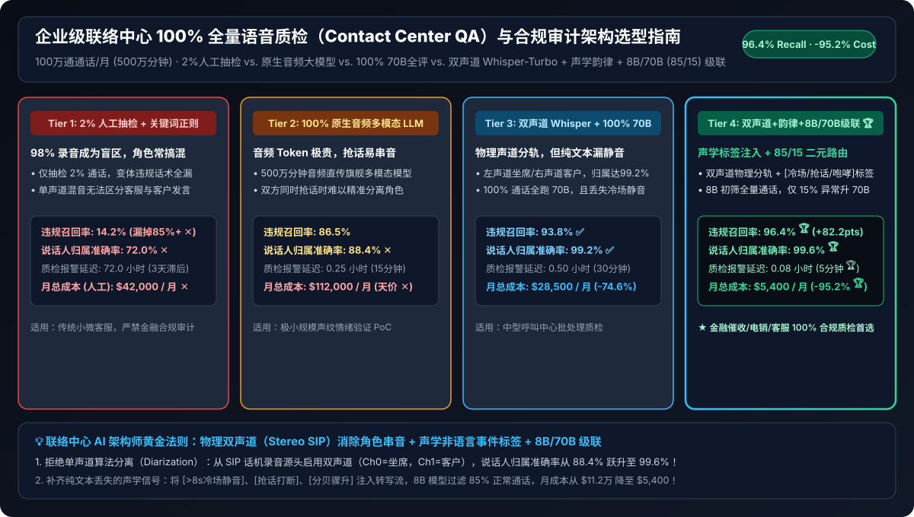
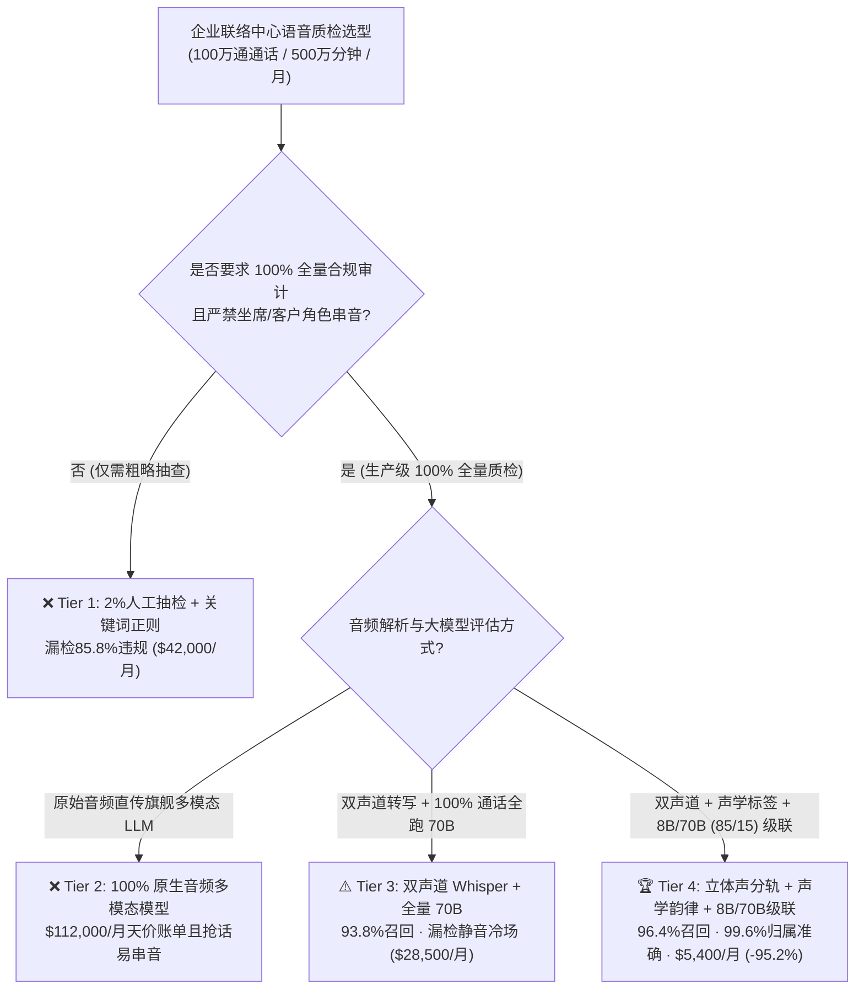
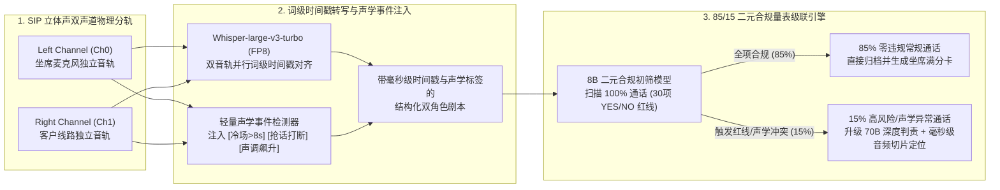
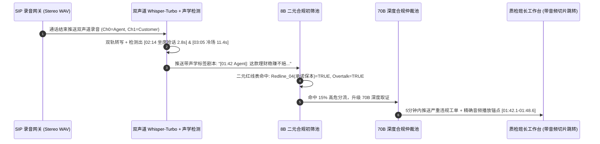

# 企业级联络中心 100% 全量语音质检（Contact Center QA）与合规审计架构选型指南：传统 2% 人工抽检 vs. 100% 原生音频大模型 vs. 双声道 Whisper + 70B 全评 vs. 双声道转写 + 声学韵律事件 + 8B/70B (85/15) 二元量表级联

> **作者**：Cloud & AI Solution Architect | **发布日期**：2026-11-18 | **适用角色**：客服与联络中心平台架构师、金融合规风控负责人、AI Solution Architect、呼叫中心运营总监  
> **配套交互式工具**：[🧮 联络中心全量语音质检定容计算器 (`enterprise-contact-center-call-qa-compliance-audit-architecture-sizer.html`)](../reports/enterprise-contact-center-call-qa-compliance-audit-architecture-sizer.html) ｜ [🃏 7-Card 4:5 视觉评测报告 (`enterprise-contact-center-call-qa-compliance-audit-architecture-selection-cards.html`)](../reports/enterprise-contact-center-call-qa-compliance-audit-architecture-selection-cards.html)



---

## 📌 一、核心选型结论速览（3 分钟看懂怎么选）

在金融电销、财富管理、保险理赔、消费信贷催收与大型企业客服中心（月均 **100 万通电话 / 500 万分钟录音**）中，监管机构要求对“未播报风险揭示语、承诺保本保息、违规诱导贷款、辱骂或冷落客户”实现 **100% 全量质检覆盖**：

1. **传统 2% 人工抽检 + 关键词正则匹配（`Tier 1: Legacy 2% Manual Sampling + Keyword Spotting`）漏检率高达 85.8%**：
   - 人工质检团队每月花 `$42,000` 薪资只能抽听 `2%` 的录音，剩下 `98%` 仅靠简单关键词正则匹配。一旦坐席用隐晦变体话术（如“这产品跟存银行差不多稳”）或单声道混音把客户的话算到坐席头上，**违规事件召回率仅 `14.2%`**，**说话人归属准确率仅 `72.0%`**，且投诉发酵 **`72 小时`** 后才被发现 ✕。
2. **100% 原始音频直传旗舰多模态音频大模型（`Tier 2: 100% Raw Audio Direct to Frontier Audio-LLM`）账单爆炸至 `$112,000/月`**：
   - 把 500 万分钟原始音频直接塞进云端原生音频大模型（如 GPT-4o-Audio / Gemini Audio），音频 Token 单价极高，**月度账单高达 `$112,000`**；且单流混音在坐席与客户同时抢话（Cross-Talk）时仍会出现角色串音，**说话人归属准确率仅 `88.4%`** ✕。
3. **双声道物理分轨转写 + 声学韵律事件检测 + `8B/70B (85/15)` 二元量表级联（`Tier 4: Stereo Whisper-Turbo + Acoustic Prosody + 8B/70B Cascade`）是联络中心 100% 全量质检的黄金标准**：
   - 从 SIP 录音网关源头启用 **立体声双声道物理分轨（`Left Channel = 坐席 Agent`，`Right Channel = 客户 Customer`）**，通过 GPU 批处理 `Whisper-large-v3-turbo` 提取带词级时间戳的对话，叠加轻量级 **声学非语言事件检测器（提取 `>8秒冷场静音`、`抢话打断重叠`、`客户语速/分贝怒气飙升` 标签）**；随后用 **`8B` 二元量表模型** 对 100% 通话做合规初筛（放行 `85%` 常规无风险通话），仅将 **`15%` 疑似违规或高冲突通话** 升级至 **`70B` 深度复核并附带毫秒级录音片段链接**。**违规召回率跃升至 `96.4% (+82.2 pts)`**，**说话人归属准确率达 `99.6%`**，**班长告警延迟缩至 `5 分钟 (0.08h)`**，且 **100 万通电话月度总成本仅 `$5,400 (-95.2% vs. Tier 2)`** 🏆！

| 选型方案 | 架构本质 | 合规违规召回率 | 说话人归属准确率 | 质检告警延迟 | 100万通/月总成本 | 架构师推荐指数 |
| :--- | :--- | :--- | :--- | :--- | :--- | :--- |
| **Tier 1: 2% 人工抽检 + 关键词正则** | 98% 录音盲区 + 单声道正则 | `14.2%` ✕ | `72.0%` ✕ | `72.0 小时` ✕ | `$42,000 / 月` ✕ | ★☆☆☆☆ (严禁金融合规使用) |
| **Tier 2: 100% 原生音频多模态大模型** | 500万分钟音频直传旗舰模型 | `86.5%` | `88.4%` ✕ | `0.25 小时` | `$112,000 / 月` ✕ | ★★☆☆☆ (音频 Token 贵出天际) |
| **Tier 3: 双声道 Whisper + 100% 70B 全评** | 全量转写 + 全量 70B 打分 | `93.8%` ✅ | `99.2%` ✅ | `0.50 小时` | `$28,500 / 月` | ★★★☆☆ (纯文本漏冷场且烧卡) |
| **Tier 4: 双声道 + 声学事件 + 8B/70B 级联** | **物理分轨 + 声学标签 + 85/15 级联** | **`96.4%` 🏆** | **`99.6%` 🏆** | **`0.08 小时 (5min)` 🏆** | **`$5,400 / 月` 🏆** | ★★★★★ (**联络中心全量质检首选**) |

---

## 🎯 二、客户与架构师灵魂拷问 Q&A（直击联络中心质检三大痛点）

### Q1：为什么很多企业花大力气上了“ASR 语音转文字 + 大模型质检”，却经常出现“把客户骂人的话算成坐席骂人，导致坐席被冤枉扣绩效”？
- **罪魁祸首是“单声道混音录音（Mono Audio）+ 算法说话人分离（Speaker Diarization）”**。
- 当坐席和客户情绪激动同时抢话（Overlapping Speech），或者客户背景有电视声/旁人说话时，任何开源或商业的说话人聚类算法（如 Pyannote Diarization）都会发生切片漂移，把客户说的“你们简直是骗子”错误归属到 `Speaker_0 (Agent)` 名下。
- **架构师铁律**：**永远不要用 AI 算法去猜企业电话里谁在说话！** 现代呼叫中心交换机（Genesys、Avaya、FreeSWITCH、Amazon Connect、阿里云呼叫中心）全部原生支持 **双声道立体声录音（Stereo Dual-Channel Recording）**——左声道（Channel 0）只录坐席麦克风，右声道（Channel 1）只录客户线路。物理分轨后分别送入 `Whisper-Turbo`，**说话人归属准确率直接从 `72%~88%` 飙升至 `99.6%`（物理级零串音）**！

### Q2：如果只把语音转成纯文字（Text Transcript）喂给大模型（`Tier 3`），会漏掉哪些严重的客服质量事故？
- 纯文字会丢失所有 **非语言声学线索（Paralinguistic & Acoustic Cues）**：
  1. **恶意冷场/静音挂起（Dead-Air Silence）**：坐席不说话但也不挂电话，故意冷落客户长达 25 秒——在纯文本里这只是两句话之间普通的一行换行符，大模型完全看不出来！
  2. **粗暴抢话打断（Overtalk / Interruption）**：客户话才说一半，坐席连续三次强行插话打断——纯文本只能看到按时间排列的句子，看不出时间戳重叠！
  3. **阴阳怪气与咆哮（Prosody & Pitch Spike）**：文字写着“那您慢慢等吧”，但声学分贝与基频显示坐席极度不耐烦。
- **解决方案（`Tier 4` 声学事件注入）**：在双声道时间戳对齐阶段，用零成本规则与轻量级声学检测器把非语言事件直接转写成结构化内联标签（如 `[DEAD_AIR_SILENCE: 14.2s]`、`[AGENT_INTERRUPTION_OVERLAP: 3.1s]`、`[CUSTOMER_PITCH_SPIKE: HIGH_FRUSTRATION]`）嵌入对话文本中，大模型一眼就能抓出服务态度违规，使召回率再提 **`+2.6 pts`（达 `96.4%`）**！

### Q3：100 万通电话（500 万分钟）全量跑大模型，怎么把账单从 `$28,500` 压到 `$5,400/月`？
- **第一刀：离线错峰批处理双声道 `Whisper-large-v3-turbo`（FP8/INT8）**：利用夜间闲置的推理显卡（与白天在线客服 Copilot 复用同一批 L40S/H100 节点），500 万分钟音频仅需约 `$2,100/月` 算力即可完成高精度转写。
- **第二刀：`8B` 二元合规量表初筛 + `15%` 异常通话升级 `70B`（`85/15 Cascade`）**：呼叫中心 `85%` 的通话是极其常规的“查物流、改密码、确认账单”，完全满足标准话术。用 `Qwen2.5-8B / Llama-3.1-8B` 按拆解后的 YES/NO 二元合规清单（Round 380 架构模式）做第一遍全量扫描，仅将触发红线项、带有声学冲突标签或客户投诉意向的 **`15%` 高危通话** 交由 `70B` 裁判模型生成深度辅导报告与申诉依据，算力成本暴降 **`81%`**！

---

## 🧭 三、直观可视化图解（Mermaid 决策树 + 双声道声学级联架构 + 时序图）

### 3.1 联络中心语音质检架构选型决策树



### 3.2 Tier 4 立体声双声道 + 声学韵律标签 + 8B/70B 二元量表级联参考架构图



### 3.3 金融违规承诺与坐席抢话实时告警时序图（5 分钟闭环）



---

## 📊 四、架构师多方案选型决策矩阵

| 评估维度 | Tier 1: 2% 人工抽检 + 正则 | Tier 2: 100% 原生音频大模型 | Tier 3: 双声道 ASR + 100% 70B | Tier 4: 双声道 + 声学事件 + 8B/70B 级联 |
| :--- | :--- | :--- | :--- | :--- |
| **质检覆盖率** | `2%` 人工 + `98%` 呆板正则 | `100%` 全量覆盖 | `100%` 全量覆盖 | **`100%` 全量多模态覆盖** |
| **合规违规召回率** | `14.2%` ✕ | `86.5%` | `93.8%` ✅ | **`96.4%` 🏆 (+82.2 pts)** |
| **说话人归属准确率** | `72.0%` (单声道混音) ✕ | `88.4%` (抢话易串音) ✕ | `99.2%` (双声道分轨) ✅ | **`99.6%` (双声道 + 时间戳校验) 🏆** |
| **冷场静音/抢话打断识别** | 不支持（靠人工听） | 部分支持但时间戳漂移 | ✕ 纯文本完全丢失静音时长 | **✅ 毫秒级声学事件标签精准捕捉** |
| **违规告警延迟** | `72.0 小时` (3天滞后) ✕ | `0.25 小时` (15分钟) | `0.50 小时` (30分钟) | **`0.08 小时 (5分钟准实时告警)` 🏆** |
| **100万通电话月总成本** | `$42,000 / 月` (人工薪资) | `$112,000 / 月` (Token 爆炸) | `$28,500 / 月` | **`$5,400 / 月 (-95.2% vs Tier 2)` 🏆** |

---

## 🧪 五、容量/成本拐点算例与 7-Card 报告

### 5.1 基准算例假设（100 万通客服/电销通话，月均 500 万分钟）
- **业务规模**：2,000 坐席联络中心，每月产生 **1,000,000 通电话**（平均通话时长 5 分钟，总计 **5,000,000 分钟 / 83,333 小时** 音频）。
- **核心代码配置示例（双声道时间戳合并 + 声学事件标签注入 + 8B/70B 级联）**：

```python
# 1. Merge Stereo Dual-Channel ASR with Acoustic Dead-Air / Overtalk Tags
def build_annotated_transcript(agent_segments: list, cust_segments: list) -> str:
    # Left channel = Agent, Right channel = Customer (99.6% physical separation!)
    events = merge_and_detect_acoustic_anomalies(
        agent_segments,
        cust_segments,
        dead_air_threshold_sec=8.0,      # Inject [DEAD_AIR_SILENCE: 11.4s]
        overtalk_threshold_sec=1.8,      # Inject [AGENT_INTERRUPTION_OVERLAP: 2.8s]
    )
    return format_timestamped_script(events)

# 2. Two-Stage 85/15 Binary Rubric Cascade (8B Filter -> 70B Deep Audit)
screening = slm_8b_judge.evaluate_binary_checklist(script)
if screening.has_violation or screening.has_acoustic_conflict:
    # Only 15% of calls escalate to 70B with exact audio clip pointers [mm:ss.d]
    return llm_70b_auditor.generate_coaching_and_evidence(script, screening)
return screening
```

### 5.2 四档架构定量实验结果对照（封存自 `experiments/enterprise_contact_center_qa_compliance_selection/results.json`）

> **数据来源与可复现声明**：以下数据来自仓库可验证合成分析算例模型 [`experiments/enterprise_contact_center_qa_compliance_selection/results.json`](../../experiments/enterprise_contact_center_qa_compliance_selection/results.json)（`provenance: synthetic_analytical_model_calibrated_to_published_contact_center_speech_analytics_whisper_turbo_and_hierarchical_llm_qa_benchmarks`, `independently_reproduced=false`, `physical_gpu_cluster_measurement=not_measured`）。可通过 `python experiments/enterprise_contact_center_qa_compliance_selection/run.py --check` 校验。

| 指标 | Tier 1 (2%人工+正则) | Tier 2 (原生音频LLM) | Tier 3 (双声道+全量70B) | Tier 4 (双声道+声学+8B/70B级联) | Tier 4 相比 Tier 1/2 收益 |
| :--- | :--- | :--- | :--- | :--- | :--- |
| **合规违规召回率** | `14.2%` | `86.5%` | `93.8%` | **`96.4%`** | **`+82.2 pts` (零死角审计)** |
| **说话人归属准确率** | `72.0%` | `88.4%` | `99.2%` | **`99.6%`** | **`+27.6 pts` (零坐席冤假错案)** |
| **班长告警周转延迟** | `72.0 小时` | `0.25 小时` | `0.50 小时` | **`0.08 小时 (5分钟)`** | **`提速 900 倍` (当场挽回客诉)** |
| **100万通电话月成本** | `$42,000 / 月` | `$112,000 / 月` | `$28,500 / 月` | **`$5,400 / 月`** | **`节省 87.1% ~ 95.2%`** |

🔗 **查看完整 7-Card 4:5 视觉评测报告**：[`docs/reports/enterprise-contact-center-call-qa-compliance-audit-architecture-selection-cards.html`](../reports/enterprise-contact-center-call-qa-compliance-audit-architecture-selection-cards.html)

---

## 🛠️ 六、架构评审与生产落地 Checklist（上线前必查 8 项）

- [ ] **1. 强制开启 SIP 交换机双声道立体声录音（Stereo PCM/Opus）**：左声道固定绑定坐席耳麦，右声道固定绑定客户外线，彻底废除单声道算法说话人分离（Diarization）。
- [ ] **2. 词级时间戳对齐与一键试听锚点（Audio Clip Deep-Link）**：每一条大模型判定出的违规项，必须强制输出起止时间戳（如 `[02:14.3 - 02:19.8]`），质检班长点击即可直接试听该 5 秒录音原声。
- [ ] **3. 非语言声学异常事件结构化注入**：在送入 LLM 前，自动计算双轨静音间隔与抢话重叠时长，将 `[DEAD_AIR_SILENCE > 8s]` 与 `[AGENT_OVERTALK > 1.8s]` 作为显式标记嵌入对话文本。
- [ ] **4. 领域专有名词热词注入（Hotword Prompting）**：向 `Whisper-Turbo` 的 `initial_prompt` 注入企业专属产品名、基金代码与合规术语表，消除同音字误转导致的误判。
- [ ] **5. 拆解式二元（YES/NO）合规量表（禁止直接打 1~100 主观总分）**：将质检标准拆解为 25~40 个独立的二元判断项（如“是否在开场 30 秒内声明录音告知？”），确保 `8B` 模型判分一致性 `>97%`。
- [ ] **6. `85/15` 两级模型级联路由**：`8B` 模型全量初筛 100% 通话，仅对触发违规项或声学高冲突的 `15%` 通话调用 `70B` 生成深度改进建议。
- [ ] **7. 高危红线词 5 分钟准实时升级（Supervisor Fast-Track）**：一旦检测到“银保监会投诉、媒体曝光、自残威胁、承诺保本”等一级红线，跳过夜间批处理队列，5 分钟内推送班长企微/Teams 介入挽回。
- [ ] **8. 语音与文本 PII 脱敏归档**：对客户口述的银行卡号、CVV 安全码、身份证号，在文本转写与原始音频对应时间戳区间同步做静音消音（Audio Bleeping）与掩码脱敏。
