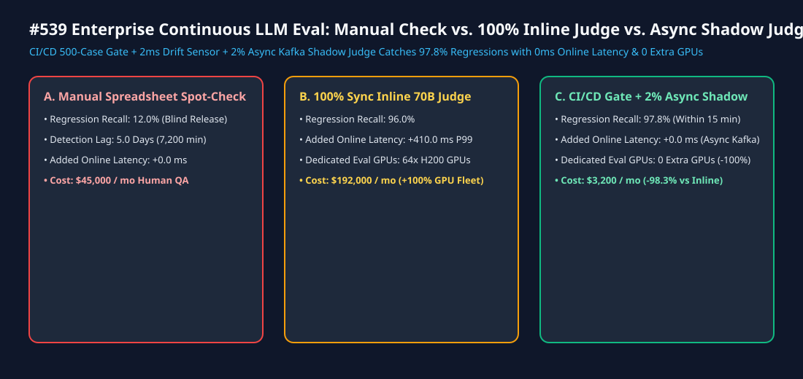

# Enterprise Continuous LLM Evaluation & Online Drift Governance: `Manual Spot-Check` vs. `100% Inline 70B Judge` vs. `CI/CD Golden Gate + 2% Async Kafka Shadow Judge` (`#539`)

> **Language / 语言**: [简体中文](./enterprise-continuous-llm-eval-cicd-async-shadow-judge-sizing-faq.md) | **English** · [📱 Interactive H5 Study Lab](../h5/continuous-llm-eval-cicd-async-shadow-judge-lab.html) · [🧮 Interactive Sizer](../reports/enterprise-continuous-llm-eval-cicd-async-shadow-judge-sizing-sizer.html) · [🃏 7-Card Deck](../reports/enterprise-continuous-llm-eval-cicd-async-shadow-judge-sizing-cards.html) · [Back to Catalog](../full-catalog-en.md)

---

## 1. Executive Summary (3-Minute Read)

1. **Why Manual Spot-Checking Misses `88.0%` of Regressions While `100%` Synchronous Inline `70B LLM-as-Judge` Doubles Your GPU Fleet (`+64 GPUs / $192K/mo`)**:
   - Manual spreadsheet review of 50 samples catches only **`12.0%`** of long-tail regressions and takes **5 days**.
   - Running a synchronous `70B LLM-as-Judge` on 100% of production traffic adds **`+410ms` P99 latency** and requires **64 dedicated H200 GPUs (`$192,000/mo`)**.
2. **The 3-Tier Zero-Latency Continuous Evaluation Pipeline**:
   - **Tier 1 (`CI/CD 500-Case Golden Gate`)**: Runs deterministic assertions + binary atomic rubrics in 8 minutes before deployment.
   - **Tier 2 (`0ms` Native Token Logprob Entropy Sensor)**: Flags high-entropy (`Entropy > 2.2 nats`) and low-retrieval-score responses inline at zero extra compute cost.
   - **Tier 3 (`2% Random + 100% High-Entropy Async Kafka Shadow Judge` on Off-Peak Idle GPUs)**: Achieves **`97.8%` regression detection recall within 15 minutes**, **`0.0ms` added online latency**, and **`0` dedicated extra GPUs (`-98.3%` monthly eval cost, `$3,200/mo`)**.

---

## 2. Quantitative Architecture Decision Matrix

| Metric | Scheme A: Manual Spreadsheet Spot-Check | Scheme B: `100%` Sync Inline `70B Judge` | Scheme C: `CI/CD Gate + Logprob Sensor + 2% Async Shadow` |
| :--- | :--- | :--- | :--- |
| **Regression Detection Recall** | `12.0%` | `96.0%` | **`97.8%` (`+85.8 pts` vs. Manual)** |
| **Added Online P99 Latency** | `+0.0 ms` | `+410.0 ms` | **`+0.0 ms` (100% Async Kafka)** |
| **Detection Time to Rollback** | `7,200 min (5 days)` | `1.0 min` | **`15.0 min` (Automated Canary Rollback)** |
| **Dedicated Eval H200 GPUs** | `0 GPUs` | `64 GPUs` | **`0 Extra GPUs` (Off-Peak Idle Harvest)** |
| **Monthly Evaluation Cost** | `$45,000 / mo` | `$192,000 / mo` | **`$3,200 / mo` (`-98.3%` vs. Inline)** |
