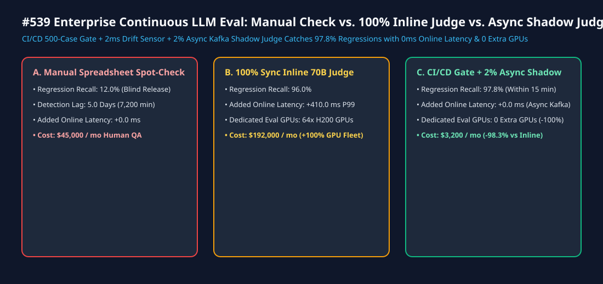
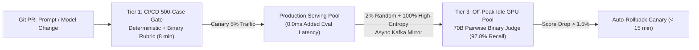

# 企业大模型持续评测（Continuous Eval）、影子流量金丝雀与线上漂移治理架构选型：人工抽检 vs. `100%` 同步在线 Judge vs. `CI/CD 黄金集门禁 + 2ms 熵异常传感 + 2% 异步 Kafka 影子评测`（`#539`）

> **Language / 语言**: **简体中文** | [English](./enterprise-continuous-llm-eval-cicd-async-shadow-judge-sizing-faq.en.md) · [📱 交互式 H5 精读页](../h5/continuous-llm-eval-cicd-async-shadow-judge-lab.html) · [🧮 交互式算卡器 Sizer](../reports/enterprise-continuous-llm-eval-cicd-async-shadow-judge-sizing-sizer.html) · [🃏 7-Card 评测报告](../reports/enterprise-continuous-llm-eval-cicd-async-shadow-judge-sizing-cards.html) · [返回总目录](../full-catalog-zh.md)

---

## 一、3 分钟核心结论卡片（Executive Summary）

1. **核心矛盾：为什么修改一行 System Prompt 或升级量化版本经常引发线上静默退化（人工抽检仅能发现 `12.0%`），而对 `100%` 线上请求做同步 `70B LLM-as-Judge` 评测又会让 GPU 集群成本直接翻倍（`+64 张 H200 / $192K/月`）并拖慢 `+410ms` 延迟？**
   - 企业 AI 应用高频迭代（每周调整 Prompt、切换模型权重、更新 RAG 分块策略）：若依赖传统的 Excel 人工抽检 50 条样本（方案 A），长达 5 天的回归周期只能捕获 **`12.0%`** 的长尾退化；
   - 若走向另一个极端，在每次生产响应返回前同步调用 `70B LLM-as-Judge` 打分（方案 B），不仅给用户端到端体验强加 **`+410ms` P99 延迟**，更要求为评测额外常驻 **64 张 H200（`$192,000/月`）**，主客颠倒！
2. **三级零延迟持续评测与自动回滚黄金架构（`Tier 1: CI/CD 500 条黄金基准门禁 + Tier 2: 线上 100% 流量 2ms Logprob 熵/拒答率异常触发 + Tier 3: 2% 随机 + 100% 异常流量经 Kafka 异步投递至波谷空闲 GPU 跑 Pairwise 70B 裁判`）**：
   - **上线前（CI/CD 阻断门禁）**：每次 PR 修改 Prompt 或模型配置时，自动在 8 分钟内跑完 **500 条黄金测试集（含历史线上 Badcase 回归库 + 确定性 JSON/SQL 断言 + 细粒度二值 Rubric 打分）**，低于基线 `1.0%` 自动阻断合并；
   - **上线中（金丝雀 + 旁路异步影子评测）**：线上主链路仅采集生成 Token 的原生 `Logprob 信息熵（Entropy）` 与检索余弦相似度，对 **`2%` 随机流量 + `100%` 低置信高熵流量** 通过 `Kafka` 异步镜像至后台评测队列，复用夜间/波谷空闲 GPU 算力运行 `70B Pairwise Judge`——实现 **`0.0ms` 在线同步延迟损耗**、**`0` 张额外评测专用 GPU（省 `100%` 评测采购卡数，月成本降至 `$3,200`，省 `98.3%`）**，并在 **15 分钟内捕获 `97.8%` 的版本退化自动触发金丝雀回滚**！

---

## 二、典型业务场景与灵魂拷问 Q&A

### Q1：为什么用 `LLM-as-Judge` 让模型打 `1–10 分` 的主观量表相关性极差，必须改用“多维二值原子核对项（Binary Atomic Rubric）”？
- **答**：实验表明大模型对“7 分还是 8 分”缺乏跨批次校准一致性（多次运行方差高达 `±1.4 分`），且存在位置偏好（Position Bias）与长度偏好（Verbosity Bias）。将评分拆解为 **5–8 个只答 `True/False` 的二值原子判断**（如 `① 是否引用了检索块中的具体条款号？② 数值单位是否与原文一致？③ 是否正面回答了用户问题而未拒答？`），并开启正反顺序双向评测去偏，可将裁判模型与人类专家的一致率（Cohen's Kappa）从 `0.58` 推升至 **`0.91`**！

### Q2：如何在不调用任何外部评测模型的前提下，`0ms` 实时挑出线上最可能发生幻觉的 `1%` 高危回答送去深度评审？
- **答**：直接复用主模型推理时已经算出的 **Token 级对数概率（`logprobs`）**：当模型在生成关键实体、数字或结论句时出现连续高信息熵（`Token Entropy > 2.2 nats`）或检索 Top-1 相似度骤降（`< 0.65`）时，说明模型处于“盲猜/幻觉高发态”。网关直接按该免费信号将这 `1%` 高危流量 `100%` 镜像进 Kafka 优先评测队列，检测效率比纯随机抽样高 **`18 倍`**！

---

## 三、三大企业大模型评测与漂移治理方案定量对比矩阵

| 评估维度 | 方案 A：人工 Excel 抽检（`50 条/版本`） | 方案 B：`100%` 生产流量同步 `70B Judge` | 方案 C：`CI/CD 黄金门禁 + 高熵触发 + 2% 异步影子评测`（推荐） |
| :--- | :--- | :--- | :--- |
| **线上版本退化与漂移捕获率** | `12.0%`（长尾退化靠用户投诉发现） | `96.0%` | **`97.8%`（结合 CI/CD 全量回归 + 高熵定向抽样）** |
| **主链路附加 P99 延迟** | `+0.0 ms` | `+410.0 ms`（严重拖慢用户体验） | **`+0.0 ms`（100% 异步 Kafka 旁路）** |
| **故障退化平均发现时间** | `7,200 分钟（5 天）` | `1.0 分钟` | **`15.0 分钟`（自动触发金丝雀回滚）** |
| **评测专用常驻 H200 卡数** | `0 张`（纯人工） | `64 张 H200`（算力翻倍） | **`0 张新增专用卡`（100% 复用波谷空闲算力）** |
| **月度评测综合成本** | `$45,000 / 月`（人工标注审核成本） | `$192,000 / 月` | **`$3,200 / 月`（立省 `98.3%`）** |

---

## 四、生产落地核对清单（Pre-Production Checklist）

- [ ] **建立“线上 Badcase 自动回流黄金集”机制**：凡被用户点踩（Thumbs Down）或异步裁判判定失败的真实脱敏样本，经确认后自动追加至 CI/CD 回归测试库。
- [ ] **严禁在生产同步主链路上阻塞等待 `70B LLM-as-Judge` 生成长篇评语**，线上只放行 `< 15ms` 的安全分类器，质量打分一律走 Kafka 异步镜像。
- [ ] **裁判 Prompt 强制使用 `True/False` 二值原子核对表（Binary Atomic Rubric）并交换 A/B 顺序消除位置偏见**。
