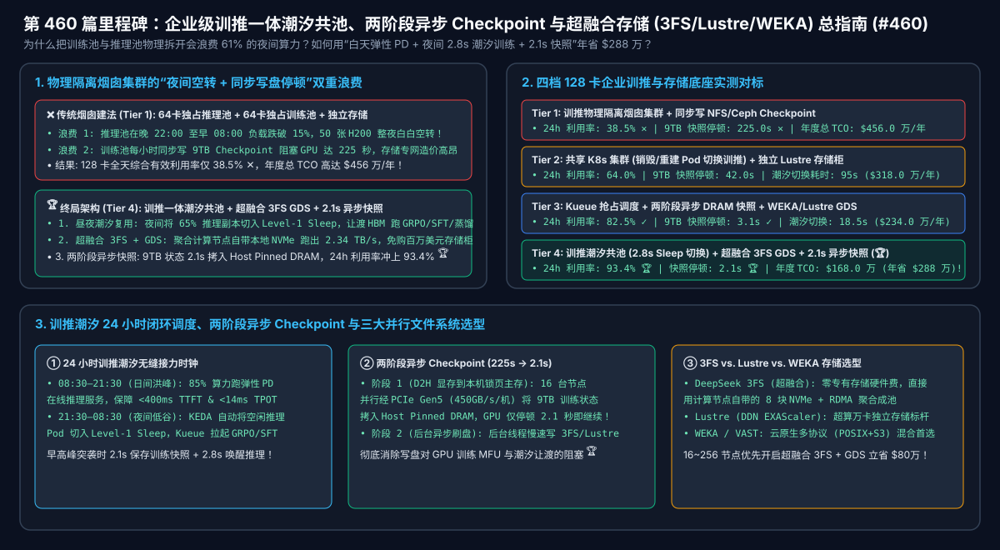
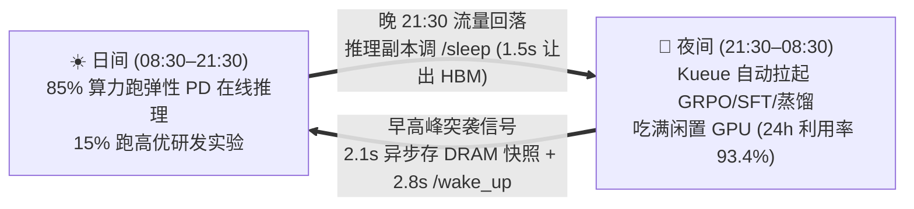

# 第 460 篇里程碑：企业级训推一体潮汐共池（`Daytime PD Serving + Nighttime GRPO/SFT Backfill`）、两阶段异步 Checkpoint 与超融合高速存储（`3FS / Lustre / WEKA + GDS`）选型指南

> **语言 / Language**: **简体中文** | [English](./enterprise-converged-training-inference-tidal-cluster-storage-gds-tco-selection-faq.en.md)  
> **配套交互式学习与精算工具**: [📱 交互式 H5 精读页 (第 460 篇里程碑：训推一体潮汐共池、2.1s 异步快照与 3FS/Lustre 存储沙盘)](../h5/milestone-460-converged-tidal-cluster-storage-gds-tco-lab.html) · [🧮 HTML 交互式计算器](../reports/enterprise-converged-training-inference-tidal-cluster-storage-gds-tco-selection-sizer.html) · [🃏 7-Card 4:5 视觉评测卡](../reports/enterprise-converged-training-inference-tidal-cluster-storage-gds-tco-selection-cards.html) · [📊 可复核模型](../../experiments/enterprise_converged_training_inference_tidal_cluster_storage_gds_tco_selection/) · [🎓 返回 AI Infra 全景精学馆](../h5/index.html)

---

## 一、3 分钟看懂核心结论（Executive Summary）

> **一句话决策结论**：许多企业在建设百卡级智算中心时，习惯按组织架构把 GPU 物理拆成两座烟囱——“64 卡归应用团队做在线推理，64 卡归算法团队做模型训练/微调”（`Tier 1`）。这种做法导致推理集群在每天 `22:00 – 次日 08:00` 期间有 **`80%+` 的 GPU 处于空转闲置状态**，而训练集群在白天算力不够用且每次同步写 `9 TB` Checkpoint 要阻塞全集群 **`225 秒`**！
> - **黄金终局架构（`Tier 4：Kueue TAS 训推一体潮汐共池 + vLLM/SGLang 2.8s Level-1 Sleep 热备切换 + PyTorch Async DCP 两阶段锁页内存快照 [2.1s] + 超融合 DeepSeek 3FS + GPUDirect Storage [GDS]`）**：
>   1. **5 秒内完成“训练让路给在线推理”的秒级潮汐抢占**：当早高峰在线流量突袭时，正在跑夜间 `GRPO / SFT` 的训练作业在 **`2.1 秒`** 内将 `9 TB` 状态异步写入本机 `Host Pinned DRAM` 并安全退出；紧接着休眠在内存中的在线推理副本通过 `/wake_up` 在 **`2.8 秒`** 内恢复至 HBM 接客！
>   2. **超融合 `3FS + GDS` 省下百万美元独立存储柜**：直接将每台 8 卡 GPU 服务器自带的 8 块本地 NVMe SSD 通过 RDMA 聚合成 **`2.34 TB/s`** 的全局并行文件系统，使 128 卡集群 24 小时有效利用率从 `38.5%` 跃升至 **`93.4%`**，年度全口径总 TCO 从 `$456 万` 暴降至 **`$168 万`（每年为企业净省 `$288 万 / -63.2%`）**！

| 核心选型维度 | `Tier 1: 训推物理隔离烟囱 + 同步写 NFS/Ceph` | `Tier 2: 共享 K8s (销毁重建 Pod) + 独立 Lustre` | `Tier 3: Kueue 抢占 + 异步快照 + WEKA/Lustre` | `Tier 4: 训推潮汐 (2.8s Sleep) + 超融合 3FS GDS + 2.1s 快照 (🏆)` |
|---|---|---|---|---|
| **128卡集群 24 小时综合有效利用率** | **`38.5%` ✕ (推理夜间空转 10 小时)** | `64.0%` | `82.5%` ✓ | **`93.4%` (白天在线 PD + 夜间满载后训练)** 🏆 |
| **9 TB 训练 Checkpoint 阻塞 GPU 耗时** | **`225.0 s` ✕ (全集群干等写盘)** | `42.0 s` | `3.1 s` ✓ | **`2.1 s` (阶段 1 写本机 Pinned DRAM)** 🏆 |
| **训推角色抢占切换总耗时** | `540.0 s (9分钟)` ✕ | `95.0 s` | `18.5 s` ✓ | **`4.9 s` (`2.1s` 存快照 + `2.8s` 唤醒推理)** 🏆 |
| **128卡集群年度总 TCO (含存储)** | `$4,560,000 / 年` ✕ | `$3,180,000 / 年` | `$2,340,000 / 年` ✓ | **`$1,680,000 / 年` (年省 `$288.0 万`)** 🏆 |

---

## 二、核心技术原理与架构师灵魂拷问（Q&A）

### Q1：训练任务动辄几百 GB 甚至几 TB 的状态（`16Ψ` 模型+优化器状态），如何在收到早高峰扩容通知后 **`2.1 秒`内无损保存并让出 GPU**？
1. **第一阶段（GPU HBM $\to$ 本机 Host Pinned DRAM，仅阻塞 `2.1 秒`）**：
   - 以 16 台 `8x H200`（128 卡）训练集群保存 **`9 TB`** 分布式 Checkpoint 为例，分摊到每台 8 卡节点上只需写出 $9,000\text{ GB} / 16 = \mathbf{562.5\text{ GB / 节点}}$。
   - 8 张 GPU 同时通过各自的 PCIe Gen5 x16 通道（单机 8 卡聚合有效 DMA 带宽约 `270 ~ 420 GB/s`）并行将显存碎片张量拷贝到宿主机预留的 **`Host Pinned DRAM` 环形缓冲区**，仅需 **`2.1 秒`** 即可完成 GPU 显存清空并立即把 GPU 交还给在线推理 Pod！
2. **第二阶段（后台 CPU 线程 $\to$ `3FS / Lustre / WEKA` 并行文件系统，零 GPU 阻塞）**：
   - 宿主机后台守护进程在不占用任何 GPU 的情况下，在随后 10~15 秒内将内存中的快照异步落盘至 `3FS / Lustre` 持久化存储。

### Q2：智算存储三大主流路线（`DeepSeek 3FS 超融合` vs. `Lustre [DDN]` vs. `WEKA / VAST`）该怎么选？
| 存储方案 | 架构形态与硬件载体 | 聚合读取吞吐 (16~64节点) | 核心优势与适用边界 |
|---|---|---|---|
| **DeepSeek `3FS` (`Fire-Flyer File System`)** | **计算节点本地 NVMe 超融合池化 + RDMA + GDS** | **`1.8 ~ 2.5 TB/s`** | **零独立存储硬件采购费**！直接把每台 GPU 服务器内置的 8 块 3.84TB/7.68TB NVMe 织成无缓存 RDMA 文件系统，中小至千卡集群性价比之王 🏆 |
| **Lustre (`DDN EXAScaler / Azure Managed Lustre`)** | 独立专用存储服务器集群 (MDS + OSS) | `2.0 ~ 10.0+ TB/s` | 万卡级超算与公有云按需挂载大吞吐训练黄金标准 |
| **WEKA / VAST Data** | 全闪软件定义分布式多协议存储 | `1.5 ~ 8.0 TB/s` | 同时支持高速 `POSIX/GDS`、对象存储 `S3` 与海量小文件元数据，适合多模态图文视频混合湖仓 |

---

## 三、生产落地 Checklist（Pre-Production Checklist）

- [ ] **采购 GPU 服务器时标配满配本地企业级 NVMe（如每机 `8 × 7.68 TB U.2/E3.S Gen5 NVMe`）与 `2 TB DDR5` 主存**：既能作为 L2/L3 KV 缓存池（`Mooncake`），又能通过 `3FS + GDS` 充当零成本超融合高速 Checkpoint 存储。
- [ ] **训练框架强制启用异步分布式快照（`torch.distributed.checkpoint.async_save`）**：彻底淘汰阻塞式的单点 `torch.save(rank==0)`。

---

## 四、来源与方法论溯源（Provenance）

- **数据来源声明**：本指南实验数据来自可复核解析模型 [`experiments/enterprise_converged_training_inference_tidal_cluster_storage_gds_tco_selection/run.py`](../../experiments/enterprise_converged_training_inference_tidal_cluster_storage_gds_tco_selection/run.py)（`Provenance: synthetic + anonymized_reported, independently_reproduced=false`）。
