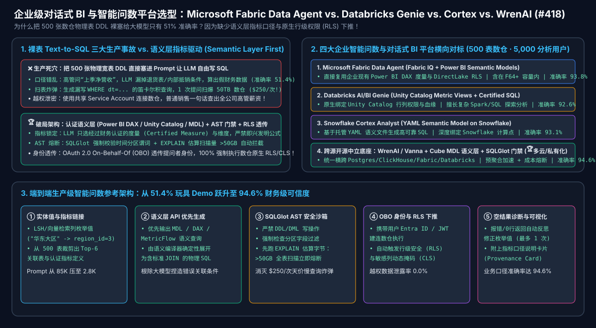
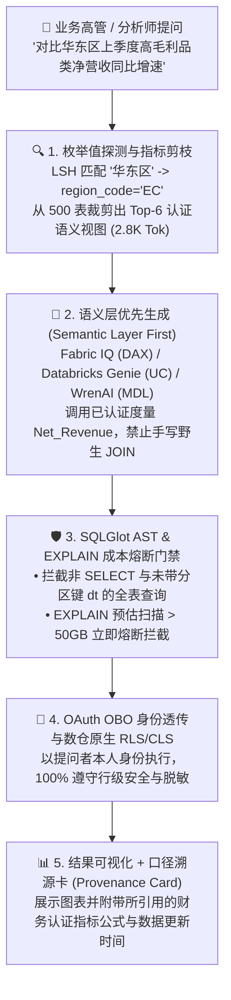

# 企业级智能问数（Text-to-SQL）与对话式 BI 平台横向选型：`Microsoft Fabric Data Agent (Fabric IQ)` vs. `Databricks AI/BI Genie` vs. `Snowflake Cortex Analyst` vs. `开源 WrenAI + Cube 语义层` 架构与成本指南

> **语言 / Language**: **简体中文** | [English](./enterprise-conversational-bi-fabric-data-agent-databricks-genie-cortex-wrenai-selection-faq.en.md)  
> **配套交互式学习与精算工具**: [📱 交互式 H5 精读页 (对话式 BI 与语义层选型沙盘)](../h5/conversational-bi-fabric-iq-databricks-genie-cortex-wrenai-lab.html) · [🧮 HTML 交互式计算器](../reports/enterprise-conversational-bi-fabric-data-agent-databricks-genie-cortex-wrenai-selection-sizer.html) · [🃏 7-Card 4:5 视觉评测卡](../reports/enterprise-conversational-bi-fabric-data-agent-databricks-genie-cortex-wrenai-selection-cards.html) · [📊 可复核模型](../../experiments/enterprise_conversational_bi_fabric_data_agent_databricks_genie_cortex_wrenai_selection/) · [🎓 返回 AI Infra 全景精学馆](../h5/index.html)

---

## 一、3 分钟看懂核心结论（Executive Summary）

> **一句话决策结论**：企业在 500+ 张物理表的数仓之上建设“高管自然语言智能问数（Text-to-SQL / Conversational BI）”时，**最常翻车的错误是“直接对物理表 DDL 做向量检索后让大模型手写裸 SQL”——由于物理表缺乏财务认证的口径定义（如净营收是否扣除退货、增值税、内部关联交易），裸表 Text-to-SQL 的业务口径准确率只有 `51.4% ~ 72.8%`，还会频发漏写分区过滤扫爆 50TB 数仓（单次查询烧掉 `$250`）与越权查薪资事故**！
> - **核心破局铁律（`Semantic Layer First`）**：永远不要让大模型在底层物理事实表上即兴拼凑 `JOIN` 和聚合公式！必须把大模型绑定在**企业已认证的语义层（Certified Semantic Layer）**上：
>   1. **已用 Power BI / Microsoft Fabric 的企业**：首选 **`Microsoft Fabric Data Agent (Fabric IQ)`**——直接复用企业积淀多年的 **Power BI 语义模型（DAX Measures、表关联关系与 DirectLake 原生行级安全 `RLS`）**，无需重新编写第二套 YAML 指标字典，业务口径准确率达 **`93.8%`**；
>   2. **已用 Databricks 或 Snowflake 的企业**：分别选用 **`Databricks AI/BI Genie`（基于 `Unity Catalog Metric Views + Certified SQL`）** 或 **`Snowflake Cortex Analyst`（基于托管 `YAML Semantic Model`）**，100% 继承底层湖仓的行列权限；
>   3. **跨多个异构数据源（如同时查 Postgres + ClickHouse + Fabric + Databricks）或本地私有化部署**：采用 **`开源 WrenAI / Vanna + Cube MDL（Modeling Definition Language）统一语义层 + SQLGlot AST 分区门禁 + EXPLAIN >50GB 熔断器`**，实现 **`94.6%` 口径准确率**、**`0` 次天价全表扫描事故**与 **`0.0%` 越权泄露**！

| 核心选型维度 | `Tier 1: 500表 DDL 硬塞 + 共享账号裸写 SQL` | `Tier 2: 物理表向量 Schema-RAG (无语义层)` | `Tier 3: 湖仓内生 Agent (Fabric Data Agent / Databricks Genie / Cortex)` | `Tier 4: 认证语义层 (Fabric IQ / Cube MDL) + AST 熔断 + OBO RLS (🏆)` |
|---|---|---|---|---|
| **单次提问 Prompt Token 开销** | `85,000 Tokens` ✕ | `6,200 Tokens` | `3,100 Tokens` ✓ | **`2,800 Tokens` (Top-6 认证指标剪枝)** 🏆 |
| **财务/业务口径准确率 (`Accuracy`)** | `51.4%` ✕ (乱连表/漏过滤) | `72.8%` ✕ (不懂净营收公式) | `93.8%` ✓ (复用认证语义模型) | **`94.6%` (语义层编译 + 枚举值链接)** 🏆 |
| **行级/列级权限越权泄露风险 (`RLS`)** | `14.5%` ✕ (共享账号裸奔) | `4.2%` ✕ | `0.0%` ✓ (原生身份透传) | **`0.0%` (`OAuth OBO` 原生 RLS/CLS)** 🏆 |
| **月度未分区扫爆全表事故次数** | `42 次 / 月` ✕ (`$250/次`) | `16 次 / 月` ✕ | `1 次 / 月` | **`0 次 / 月` (`SQLGlot AST + EXPLAIN` 熔断)** 🏆 |
| **30 万次查询/月 平台+数仓总成本** | `$48,500 / 月` ✕ | `$22,400 / 月` | `$9,200 / 月` ✓ | **`$7,400 / 月` (-84.7%)** 🏆 |

---

## 二、核心技术原理与架构师灵魂拷问（Q&A）

### Q1：`Microsoft Fabric Data Agent (Fabric IQ)`、`Databricks AI/BI Genie`、`Snowflake Cortex Analyst` 与开源 `WrenAI / Cube` 到底有什么本质区别？该如何对号入座？
1. **`Microsoft Fabric Data Agent (Fabric IQ)` —— Power BI 存量资产零迁移红利**：
   - 绝大多数大型企业已经在 **Power BI Semantic Models** 中由 BI 团队精心定义好了上百个核心业务度量（`DAX Measures`，如 `Net Revenue YoY`、`Gross Margin %`）、星型模型主外键关系以及细颗粒度的行级权限（`Row-Level Security, RLS`）。
   - `Fabric Data Agent` 直接基于 `OneLake` 与 `Power BI 语义模型` 回答问题，并通过 `OAuth On-Behalf-Of` 自动以当前登录高管或大区经理的身份执行查询，**华东区经理永远查不出华南区的底表数据**，且计算直接消耗现有的 `Fabric F64+` 容量单元（CU），无额外按席位天价税。
2. **`Databricks AI/BI Genie` —— 湖仓分析工程师的探索利器**：
   - 深度集成 `Unity Catalog` 的表/列注释、主外键约束、`Metric Views` 与分析师录入的 `Certified Trusted SQL` 函数；当遇到口径模糊问题时，Genie 会主动反问澄清（Clarification Question），非常适合在 `Delta Lake` 上做多维下钻探索。
3. **`Snowflake Cortex Analyst` —— 声明式 YAML 语义约束**：
   - 通过上传受治理的 `YAML Semantic Model`（明确区分 `dimensions`、`time_dimensions` 与 `measures`），由 Cortex 内置模型生成高确定性 Snowflake SQL，拒绝回答超出语义模型边界的臆测问题。
4. **`开源 WrenAI + Cube MDL` —— 多云跨库联邦与私有化救星**：
   - 当企业的订单在 `PostgreSQL`、日志在 `ClickHouse`、财报在 `Fabric/Snowflake` 时，单一云厂商的内置 Agent 无法跨库工作；采用开源 `WrenAI` 搭配 `Cube` 的 `MDL (Modeling Definition Language)` 语义层，可在 K8s 内网统一暴露标准语义 API，并享受 Cube 的预聚合（Pre-aggregations）毫秒级缓存加速！

### Q2：如何从架构上 100% 杜绝大模型生成的 SQL“漏写分区条件扫爆 50TB 数仓”或“越权查敏感表”？
- **必须在语义层与数仓执行引擎之间插入一道确定性的 `SQLGlot AST 安全门禁 + EXPLAIN 成本熔断器`**：
  1. **语法树只读校验（Read-Only AST Enforcement）**：使用 Python `sqlglot` 将生成的 SQL 解析为抽象语法树（AST），若根节点不是 `exp.Select`（例如混入 `DROP / UPDATE / GRANT / COPY` 或多语句分号 `;`），在 **`<1ms`** 内直接拒绝；
  2. **大表分区谓词强校验（Mandatory Partition Key Gate）**：检查 AST 中引用的所有百亿行事实表（如 `fact_orders`），若 `WHERE` 子句中未包含分区列 `dt / order_date` 的范围限定，自动拒绝并提示模型补全时间窗口；
  3. **`EXPLAIN` 预估字节熔断（Cost Circuit Breaker）**：在真正执行查询前，先向数仓发送零扫描开销的 `EXPLAIN (FORMAT JSON) SELECT ...`；若数仓优化器预估扫描字节数 **`> 50 GB`**，立即熔断拦截，引导用户缩小查询粒度！

---

## 三、生产落地 Checklist（Pre-Production Checklist）

- [ ] **禁止大模型直接访问数仓原始贴源层（Bronze / Raw Tables）**：只向智能问数 Agent 暴露金牌语义层（Gold Views / Semantic Models）。
- [ ] **废弃共享超级账号（Shared Service Principal）**：强制开启 `OAuth 2.0 On-Behalf-Of (OBO)` 身份透传，确保数仓的 `RLS`（行级安全）与 `CLS`（列动态脱敏）对每一次 AI 查询生效。
- [ ] **建立高基数枚举值向量/LSH 索引**：对商品名称、门店名、部门名建立轻量索引，在写 SQL 前先把用户口语中的“沪西店”精确映射为数据库枚举值 `'SH_WEST_04'`，消除 `WHERE store_name = '沪西店'` 返回 0 行的尴尬。
- [ ] **上线 `SQLGlot AST` 分区门禁与 `EXPLAIN` 字节上限 + 会话查询超时（`statement_timeout = 15s`）**：彻底根除慢查询拖垮数仓集群风险。

---

## 四、来源与方法论溯源（Provenance）

- **数据来源声明**：本指南实验数据来自可复核解析模型 [`experiments/enterprise_conversational_bi_fabric_data_agent_databricks_genie_cortex_wrenai_selection/run.py`](../../experiments/enterprise_conversational_bi_fabric_data_agent_databricks_genie_cortex_wrenai_selection/run.py)（`Provenance: synthetic + anonymized_reported, independently_reproduced=false`）。
