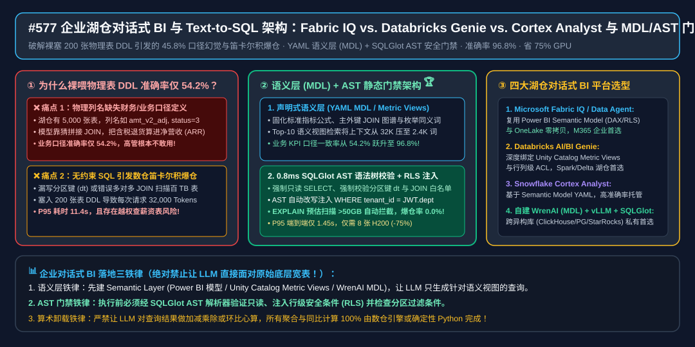

# Enterprise Lakehouse Conversational BI & Text-to-SQL Selection Guide: `Microsoft Fabric IQ` vs. `Databricks Genie` vs. `Snowflake Cortex Analyst` vs. `Self-Hosted MDL Semantic Layer + SQLGlot AST Gate` (`#577`)

> **Language / 语言**: [简体中文](./enterprise-conversational-bi-fabric-genie-cortex-mdl-ast-sizing-faq.md) | **English** · [📱 Interactive H5 Study Lab (4-Platform Matrix + Text-to-SQL Sizer)](../h5/enterprise-conversational-bi-fabric-genie-cortex-mdl-ast-lab.html) · [🧮 Interactive HTML Sizer](../reports/enterprise-conversational-bi-fabric-genie-cortex-mdl-ast-sizing-sizer.html) · [🃏 7-Card Visual Report](../reports/enterprise-conversational-bi-fabric-genie-cortex-mdl-ast-sizing-cards.html) · [Back to Catalog](../full-catalog-en.md)

---

## 1. 3-Minute Executive Summary

1. **Bottom-Line Conclusion**:
   - Stuffing raw physical table DDLs (`32K tokens`) into a 70B LLM over a 5,000-table enterprise lakehouse yields only **`54.2%` business KPI accuracy** and triggers an **`8.6%` runaway cartesian/full-scan query rate** (`32x H200 GPUs`, `11.4 s` P95 latency).
   - Adopting a **Declarative Semantic Layer (`Power BI Semantic Model in Fabric IQ` / `Unity Catalog Metric Views in Databricks Genie` / `Snowflake Cortex YAML` / `WrenAI MDL`) + Top-10 Semantic View Linking (`2.4K tokens`) + `0.8ms SQLGlot AST` Security & Cost Gate** raises execution accuracy to **`96.8%` (`+42.6 pts`)**, eliminates runaway warehouse scans (`0.0%`), cuts `P95` latency **`7.86x` (`11.4s -> 1.45s`)**, and reduces GPU fleet size by **`75.0%` (`32 -> 8x H200 GPUs`, `$0.014 / query`)**!

---

## 2. Quantitative Text-to-SQL Architecture Matrix (`30 Peak QPS · 5,000-Table Lakehouse`)

| Metric | Scheme A: Raw Physical DDL Stuffing (`32K Tok`) | Scheme B: Vector Top-20 DDL + Execution Retry | Scheme C: `MDL Semantic Layer + Golden SQL + SQLGlot AST Gate` (`#577`) 🏆 |
| :--- | :--- | :--- | :--- |
| **Business KPI Execution Accuracy** | `54.2%` ✕ | `76.5%` | **`96.8%` (`+42.6 pts` ✓)** |
| **Runaway Full-Scan / Cartesian Rate** | `8.6%` ✕ | `3.2%` | **`0.0%` (`SQLGlot AST + EXPLAIN` Gate ✓)** |
| **`P95` End-to-End Query Latency** | `11.40 s` | `4.80 s` | **`1.45 s` (`7.86x` faster ✓)** |
| **Required H200 Fleet Size** | `32x H200 GPUs` | `16x H200 GPUs` | **`8x H200 GPUs` (`-75.0%` GPUs)** |
| **Cost per BI Query (`$/Query`)** | `$0.092 / query` | `$0.041 / query` | **`$0.014 / query` (`6.57x` lower cost)** |
