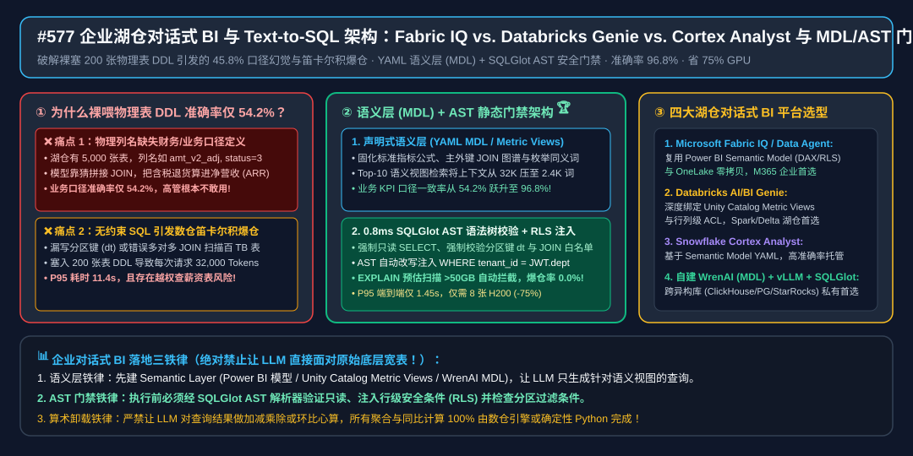

# 企业湖仓一体对话式 BI 与 Text-to-SQL 架构选型：`Microsoft Fabric IQ` vs. `Databricks Genie` vs. `Snowflake Cortex Analyst` vs. `自建 MDL 语义层 + SQLGlot AST 门禁` 指南（`#577`）

> **Language / 语言**: **简体中文** | [English](./enterprise-conversational-bi-fabric-genie-cortex-mdl-ast-sizing-faq.en.md) · [📱 交互式 H5 精读页（含四大平台横评 + Text-to-SQL 算卡器）](../h5/enterprise-conversational-bi-fabric-genie-cortex-mdl-ast-lab.html) · [🧮 交互式算卡器 Sizer](../reports/enterprise-conversational-bi-fabric-genie-cortex-mdl-ast-sizing-sizer.html) · [🃏 7-Card 评测报告](../reports/enterprise-conversational-bi-fabric-genie-cortex-mdl-ast-sizing-cards.html) · [返回总目录](../full-catalog-zh.md)

---

## 一、3 分钟核心结论卡片（Executive Summary）

1. **一句话结论**：
   - 企业在落地覆盖数千张数据湖仓表的对话式 BI（Text-to-SQL，服务 `20,000` 名业务人员，峰值 `30 QPS`）时，若采用传统的 **“向量检索物理表 DDL 硬塞 70B 模型直接跑 SQL”**，会因物理列名缺失业务口径定义（如净收入 ARR、毛利率剔除项）导致业务执行准确率仅 **`54.2%`**，且频繁生成漏写分区键的百 TB 笛卡尔积慢查询（数仓爆仓率 **`8.6%`**，需 **`32 张 H200`**，`P95` 耗时 `11.4 s`）；
   - 采用 **`声明式语义层（MDL / Semantic Model / Metric Views）+ Top-10 语义视图链接（32K -> 2.4K Tokens）+ SQLGlot AST 静态语法树门禁（强制注入 RLS 行级权限与分区谓词 + EXPLAIN 成本熔断）`**：
     - 业务 KPI 执行准确率从 `54.2%` 跃升至 **`96.8%`（提升 `+42.6 pts`）**；
     - 数仓慢查询爆仓率与越权查询率双双降至 **`0.0%`**，端到端 `P95` 耗时从 `11.4 s` 压至 **`1.45 s`（提速 `7.86 倍`）**，所需自建/托管 GPU 从 `32 张` 缩减至 **`8 张 H200`（立省 `75.0%` GPU，单次查询成本 `$0.014`）**！

---

## 二、灵魂拷问 Q&A：MDL 语义层原理、SQLGlot AST 门禁与四大湖仓 BI 平台横评

### Q1：为什么同样是用大模型写 SQL，接了“语义层（Semantic Layer / MDL）”就能把准确率从 `54.2%` 拉升到 `96.8%`？
- **答**：
  - 原始数仓物理表是为 ETL 性能设计的（存在大量冗余宽表、缩写编码与复杂多表关联），大模型并不懂贵司“华东区有效净销售额”必须过滤 `order_status IN (2,5) AND is_internal = 0`；
  - **声明式语义层（Modeling Definition Language, MDL）** 将企业的 **标准指标公式（Measures）、维度（Dimensions）、合法的表间主外键关系（Relationships）以及业务黑话同义词（Verified Golden SQL）** 显式定义为结构化契约；大模型只需针对高层语义指标生成查询，由语义编译器确定性展开为底层物理 SQL，彻底消灭口径胡编与非法多对多 JOIN！

---

### Q2：四大主流企业湖仓对话式 BI 方案（`Microsoft Fabric IQ` vs. `Databricks AI/BI Genie` vs. `Snowflake Cortex Analyst` vs. `自建 WrenAI + vLLM`）如何选型？

| 平台方案 | 底层语义层底座 | 安全权限与治理集成 | 最佳适用企业场景（SA 选型结论） |
| :--- | :--- | :--- | :--- |
| **`Microsoft Fabric IQ / Data Agent`** | **原生复用 Power BI Semantic Model（DAX 度量值 + 表关系）** + OneLake | 原生继承 Microsoft Entra ID、OneLake RLS/CLS 行列权限与 Purview 敏感标签 | **已使用 Power BI / Fabric / M365 Copilot 的企业零迁移成本首选** |
| **`Databricks AI/BI Genie`** | **`Unity Catalog Metric Views` + 表/列注释与认证 SQL 库** | 100% 强制执行 Unity Catalog 行过滤（Row Filter）与列掩码（Column Mask） | **以 Spark / Delta Lake 为核心的数仓与数据科学团队首选** |
| **`Snowflake Cortex Analyst`** | 基于托管 **Semantic Model YAML** 文件（定义 Facts / Dimensions / Verified Queries） | 在 Snowflake 虚拟仓 RBAC 内闭环运行，零数据出境 | **核心财务/零售数仓已在 Snowflake 上的企业开箱即用首选** |
| **`自建 WrenAI (MDL) + vLLM/SGLang + SQLGlot`** 🏆 | 开源标准化 **MDL JSON/YAML 引擎** + Qdrant 金标 SQL 少样本检索 | 配合网关 **`SQLGlot AST` 自动改写注入 `WHERE tenant_id = ...` 与 `EXPLAIN` 门禁** | **跨异构多数据源（StarRocks / ClickHouse / PostgreSQL / 本地数仓）私有化首选** |

---

## 三、三种 Text-to-SQL 架构定量对比矩阵（`30 Peak QPS · 5,000 表企业湖仓`）

| 评估维度 | 方案 A：物理 DDL 硬塞 70B (`Raw DDL Stuffing · 32K Tok`) | 方案 B：向量检索 Top-20 表 + 错误重试 (`Vector Schema + Retry`) | 方案 C：`MDL 语义层 + 金标少样本 + SQLGlot AST 门禁` (`#577`) 🏆 |
| :--- | :--- | :--- | :--- |
| **业务指标口径准确率 (`Execution Accuracy`)** | `54.2%`（口径猜错/JOIN 翻车 ✕） | `76.5%` | **`96.8%`（提升 `+42.6 pts` ✓）** |
| **全表扫描/笛卡尔积爆仓率** | `8.6%`（漏写分区键拖垮数仓 ✕） | `3.2%` | **`0.0%`（`SQLGlot AST + EXPLAIN` 100% 拦截 ✓）** |
| **端到端查询延迟 (`P95 Latency`)** | `11.40 s` | `4.80 s` | **`1.45 s`（提速 `7.86 倍` ✓）** |
| **所需 H200 GPU 总卡数** | `32 张 H200` | `16 张 H200` | **`8 张 H200`（立省 `75.0%` GPU）** |
| **单次 BI 问答综合成本 (`$/Query`)** | `$0.092 / 次` | `$0.041 / 次` | **`$0.014 / 次`（成本降低 `6.57 倍`）** |

---

## 四、对话式 BI 与 Text-to-SQL 上线核对清单（SA Pre-Production Checklist）

- [ ] **1. 建立认证语义指标层（MDL / Semantic Model）**：将前 100 个核心财务/经营 KPI 固化为语义度量值，禁止 LLM 自由拼写复杂营收公式。
- [ ] **2. 部署 `0.8 ms SQLGlot AST` 强制改写与门禁**：拦截一切 `DROP / UPDATE / DELETE / GRANT`；对事实表查询强制校验时间分区谓词，并由 AST 自动注入当前登录用户的部门 RLS 过滤条件。
