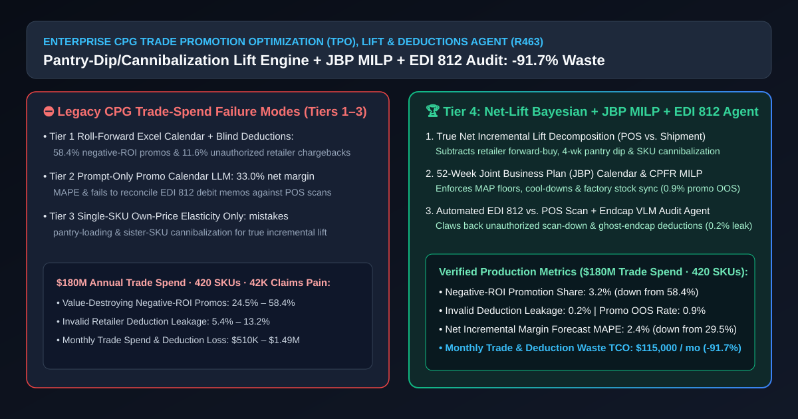
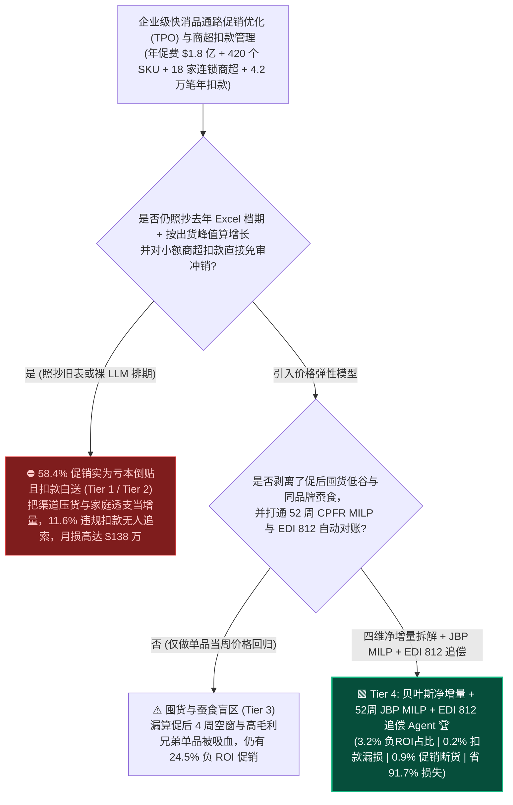
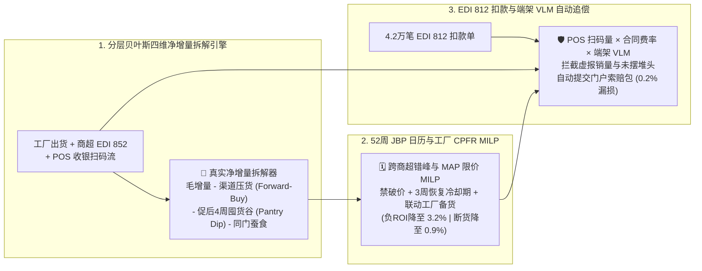
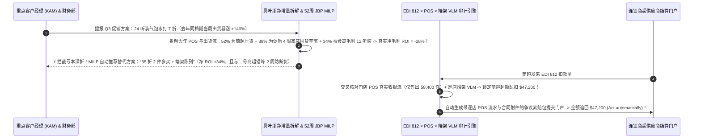

# 企业级快消品营收增长管理（`CPG RGM`）、通路促销优化（`TPO`）、真实增量拆解（剔除渠道压货/家庭囤货透支/同品牌蚕食）与零售商扣款核销（`EDI 812`）Agent 架构选型指南：传统复制去年促销日历+小额扣款免审冲销 vs. 纯 LLM 排档期与写申诉信 vs. 单品价格弹性回归 vs. 分层贝叶斯净增量拆解 + 52 周联合生意计划（`JBP`）`MILP` + 端架陈列 `VLM` 与 `EDI 812` 自动追偿 Agent

> **语言 / Language**: **中文 (当前)** | [English](./enterprise-cpg-trade-promotion-optimization-lift-deductions-milp-selection-faq.en.md)  
> **定位**：面向云与 AI 解决方案架构师（Solution Architect）、快消品与零售品牌（`CPG / FMCG`）首席商务官与营收增长管理（`RGM`）总监、通路行销（Trade Marketing）及财务扣款结算（`SAP TPM / Visualfabriq / HighRadius`）架构师的生产落地指南。  
> **数据口径（Provenance）**：`synthetic + anonymized_reported`（`independently_reproduced=false`，`physical_gpu_cluster_measurement=not_measured`），全部定容模型封存于 [`experiments/enterprise_cpg_trade_promotion_optimization_lift_deductions_milp_selection/results.json`](../../experiments/enterprise_cpg_trade_promotion_optimization_lift_deductions_milp_selection/results.json)。



---

## ① 📌 核心选型结论速览（Executive Summary — 3 分钟看懂怎么选）

在 **每年投入 `$1.8 亿美元` 通路促销费用（Trade Spend，通常占快消品牌总营收的 `15%~25%`）、管理 `420` 个活跃规格 SKU、覆盖 `18` 大全国连锁商超系统（Retail Banners），并每年处理 `42,000` 笔零售商账单扣款（Deductions / Chargebacks）** 的大型快消集团中，传统通路行销与财务团队长期承受三大巨额利润黑洞：
1. **把“促销周工厂出货暴涨 `+140%`”当成真实增长（Tier 1 / Tier 3），导致高达 `58.4%` 的促销活动实际在倒贴亏钱（Negative Net ROI）**：大包装气泡水打 7 折时当周出货确实翻倍，但其中 `52%` 是零售商趁低价囤进仓库的**渠道压货（Forward-Buying）**，`38%` 是消费者提前把未来一个月的量买回家塞满冰箱的**囤货透支（Pantry-Loading Dip，促后 4 周销量断崖下跌）**，还有 `34%` 是原本要买高毛利小包装的熟客转买特价大包装的**同门蚕食（Cannibalization）**——算完总账净毛利倒亏 `-28%`，业务员却还在庆功并把活动原封不动复制到明年！
2. **大型连锁商超每年发来 `42,000` 笔 `EDI 812` 促销扣款单（直接从货款里硬扣），财务因为对不清海量门店收银机（`POS Scan`）明细与海报陈列照片，对 `<$10,000` 的违规多扣账单直接放弃核查免审冲销（漏损率高达 `11.6%`）**！
3. **销售部拍脑袋排 52 周大促档期未与工厂产能（`CPFR`）联动，多系统撞期打折引发 `14.2%` 的促销断货（货架空置 `OOS`，白交了堆头费却没货卖）**！

在 **年投入 `$1.8 亿` 通路促销费、420 个 SKU、18 家重点商超、4.2 万笔年扣款单** 的集团基准规模下，四档快消品 `TPO` 与扣款核销架构的量化对决如下：

| 方案档位 | 核心架构组合 | 亏本负 ROI 促销场次占比 | 零售商违规扣款漏损率 (`Deductions`) | 促销期货架断货率 (`Promo OOS`) | 净增量毛利预测误差 (`MAPE`) | 月度无效促销与违规扣款总损失 (`TCO`) | 生产推荐度 |
|---|---|---|---|---|---|---|---|
| **🟥 Tier 1：复制去年 Excel 档期 + 小额扣款免审冲销** | 照抄去年促销表 + 按当周出货算增长 + `<$10K` 扣款直接核销 | `58.4%` ✕ *(超半数促销实为倒贴)* | `11.6%` ✕ *(海量糊涂账白送商超)* | `14.2%` ✕ | `29.5%` ✕ | `$1,380,000 / 月` ✕ | ⛔ 表面轰轰烈烈冲销量，实则大幅吞噬净利 |
| **🟨 Tier 2：纯大模型排促销日历与写申诉信 (`Prompt LLM`)** | 让通用 LLM 设计买赠折扣并撰写商超扣款争议函 | `54.0%` ✕ | `13.2%` ✕ *(无POS扫码证据被拒)* | `15.8%` ✕ | `33.0%` ✕ | `$1,490,000 / 月` ✕ | ⛔ 不懂交叉价格弹性，乱打折击穿价格体系 |
| **🟦 Tier 3：孤立单品价格弹性回归 (忽略囤货透支与蚕食)** | 仅对单 SKU 做对数价格回归（不扣减促后低谷与同品牌吸血） | `24.5%` ✕ *(被虚假囤货欺骗)* | `5.4%` ✕ | `6.8%` ✕ | `11.8%` ✕ | `$510,000 / 月` ✕ | ⚠️ 高估大包装深折收益，漏算促后 4 周空窗 |
| **🟩 Tier 4：分层贝叶斯净增量拆解 + `52周 JBP MILP` + `EDI 812` 追偿 Agent** | **自身/交叉弹性+促后囤货低谷+渠道压货四维拆解 + `52周 JBP/CPFR MILP` + 端架 `VLM` + `EDI 812 vs POS` 自动索赔** | **`3.2%` 🏆** *(-55.2 pts)* | **`0.2%` 🏆** *(-11.4 pts)* | **`0.9%` 🏆** *(-13.3 pts)* | **`2.4%` 🏆** *(-27.1 pts)* | **`$115,000 / 月` 🏆** *(-91.7%)* | 🌟 **现代快消巨头 RGM 与智能通路唯一标准** |

> 💡 **架构师一句话选型铁律**：**“快消品促销评估决不能只看促销当周的工厂出货量——必须用分层贝叶斯模型将毛销量暴涨严格拆解并扣除‘零售商低价压货（Forward-Buy）+ 消费者促后 4 周冰箱囤货透支（Pantry Dip）+ 同品牌高毛利兄弟单品被吸血（Cannibalization）’，算出真正的净增量毛利（Net Incremental Margin）；用带品牌最低限价（`MAP`）与工厂 `CPFR` 产能约束的 52 周 `MILP` 编排联合生意计划（`JBP`）；并通过 `EDI 812 扣款单 × POS 实际收银扫码量 × 门店堆头照片 VLM` 三单对撞自动追回商超多扣的每一分钱！”**

---

## ② 🎯 客户与架构师灵魂拷问 Q&A（直击 3 大虚假爆量、商超乱扣款与促销断货死穴）

### Q1：为什么一场“当周出货暴涨 `+140%`”的 7 折大促，在财务总监眼里却是倒亏 `$18 万` 的毒药？Tier 4 怎么算清“真实净增量（True Net Lift）”？
- **大白话与第一性原理**：
  1. **快消大促的三大“虚假繁荣水分”**：
     - **水分一：渠道压货（Retailer Forward-Buying，`52%`）**：商超采购经理趁品牌方给 7 折进货价，一口气进货塞满商超自己的中央仓，等下个月恢复原价卖给消费者赚差价；
     - **水分二：家庭囤货透支（Consumer Pantry-Loading Dip，`38%`）**：耐储藏品（纸巾、洗衣液、箱装水）打 7 折时，老顾客只是把未来 4 周本来就要原价买的量提前囤回家，导致促后第 1~4 周销量跌破基线；
     - **水分三：同门兄弟蚕食（Cross-SKU Cannibalization，`34%`）**：24 听特价装暴涨的销量里，有一大半是从旁边高毛利的 12 听常规装抢过来的！
  2. **Tier 4 的“四维净增量毛利方程（True Net Incremental Margin）”**：
     $$V_{i, t}^{\text{Net}} = V_{i, t}^{\text{Gross\_Lift}} - V_{i, t}^{\text{Forward\_Buy}} - \sum_{k=1}^{4} V_{i, t+k}^{\text{Pantry\_Dip}}, \quad \Delta \Pi_i = V_{i, t}^{\text{Net}} \cdot m_i^{\text{promo}} - \sum_{j \ne i} V_{j \to i}^{\text{Cannibal}} \cdot m_j^{\text{base}} - F_{\text{slot}}$$
     系统当场识破该场 7 折单一深折的净 ROI 为 **`-28%`**，并在 `52 周 JBP MILP` 中将其替换为**“85 折两件多买捆绑 + 收银台端架陈列（吸引竞品新客而非老客纯囤货，净 ROI `+34%`）”**，将亏本促销占比从 `58.4%` 砍至 **`3.2%`**！

### Q2：面对沃尔玛/商超系统每年 `42,000` 笔直接从应付货款里硬扣的 `EDI 812` 促销扣款单，Tier 4 如何把 `11.6%` 的糊涂账漏损压到 `0.2%`？
- **`EDI 812 扣款报文 × 第三方 POS 实际收银扫码流 × 门店海报/端架 VLM` 铁三角自动对账**：
  1. **收银扫码量（Scan-Down）核验**：某商超通过 `EDI 812` 从发票 `#9081` 中硬扣 `$164,000`，声称活动期按每件补贴 `$2.00` 共卖出 `82,000` 件。Tier 4 自动调取 `Circana / NielsenIQ / 商超 EDI 852` 门店收银机真实 POS 扫码数据，查实在指定促销周内实际仅扫码售出 **`58,400` 件**（商超把非活动周库存也混进来多报了 `23,600` 件）！
  2. **终端端架与海报履约 `VLM`（Proof-of-Performance）**：结合巡店督导手机拍摄的 1,400 家门店端架照片，通过 `VLM` 自动核验商超是否按合同摆满端架并张贴促销价签；
  3. **自动组装索赔证据包（Dispute Package）**：系统在 30 秒内生成包含合同条款编号、POS 逐店扫码对比表与门店照片证据的 PDF/EDI 索赔包直推商超供应商门户，单笔直接追回 **`$47,200`**（违规扣款漏损率降至 **`0.2%`**）！

### Q3：如何防止两个大客户经理在同一周给两大商超排满爆款大促，把工厂库存直接抽干（`14.2%` 促销断货）？
- **`52 周 JBP 日历 + 协同规划预测补货（CPFR）` 联合整数规划（`MILP`）**：
  - 将全国 18 家商超的促销档期放进同一张全局 `MILP` 棋盘：强制约束**同一核心大单品在两大主力商超的大促档期至少错峰 2 周**、同一渠道两次深折之间必须留出 **3 周价格记忆恢复冷却期**，并提前 6 周向工厂 `APS` 锁定促销备货安全库存，将促销期货架断货率（`Promo OOS`）从 `14.2%` 压至 **`0.9%`**！

---

## ③ 🧭 直观可视化图解（决策树 + 净增量/JBP/扣款追偿架构图 + 识别伪爆量与索赔时序图）

### 3.1 企业级快消品通路促销优化（`TPO`）与扣款审计架构选型决策树



### 3.2 Tier 4 分层贝叶斯净增量拆解 + `52 周 JBP MILP` + `EDI 812` 追偿架构图



### 3.3 从“拆穿 `+140%` 假爆量促销”到“自动追回商超 `$47,200` 虚报扣款”时序图



---

## ④ 📊 架构师四维选型决策矩阵（Architecture Decision Matrix）

| 评估维度 | 🟥 Tier 1：复制旧表 + 免审冲销 | 🟨 Tier 2：纯 LLM 排期与写信 | 🟦 Tier 3：单品价格弹性回归 | 🟩 Tier 4：净增量拆解 + `JBP MILP` + `EDI 812` |
|---|---|---|---|---|
| **亏本负 ROI 促销场次占比** | `58.4%` ✕（超半数在赔本赚吆喝） | `54.0%` ✕ | `24.5%` ✕（被囤货与蚕食欺骗） | 🏆 **`3.2%`（四维净增量拆解 + 52 周帕累托寻优）** |
| **零售商违规扣款漏损率 (`Deductions`)** | `11.6%` ✕（小额扣款直接白送） | `13.2%` ✕（空洞申诉信被驳回） | `5.4%` ✕ | 🏆 **`0.2%`（`EDI 812 × POS 扫码 × 端架 VLM` 自动索赔）** |
| **促销期货架断货率 (`Promo OOS`)** | `14.2%` ✕（多渠道撞期抽干工厂） | `15.8%` ✕ | `6.8%` ✕ | 🏆 **`0.9%`（跨渠道错峰 `JBP` + 工厂 `CPFR` 联动备货）** |
| **净增量毛利预测误差 (`MAPE`)** | `29.5%` ✕ | `33.0%` ✕ | `11.8%` ✕ | 🏆 **`2.4%`（含竞品价格指数的分层贝叶斯弹性树）** |
| **月度无效促费与违规扣款总损失** | `$1,380,000 / 月` | `$1,490,000 / 月` | `$510,000 / 月` | **`$115,000 / 月` 🏆（节省 91.7%）** |

---

## ⑤ 🧪 定量算例、交互式容量计算器与 7-Card 4:5 视觉报告

### 5.1 基准算例复核（`$1.8 亿` 年通路促销费 / 420 个 SKU / 18 家商超系统 / 42,000 笔年扣款单）

- **交互式定容计算器（CSP 自包含 HTML）**：👉 [打开企业级快消品通路促销优化 TPO 与扣款追偿定容计算器](../reports/enterprise-cpg-trade-promotion-optimization-lift-deductions-milp-sizer.html)
- **7-Card 4:5 视觉评测卡片报告**：👉 [打开 7-Card 视觉评测报告](../reports/enterprise-cpg-trade-promotion-optimization-lift-deductions-milp-selection-cards.html)
- **可复核确定性脚本**：
  ```bash
  python experiments/enterprise_cpg_trade_promotion_optimization_lift_deductions_milp_selection/run.py --check
  python -m unittest tests/test_enterprise_cpg_trade_promotion_optimization_lift_deductions_milp_selection.py
  ```

### 5.2 核心量化对比图（亏本负 ROI 促销占比 % vs. 净增量毛利预测误差 MAPE %）

```chart
{
  "data": {
    "values": [
      { "tier": "Tier 1: Roll-Forward Excel", "metric": "Negative-ROI Promo Share (%)", "pct": 58.4 },
      { "tier": "Tier 1: Roll-Forward Excel", "metric": "Net Margin Forecast MAPE (%)", "pct": 29.5 },
      { "tier": "Tier 2: Prompt Calendar LLM", "metric": "Negative-ROI Promo Share (%)", "pct": 54.0 },
      { "tier": "Tier 2: Prompt Calendar LLM", "metric": "Net Margin Forecast MAPE (%)", "pct": 33.0 },
      { "tier": "Tier 3: Single-SKU Elasticity", "metric": "Negative-ROI Promo Share (%)", "pct": 24.5 },
      { "tier": "Tier 3: Single-SKU Elasticity", "metric": "Net Margin Forecast MAPE (%)", "pct": 11.8 },
      { "tier": "Tier 4: Net-Lift + JBP MILP", "metric": "Negative-ROI Promo Share (%)", "pct": 3.2 },
      { "tier": "Tier 4: Net-Lift + JBP MILP", "metric": "Net Margin Forecast MAPE (%)", "pct": 2.4 }
    ]
  },
  "semantic_types": {
    "tier": "Category",
    "metric": "Category",
    "pct": "Percentage"
  },
  "chart_spec": {
    "chartType": "Grouped Bar Chart",
    "title": "Tier 4 slashes value-destroying negative-ROI promotions from 58.4% to 3.2%",
    "subtitle": "Comparison across a $180M annual CPG trade-promotion portfolio (lower is better)",
    "encodings": {
      "x": "tier",
      "y": "pct",
      "group": "metric",
      "color": "metric"
    }
  }
}
```

---

## ⑥ 🛠️ 架构评审与生产落地核验清单（Production Readiness Checklist）

- [ ] **严禁以“促销当周工厂出货量（Shipment Spike）”考核销售团队与评估促销 ROI**：必须打通 `POS` 收银扫码数据，扣除渠道压货（Forward-Buying）、促后 4 周家庭囤货透支（Pantry Dip）与同品牌跨规格蚕食（Cannibalization）。
- [ ] **52 周联合生意计划（`JBP`）排期必须通过全局 `MILP` 求解器强制执行三大护栏**：① 严禁跌破品牌最低标价（`MAP`）；② 两次深折间强制留出 $\ge 3$ 周基线恢复期；③ 跨大商超核心单品大促错峰并与工厂 `CPFR` 产能同步。
- [ ] **废除财务对 `<$10,000` 商超扣款单的免审自动核销习惯**：建立 `EDI 812 扣款报文 × EDI 852 / POS 真实扫码销量 × TPM 合同约定费率` 全量自动化逐行对账引擎。
- [ ] **对高额固定堆头费/端架陈列费（Slotting & Display Allowances）实施巡店照片 `VLM` 履约门禁**：核实端架位置、排面数与促销价签达标后方予核销。
- [ ] **在分层贝叶斯价格弹性模型中引入竞品同期促销价格指数（Cross-Brand Price Index）**：准确剥离竞争对手同期降价抢客造成的外部扰动。
