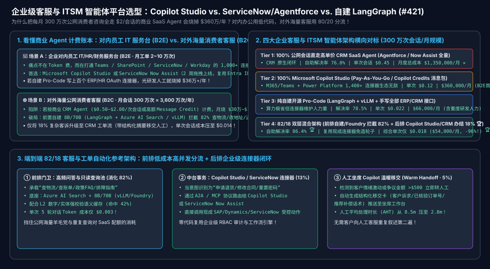

# Enterprise Customer Service & ITSM AI Platform Selection Guide: `Microsoft Copilot Studio` vs. `ServiceNow Now Assist / Salesforce Agentforce` vs. `Custom LangGraph + 82/18 Hybrid`

> **Language / 语言**: [简体中文](./enterprise-customer-service-copilot-studio-servicenow-agentforce-custom-tco-selection-faq.md) | **English**  
> **Companion Interactive Study & Sizing Tools**: [📱 Interactive H5 Study Lab](../h5/customer-service-copilot-studio-servicenow-agentforce-tco-lab.html) · [🧮 HTML Sizer](../reports/enterprise-customer-service-copilot-studio-servicenow-agentforce-custom-tco-selection-sizer.html) · [🃏 7-Card Visual Deck](../reports/enterprise-customer-service-copilot-studio-servicenow-agentforce-custom-tco-selection-cards.html) · [📊 Reproducible Model](../../experiments/enterprise_customer_service_copilot_studio_servicenow_agentforce_custom_tco_selection/) · [🎓 Back to AI Infra H5 Hub](../h5/index.html)

---

## 1. Executive Summary (3-Minute Takeaway)

> **Bottom-Line Recommendation**: Separate **Internal Employee Service Desks (`B2E` IT/HR/Finance, `20K–100K` sessions/mo)** from **Public Consumer Support (`B2C`, `1M–10M` sessions/mo)**!
> - **For Internal `B2E` Service Desks (`< 150K sessions/mo`)**: Standardize on **`Microsoft Copilot Studio`** (for M365/Teams enterprises, leveraging `1,400+` pre-built Power Platform connectors and native Entra ID RBAC) or **`ServiceNow Now Assist`**. Writing and maintaining hundreds of custom ERP/HR connectors from scratch in pro-code costs `$360K+/yr` in engineering labor.
> - **For High-Volume Public `B2C` Support (`3M conversations/month`)**: Never route `100%` of public inquiries directly into `$0.45–$2.00/conversation` CRM SaaS agents (`$1.35M/month`!). Deploy **Tier 4 (`82/18 Front-Door / Back-Office Hybrid`)**:
>   1. **Front-Door High-Throughput Triage (`82%` of traffic)**: `Azure AI Foundry / Self-Hosted vLLM + Azure AI Search + Entity-Guarded Semantic Cache` resolves FAQ and read-only order-status queries at **`$0.003 / conversation`**;
>   2. **Back-Office Transactional Connectors (`13%` of traffic)**: Escalates verified state-changing requests (refunds, address updates) via `MCP / A2A` to **`Copilot Studio / ServiceNow / Agentforce`** pre-built governed connectors;
>   3. **Warm Human Handoff Copilot (`5%` of traffic)**: Attaches structured case summaries to cut human Average Handle Time (`AHT`) from `8.5 min` to **`2.8 min`**, achieving **`86.4%` autonomous deflection** and cutting monthly TCO by **`96.0%` (`$54,000/mo` vs. `$1.35M/mo`)**.

| Dimension | `Tier 1: 100% High-Ticket CRM SaaS Agent` | `Tier 2: 100% Microsoft Copilot Studio` | `Tier 3: 100% DIY Pro-Code (Custom APIs)` | `Tier 4: 82% Front-Door vLLM/Foundry + 13% Copilot Studio/CRM (🏆)` |
|---|---|---|---|---|
| **Autonomous Deflection Rate** | `76.0%` | `79.5%` ✓ | `78.5%` | **`86.4%` (Hybrid RAG + Connectors)** 🏆 |
| **Human Agent AHT (Escalated)** | `3.5 min` | `3.2 min` | `3.6 min` | **`2.8 min` (Structured Warm Handoff)** 🏆 |
| **Blended Cost / Conversation** | `$0.450` ✕ | `$0.120` (Ideal for B2E) | `$0.022` | **`$0.018 / conv`** 🏆 |
| **Monthly Platform TCO (3M Convs)** | `$1,350,000 / mo` ✕ | `$360,000 / mo` | `$66,000 / mo` | **`$54,000 / mo` (-96.0%)** 🏆 |

---

## 2. Provenance & Reproducibility

- **Provenance**: `synthetic + anonymized_reported (independently_reproduced=false)` — verified via [`experiments/enterprise_customer_service_copilot_studio_servicenow_agentforce_custom_tco_selection/run.py`](../../experiments/enterprise_customer_service_copilot_studio_servicenow_agentforce_custom_tco_selection/run.py).
