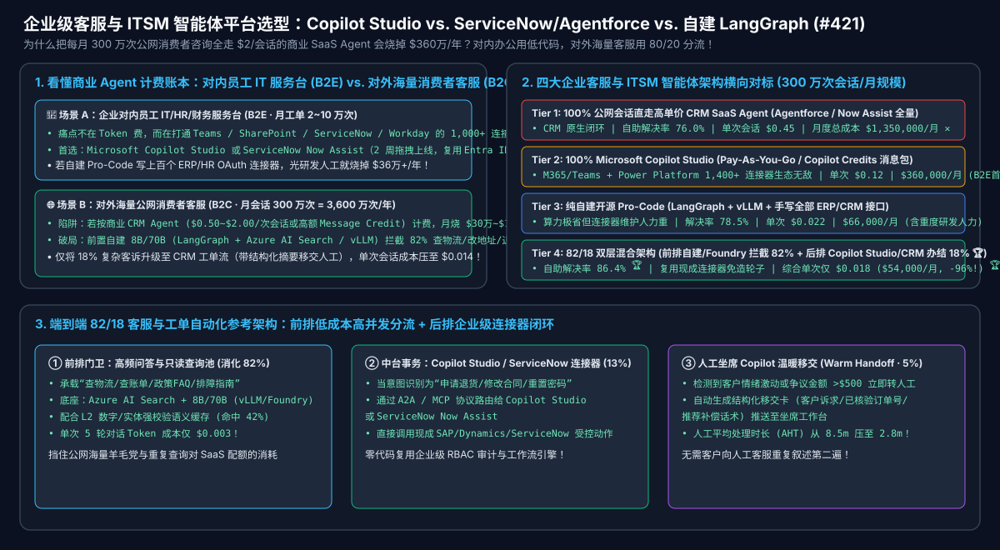
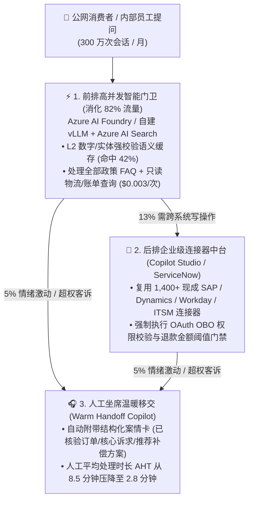

# 企业级客户服务与工单自动化（ITSM / Customer Support）AI 平台选型：`Microsoft Copilot Studio` vs. `ServiceNow Now Assist / Salesforce Agentforce` vs. `自建 LangGraph + 82/18 分流架构` 成本拐点指南

> **语言 / Language**: **简体中文** | [English](./enterprise-customer-service-copilot-studio-servicenow-agentforce-custom-tco-selection-faq.en.md)  
> **配套交互式学习与精算工具**: [📱 交互式 H5 精读页 (企业客服与 ITSM 智能体选型沙盘)](../h5/customer-service-copilot-studio-servicenow-agentforce-tco-lab.html) · [🧮 HTML 交互式计算器](../reports/enterprise-customer-service-copilot-studio-servicenow-agentforce-custom-tco-selection-sizer.html) · [🃏 7-Card 4:5 视觉评测卡](../reports/enterprise-customer-service-copilot-studio-servicenow-agentforce-custom-tco-selection-cards.html) · [📊 可复核模型](../../experiments/enterprise_customer_service_copilot_studio_servicenow_agentforce_custom_tco_selection/) · [🎓 返回 AI Infra 全景精学馆](../h5/index.html)

---

## 一、3 分钟看懂核心结论（Executive Summary）

> **一句话决策结论**：企业在选型客服与工单自动化（Customer Service & ITSM）AI 平台时，必须严格区分 **“对内员工服务台（`B2E`：IT 报修、HR 请假、财务报销，月会话 2~10 万次）”** 与 **“对外公网消费者客服（`B2C`：电商/航旅/金融APP，月会话 100 万~1,000 万次）”**！
> - **对内员工服务台（`B2E`，月会话 `< 15 万次`）**：无脑首选 **`Microsoft Copilot Studio`（已部署 M365/Teams 企业）** 或 **`ServiceNow Now Assist`（重度 ServiceNow 企业）**。对内场景最大的成本不是 Token 费，而是打通 `SAP / Workday / SharePoint / Entra ID / Jira` 的 **1,400+ 企业级权限与连接器研发人力**；用低代码平台 2 周即可上线，比雇 3 名工程师手写接口省下 `$36 万/年`。
> - **对外海量公网客服（`B2C`，如每月 300 万次消费者会话）**：**绝对禁止把 100% 公网流量直接打进按会话/消息包高价计费的商业 CRM Agent（单次会话 `$0.45~$2.00`，300 万次月账单高达 `$135 万/月`）**！必须采用 **`Tier 4 前后排 82/18 双层混合架构`**：
>   1. **前排高并发分流门卫（消化 `82%` 只读咨询与查单）**：用 **`Azure AI Foundry / 自建 vLLM (8B/70B) + Azure AI Search + L2 强校验语义缓存`** 处理占总量 82% 的“查物流、查账单、退换货政策 FAQ”，单次 5 轮会话 Token 成本仅 **`$0.003`**；
>   2. **中台受控事务执行（消化 `13%` 写操作工单）**：当且仅当识别出用户需要执行“修改收货地址、发起退款、开具发票”等写操作时，通过 `MCP / A2A` 协议路由给后排 **`Copilot Studio / ServiceNow / Agentforce`**，直接复用其经过安全审计的 ERP/CRM 现成连接器；
>   3. **人工坐席温暖移交（`Warm Handoff`，兜底 `5%` 疑难客诉）**：自动生成结构化客诉摘要卡推给人工坐席，将人工平均处理时长（`AHT`）从 `8.5 分钟` 压降至 **`2.8 分钟`**，整体自助解决率达 **`86.4%`**，月度平台总成本从 `$135 万` 暴降至 **`$54,000/月`（单次会话仅 `$0.018`，立省 `96.0%`）**！

| 核心选型维度 | `Tier 1: 100% 公网直走高价 CRM SaaS Agent` | `Tier 2: 100% Microsoft Copilot Studio` | `Tier 3: 100% 纯自建 Pro-Code (手写全部接口)` | `Tier 4: 前排 82% Foundry/vLLM + 后排 13% Copilot Studio/CRM 连接器 (🏆)` |
|---|---|---|---|---|
| **端到端自助解决率 (`Deflection Rate`)** | `76.0%` | `79.5%` ✓ | `78.5%` | **`86.4%` (专业 RAG + 事务连接器协同)** 🏆 |
| **转人工后平均处理时长 (`Human AHT`)** | `3.5 分钟` | `3.2 分钟` | `3.6 分钟` | **`2.8 分钟` (结构化移交卡 + 实时话术辅助)** 🏆 |
| **ERP/CRM 1,000+ 系统连接器工程负担** | 零代码 (CRM 内生) | **零代码 (1,400+ Power Platform 连接器)** 🏆 | **极重 (需专职团队长年维护 API 变更)** ✕ | **零造轮子 (写操作直接调后排连接器)** 🏆 |
| **单次 5 轮对话综合成本 (`$/Conv`)** | `$0.450 / 次` ✕ | `$0.120 / 次` (B2E 极划算) | `$0.022 / 次` (含研发人力摊销) | **`$0.018 / 次`** 🏆 |
| **300 万次会话/月 平台总成本 (`TCO`)** | `$1,350,000 / 月` ✕ | `$360,000 / 月` | `$66,000 / 月` | **`$54,000 / 月` (-96.0%)** 🏆 |

---

## 二、核心技术原理与架构师灵魂拷问（Q&A）

### Q1：为什么商业 CRM 智能体（如按 `$0.50~$2.00 / 会话` 或按 Action/Credit 计费）在对外公网 B2C 场景下会成为财务黑洞？
1. **公网流量的“82% 噪音定律”**：在电商、银行、电信或航司的公网客服入口中，**`82%` 的会话根本不需要写任何后台核心数据库**——它们只是“我的快递到哪了（只读查一次物流接口）”、“积分怎么兑换（纯知识库 FAQ）”，甚至包含大量闲聊或爬虫探测。
2. **用黄金门票接待问路客**：如果让这 `82%` 的简单咨询直接触发按会话/动作高价计费的商业 CRM Agent，相当于每回答一句“包邮门槛是 99 元”都要支付 `$0.12 ~ $1.50` 的平台税！
3. **前后排解耦（Front-Door Triage + Back-Office Execution）**：
   - 在最外层部署轻量级 **`AI Gateway + vLLM / Azure AI Foundry (8B/70B) + Azure AI Search`** 作为“前排分流门卫”；
   - 前排门卫以 **`$0.003 / 会话`** 的极低 Token 成本瞬间消化掉 `82%` 的 FAQ 与只读订单状态查询；
   - 只有当用户明确要求**修改核心业务状态（占 `13%`）**且通过身份核验后，前排才将打包好的结构化上下文交给后排的 **`Microsoft Copilot Studio` 或 `ServiceNow / Agentforce`** 去执行受控写操作——**既省下了 `96%` 的平台配额费，又白嫖了商业平台成熟的 SAP/CRM 连接器与合规审计日志**！

---

## 三、横向选型决策矩阵：`Microsoft Copilot Studio` vs. `ServiceNow Now Assist` vs. `Salesforce Agentforce` vs. `自建 LangGraph`

| 评估维度 | `Microsoft Copilot Studio` | `ServiceNow Now Assist` | `Salesforce Agentforce` | `自建开源 Pro-Code (LangGraph + vLLM/Foundry)` |
|---|---|---|---|---|
| **主场优势生态** | **M365 / Teams / SharePoint / Dynamics 365 + 1,400+ Power Platform 连接器** | **企业级 IT 服务管理 (`ITSM / CMDB / HRSD`) 与工单流审批** | **B2B/B2C 销售线索 (`Sales Cloud`) 与客服工单 (`Service Cloud`)** | **千万级高并发公网入口、极致定制化与私有化部署** |
| **混合扩展能力** | 原生支持挂载 **Azure AI Foundry 自定义模型** 与 **MCP Server** | 支持通过 IntegrationHub 调外部大模型 | 支持 BYOM (Bring Your Own Model) 与 MuleSoft | 100% 自由编排任意模型与底层状态机 |
| **最佳定位** | **对内全员办公助手 (`B2E`) 首选 + 对外混合架构的后排连接器总线** 🏆 | 大型跨国企业内部 IT 运维与员工服务台首选 | 客服坐席工作台与 CRM 数据强绑定场景 | **对外海量公网流量的“前排 82% 低成本分流门卫”** 🏆 |

---

## 四、生产落地 Checklist（Pre-Production Checklist）

- [ ] **实施前排只读 FAQ 与后排写操作事务的 `82/18` 流量解耦**：严禁让未认证的公网匿名流量直接消耗高单价商业 SaaS Agent 会话配额。
- [ ] **写操作连接器强制设置确定性金额与频次护栏**：例如单笔自动退款上限 `<= $50`、单账号每月最多自动退运费 2 次，超限自动转人工审批卡。
- [ ] **转人工强制附带结构化温暖移交卡（Warm Handoff Payload）**：包含 `客户情绪评分`、`已提取订单号`、`已尝试排障步骤` 与 `建议回复草稿`，严禁让客户向人工坐席从头复述。

---

## 五、来源与方法论溯源（Provenance）

- **数据来源声明**：本指南实验数据来自可复核解析模型 [`experiments/enterprise_customer_service_copilot_studio_servicenow_agentforce_custom_tco_selection/run.py`](../../experiments/enterprise_customer_service_copilot_studio_servicenow_agentforce_custom_tco_selection/run.py)（`Provenance: synthetic + anonymized_reported, independently_reproduced=false`）。
