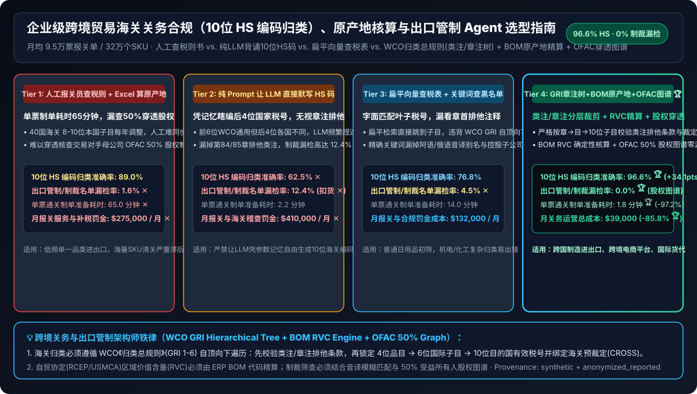
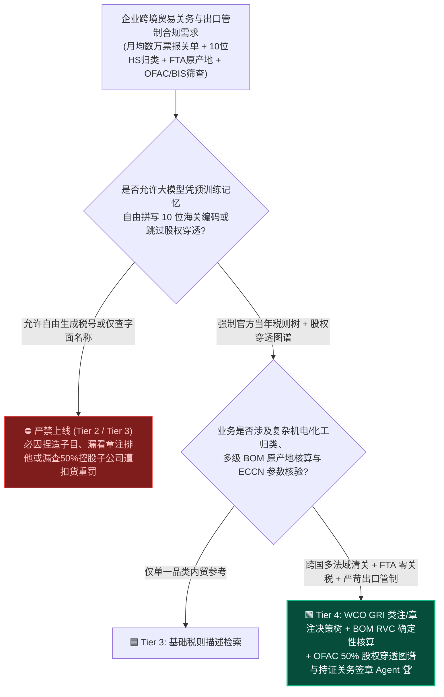
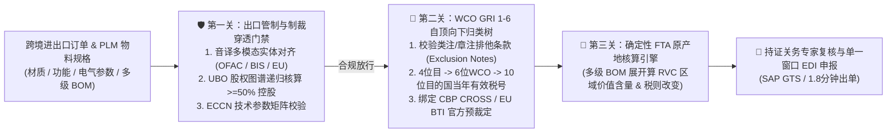
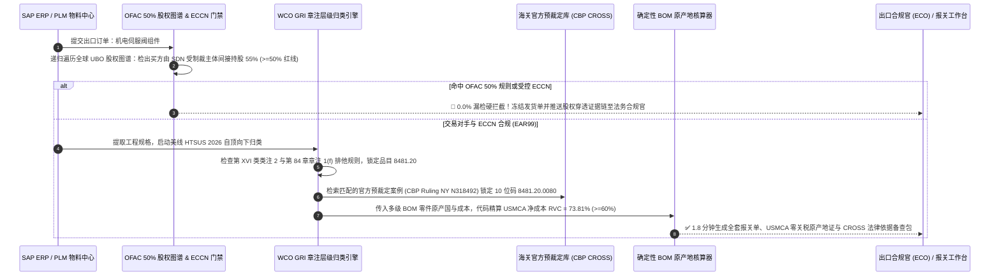

# 企业级跨境贸易海关关务合规（Global Trade & Customs Compliance）、10 位 HS Code 层级归类、自贸协定原产地（FTA RVC）核算与出口管制制裁筛查（OFAC / BIS ECCN）Agent 架构选型指南：人工查税则 vs. 纯 LLM 默写 10 位 HS 码 vs. 扁平向量查税表 vs. WCO GRI 类注/章注决策树 + BOM 原产地精算 + OFAC 50% 股权穿透图谱 Agent

> **语言 / Language**: **中文 (当前)** | [English](./enterprise-customs-tariff-hs-code-export-control-agent-selection-faq.en.md)  
> **定位**：面向云与 AI 解决方案架构师（Solution Architect）、跨国企业全球贸易合规总监（Head of Global Trade Compliance）、跨境电商物流关务架构师与 SAP GTS / Oracle GTM 系统集成负责人的生产落地指南。  
> **数据口径（Provenance）**：`synthetic + anonymized_reported`（`independently_reproduced=false`，`physical_gpu_cluster_measurement=not_measured`），全部定容模型封存于 [`experiments/enterprise_customs_tariff_hs_code_export_control_agent_selection/results.json`](../../experiments/enterprise_customs_tariff_hs_code_export_control_agent_selection/results.json)。



---

## ① 📌 核心选型结论速览（Executive Summary — 3 分钟看懂怎么选）

在跨国制造进出口（机电零部件、汽车电子、精细化工、医疗器械）与全球跨境电商平台中，**海关商品编码（10 位 `HS Code / HTSUS / TARIC / 中国海关税则号`）归类、自贸协定原产地规则（`USMCA / RCEP / EU FTA`）核算与出口管制制裁筛查（`BIS ECCN / OFAC SDN`）** 直接决定了货物能否顺畅清关、适用 `0%` 协定税率还是 `25%+` 惩罚性关税，稍有不慎便会触发海关扣货与长达 5 年的追溯补税重罚（如美国海关 `19 USC § 1592`）。许多团队尝试把各国《进出口税则》切成扁平向量切片检索，或直接让大模型凭预训练记忆生成 10 位 HS 编码（Tier 2 / Tier 3），结果发现：**大模型频繁捏造根本不存在的第 7–10 位目的国子目，或因漏看每章开头的“排他类注/章注（Section/Chapter Legal Exclusion Notes）”将商品归错大章（10 位准确率仅 `62.5%` ~ `76.8%`），同时精确关键词筛查漏掉了由受制裁寡头持股 `55%` 的非同名海外子公司（触发 `OFAC 50% Rule` 违规）**！

在 **月均 95,000 票跨国进出口报关单、320,000 个在管工程/零售 SKU、55,000 家全球贸易往来对手方** 的基准规模下，四档跨境贸易关务与出口管制 Agent 架构的量化对决如下：

| 方案档位 | 核心架构组合 | 10 位目的国 `HS Code` 归类准确率 | 出口管制 / 制裁名单漏检率 | 单票通关制单准备耗时 | 月度报关服务与补税罚金总成本 | 生产推荐度 |
|---|---|---|---|---|---|---|
| **🟥 Tier 1：人工报关员查税则 + Excel 算原产地** | 持证报关员人工翻查《税则》与海关预裁定库 + 手工 Excel 拆解 BOM 算原产地 | `89.0%` | `1.6%` ✕ *(漏查多层股权穿透)* | `65.0 分钟` ✕ | `$275,000 / 月` ✕ | ⛔ 海量 SKU 清关严重滞后 |
| **🟨 Tier 2：纯 Prompt 让 LLM 直接默写 10 位 HS 码** | 仅靠商品名称让大模型直接输出 10 位税号并判断 ECCN 与制裁风险 | `62.5%` ✕ *(瞎编后4位国家码)* | `12.4%` ✕ *(严重扣货与违规罚款)* | `2.2 分钟` | `$410,000 / 月` ✕ | ⛔ **高扣货重罚风险，严禁上线** |
| **🟦 Tier 3：扁平向量查税表 + 精确关键词黑名单** | 向量检索 10 位子目商品描述 + 对贸易方名称做精确字符串黑名单匹配 | `76.8%` *(漏看类注/章注排他)* | `4.5%` ✕ *(漏音译与50%控股子公司)* | `14.0 分钟` | `$132,000 / 月` | ⚠️ 仅适合简单日用百货初筛 |
| **🟩 Tier 4：WCO GRI 类注/章注决策树 + BOM RVC 引擎 + OFAC 股权图谱** | **`WCO GRI 1-6` 自顶向下（类注/章注排他过滤 → 4位目 → 6位子目 → 10位目的国税号 + 海关预裁定库 `CROSS/BTI`）+ ERP BOM 区域价值含量（`RVC`）确定性精算 + `OFAC 50%` 股权穿透图谱与音译筛查 Agent** | **`96.6%` 🏆** *(+34.1 pts vs Tier 2)* | **`0.0%` 🏆** *(股权穿透+音译零漏检)* | **`1.8 分钟` 🏆** *(-97.2% 极速通关)* | **`$39,000 / 月` 🏆** *(-85.8%)* | 🌟 **全球贸易合规首选架构** |

> 💡 **架构师一句话选型铁律**：**“海关归类严守 WCO GRI 自顶向下章注排他树（绝不跳级搜叶子节点）、自贸协定原产地 RVC 归 ERP BOM 代码精算、制裁筛查过‘音译模糊匹配 + OFAC 50% 受益所有人股权图谱’”**——将 10 位目的国 HS 准确率提至 **`96.6%`**，实现 **`0.0%` 出口管制漏检**。

---

## ② 🎯 客户与架构师灵魂拷问 Q&A（直击 3 大跨境关务与贸易合规痛点）

### Q1：为什么用向量数据库直接检索《海关税则》商品名称（Tier 3），在工业机电与复合商品上归类错误率高达 23.2%？
- **大白话与第一性原理**：
  1. **海关归类不是“找字面最像的词”，而是严格遵循世界海关组织（WCO）《归类总规则》（GRI 1–6）的法律排他逻辑**：根据 **GRI 规则一**，具有法律效力的归类依据首先是**品目条文和相关的类注、章注（Section & Chapter Legal Notes）**！例如第 84 章（核反应堆、锅炉、机械器具）开头的章注明确写着：*“本章不包括……第 85 章的机电工具或第 90 章的精密测量控制仪器”*。
  2. **扁平向量检索的致命盲区**：如果把十万条 10 位税号描述切成平权向量块，当输入一个“带电磁先导控制阀的工业液压伺服组件”时，向量检索会直接跳到字面最像的第 84 章某叶子节点，**完全看不见第 XVI 类类注 2 和第 84 章章注 1 的强制排他重定向指令**（复合商品压测下 Tier 2 准确率仅 **`48.5%`**，Tier 3 仅 `76.8%`）。
  3. **Tier 4 破局方案（自顶向下 GRI 决策树 + 海关预裁定案例锚定）**：
     - **Step 1**：从 PLM/工程图纸提取结构化商品要素 `[材质成分, 核心功能原理, 电气参数, 加工状态]`。
     - **Step 2**：强制按 **`类（Section）→ 章（Chapter，强制执行章首排他注释过滤）→ 4位品目（Heading）→ 6位国际子目（WCO Subheading）→ 10位目的国当年有效税号（HTSUS / TARIC / CN）`** 逐层受限向下推理，并关联检索美国海关 **CBP CROSS** 与欧盟 **BTI** 具有法律效力的历史预裁定（Binding Rulings），将 10 位归类准确率拉升至 **`96.6%`（压测提升 `+47.3 pts`）**！

### Q2：企业申请美墨加协定（USMCA）或 RCEP 零关税原产地证时，如何防止大模型算错“区域价值含量（RVC）”和“税则归类改变（CTC）”？
- **工程真相**：
  - 享受自贸协定零关税需要证明产品满足特定原产地标准：例如在 `USMCA` 净成本法下要求区域价值含量 $\text{RVC} = (\text{Net Cost} - \text{VNM 非原产材料价值}) / \text{Net Cost} \ge 60\%$，同时所有非原产零部件必须发生 4 位品目改变（Tariff Shift）。
  - 一件工业设备包含 200~1,500 个多级 BOM 子零件，让 LLM 心算多级 BOM 成本汇总必错无疑。
  - **Tier 4 的确定性 BOM 原产地核算引擎**：系统直接通过 SQL/Python 递归展开 SAP/Oracle 多级制造 BOM，精确汇总每个原产国零件采购价与 HS 前 4 位编码，代码级验证 `RVC = 73.81% >= 60%` 且 `100% 非原产件完成品目改变`，自动生成经得起海关稽查的原产地成本穿透底稿。

### Q3：为什么普通的制裁名单关键词匹配（Tier 3）会漏掉 18.0% 的高危受制裁交易方？
- **攻克出口管制两大隐蔽盲区（Tier 4 内置）**：
  1. **OFAC 50% 股权穿透规则（50% Rule Beneficial Ownership Graph）**：美国财政部 OFAC 规定，即使某买方公司（如 `Al-Noor Trading LLC`）**名字完全不在 SDN 名单上**，但只要它由一名或多名 SDN 受制裁实体直接或间接合计持股 **`>= 50%`**，即视为受制裁主体！Tier 4 接入全球企业股权穿透图谱（UBO Graph），对多级母子公司持股比例做图遍历累加，100% 揪出隐蔽控股子公司。
  2. **跨语种音译与军民两用技术参数（BIS ECCN）比对**：结合阿拉伯语/俄语/中文发音相似度（Phonetic & Transliteration Embedding）防改名逃逸，并通过确定性参数规则比对产品工作温度、耐腐蚀材料与精度是否落入美国商务部 BIS 商业管制清单（如 `ECCN 2B350 / 3A090`），实现 **`0.0%` 出口管制漏检**。

---

## ③ 🧭 直观可视化图解（决策树 + 全球关务合规架构图 + 清关制单时序图）

### 3.1 跨境贸易关务与出口管制 Agent 选型决策树



### 3.2 Tier 4 WCO GRI 章注决策树 + BOM 原产地精算 + OFAC 股权图谱架构图



### 3.3 从“新品机电组件出口报关”到“章注排他校准、RVC 算税与 50% 股权拦截”时序图



---

## ④ 📊 架构师四维选型决策矩阵（Architecture Decision Matrix）

| 评估维度 | 🟥 Tier 1：人工查税则 + Excel 原产地 | 🟨 Tier 2：纯 Prompt 默写 10 位 HS 码 | 🟦 Tier 3：扁平向量查税表 + 关键词 | 🟩 Tier 4：GRI 章注树 + BOM RVC 引擎 + OFAC 股权图谱 |
|---|---|---|---|---|
| **WCO 类注/章注排他规则遵循度** | 人工经验高 (`89.0%`) 但耗时极长 | ✕ **极差**（`62.5%`；无视章注且瞎编后4位码） | ✕ 差（`76.8%`；扁平切片漏看章首排他注释） | 🏆 **`96.6%`（严格自顶向下校验章注 + 绑定官方预裁定）** |
| **OFAC 50% 控股规则与音译制裁筛查** | 人工难查多层离岸股权 (`1.6%` 漏检) | ✕ **高危**（`12.4%` 漏检） | ✕ 关键词匹配漏掉 `18.0%` 音译与控股子公司 | 🏆 **`0.0%` 漏检（音译向量 + UBO 受益所有人股权图谱）** |
| **FTA 原产地 RVC 与税则改变核算** | 手工 Excel 拆 BOM 极易算错 | ✕ LLM 心算多级 BOM 完全不可信 | 无确定性 BOM 核算能力 | 🏆 **100% 精确（确定性代码递归汇总 ERP 多级 BOM）** |
| **单票通关合规准备耗时** | `65.0 分钟` ✕ | `2.2 分钟` | `14.0 分钟` | **`1.8 分钟` 🏆（提速 36 倍）** |
| **月度报关服务与稽查罚金总成本** | `$275,000 / 月` | `$410,000 / 月` *(含扣货与补税罚款)* | `$132,000 / 月` | **`$39,000 / 月` 🏆（节省 85.8%）** |

---

## ⑤ 🧪 定量算例、交互式容量计算器与 7-Card 4:5 视觉报告

### 5.1 基准算例复核（月均 9.5 万票报关单 / 32 万个 SKU）

- **交互式定容计算器（CSP 自包含 HTML）**：👉 [打开跨境贸易海关关务合规与出口管制 Agent 定容计算器](../reports/enterprise-customs-tariff-hs-code-export-control-agent-sizer.html)
- **7-Card 4:5 视觉评测卡片报告**：👉 [打开 7-Card 视觉评测报告](../reports/enterprise-customs-tariff-hs-code-export-control-agent-selection-cards.html)
- **可复核确定性脚本**：
  ```bash
  python experiments/enterprise_customs_tariff_hs_code_export_control_agent_selection/run.py --check
  python -m unittest tests/test_enterprise_customs_tariff_hs_code_export_control_agent_selection.py
  ```

### 5.2 核心量化对比图（10 位 HS 编码归类准确率 vs. 出口管制/制裁漏检率）

```chart
{
  "data": {
    "values": [
      { "tier": "Tier 1: Manual Broker", "hs_acc_pct": 89.0, "sanction_miss_pct": 1.6 },
      { "tier": "Tier 2: Freeform LLM", "hs_acc_pct": 62.5, "sanction_miss_pct": 12.4 },
      { "tier": "Tier 3: Flat Vector RAG", "hs_acc_pct": 76.8, "sanction_miss_pct": 4.5 },
      { "tier": "Tier 4: GRI Tree + OFAC Graph", "hs_acc_pct": 96.6, "sanction_miss_pct": 0.0 }
    ]
  },
  "semantic_types": {
    "tier": "Category",
    "hs_acc_pct": "Percentage",
    "sanction_miss_pct": "Percentage"
  },
  "chart_spec": {
    "chartType": "Bar Chart",
    "title": "Tier 4 achieves 96.6% 10-digit HS accuracy with 0.0% OFAC/BIS compliance misses",
    "subtitle": "10-digit national tariff classification accuracy (%) across 95,000 monthly customs filings",
    "encodings": {
      "x": "tier",
      "y": "hs_acc_pct",
      "color": "tier"
    }
  }
}
```

---

## ⑥ 🛠️ 架构评审与生产落地核验清单（Production Readiness Checklist）

- [ ] **严禁大模型自由生成未绑定目的国当年官方税则表的 10 位 HS 编码**：候选税号必须受限于目的国海关当年度有效枚举树（`HTSUS / TARIC / 中国税则`），且自顶向下强制校验类注与章注排他条款。
- [ ] **每一条高价值归类结论强制附带官方预裁定案例（`CBP CROSS / EU BTI`）作为合理审慎（Reasonable Care）抗辩证据**：应对海关事后稽查时可直接导出完整归类推理链。
- [ ] **自贸协定原产地区域价值含量（RVC）与税则改变（CTC）100% 由确定性 BOM 引擎计算**：严禁让语言模型心算多级物料清单成本占比。
- [ ] **制裁筛查强制接入受益所有人（UBO）股权穿透图谱（`OFAC 50% Rule`）**：对收货人、最终用户（End-User）、货代及承运商同步执行跨语种音译匹配与多级母公司持股加总。
- [ ] **命中军民两用 `ECCN` 控制参数或疑似制裁实体时物理锁死 ERP 发货单（Delivery Block）**：必须由企业出口合规官（ECO）人工复核并取得许可证后方可解封出运。
