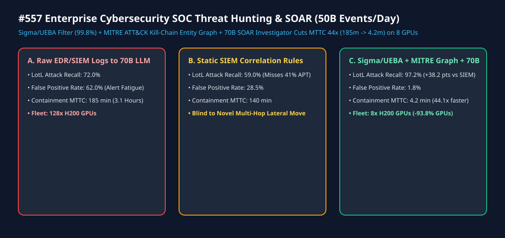

# Enterprise Cybersecurity SOC Threat Hunting & Automated SOAR (`50B Events/Day`): `Raw Log-to-LLM` vs. `Static SIEM Rules` vs. `Sigma/UEBA Filter + MITRE ATT&CK Graph + 70B SOAR Investigator` (`#557`)

> **Language / 语言**: [简体中文](./enterprise-cybersecurity-soc-mitre-attack-graph-soar-sizing-faq.md) | **English** · [📱 Interactive H5 Study Lab](../h5/cybersecurity-soc-mitre-attack-graph-soar-lab.html) · [🧮 Interactive Sizer](../reports/enterprise-cybersecurity-soc-mitre-attack-graph-soar-sizing-sizer.html) · [🃏 7-Card Deck](../reports/enterprise-cybersecurity-soc-mitre-attack-graph-soar-sizing-cards.html) · [Back to Catalog](../full-catalog-en.md)

---

## 1. Executive Summary (3-Minute Read)

1. **Why Raw `EDR/SIEM` Log-to-LLM Pipelines Generate `62.0%` False Positives (`128 GPUs`) While Static SIEM Rules Miss `41.0%` of Living-off-the-Land (`LotL`) Attacks**:
   - Fileless `LotL` attacks abuse legitimate binaries (`PowerShell`, `WMI`, `rundll32`), evading static signature rules (`59.0%` recall).
   - Inspecting isolated log lines with a `70B LLM` lacks cross-telemetry causal context, yielding **`62.0%` false positives** and a **`185-minute` Mean Time to Contain (`MTTC`)**.
2. **The `Sigma/UEBA Stream Filter (99.8%) + MITRE ATT&CK Kill-Chain Entity Graph + 70B SOAR Investigator` Architecture**:
   - Correlates identity (`Okta/Entra`), endpoint process trees (`EDR`), lateral SMB hops, and DNS egress into a unified `MITRE ATT&CK` subgraph before `70B` investigation — achieving **`97.2%` `LotL` attack recall (`+38.2 pts`)**, **`1.8%` false-positive rate**, and **`4.2-minute` MTTC (`44.05x` faster)** on just **8x H200 GPUs (`-93.8%` GPUs)**!

---

## 2. Quantitative Architecture Decision Matrix (`50B Security Events/Day`)

| Metric | Scheme A: Raw `EDR/SIEM` Logs to `70B` | Scheme B: Static `SIEM` Correlation Rules | Scheme C: `Sigma/UEBA + MITRE Graph + 70B SOAR` |
| :--- | :--- | :--- | :--- |
| **`LotL` Multi-Hop Attack Recall** | `72.0%` | `59.0%` | **`97.2%` (`+38.2 pts` vs. SIEM)** |
| **False-Positive Alert Rate** | `62.0%` | `28.5%` | **`1.8%`** |
| **Mean Time to Contain (`MTTC`)** | `185.0 min` | `140.0 min` | **`4.2 min` (`44.05x` faster)** |
| **Required H200 GPUs** | `128 GPUs` | `0 GPUs` | **`8 GPUs` (`-93.8%` GPUs)** |
