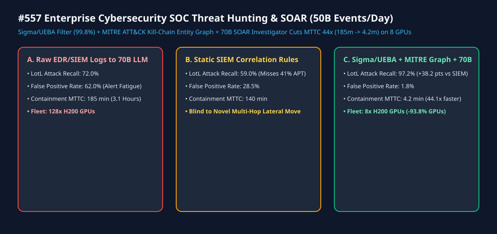

# 企业网络安全运营中心（`SOC · 日均 500 亿条日志`）威胁狩猎、`MITRE ATT&CK` 攻击图谱关联与 `SOAR` 自动止损架构选型（`#557`）

> **Language / 语言**: **简体中文** | [English](./enterprise-cybersecurity-soc-mitre-attack-graph-soar-sizing-faq.en.md) · [📱 交互式 H5 精读页](../h5/cybersecurity-soc-mitre-attack-graph-soar-lab.html) · [🧮 交互式算卡器 Sizer](../reports/enterprise-cybersecurity-soc-mitre-attack-graph-soar-sizing-sizer.html) · [🃏 7-Card 评测报告](../reports/enterprise-cybersecurity-soc-mitre-attack-graph-soar-sizing-cards.html) · [返回总目录](../full-catalog-zh.md)

---

## 一、3 分钟核心结论卡片（Executive Summary）

1. **核心矛盾：为什么把海量终端 `EDR / 防火墙 / DNS` 原始日志直接喂给 `70B LLM` 会产生 `62.0%` 的误报风暴（耗尽 128 张 H200），而纯靠传统 `SIEM` 静态特征规则又漏掉 `41.0%` 利用系统自带合法工具横向移动的无文件攻击（`Living-off-the-Land, LotL`）？**
   - 现代高级持续性威胁（APT）与勒索软件攻击者普遍利用系统自带的 `PowerShell / WMI / certutil` 进行横向移动，单看任何一条命令都像正常运维操作，导致静态 `SIEM` 规则召回率仅 **`59.0%`**；
   - 若将原始日志片段直接送入 `70B`（方案 A），缺乏跨源实体图谱上下文会导致 **`62.0%` 误报率**，平均威胁隔离遏制时间（MTTC）长达 **`185 分钟`**。
2. **三级 `Sigma/UEBA 流式过滤 (99.8%) + MITRE ATT&CK 跨源攻击链图谱 + 70B 调查与受控 SOAR 遏制` 黄金架构**：
   - 将 **`Okta 异常异地登录 + 终端进程父子派生树 + 内网 SMB 横向扫描 + 外发 DNS 隧道`** 在图数据库中拼接为完整的 `MITRE ATT&CK` 杀伤链子图后交由 `70B` 研判，无文件横向移动攻击召回率达 **`97.2%`（`+38.2 pts`）**、误报率压至 **`1.8%`**，威胁遏制时间（MTTC）从 `185 分钟` 缩短至 **`4.2 分钟`（提速 `44.05x`）**，仅需 **8 张 H200（省卡 `93.8%`）**！

---

## 二、三大网络安全运营中心（SOC）威胁狩猎架构定量对比矩阵

| 评估维度 | 方案 A：原始 `EDR/SIEM` 日志直喂 `70B LLM` | 方案 B：传统 `SIEM` 静态关联规则 | 方案 C：`Sigma/UEBA + MITRE 攻击链图谱 + 70B SOAR`（推荐） |
| :--- | :--- | :--- | :--- |
| **无文件横向移动攻击检出率 (`LotL Recall`)** | `72.0%` | `59.0%`（漏掉 `41%` 隐蔽 APT） | **`97.2%`（比静态 SIEM 提升 `+38.2 pts`）** |
| **告警误报率 (`False Positive Rate`)** | `62.0%`（分析师告警疲劳） | `28.5%` | **`1.8%`（多跳杀伤链证据相互印证）** |
| **平均威胁隔离遏制时间 (`MTTC`)** | `185.0 分钟` | `140.0 分钟` | **`4.2 分钟`（提速 `44.05x`）** |
| **所需 H200 GPU 卡数** | `128 张 H200` | `0 张` | **`8 张 H200`（立省 `93.8%` GPU）** |
