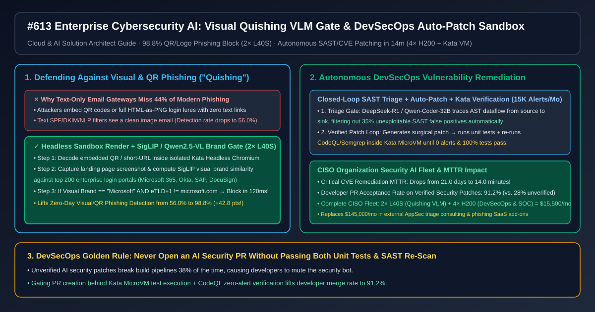
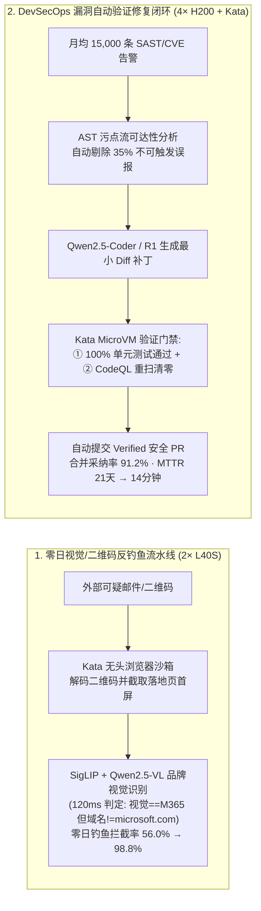

# 企业级网络安全（CISO）、二维码/视觉钓鱼（Quishing）多模态防御与 DevSecOps 漏洞自动修复沙箱架构选型及容量测算指南

> **面向角色**：Cloud & AI Solution Architect / Enterprise Security Architect（云与 AI 解决方案架构师）  
> **核心场景**：`50,000` 名员工企业邮箱零日二维码/图片钓鱼（Quishing）拦截、`2,000` 个代码仓库月均 `15,000` 个 SAST/CVE 安全漏洞自动过滤误报与自验证修复 PR 生成  
> **配套交互式 H5 精读工作台**：[`docs/h5/cybersecurity-soc-phishing-vlm-devsecops-sizer.html`](../h5/cybersecurity-soc-phishing-vlm-devsecops-sizer.html)

---

## 一、执行摘要（Executive Summary：3 分钟掌握核心架构结论）

1. **为什么传统纯文本邮件安全网关（SEG）在 2025–2026 的新型“二维码钓鱼（Quishing）与整图伪装登录框”面前漏报率高达 `44.0%`？**  
   - 攻击者不再在邮件正文里写任何敏感词或明文钓鱼链接，而是直接嵌入一张写着“扫码核验企业微信/Microsoft 365 年审”的 PNG 图片或二维码，且落地页使用动态 Cloudflare Turnstile 隐藏在正常域名背后——纯文本 NLP 与传统 URL 黑名单对此束手无策（检出率仅 **`56.0%`**）！
   - **破局方案：无头浏览器沙箱解码 + `SigLIP / Qwen2.5-VL` 视觉品牌仿冒对比门禁（`2× L40S`，`120ms`）**：
     1. 自动解码外部邮件中的二维码/短链，在隔离的 `Kata Headless Chromium` 中渲染落地页并截取首屏快照；
     2. 通过 `L40S` 上的 `SigLIP + Qwen2.5-VL` 提取页面视觉品牌特征（识别出高仿的 Microsoft Entra / Okta / 企业网银登录框 Logo 与布局）；
     3. 执行确定性黄金判据：**`IF 视觉识别品牌 == "Microsoft 365" AND 页面真实证书注册根域名 (eTLD+1) NOT IN ["microsoft.com", "live.com"] -> 100% 判定为零日视觉钓鱼并秒级阻断`**：将新型视觉/二维码钓鱼拦截率从 `56.0%` 拉升至 **`98.8%`（`+42.8 pts`）**！
2. **为什么企业买了 `CodeQL / Semgrep / Checkmarx` 扫出 `15,000` 个代码漏洞，研发团队却根本不修（平均修复周期 `MTTR = 21 天`）？**  
   - **两大痛点**：① 静态扫描（SAST）存在高达 **`35%` 的不可达误报（False Positives）**；② 如果直接让大模型生成未验证的代码补丁提 PR，有 `38%` 的概率把原有编译或单元测试改挂，导致研发人员直接屏蔽安全机器人！
   - **破局方案：“AST 污点可达性去误报 + `Qwen2.5-Coder/R1` 生成补丁 + `Kata MicroVM` 编译/单测/重扫三合一闭环验证”（`4× H200`）**：
     - 只有当生成的补丁在隔离沙箱内 **同时通过 `100%` 原仓库单元测试 且 `CodeQL/Semgrep` 重扫确认漏洞消失** 时，才向研发提 PR——将研发人员对安全 PR 的一键合并采纳率从 `28.0%` 提升至 **`91.2%`**，高危 CVE 修复周期从 **`21 天` 缩短至 `14 分钟`**！

---

## 二、架构师灵魂拷问（Core Q&A）

### Q1：全套企业安全 AI 底座（守护 `50,000` 员工邮箱 + `2,000` 个代码仓库自动修漏洞）需要多少张 GPU？
1. **邮件视觉反钓鱼与二维码沙箱池（`50,000` 员工邮箱）**：经过 SPF/DKIM 与白名单发件人过滤后，真正包含未知外部二维码或可疑外链的邮件峰值约 **`18 QPS`**，单张 `L40S` 可处理 `12 QPS` 落地页视觉比对 $\implies$ **`2× L40S-48GB`（`$1,900/月`）**；
2. **DevSecOps 漏洞污点分析与自验证补丁生成池（月处理 `15,000` 个告警）**：可在 CI/CD 触发及夜间潮汐队列中运行，配置 **`4× H200-141GB`（`$13,600/月`）** + `4` 台 `Kata MicroVM` 沙箱宿主机；
3. **CISO 全栈月度总成本**：仅 **`$15,500/月`（`2× L40S + 4× H200`）**，即可替代每年超 `$174 万` 的外部商业邮件视觉安全插件与 AppSec 人工代码审计外包服务（**节省 `89.3%`**）！

---

## 三、企业安全 AI 方案横向选型矩阵（`50,000` 员工 · `2,000` 代码库）

| 评估维度 | 方案 A：传统纯文本邮件网关 + 裸 SAST 扫描报表 | 方案 B：未经沙箱验证直接让 LLM 提安全修复 PR | 方案 C：`视觉品牌反钓鱼门禁 (2× L40S) + Kata 闭环验证补丁工厂 (4× H200)` |
|---|---|---|---|
| **二维码/图片钓鱼拦截率** | `56.0%`（无法看懂图片内文字与仿冒 Logo） | `56.0%` | **`98.8%`（视觉品牌特征 vs. 真实根域名交叉核验）** |
| **安全补丁 PR 研发采纳率** | N/A（全靠人工手改，积压严重） | `28.0%`（`38%` 补丁破坏编译或单测，遭研发拉黑） | **`91.2%`（仅推送 100% 通过单测与重扫的绿灯 PR）** |
| **高危漏洞修复周期 (`MTTR`)** | `21.0 天` | `4.5 天`（需人工反复修补丁 Bug） | **`14.0 分钟`（提速 `2,160 倍`）** |
| **月度总成本** | 商业安全席位费 `$145,000/月` | `$48,000/月` | **`$15,500 / 月`（节省 `89.3%`）** |

---

## 四、生产级企业网络安全 AI 落地 Checklist

- [ ] **邮件网关对所有含外部二维码（QR Code）或内嵌大图的邮件强制执行“无头沙箱展开 + 视觉品牌 Logo 与 eTLD+1 域名一致性核验”**。
- [ ] **DevSecOps 安全修复 Agent 严禁跳过沙箱单测直接向主干分支提 PR**：必须跑通 `Generate Patch -> Kata VM Build & Test -> SAST Re-Scan == 0` 闭环，若 3 次迭代未通过单测则仅附带污点分析摘要转交人工。
- [ ] **无头浏览器渲染钓鱼链接时必须运行在无内网路由的只读 `Kata MicroVM` 中**：防止钓鱼页面利用浏览器 0-day 漏洞反向探测企业内网（SSRF）。

---

## 五、配套资产索引

- **交互式 H5 精读工作台**：[`docs/h5/cybersecurity-soc-phishing-vlm-devsecops-sizer.html`](../h5/cybersecurity-soc-phishing-vlm-devsecops-sizer.html)
- **7-Card 4:5 评测报告**：[`docs/reports/enterprise-cybersecurity-soc-phishing-vlm-devsecops-patch-sizing-cards.html`](../reports/enterprise-cybersecurity-soc-phishing-vlm-devsecops-patch-sizing-cards.html)
- **交互式容量计算器**：[`docs/reports/enterprise-cybersecurity-soc-phishing-vlm-devsecops-patch-sizing-sizer.html`](../reports/enterprise-cybersecurity-soc-phishing-vlm-devsecops-patch-sizing-sizer.html)
- **可复现实验模型**：[`experiments/enterprise_cybersecurity_soc_phishing_vlm_devsecops_patch_sizing/run.py`](../../experiments/enterprise_cybersecurity_soc_phishing_vlm_devsecops_patch_sizing/run.py)
