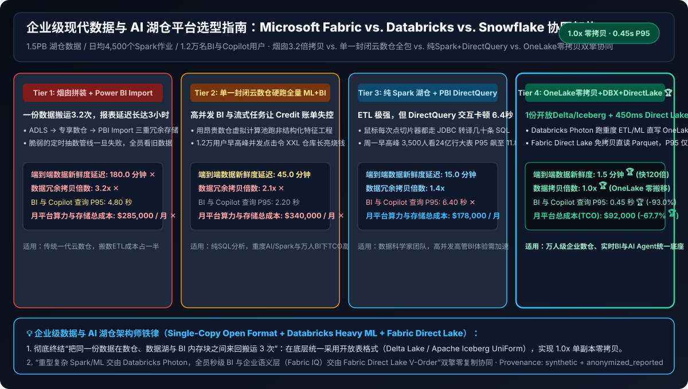
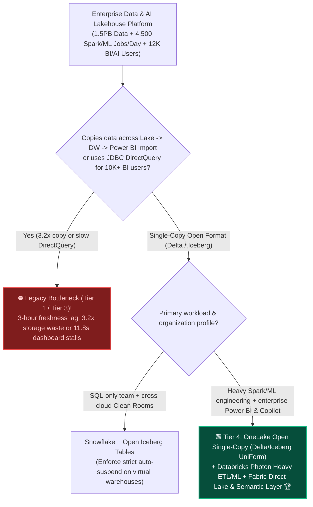
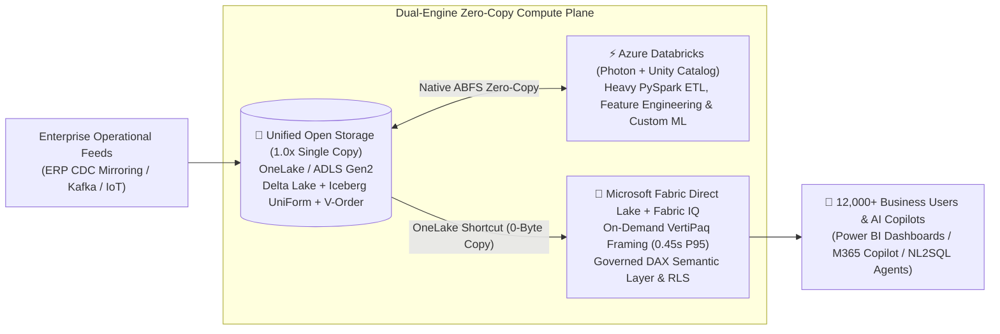
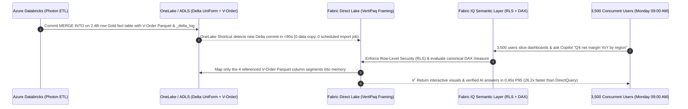

# Enterprise Data & AI Lakehouse Platform Selection Guide: `Microsoft Fabric (OneLake + Direct Lake)` vs. `Databricks Unity Catalog` vs. `Snowflake` vs. Open Zero-Copy Dual-Engine Architecture (`OneLake Delta/Iceberg UniForm + Databricks Heavy Spark/ML + Fabric Direct Lake Sub-Second BI & Semantic Layer`)

> **Language / 语言**: **English (Current)** | [中文](./enterprise-data-platform-fabric-databricks-snowflake-lakehouse-selection-faq.md)  
> **Scope**: End-to-end production reference architecture and TCO selection guide for Cloud & AI Solution Architects, Chief Data Officers (`CDOs`), VPs of Data Platform Engineering, and Enterprise BI / AI Agent (`Fabric IQ / NL2SQL`) Architects.  
> **Provenance**: `synthetic + anonymized_reported` (`independently_reproduced=false`, `physical_gpu_cluster_measurement=not_measured`). Deterministic evaluation model sealed in [`experiments/enterprise_data_platform_fabric_databricks_snowflake_lakehouse_selection/results.json`](../../experiments/enterprise_data_platform_fabric_databricks_snowflake_lakehouse_selection/results.json).



---

## ① 📌 Executive Summary (3-Minute Architect Verdict)

When architecting an enterprise Data & AI foundation, CTOs and Chief Data Officers (`CDOs`) face a perennial strategic question: **"Should we standardize on Microsoft Fabric, Databricks, or Snowflake—and if our data engineers already love Databricks, how do we serve 12,000 business users on Power BI and M365 Copilot without copying petabytes of data three times?"** Legacy stitched stacks (`ADF + ADLS + Dedicated DW + Power BI Import Mode`, Tier 1) duplicate data **`3.2×`** with a **`180.0-minute (3-hour)`** freshness lag. Conversely, pointing Power BI `DirectQuery` over JDBC/Thrift at a pure Spark SQL warehouse (Tier 3) translates every dashboard slicer click into live SQL queries, degrading `P95` dashboard latency to **`6.40s` (`11.80s` during Monday 09:00 AM executive traffic storms)**.

Evaluated across a production baseline of **1.5 PB of active lakehouse data, 4,500 daily Spark ETL and ML jobs, and 12,000 concurrent BI and AI Copilot users**, the four architectural tiers compare as follows:

| Architectural Tier | Core Stack Combination | End-to-End Freshness Lag | Data Copy Duplication Factor | 12K-User BI / Copilot `P95` Latency | Monthly Compute, Storage & BI TCO | Production Verdict |
|---|---|---|---|---|---|---|
| **🟥 Tier 1: Legacy Siloed Stack + PBI Import** | `ADF` + `ADLS` + Dedicated DW + scheduled `Power BI Import` memory cubes | `180.0 min` (`3h` ✕) | `3.2x` ✕ *(Lake + DW + Import copies)* | `4.80 sec` | `$285,000 / mo` ✕ | ⛔ Half of compute wasted copying data |
| **🟨 Tier 2: Monolithic Cloud DW for All ML & BI** | Running heavy unstructured Python/ML + 12K-user BI on proprietary XXL warehouses | `45.0 min` | `2.1x` ✕ | `2.20 sec` | `$340,000 / mo` ✕ | ⛔ Runaway credit burn under concurrency |
| **🟦 Tier 3: Pure Spark Lakehouse + `DirectQuery`** | `Databricks` ETL + `Power BI DirectQuery` translating clicks into JDBC SQL | `15.0 min` | `1.4x` | `6.40 sec` ✕ *(`11.8s` Monday peak)* | `$178,000 / mo` | ⚠️ Strong ML, sluggish interactive BI |
| **🟩 Tier 4: Open Zero-Copy Lakehouse (`OneLake` + `Databricks` + `Direct Lake`)** | **Single-Copy `OneLake / ADLS Gen2` (`Delta / Iceberg UniForm`) + `Azure Databricks Photon` for Heavy Spark/ML + `Microsoft Fabric Direct Lake (V-Order)` for Sub-Second BI & `Fabric IQ` Semantic Layer** | **`1.5 min` 🏆** *(120× faster)* | **`1.0x` 🏆** *(Zero-copy single source)* | **`0.45 sec` 🏆** *(-93.0% faster)* | **`$92,000 / mo` 🏆** *(-67.7%)* | 🌟 **Recommended Architecture** |

> 💡 **Golden Rule for Enterprise Data & AI Lakehouse Architects**: **"Eliminate data-movement pipelines between your Lake, Warehouse, and BI cubes—store a single open copy in `OneLake / ADLS Gen2` (`Delta Lake + Iceberg UniForm`), run complex PySpark/ML engineering on `Azure Databricks Photon` with `V-Order` enabled, and serve 12,000+ Power BI and AI Copilot users via zero-copy `Fabric Direct Lake`."**

---

## ② 🎯 Customer & Architect Deep-Dive Q&A (3 Real-World Lakehouse Architecture Pain Points)

### Q1: How does Microsoft Fabric `Direct Lake` achieve 0.45-second P95 latency on a 2.4-billion-row table without importing data or running SQL `DirectQuery`?
- **First-Principles Reality**:
  1. **Breaking the `Import` vs. `DirectQuery` Tradeoff**: Historically, architects had to choose between **Import Mode** (fast in-memory VertiPaq scans, but requires copying data on a rigid schedule with a 3-hour lag) and **DirectQuery Mode** (zero data copy, but every visual click fires live SQL over JDBC/ODBC, stalling at `6.40s–11.80s` under high user concurrency).
  2. **Zero-Copy On-Demand VertiPaq Framing (`Direct Lake`)**: Because `OneLake` stores data natively as open `Delta Lake Parquet` files, and `V-Order` write optimization aligns Parquet row groups with Power BI's in-memory VertiPaq dictionary/RLE compression layout, `Direct Lake` **bypasses the SQL query execution engine entirely**. The VertiPaq engine maps only the needed column segments directly from `OneLake` into memory on demand the moment a new `_delta_log` commit lands—delivering **`1.5-minute` data freshness** and **`0.45-second` `P95` latency (`26.2×` faster than `DirectQuery` at Monday morning peak)** with **`1.0x` storage**.

### Q2: If our engineering team already uses Azure Databricks, how do Databricks and Microsoft Fabric work together without duplicating storage or governance?
- **The Zero-Copy "Better Together" Pattern (`ADLS Gen2 / OneLake Shortcuts` + `Delta UniForm`)**:
  - **Do not rip-and-replace working Databricks pipelines**: `OneLake` is built on top of `ADLS Gen2` and speaks native `ABFS` and `Delta Lake / Iceberg` APIs.
  - In Tier 4, `Azure Databricks Photon` writes Gold Delta tables directly to `OneLake` (or mounts existing `Unity Catalog` ADLS Gen2 paths into Fabric via zero-copy **`OneLake Shortcuts`**) with `'delta.universalFormat.enabledFormats' = 'iceberg'` (`UniForm`). There is **zero physical data movement, zero egress fee, and zero duplicate storage bill**.

### Q3: How should an Architect position Microsoft Fabric vs. Databricks vs. Snowflake across enterprise workloads?
- **Clear Workload-to-Engine Mapping**:
  - **Microsoft Fabric (`OneLake + Direct Lake + Eventhouse + Fabric IQ`)**: Unbeatable for the **Enterprise Consumption, Real-Time KQL Telemetry, Governed Semantic Layer, and Self-Service BI/Copilot plane** (plus reserved `F64+` capacity eliminates per-user Power BI Pro licensing fees for thousands of viewers).
  - **Databricks (`Unity Catalog + Photon + Mosaic AI`)**: Ideal for **complex multi-stage PySpark data engineering, custom feature engineering, unstructured data processing, and deep ML/LLM training**.
  - **Snowflake**: Strong fit for SQL-centric analytics teams and cross-cloud B2B Data Clean Rooms; when paired with a lakehouse, always enforce **open `Apache Iceberg` / `Delta UniForm` tables** to prevent proprietary storage lock-in.

---

## ③ 🧭 Visual Architecture Diagrams (Decision Tree + Zero-Copy Dual-Engine Topology + Sequence Flow)

### 3.1 Architecture Selection Decision Tree



### 3.2 Tier 4 OneLake Single-Copy + Databricks Photon + Fabric Direct Lake Topology



### 3.3 End-to-End Sequence: Zero-Copy Commit from Databricks to 3,500 Concurrent Power BI Users



---

## ④ 📊 4-Tier Architecture Decision Matrix

| Evaluation Dimension | 🟥 Tier 1: Siloed Stack + PBI Import | 🟨 Tier 2: Monolithic Cloud DW | 🟦 Tier 3: Pure Spark + `DirectQuery` | 🟩 Tier 4: `OneLake` + `Databricks` + `Direct Lake` |
|---|---|---|---|---|
| **Storage & ETL Copy Duplication** | `3.2x` ✕ (Lake + DW + Import cubes) | `2.1x` ✕ (proprietary table ingestion) | `1.4x` | 🏆 **`1.0x` (single open `Delta / Iceberg` copy)** |
| **End-to-End Data Freshness Lag** | `180.0 min` (`3h` ✕) | `45.0 min` | `15.0 min` | 🏆 **`1.5 min` (instant framing on Delta commit)** |
| **12K-User BI & AI Copilot `P95` Latency** | `4.80 sec` | `2.20 sec` *(high XXL credit cost)* | `6.40 sec` ✕ *(`11.8s` Monday peak)* | 🏆 **`0.45 sec` (VertiPaq zero-copy `Direct Lake`)** |
| **Open Table Format Interoperability** | Poor (fragmented governance) | ✕ Proprietary storage lock-in | Good (`Unity Catalog`) | 🏆 **Best-in-class (`Delta UniForm` reads as Delta & Iceberg)** |
| **Monthly 1.5-PB Platform & BI TCO** | `$285,000 / mo` | `$340,000 / mo` *(credit spikes)* | `$178,000 / mo` | **`$92,000 / mo` 🏆 (-67.7%)** |

---

## ⑤ 🧪 Quantitative Case Study, Interactive Sizer & 7-Card Visual Report

- **Interactive HTML Sizer**: 👉 [Open Enterprise Data & AI Lakehouse Platform Sizer](../reports/enterprise-data-platform-fabric-databricks-snowflake-lakehouse-sizer.html)
- **7-Card 4:5 Visual Benchmark Report**: 👉 [Open 7-Card Visual Benchmark Deck](../reports/enterprise-data-platform-fabric-databricks-snowflake-lakehouse-selection-cards.html)
- **Deterministic Verification**:
  ```bash
  python experiments/enterprise_data_platform_fabric_databricks_snowflake_lakehouse_selection/run.py --check
  python -m unittest tests/test_enterprise_data_platform_fabric_databricks_snowflake_lakehouse_selection.py
  ```

---

## ⑥ 🛠️ Production Readiness & Architecture Review Checklist

- [ ] **Standardize on Open Table Formats (`Delta Lake + Iceberg UniForm`) in `OneLake / ADLS Gen2`**: Never lock petabyte-scale enterprise data into a single vendor's proprietary storage engine.
- [ ] **Enable `V-Order` Optimization and Scheduled `OPTIMIZE` Compaction on Gold Tables**: Prevent small-file proliferation so `Fabric Direct Lake` stays within in-memory framing guardrails without falling back to `DirectQuery`.
- [ ] **Mount Existing Databricks `ADLS Gen2` Gold Tables via Zero-Copy `OneLake Shortcuts`**: Eliminate all `ADF` copy pipelines whose only purpose was moving data from the Lakehouse into BI storage.
- [ ] **Centralize Business Metrics and Row-Level Security (`RLS`) in the `Fabric IQ / Semantic Model` Layer**: Route both human Power BI dashboards and AI Copilot (`NL2SQL`) agents through the governed semantic layer.
- [ ] **Rightsize Compute Commitments (`Reserved Fabric F-SKU` + `Databricks Commit`)**: Leverage Fabric's 24-hour background compute smoothing for bursty ETL jobs and serverless auto-termination for interactive Spark clusters.
