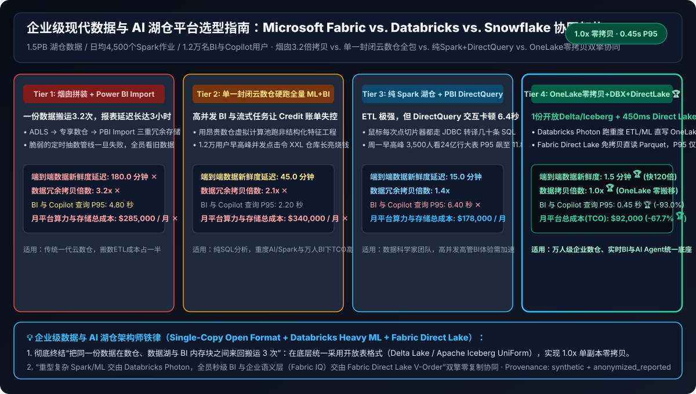
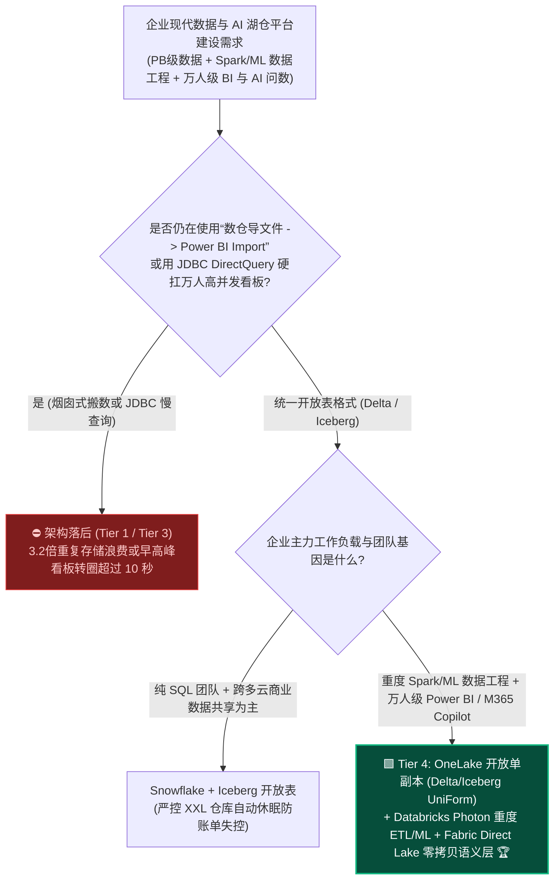
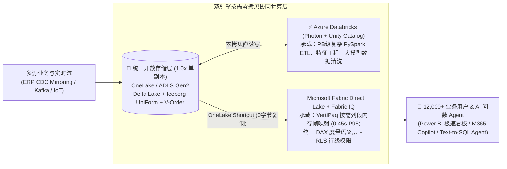
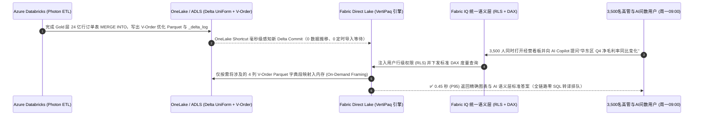

# 企业级现代数据与 AI 湖仓平台（Enterprise Data & AI Lakehouse Platform）横向选型指南：`Microsoft Fabric (OneLake + Direct Lake)` vs. `Databricks Unity Catalog` vs. `Snowflake` vs. 开放零拷贝双引擎协同架构（`OneLake Delta/Iceberg UniForm + Databricks 重度 ETL/ML + Fabric Direct Lake 亚秒级 BI 与语义层`）

> **语言 / Language**: **中文 (当前)** | [English](./enterprise-data-platform-fabric-databricks-snowflake-lakehouse-selection-faq.en.md)  
> **定位**：面向云与 AI 解决方案架构师（Solution Architect）、首席数据官（CDO）、数据平台副总裁与企业 BI / AI 智能问数（Text-to-SQL / Fabric IQ）底座架构师的生产落地指南。  
> **数据口径（Provenance）**：`synthetic + anonymized_reported`（`independently_reproduced=false`，`physical_gpu_cluster_measurement=not_measured`），全部定容模型封存于 [`experiments/enterprise_data_platform_fabric_databricks_snowflake_lakehouse_selection/results.json`](../../experiments/enterprise_data_platform_fabric_databricks_snowflake_lakehouse_selection/results.json)。



---

## ① 📌 核心选型结论速览（Executive Summary — 3 分钟看懂怎么选）

在构建支撑企业 BI 分析与生成式 AI（RAG / Text-to-SQL Agent / 特征工程）的现代数据底座时，CTO 与首席数据官（CDO）面临最高频的架构抉择：**“我们到底该选 Microsoft Fabric、Databricks 还是 Snowflake？或者已经用了 Databricks 的数据工程团队，如何与全公司 1.2 万名业务人员使用的 Power BI / M365 Copilot 打通，而不用把几百 TB 数据来回搬运复制三遍？”** 传统的拼装式架构（`ADF + ADLS + 专享 SQL 数仓 + Power BI Import 定时导入`，Tier 1）把同一份数据复制了 **`3.2 倍`**，端到端报表可见延迟长达 **`180 分钟（3 小时）`**；而如果在纯 Spark 湖仓之上用传统的 `Power BI DirectQuery` 跨 JDBC 直连查询 24 亿行大表（Tier 3），每次业务员点击看板切片器都会触发几十条实时 SQL，导致早高峰 P95 响应卡顿至 **`6.40 秒 ~ 11.80 秒`**！

在 **1.5 PB 活跃湖仓数据、日均 4,500 个 Spark ETL 与机器学习作业、12,000 名业务 BI 与 AI 问数（Copilot）并发用户** 的基准规模下，四档企业级数据与 AI 湖仓架构的量化对决如下：

| 方案档位 | 核心架构组合 | 端到端数据新鲜度延迟 | 数据冗余拷贝倍数 | 万人 BI / Copilot 查询 `P95` | 月度平台算力与存储总成本 (`TCO`) | 生产推荐度 |
|---|---|---|---|---|---|---|
| **🟥 Tier 1：传统多组件烟囱拼装 + PBI Import** | `ADF` + `ADLS` + 专享数仓 + `Power BI Import` 定时全量/增量导入内存块 | `180.0 分钟` (`3h` ✕) | `3.2x` ✕ *(湖+仓+BI三份拷贝)* | `4.80 秒` | `$285,000 / 月` ✕ | ⛔ 一半算力浪费在纯搬数 ETL 上 |
| **🟨 Tier 2：单一封闭云数仓硬跑全量 ML + 万人 BI** | 将非结构化 Python/ML 处理与 1.2 万用户高并发 BI 全部塞进传统云数仓 XXL 集群 | `45.0 分钟` | `2.1x` ✕ | `2.20 秒` | `$340,000 / 月` ✕ | ⛔ 早高峰并发与流式任务令 Credit 暴涨 |
| **🟦 Tier 3：纯 Spark 湖仓 + Power BI DirectQuery** | `Databricks` 完成 ETL + `Power BI` 通过 JDBC/Thrift `DirectQuery` 实时查 SQL 端点 | `15.0 分钟` | `1.4x` | `6.40 秒` ✕ *(早高峰卡至11.8s)* | `$178,000 / 月` | ⚠️ 数据科学强，但万人交互式 BI 慢 |
| **🟩 Tier 4：OneLake 开放单副本 + Databricks ETL + Fabric Direct Lake 双擎零拷贝协同** | **底层统一 `OneLake / ADLS Gen2` 开放表格式（`Delta Lake + Iceberg UniForm`）+ `Azure Databricks Photon` 跑重度复杂 Spark/ML + `Microsoft Fabric Direct Lake (V-Order)` 零拷贝承载亚秒级 BI 与 `Fabric IQ` 语义层** | **`1.5 分钟` 🏆** *(提速120倍)* | **`1.0x` 🏆** *(零搬移单副本)* | **`0.45 秒` 🏆** *(-93.0% 亚秒响应)* | **`$92,000 / 月` 🏆** *(-67.7%)* | 🌟 **现代企业数据与 AI 底座首选架构** |

> 💡 **架构师一句话选型铁律**：**“彻底终结在数据湖、数仓与 BI 内存块之间来回搬数的伪湖仓；底层用 `OneLake / ADLS` 存唯一一份开放 `Delta / Iceberg (UniForm)` 表，算力层让 `Databricks Photon` 干重度复杂 PySpark/ML 加工并开启 `V-Order`，消费层用 `Fabric Direct Lake` 免拷贝直读底层 Parquet 文件”**——既保留 Databricks 的顶级数据工程能力，又白拿 `0.45 秒` 的万人级 Power BI 极速体验与 `Fabric IQ` AI 语义层！

---

## ② 🎯 客户与架构师灵魂拷问 Q&A（直击 3 大数据平台选型痛点）

### Q1：Microsoft Fabric 的 `Direct Lake` 模式到底是什么黑科技？为什么它既不需要像 `Import` 那样定时搬数据，又比 `DirectQuery` 快 14 倍？
- **大白话与第一性原理**：
  1. **过去十年 BI 架构的“不可能三角”**：
     - **Import（导入模式）**：性能够快（数据被压进 Power BI 专属的 VertiPaq 列式内存引擎），但每天要把几百 GB 数据从数仓抽出来重新编码复制一份，延迟高达 **`3 小时`**，且受单模型内存容量上限卡死。
     - **DirectQuery（直连模式）**：不用搬数据，但业务员在报表上每点一下鼠标筛选器，Power BI 就得把 DAX 转译成复杂的 SQL 发给远端 Spark/数仓引擎现算（走 JDBC/ODBC 序列化传输），在 24 亿行大表 + 3,500 人周一早高峰并发下，P95 延迟飙升到 **`11.80 秒`**！
  2. **`Direct Lake` 的底层破局原理（零拷贝按需列帧加载 Zero-Copy On-Demand Framing）**：
     - 因为 `OneLake` 底层的 `Delta Lake` 表内部本身就是列式存储的 `Parquet` 文件（开启 `V-Order` 排序与字典游程编码后，其物理结构与 Power BI 的 VertiPaq 内存格式高度同构）！
     - 当上游 `Databricks` 或 `Fabric Spark` 提交一笔新的 Delta 事务日志（`_delta_log`）时，**`Direct Lake` 根本不通过 SQL 引擎做中间转译，而是由 Power BI 的 VertiPaq 引擎直接通过内存映射按需将 OneLake 上所查询的那几列 Parquet 数据段（Column Segments）零拷贝加载进内存帧**！
     - 结果：上游数据入湖后 **`1.5 分钟`** 报表即刻可见，且 3,500 人并发查询 P95 仅需 **`0.45 秒`（比 DirectQuery 快 `26.2 倍`）**！

### Q2：如果企业已经有很强的 Azure Databricks 团队，选 Microsoft Fabric 是不是必须把 Databricks 推倒重来？两者怎么实现“1+1 > 2 零拷贝共生”？
- **工程真相（严禁非此即彼的二选一思维）**：
  - **Databricks 与 Microsoft Fabric 共享完全相同的底层存储（`ADLS Gen2 / OneLake`）与开放表格式（`Delta Lake / Apache Iceberg UniForm`）！**
  - **Tier 4 黄金分工范式**：
    1. **重度数据工程与特征工程留给 `Azure Databricks`**：对于极其复杂的超大规模流批一体清洗（Delta Live Tables）、非结构化文本/多模态清洗、复杂图计算与自定义 PyTorch/MLflow 训练，继续充分发挥 Databricks `Photon` 引擎与 `Unity Catalog` 的深度调优优势，并将产出的 Gold 层 Delta 表直接落盘在共享的 ADLS Gen2 / OneLake 容器中（开启 `delta.parquet.vorder.enabled = true`）。
    2. **零拷贝挂载与全员消费交给 `Microsoft Fabric`**：通过 **`OneLake Shortcuts（快捷方式）`** 或 **`Unity Catalog -> OneLake 镜像目录`**，在 0 字节物理复制、0 网络出站费（Egress）的前提下，将 Gold 表直接暴露给 `Fabric Direct Lake` 语义模型、实时情报（Real-Time Intelligence Eventhouse）以及企业级 **`Fabric IQ / Copilot`**，实现 **`1.0x` 单副本零冗余**！

### Q3：面对 Snowflake、Databricks 与 Microsoft Fabric 三大阵营，架构师该如何根据客户画像精准定夺？
- **三大平台核心定位与边界一句话总结**：
  1. **选 `Microsoft Fabric` 为主底座**：企业深度绑定 Azure + M365 + Power BI 生态，追求极致的端到端 SaaS 易用性（OneLake 统一存储、F64+ 容量免除全员 Power BI Pro 个人许可证费）、`Direct Lake` 亚秒级 BI 以及开箱即用的 `Fabric IQ` 业务本体语义层。
  2. **选 `Databricks` 为核心引擎**：工作负载以 PB 级重度 Spark 数据工程、复杂流处理（Structured Streaming）、非结构化 AI 数据准备与自定义大模型微调/MLOps 为主。
  3. **选 `Snowflake` 为主数仓**：企业团队以纯标准 SQL 分析师为主（无专职 Spark 工程师），且强依赖跨 AWS/Azure/GCP 多云原生干净房间（Data Clean Rooms）数据共享；若与湖仓协同，务必启用 **`Apache Iceberg / Delta UniForm` 外部表** 避免封闭存储双份锁定。

---

## ③ 🧭 直观可视化图解（决策树 + 零拷贝双擎架构图 + 周一早高峰时序图）

### 3.1 企业级现代数据与 AI 湖仓平台选型决策树



### 3.2 Tier 4 OneLake 开放单副本 + Databricks + Fabric Direct Lake 零拷贝协同架构图



### 3.3 从“Databricks 完成 24 亿行交易表增量合并”到“90 秒后 3,500 人 0.45 秒零拷贝查询”时序图



---

## ④ 📊 架构师四维选型决策矩阵（Architecture Decision Matrix）

| 评估维度 | 🟥 Tier 1：烟囱拼装 + PBI Import | 🟨 Tier 2：单一封闭云数仓全包 | 🟦 Tier 3：纯 Spark + DirectQuery | 🟩 Tier 4：OneLake + Databricks + Direct Lake |
|---|---|---|---|---|
| **存储与搬数 ETL 冗余拷贝倍数** | `3.2x` ✕（湖+仓+BI 三份物理拷贝） | `2.1x` ✕（数仓私有格式导入） | `1.4x` | 🏆 **`1.0x`（全局唯一一份开放 Delta/Iceberg 表）** |
| **端到端数据从入湖到报表可见延迟** | `180.0 分钟` (`3h` ✕) | `45.0 分钟` | `15.0 分钟` | 🏆 **`1.5 分钟`（Delta 提交即刻帧映射，快 120 倍）** |
| **万人级高并发 BI 与 AI 问数 `P95` 延迟** | `4.80 秒` | `2.20 秒` *(靠昂贵 XXL 集群硬撑)* | `6.40 秒` ✕ *(早高峰卡至 `11.8s`)* | 🏆 **`0.45 秒`（Direct Lake 列式内存帧直读）** |
| **跨引擎开放互操作性（防厂商锁定）** | 差（多套孤立元数据与权限） | ✕ 封闭私有格式锁定 | 较好（Unity Catalog 开放） | 🏆 **极高（`Delta UniForm` 同时兼容 Spark、Iceberg 与 Fabric）** |
| **月度 1.5PB 平台算力、存储与许可 TCO** | `$285,000 / 月` | `$340,000 / 月` *(Credit 账单失控)* | `$178,000 / 月` | **`$92,000 / 月` 🏆（节省 67.7%）** |

---

## ⑤ 🧪 定量算例、交互式容量计算器与 7-Card 4:5 视觉报告

### 5.1 基准算例复核（1.5 PB 活跃数据 / 12,000 名 BI 与 AI 用户）

- **交互式定容计算器（CSP 自包含 HTML）**：👉 [打开企业级现代数据与 AI 湖仓平台定容计算器](../reports/enterprise-data-platform-fabric-databricks-snowflake-lakehouse-sizer.html)
- **7-Card 4:5 视觉评测卡片报告**：👉 [打开 7-Card 视觉评测报告](../reports/enterprise-data-platform-fabric-databricks-snowflake-lakehouse-selection-cards.html)
- **可复核确定性脚本**：
  ```bash
  python experiments/enterprise_data_platform_fabric_databricks_snowflake_lakehouse_selection/run.py --check
  python -m unittest tests/test_enterprise_data_platform_fabric_databricks_snowflake_lakehouse_selection.py
  ```

### 5.2 核心量化对比图（万人并发 BI/AI 查询 P95 延迟 vs. 月度平台总拥有成本 TCO）

```chart
{
  "data": {
    "values": [
      { "tier": "Tier 1: Siloed + PBI Import", "p95_sec": 4.80, "monthly_tco_k_usd": 285 },
      { "tier": "Tier 2: Monolithic Cloud DW", "p95_sec": 2.20, "monthly_tco_k_usd": 340 },
      { "tier": "Tier 3: Spark + DirectQuery", "p95_sec": 6.40, "monthly_tco_k_usd": 178 },
      { "tier": "Tier 4: OneLake + DBX + DirectLake", "p95_sec": 0.45, "monthly_tco_k_usd": 92 }
    ]
  },
  "semantic_types": {
    "tier": "Category",
    "p95_sec": "Quantity",
    "monthly_tco_k_usd": "Amount"
  },
  "chart_spec": {
    "chartType": "Bar Chart",
    "title": "Tier 4 delivers 0.45s P95 BI/AI latency while cutting monthly lakehouse TCO to $92K",
    "subtitle": "Monthly platform compute, storage, and BI licensing TCO (USD thousands) at 1.5 PB scale",
    "encodings": {
      "x": "tier",
      "y": "monthly_tco_k_usd",
      "color": "tier"
    }
  }
}
```

---

## ⑥ 🛠️ 架构评审与生产落地核验清单（Production Readiness Checklist）

- [ ] **强制使用开放通用表格式（`Delta Lake UniForm / Apache Iceberg`）作为唯一存储事实源**：严禁将核心企业数据锁死在单一引擎的私有封闭存储格式中，确保 Spark、Fabric、Snowflake 与 Trino 均可零拷贝直读同一份 Parquet 文件。
- [ ] **Gold 层宽表与维度表强制开启 `V-Order` 与定期 `OPTIMIZE` 压缩**：为确保 `Fabric Direct Lake` 维持亚秒级性能且不回退（Fallback）至慢速 DirectQuery，必须定期合并碎小 Parquet 文件并控制行组（Row Group）大小在最优区间。
- [ ] **用 `OneLake Shortcuts` 替代跨系统复制数据的搬数管线**：Databricks 产出的 Gold 表直接通过 Shortcut 挂载至 Fabric，砍掉所有仅用于把数据从湖搬进 BI 的冗余 ADF Copy 任务。
- [ ] **在 `Fabric IQ / Semantic Model` 层统一收敛业务指标与行级安全（RLS）**：无论是高管看 Power BI 看板还是员工用 AI Agent 问数，必须强制路由至同一套受管语义层度量（DAX / MDL），严禁让 LLM 绕过语义层直接对底层 Bronze/Silver 明细表写裸 SQL。
- [ ] **容量精细治理与平滑防毛刺（Capacity Smoothing & Autoscale）**：对 Fabric 采用 1 年期预留 `F-SKU`（享 ~41% 折扣且利用后台 24 小时平滑机制消化突发 ETL 峰值），对 Databricks 采用提交折扣（DBU Commit）+ Photon Serverless 自动休眠。
