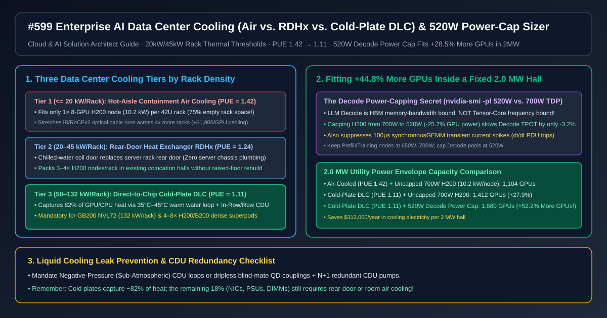

# Enterprise AI Data Center Power, Cooling (`Air 15kW vs. RDHx 35kW vs. Cold-Plate DLC 120kW+`) & `520W` Decode Power-Capping Sizing Guide

> **Target Persona**: Cloud & AI Solution Architect  
> **Core Scenarios**: Retrofitting legacy `15 kW/rack` enterprise colocation halls, designing `2 MW–20 MW` liquid-cooled AI data centers, and maximizing GPU count inside fixed utility power envelopes  
> **Interactive H5 Learning Workbench**: [`docs/h5/datacenter-power-cooling-dlc-powercap-sizer.html`](../h5/datacenter-power-cooling-dlc-powercap-sizer.html)

---

## 1. Executive Summary

1. **Three Data Center Thermal Density Tiers (`20 kW` & `45 kW` Breakpoints)**:
   - **Tier 1 (`<= 20 kW/rack` Hot-Aisle Air Cooling, `PUE = 1.42`)**: Fits only `1× 8-GPU H200` node (`10.2 kW`) per rack, wasting `75%` of rack space and inflating optical cabling costs by `+$1,800/GPU`.
   - **Tier 2 (`20–45 kW/rack` Rear-Door Heat Exchanger `RDHx`, `PUE = 1.24`)**: Best **colocation retrofit** for `3–4× H200` nodes/rack without server chassis plumbing.
   - **Tier 3 (`50–132 kW/rack` Direct-to-Chip Cold-Plate `DLC`, `PUE = 1.11`)**: Captures `82%` of heat via `35°C–45°C` warm water loops, cutting cooling electricity by **`73.8%`** and enabling `GB200 NVL72` (`132 kW/rack`).
2. **Fitting `+52.2%` More GPUs Inside a Fixed `2.0 MW` Power Cap (`1,104 -> 1,680` H200 GPUs)**:
   - Because LLM Decode is HBM-bandwidth-bound rather than frequency-bound, capping `H200` Decode pools at **`520W` (`-25.7%` from `700W` TDP)** reduces Decode throughput by only **`-3.2%`**.
   - Combining **Cold-Plate `DLC (PUE 1.11)` + `520W` Decode Power Capping** expands a `2.0 MW` hall's capacity from **`1,104` GPUs (Air + 700W) to `1,680` GPUs (`+576` GPUs / `+52.2%`)** while saving **`$312,000/yr`** in cooling power!

---

## 2. Cooling & Power-Capping Matrix (`2.0 MW` Facility Power Cap)

| Configuration | Facility `PUE` | IT Power Available | Node Power (`8× H200`) | **Max Deployable `H200` GPUs** |
|---|---|---|---|---|
| **Air Cooling + Uncapped `700W`** | `1.42` | `1,408 kW` | `10.2 kW` | **`1,104 GPUs`** |
| **`RDHx` Rear-Door + Uncapped `700W`** | `1.24` | `1,613 kW` | `10.2 kW` | **`1,264 GPUs` (`+14.5%`)** |
| **Cold-Plate `DLC` + Uncapped `700W`** | `1.11` | `1,802 kW` | `10.2 kW` | **`1,412 GPUs` (`+27.9%`)** |
| **Cold-Plate `DLC` + `520W` Decode Cap** | **`1.11`** | **`1,802 kW`** | **`8.58 kW`** | **`1,680 GPUs` (`+52.2%`)** |

---

## 3. Production Checklist

- [ ] Retain **`18%–20%` air/RDHx cooling capacity** alongside Cold-Plate DLC to cool DIMMs, optical transceivers, NVMe drives, and PSUs.
- [ ] Apply **`nvidia-smi -pl 520` power capping** on memory-bound Decode pools (`-25.7%` GPU power for `-3.2%` TPOT impact).
