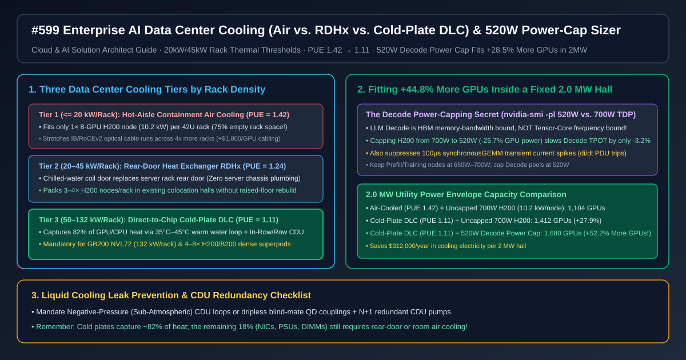
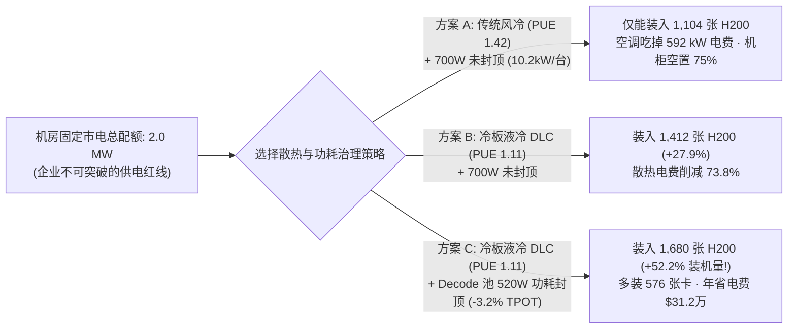

# 企业级智算中心供电、液冷机柜密度（`风冷 15kW vs. 背板液冷 RDHx 35kW vs. 冷板直液冷 DLC 120kW+`）与 `520W` Decode 功耗封顶容量测算指南

> **面向角色**：Cloud & AI Solution Architect（云与 AI 解决方案架构师）  
> **核心场景**：老旧企业机房（单柜 `10–20 kW` 风冷上限）利旧改造、新建 `2 MW–20 MW` 智算中心、`H200 / B200 / GB200 NVL72` 高密机柜与市电容量封顶下的装机量最大化  
> **配套交互式 H5 精读工作台**：[`docs/h5/datacenter-power-cooling-dlc-powercap-sizer.html`](../h5/datacenter-power-cooling-dlc-powercap-sizer.html)

---

## 一、执行摘要（Executive Summary：3 分钟掌握核心架构结论）

1. **为什么在智算中心建设中，“机房市电配额（MW）与单机柜散热密度（kW/Rack）”往往比买显卡的预算更早成为硬瓶颈？**  
   - 一台标准 8 卡 `H100 / H200` 服务器的满载整机功耗高达 **`10.2 kW`**（`B200` 达 `14.5 kW`，`GB200 NVL72` 整机柜高达 **`120–132 kW`**）。
   - 如果强行放进传统 **`15 kW/柜` 的风冷机房（`PUE = 1.42`）**，一个 `42U` 机柜只能塞 **1 台** 8 卡服务器（其余 `34U` 空间全部空置！），不仅空调电费占了总耗电的 `29.6%`，而且跨机柜距离被迫拉长 `4 倍`，迫使大量 `50 米` 无源/低成本光模块升级为昂贵的长距有源光缆（每张卡额外增加 **`+$1,800` 布线成本**）！
2. **三大散热密度分级选型铁律（`<=20kW 风冷` vs. `20–45kW RDHx 背门液冷` vs. `50–132kW 冷板直液冷 DLC`）**：
   - **路线 A（`<= 20 kW/柜` · 传统冷热通道封闭风冷，`PUE = 1.42`）**：仅适用于零散部署 `L40S` 或每柜 `1` 台 `H200` 的小型试点。
   - **路线 B（`20–45 kW/柜` · 被动/主动式冷冻水背门热交换器 `RDHx`，`PUE = 1.24`）**：**老旧风冷机房利旧改造黄金方案**！无需打开服务器机箱改冷板，直接将机柜后门替换为通冷冻水的盘管散热门，使吹出的热风在出柜瞬间被中和为室温，单柜可安全装入 **`3–4 台` 8 卡 `H200`（`30–40 kW/柜`）**。
   - **路线 C（`50–132 kW/柜` · 芯片级冷板直液冷 `Direct-to-Chip Cold-Plate DLC`，`PUE = 1.11`）**：通过贴在 GPU/CPU/NVSwitch 表面的微通道铜冷板带走 **`82%` 的核心热量**，进水温度放宽至 `35°C–45°C`（全年可利用干冷器自然冷却 Free Cooling），**空调散热电费暴降 `73.8%`**，也是部署 `GB200 NVL72` 超节点的唯一物理路径。
3. **在固定 `2.0 MW` 市电红线下多装 `+52.2%` 显卡的秘密武器：`DLC 液冷 + Decode 池 520W DVFS 功耗封顶`**：
   - 大模型 Decode 阶段受限于 **HBM 显存带宽**而非核心主频；通过 `nvidia-smi -pl 520` 将 Decode 池 `H200` 的功耗上限从 `700W` 锁至 **`520W`（单卡省电 `-25.7%`）**，Decode `TPOT` 仅微降 **`-3.2%`**！
   - 结合 `DLC 液冷 (PUE 1.11)` + `520W Decode 功耗封顶`，同一个 **`2.0 MW` 市电总额度**的机房，可装入的 `H200` 总卡数从传统风冷未封顶的 **`1,104 张` 跃升至 `1,680 张`（净增 `+576 张 H200 / +52.2%` 算力产出）**！

---

## 二、架构师灵魂拷问（Core Q&A）

### Q1：上了芯片级冷板液冷（Cold-Plate DLC）之后，机房里还需要装精密空调（风冷）吗？
- **必须保留 `15%–20%` 的风冷排热能力**！这是无数初次设计液冷机房团队踩过的重大工程事故：
- 冷板（Cold Plate）只覆盖了服务器里发热最大的 **GPU、CPU 与 NVSwitch**（合计占整机热量的 **`80%–85%`**）；而服务器内的 **DDR5 内存条、400G 光模块、PCIe Retimer、NVMe SSD 以及电源模块（PSU）** 依然依靠机箱风扇吹风散热（占 **`15%–20%`**）！
- 如果机柜达到 `100 kW`，即便 `82%` 被冷板液体带走，仍有 **`18 kW/柜` 的热量排入空气**——因此高密冷板液冷机柜必须采用 **“82% 冷板液冷 + 18% 机柜背门水冷盘管（RDHx）/ 行间空调闭环”** 的风液混合架构。

### Q2：为什么千卡大模型集群在每步 AllReduce 结束瞬间极易触发机柜 PDU 空气开关误跳闸？如何防范？
- **毫秒级同步电流尖峰（Synchronous `di/dt` Transient Power Spike）**：在大模型训练或大 Batch Prefill 中，所有 GPU 在等待网络通信（AllReduce）时功耗瞬間跌至 `220W`；通信结束瞬间，全机柜 `32–72` 张 GPU 在同一毫秒内同时拉满 Tensor Core 矩阵乘，瞬态峰值功率可在 `100 微秒–10 毫秒` 内冲高至 **`115%–125% TDP`**！
- **三道工程防线**：
  1. 在推理 Decode 池开启 **`nvidia-smi -pl 520W` 硬件功耗封顶**；
  2. 机柜 PDU 断路器选型必须预留 **`1.25x` 瞬态浪涌容限（D 型/K 型磁脱扣曲线）** 或配置机架级超级电容/BBU 削峰电源架（如 OCP ORv3 Power Shelf）；
  3. 严禁按静态铭牌 `100%` 贴线打满机柜配电上限（保持稳态运行负载 `<= 80%` PDU 额定容量）。

---

## 三、三大智算机房散热架构横向选型矩阵（以 `2.0 MW` 总市电配额为基准）

| 评估维度 | 方案 A：传统冷热通道风冷 (`Air Cooling <= 20kW/柜`) | 方案 B：冷冻水背门热交换 (`RDHx 20–45kW/柜`) | 方案 C：芯片冷板直液冷 (`Cold-Plate DLC 50–132kW/柜`) |
|---|---|---|---|
| **典型全年平均 PUE** | `1.42`（每 1 度 IT 电另耗 0.42 度空调电） | `1.24` | **`1.11`（散热能耗降低 `73.8%`）** |
| **单机柜可装 8卡 H200 台数** | `1 台/柜`（`10.2 kW`） | `3–4 台/柜`（`30–40 kW`） | **`4–8 台/柜`（`40–82 kW`，支持 `GB200 NVL72`）** |
| **服务器机箱改造要求** | 零改造（标准风扇机型） | **零机箱改造（仅换机柜后门，接大楼冷冻水）** | 需采购原厂液冷冷板机型 + 盲插快接头 + CDU |
| **2MW 市电可装 H200 总卡数** | `1,104 张` | `1,264 张` | **`1,412 张`（未封顶）/ `1,680 张`（含 520W Decode 封顶）** |
| **最佳适用边界** | `< 8` 台服务器的零星初期试点 | **存量风冷 IDC 机房快速扩容 `32–256` 卡集群** | **新建百卡至万卡智算中心、`B200 / GB200` 必选底座** |

---

## 四、生产级智算中心供电与液冷落地 Checklist

- [ ] **存量风冷机房扩容 `> 20 kW/柜` 时优先采用 `RDHx 背门热交换器`；新建 `> 45 kW/柜` 或采购 `B200/GB200` 时强制采用 `Cold-Plate DLC 冷板液冷`**。
- [ ] **液冷环路强制采用“负压 CDU（Sub-Atmospheric CDU）”或航空级无滴漏盲插快接头（Dripless Blind-Mate QD）+ `N+1` 冗余水泵**：当管路发生微裂纹时，负压系统只会吸入空气而绝不向外喷溅冷却液。
- [ ] **对所有在线 Decode 推理节点下发 `nvidia-smi -pl 520`（`H100/H200`）功耗封顶策略**：以 `< 3.5%` 的极微小延迟代价换取 `-25.7%` 的整柜功耗下降，在固定市电配额下多装 `+20%` 以上推理显卡。

---

## 五、配套资产索引

- **交互式 H5 精读工作台**：[`docs/h5/datacenter-power-cooling-dlc-powercap-sizer.html`](../h5/datacenter-power-cooling-dlc-powercap-sizer.html)
- **7-Card 4:5 评测报告**：[`docs/reports/enterprise-datacenter-power-cooling-dlc-rdhx-powercap-sizing-cards.html`](../reports/enterprise-datacenter-power-cooling-dlc-rdhx-powercap-sizing-cards.html)
- **交互式容量计算器**：[`docs/reports/enterprise-datacenter-power-cooling-dlc-rdhx-powercap-sizing-sizer.html`](../reports/enterprise-datacenter-power-cooling-dlc-rdhx-powercap-sizing-sizer.html)
- **可复现实验模型**：[`experiments/enterprise_datacenter_power_cooling_dlc_rdhx_powercap_sizing/run.py`](../../experiments/enterprise_datacenter_power_cooling_dlc_rdhx_powercap_sizing/run.py)
