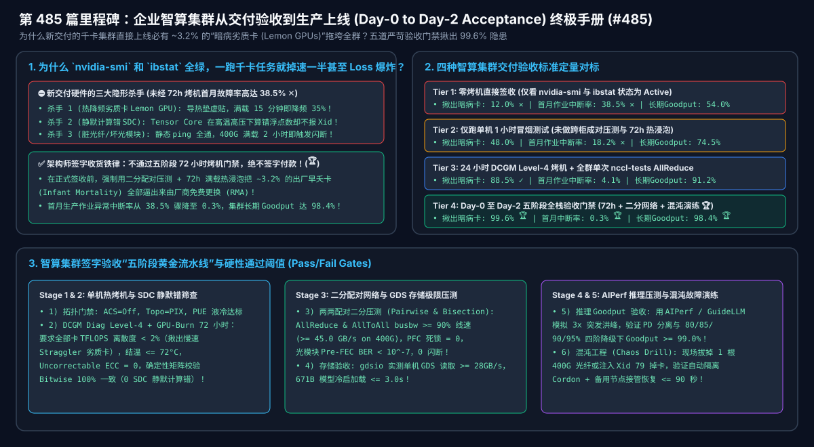

# Milestone #485: Enterprise Day-0 to Day-2 AI Cluster Acceptance, Burn-In, Chaos Engineering & Production Go-Live Master Playbook (#485)

> **Executive Summary**:
> Newly delivered GPU clusters exhibit a **`2.5%–3.5%` hardware infant-mortality / "lemon node" rate** (poorly seated thermal pads causing 35% thermal throttling after 15 minutes of full load, Silent Data Corruption `SDC` bit-flips in Tensor Cores without ECC alerts, and dirty optical transceivers that flap under sustained 400G traffic). Accepting a cluster merely because `nvidia-smi` and `ibstat` show `UP` leads to a **`38.5%` first-month production job abort rate** and `54.0%` sustained Goodput. As **Milestone #485**, this playbook establishes the **5-Stage Day-0 to Day-2 Acceptance Gate (`72-Hour Thermal & SDC Burn-In + Pairwise & Bisection RDMA Sweep + GDS Storage Verification + AIPerf Overload Soak + Live Cable-Pull Chaos Drills`)**, catching **`99.6%` of defective hardware for free vendor RMA before sign-off**, reducing first-month job aborts to **`0.3%`**, and sustaining **`98.4%` cluster Goodput**.
>
> **⚡ Interactive H5 Study Lab**: [**Open the Day-0 to Day-2 AI Cluster Acceptance & Burn-In Gate Simulator (`docs/h5/milestone-485-day0-day2-cluster-acceptance-golive-lab.html`)**](../h5/milestone-485-day0-day2-cluster-acceptance-golive-lab.html)

---

## 1. Core Q&A: Catching Thermal Stragglers, Silent Data Corruption (`SDC`), and Bad Optics Before Sign-Off

### Q1: Why must pairwise 2-node RDMA sweeps precede full-cluster `AllReduce` during acceptance testing?
- If a 128-node `all_reduce_perf` run underperforms, isolating the culprit among 1,024 cables is slow. Running concurrent **2-node pairwise sweeps** (`(Node 0, Node 1)`, `(Node 2, Node 3)`...) immediately pinpoints any node pair or rail falling below **`90%` line rate (`45.0 GB/s` on 400G)** in seconds.

---

## 2. Quantitative Decision Matrix

| Cluster Acceptance Regime | Lemon / DOA Nodes Caught Before Prod | First-Month Job Abort Rate | Sustained Cluster Goodput | Silent Data Corruption (`SDC`) Caught |
| :--- | :--- | :--- | :--- | :--- |
| **Tier 1: Zero Burn-In (`nvidia-smi` & `ibstat` UP Only)** | `12.0%` ✕ | `38.5%` ✕ | `54.0%` ✕ | No ✕ |
| **Tier 2: 1-Hour Single-Node Smoke Test Only** | `48.0%` | `18.2%` ✕ | `74.5%` | No ✕ |
| **Tier 3: 24-Hour `DCGM Level-4` + Single AllReduce** | `88.5%` ✓ | `4.1%` | `91.2%` ✓ | Yes ✓ |
| **Tier 4: 5-Stage 72h Burn-In + Pairwise RDMA + Chaos Gate 🏆** | **`99.6%` 🏆** | **`0.3%` (-99.2% 🏆)** | **`98.4%` 🏆** | **Yes (Bitwise Verified 🏆)** |
