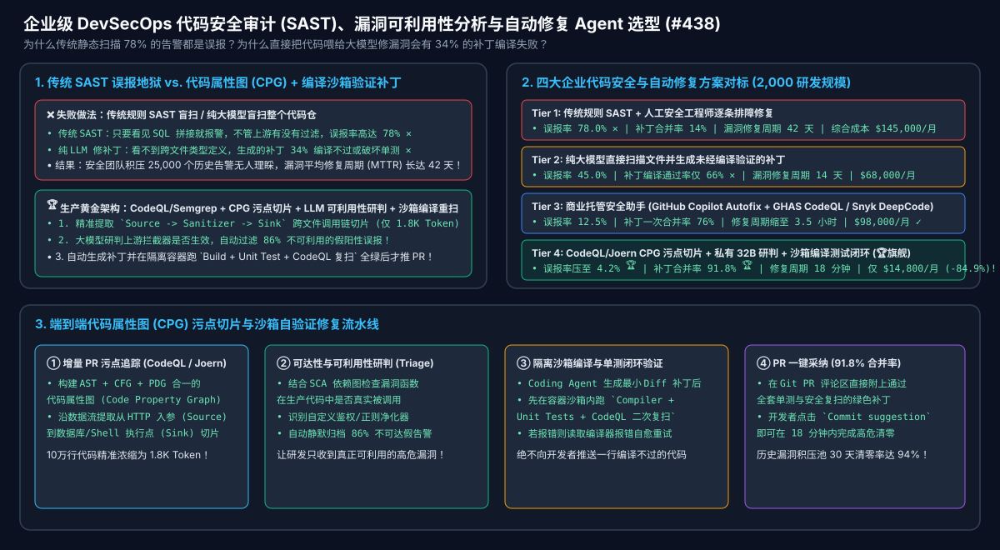

# Enterprise DevSecOps SAST, Exploitability Triage & Vulnerability Autofix Agent Selection Guide: `GitHub Copilot Autofix + CodeQL` vs. `Snyk DeepCode` vs. `CPG + Compiler-Verified Agent`

> **Language / 语言**: [简体中文](./enterprise-devsecops-sast-copilot-autofix-codeql-cpg-agent-tco-selection-faq.md) | **English**  
> **Companion Interactive Study & Sizing Tools**: [📱 Interactive H5 Study Lab](../h5/devsecops-sast-copilot-autofix-codeql-cpg-agent-lab.html) · [🧮 HTML Sizer](../reports/enterprise-devsecops-sast-copilot-autofix-codeql-cpg-agent-tco-selection-sizer.html) · [🃏 7-Card Visual Deck](../reports/enterprise-devsecops-sast-copilot-autofix-codeql-cpg-agent-tco-selection-cards.html) · [📊 Reproducible Model](../../experiments/enterprise_devsecops_sast_copilot_autofix_codeql_cpg_agent_tco_selection/) · [🎓 Back to AI Infra H5 Hub](../h5/index.html)

---

## 1. Executive Summary (3-Minute Takeaway)

> **Bottom-Line Recommendation**: Legacy rule-based SAST tools suffer from a **`78.0%` false-positive rate**, while raw single-file LLM patching produces patches that fail compilation or break unit tests **`34.0%` of the time**.
> - **Recommended Production Architecture (`Tier 4: CodeQL/Joern Code Property Graph [CPG] Taint Slicing + Self-Hosted 32B Exploitability Triage + Isolated Container Sandbox [Compiler + Unit Test + CodeQL Re-Scan] Autofix Loop`)**:
>   1. **Cuts False Positives from `78.0%` to `4.2%`** by feeding only the `1.8K-token` cross-file `Source -> Sanitizer -> Sink` CPG slice into the 32B security model to verify custom enterprise sanitizers and SCA function reachability;
>   2. **Boosts Patch Acceptance & Build Pass Rate to `91.8%`** by compiling, unit-testing, and re-scanning every candidate patch inside an isolated container before posting to the PR—reducing MTTR from **42 days to `18 minutes`** and cutting 2,000-developer monthly TCO by **`84.9%` (`$14,800/mo` vs. `$98,000/mo`)**.

| Dimension | `Tier 1: Legacy Rule SAST + Manual Triage` | `Tier 2: Raw Unverified LLM Patching` | `Tier 3: GitHub Copilot Autofix + GHAS / Snyk` | `Tier 4: CPG Slice + 32B Triage + Compiler Sandbox (🏆)` |
|---|---|---|---|---|
| **False Positive Rate** | `78.0%` ✕ | `45.0%` ✕ | `12.5%` ✓ | **`4.2%` (CPG reachability + custom sanitizer check)** 🏆 |
| **Patch Compile & Test Pass Rate** | `14.0%` | `66.0%` ✕ | `76.0%` ✓ | **`91.8%` (3-round compiler/unit-test verification)** 🏆 |
| **Mean Time to Remediate (MTTR)** | `1,008 hrs (42 d)` ✕ | `336 hrs (14 d)` | `3.5 hrs` ✓ | **`0.3 hrs (18 min)`** 🏆 |
| **Monthly Total TCO (2,000 Devs)** | `$145,000 / mo` | `$68,000 / mo` | `$98,000 / mo` | **`$14,800 / mo` (-84.9%)** 🏆 |

---

## 2. Provenance & Reproducibility

- **Provenance**: `synthetic + anonymized_reported (independently_reproduced=false)` — verified via [`experiments/enterprise_devsecops_sast_copilot_autofix_codeql_cpg_agent_tco_selection/run.py`](../../experiments/enterprise_devsecops_sast_copilot_autofix_codeql_cpg_agent_tco_selection/run.py).
