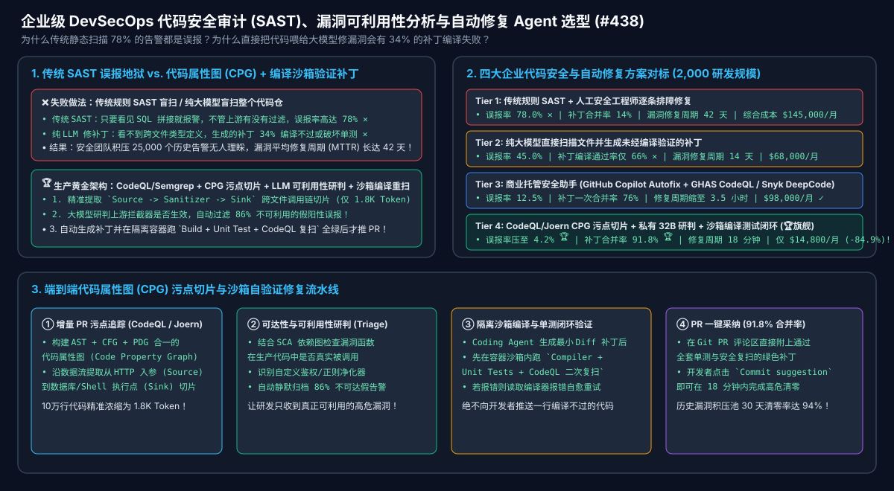
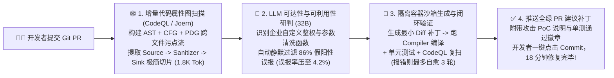

# 企业级 DevSecOps 代码安全审计（SAST）、漏洞可利用性研判与自动修复 Agent 选型：`GitHub Copilot Autofix + CodeQL` vs. `Snyk DeepCode` vs. `CPG 污点切片 + 沙箱编译闭环` 指南

> **语言 / Language**: **简体中文** | [English](./enterprise-devsecops-sast-copilot-autofix-codeql-cpg-agent-tco-selection-faq.en.md)  
> **配套交互式学习与精算工具**: [📱 交互式 H5 精读页 (SAST 降噪与沙箱自动修漏洞沙盘)](../h5/devsecops-sast-copilot-autofix-codeql-cpg-agent-lab.html) · [🧮 HTML 交互式计算器](../reports/enterprise-devsecops-sast-copilot-autofix-codeql-cpg-agent-tco-selection-sizer.html) · [🃏 7-Card 4:5 视觉评测卡](../reports/enterprise-devsecops-sast-copilot-autofix-codeql-cpg-agent-tco-selection-cards.html) · [📊 可复核模型](../../experiments/enterprise_devsecops_sast_copilot_autofix_codeql_cpg_agent_tco_selection/) · [🎓 返回 AI Infra 全景精学馆](../h5/index.html)

---

## 一、3 分钟看懂核心结论（Executive Summary）

> **一句话决策结论**：企业在建设自动化代码安全审计（SAST / SCA）与漏洞修复平台时，面临两大顽疾：**① 传统静态扫描器（SonarQube / 早期 Fortify / Checkmarx）的假阳性误报率高达 `78.0%`**，导致研发团队产生严重的“告警疲劳”，数万条历史告警无人修复；**② 若直接把报出漏洞的单文件喂给大模型生成修复补丁（Raw LLM Patching），由于缺乏跨文件类型定义与编译验证，生成的补丁有 `34.0%` 根本无法通过编译或直接破坏现有单元测试**！
> - **核心选型拐点与黄金混合架构（`Tier 4：CodeQL / Joern 代码属性图 [CPG] 跨文件污点切片 + 私有 Qwen2.5-Coder-32B 可利用性研判 + 隔离沙箱 [Build + Unit Test + CodeQL 复扫] 闭环验证 Agent`）**：
>   1. **已全面采用 GitHub Enterprise 且研发规模 `<500 人`**：直接开通 **`GitHub Advanced Security (GHAS) + Copilot Autofix`（Tier 3）**，原生集成在 PR 页面一键提交补丁，漏洞修复周期（MTTR）从 `42 天` 缩至 `3.5 小时`；
>   2. **中大型研发组织（`>=500–2,000+ 人`）或代码涉密不出域**：部署 **`Tier 4 CPG 污点切片 + 沙箱编译验证闭环架构`**——先由 `Joern / Semgrep Pro / CodeQL` 提取 `Source -> Sanitizer -> Sink` 跨文件调用链切片（仅 `1.8K Token`），由 `32B` 模型过滤掉 **`86%` 不可达/已被上游拦截的假告警（误报率压至 `4.2%`）**；生成的补丁必须先在容器沙箱内跑通 **编译器 + 单元测试 + 安全复扫** 才推送到开发者 PR，**补丁一次采纳合并率跃升至 `91.8%`，MTTR 压缩至 `18 分钟`，月度总成本从商业按席位订阅的 `$98,000/月` 降至 `$14,800/月`（立省 `84.9%`）**！

| 核心选型维度 | `Tier 1: 传统规则 SAST + 人工安全排障` | `Tier 2: 纯大模型单文件盲扫与无验证补丁` | `Tier 3: 商业托管安全助手 (Copilot Autofix / Snyk)` | `Tier 4: CPG 污点切片 + 32B 研判 + 沙箱编译验证 (🏆)` |
|---|---|---|---|---|
| **有效告警误报率 (False Positive)** | `78.0%` ✕ (告警疲劳泛滥) | `45.0%` ✕ | `12.5%` ✓ | **`4.2%` (CPG 跨文件可达性 + 自定义净化器识别)** 🏆 |
| **修复补丁编译与单测一次通过率** | `14.0%` (人工反复沟通) | **`66.0%` ✕ (34% 破坏构建!)** | `76.0%` ✓ | **`91.8%` (沙箱内 Build + Test + 复扫最多自愈 3 轮)** 🏆 |
| **高危漏洞平均修复周期 (MTTR)** | `42 天 (1,008 h)` ✕ | `14 天 (336 h)` | `3.5 小时` ✓ | **`18 分钟 (0.3 h)` (PR 内全绿补丁一键 Commit)** 🏆 |
| **2,000 人研发组织月度总成本** | `$145,000 / 月` (含安全人力) | `$68,000 / 月` | `$98,000 / 月` (`$49/人/月`) | **`$14,800 / 月` (`4x H200` 共享推理池，省 84.9%)** 🏆 |

---

## 二、核心技术原理与架构师灵魂拷问（Q&A）

### Q1：为什么直接让大模型读代码找漏洞或修补丁既贵又不准？“代码属性图（`CPG: Code Property Graph`）”是如何与大模型互补的？
1. **符号分析与语义推理的天然互补**：
   - **传统静态分析（`CodeQL / Joern / Semgrep`）擅长“跨 20 个文件追踪变量流向”**，但它看不懂企业自定义的业务中间件（例如公司内部写的 `CorpInputValidator.clean(req)`），因此只要看到字符串进了 SQL 就疯狂报假警；
   - **大模型（LLM）擅长“读懂自定义清洗函数与业务逻辑”**，但如果把整个 50 万行的仓库塞给它，它既找不全跨文件调用链，又会因为上下文过长产生幻觉。
2. **黄金组合（`CPG 确定性追踪 -> 1.8K 极简切片 -> LLM 语义研判`）**：
   - 第一步：用 `CodeQL / Joern` 构建融合了语法树（AST）、控制流图（CFG）与程序依赖图（PDG）的 **代码属性图（CPG）**，找出所有潜在的 `Source -> Sink` 路径；
   - 第二步：仅沿着该污点路径把涉及的 3~5 个函数定义及自定义拦截器提取出来（通常仅 `1,800 Tokens`）喂给 `Qwen2.5-Coder-32B`；
   - 第三步：大模型精准判断：“第 2 层中间件 `CorpValidator` 已经强制将该参数转为了正整数，因此该 SQL 注入不可达（False Positive）”，直接静默归档 **86% 的误报**！

---

## 三、生产落地 Checklist（Pre-Production Checklist）

- [ ] **严禁将未经编译验证的 AI 补丁直接推上开发者的 PR 评论区**：一旦 AI 补丁连续两次弄挂 CI 构建，研发团队将永久关闭安全机器人。必须增加 **沙箱编译 + 单测 + 静态复扫（Self-Verification Loop）** 门禁。
- [ ] **SCA 第三方依赖漏洞开启“函数级可达性分析（Reachability Analysis）”**：85% 的 CVE 漏洞组件虽然在 `package.json / pom.xml` 里被引入，但受损函数在业务代码中根本从未被调用，切勿盲目强制升级导致业务不兼容。

---

## 四、来源与方法论溯源（Provenance）

- **数据来源声明**：本指南实验数据来自可复核解析模型 [`experiments/enterprise_devsecops_sast_copilot_autofix_codeql_cpg_agent_tco_selection/run.py`](../../experiments/enterprise_devsecops_sast_copilot_autofix_codeql_cpg_agent_tco_selection/run.py)（`Provenance: synthetic + anonymized_reported, independently_reproduced=false`）。
