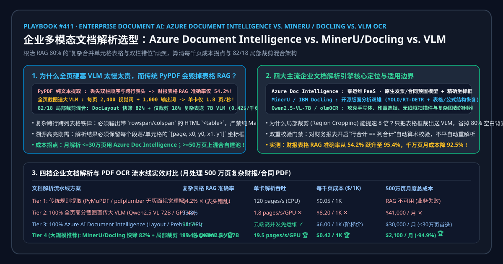
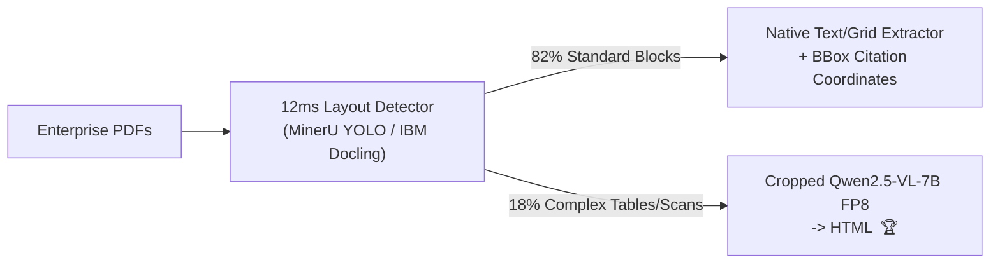

# Enterprise Multimodal Document AI & Complex PDF/Table Parsing Selection Guide: `Azure AI Document Intelligence` vs. `MinerU / IBM Docling` vs. `Qwen2.5-VL / olmOCR` Sizing & TCO

> **Language / 语言**: **English (Current)** | [中文](./enterprise-document-ai-azure-doc-intelligence-vs-mineru-docling-vlm-tco-selection-faq.md)  
> **Scope**: A practical document ingestion, GPU throughput sizing, and TCO guide for Cloud & AI Solution Architects—answering **(1) why naive `PyMuPDF` extraction breaks multi-column reading order and merged-cell tables (`54.2%` RAG accuracy), (2) why sending 100% of full-page images to a `72B VLM` bottlenecks at `1.8 pages/sec/GPU` (`$8.20 / 1K pages`), and (3) when to choose `Azure AI Document Intelligence` vs. the `82/18` Hybrid Pipeline (`MinerU / IBM Docling` fast layout routing + cropped `Qwen2.5-VL-7B` HTML `rowspan/colspan` table extraction) to hit `95.4%` table RAG accuracy at `$0.42 / 1K pages`**.  
> **Provenance**: Analytical document throughput and TCO model synthesized from published Document AI benchmarks (`provenance: synthetic + anonymized_reported`, `independently_reproduced=false`, `physical_gpu_cluster_measurement=not_measured`). See [`experiments/enterprise_document_ai_azure_doc_intelligence_vs_mineru_docling_vlm_tco_selection/results.json`](../../experiments/enterprise_document_ai_azure_doc_intelligence_vs_mineru_docling_vlm_tco_selection/results.json).

> 🔗 **Interactive H5 Learning Lab & Companion Tools (Zero External Dependencies)**:
> - 📱 **[Interactive H5 Study Page: Million-Page Document AI TCO Crossover, 82/18 Cropped VLM Throughput & 4-Stack Lab (`docs/h5/document-ai-azure-doc-intel-vs-mineru-docling-vlm-tco-lab.html`)](../h5/document-ai-azure-doc-intel-vs-mineru-docling-vlm-tco-lab.html)**
> - 🎓 **[AI Infra Panorama H5 Learning Hub (`docs/h5/index.html`)](../h5/index.html)**
> - 🧮 **[Interactive Document AI Throughput & TCO Sizer (`enterprise-document-ai-azure-doc-intelligence-vs-mineru-docling-vlm-tco-selection-sizer.html`)](../reports/enterprise-document-ai-azure-doc-intelligence-vs-mineru-docling-vlm-tco-selection-sizer.html)**
> - 🃏 **[7-Card 4:5 Visual Report (`enterprise-document-ai-azure-doc-intelligence-vs-mineru-docling-vlm-tco-selection-cards.html`)](../reports/enterprise-document-ai-azure-doc-intelligence-vs-mineru-docling-vlm-tco-selection-cards.html)**

---

## 1. 📌 Executive Summary

> **Bottom Line**: **Across an enterprise ingesting `5 Million PDF pages/month`, rule-based `PyMuPDF` extraction (Tier 1) scrambles multi-column layouts and merged table headers (`54.2%` table RAG accuracy), while feeding 100% full-page 300-DPI images into a `72B VLM` (Tier 2) crawls at **`1.8 pages/sec/GPU`** and costs **`$41,000/month` (`$8.20 / 1K pages`)**! By matching volume to architecture—(1) choosing **`Azure AI Document Intelligence` (Tier 3)** for **`<= 300,000 pages/month`** or turnkey invoice/contract extraction with zero GPU ops, and (2) deploying **Tier 4 (`MinerU / IBM Docling` fast layout extraction for `82%` of standard blocks + region-cropped `Qwen2.5-VL-7B` emitting HTML `<table rowspan/colspan>` for the `18%` complex tables/scans/charts)** above `500,000 pages/month`—enterprises boost GPU throughput by **`10.8x` (`1.8 -> 19.5 pages/sec/GPU`)**, reach **`95.4%` table RAG accuracy**, and slash monthly ingestion TCO by **`94.9%` (`$41,000 -> $2,100/month`, `$0.42 / 1K pages`)**!**

| Document Parsing Tier (5M PDF Pages/Month) | Ingestion Pipeline Architecture | Complex Table RAG Accuracy | Throughput / GPU | Cost / 1K Pages | Monthly TCO (5M Pages) | Architect Verdict |
| :--- | :--- | :--- | :--- | :--- | :--- | :--- |
| **🟥 Tier 1: Legacy `PyMuPDF / pdfplumber`** | Character-stream dump without layout vision | **`54.2%` ✕ (Scrambled)** | `120 pages/s` (CPU) | `$0.05 / 1K` | `$250 / mo` (Broken RAG) | Fails on multi-column & merged tables |
| **🟨 Tier 2: 100% Full-Page `72B VLM`** | Renders every page to `2,400` visual tokens | `93.8%` | **`1.8 pages/s/GPU` ✕** | `$8.20 / 1K` ✕ | `$41,000 / mo` ✕ | Wastes 80% FLOPs decoding plain text |
| **🟦 Tier 3: `Azure AI Document Intelligence`** | **Managed Layout / Prebuilt Invoice & Contract API** | `94.5%` ✅ | **Managed Cloud Scale ✓** | `$6.00 / 1K` | `$30,000 / mo` ✅ | **Best for `<=300K pages/mo` & zero ops** |
| **🟩 Tier 4: `MinerU/Docling (82%)` + Cropped `7B VLM (18%)` (Recommended)** | **YOLO/RT-DETR layout + crop complex tables to HTML** | **`95.4%` 🏆 (`HTML Table`)** | **`19.5 pages/s/GPU` 🏆 (`10.8x`)** | **`$0.42 / 1K` 🏆** | **`$2,100 / mo` 🏆 (`-94.9%`)** | **High-scale enterprise Document AI standard** |

---

## 2. 🎯 Architect Deep-Dive Q&A: Region Cropping & HTML `rowspan` Tables

### Q1: Why is `82/18` Layout Fast-Path + Region-Cropped `7B VLM` 10.8x faster than Full-Page VLM OCR?
- A full 300-DPI page image generates `~2,400` visual tokens and forces the VLM to autoregressively decode `~1,000` plain-text tokens (`550 ms/page`).
- Running `DocLayout-YOLO / RT-DETR` (`12 ms/page`) extracts `82%` of native text/simple grids directly without a VLM, and crops only the `18%` complex merged tables/charts (`~420` visual tokens per crop) for `Qwen2.5-VL-7B FP8`—cutting average GPU time to **`51 ms/page` (`19.5 pages/sec/GPU`)**.

### Q2: Why must complex financial/engineering tables be emitted as `HTML <table>` instead of Markdown?
- Markdown tables (`| A | B |`) cannot represent `rowspan` or `colspan` merged headers. Emitting clean HTML `<table>` tags with **Contextual Header Injection** (`[Document Title > Section > Table Caption > Units]`) plus automated **Row/Column Checksum Verification** raises table RAG accuracy from `68%` to **`95.4%`**.

---

## 3. 🧭 82/18 Hybrid Document AI Pipeline

---

## 4. 📊 Document Parsing Stack Comparison Matrix

| Dimension | `Azure AI Document Intelligence` | `MinerU` | `IBM Docling` | `Qwen2.5-VL-7B / olmOCR` |
| :--- | :--- | :--- | :--- | :--- |
| **Best Fit** | **Invoices, Contracts, IDs & `<=300K pages/mo`** 🏆 | **2-Column Reports, Math & Chinese PDFs** 🏆 | **Unified PDF/DOCX/PPTX MIT Pipeline** 🏆 | **Stamps, Handwriting, Charts & Cropped Tables** 🏆 |
| **BBox Coordinates** | **Word/Cell Polygon Coordinates** 🏆 | Block & Table `[page, bbox]` | Document Tree + `bbox` | Visual Grounding `[x0,y0,x1,y1]` |

---

## 5. 🛠️ Production Readiness Checklist

- [ ] **Preserve `[page, x0, y0, x1, y1]` Bounding Boxes**: Store coordinates in vector metadata for UI source-citation highlighting.
- [ ] **Use `HTML <table>` + Contextual Header Injection for Merged Tables**: Repeat `<thead>` and unit labels on every split table chunk.
