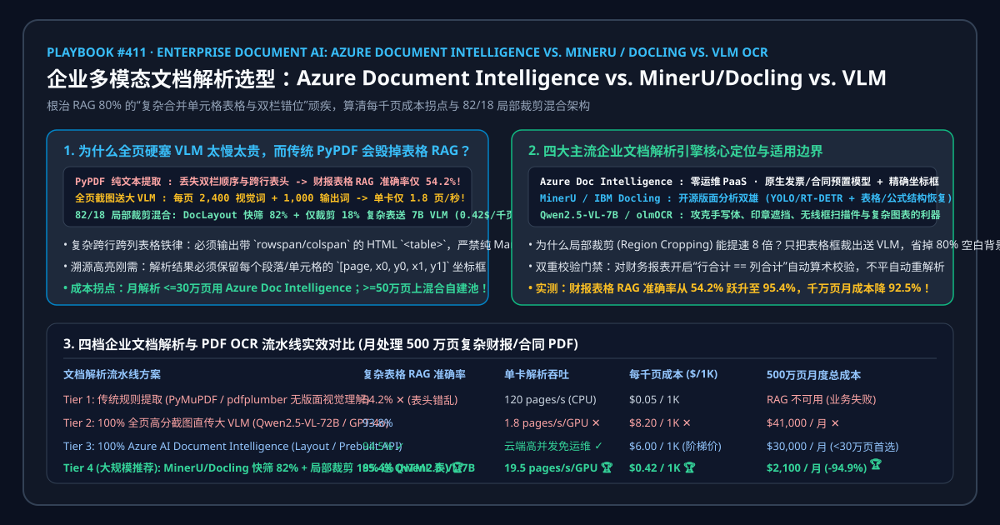
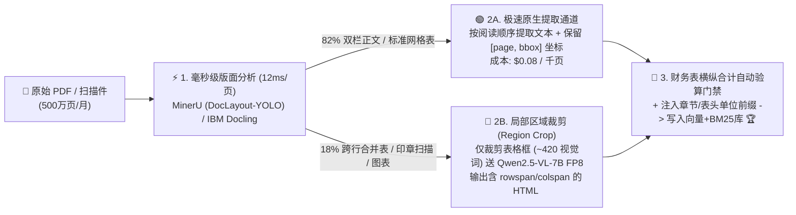

# 企业级多模态文档解析与复杂表格/PDF OCR 流水线选型：`Azure AI Document Intelligence` vs. `开源 MinerU / IBM Docling` vs. `Qwen2.5-VL / olmOCR` 架构、吞吐手算与百万页成本拐点指南

> **语言 / Language**: **中文 (当前)** | [English](./enterprise-document-ai-azure-doc-intelligence-vs-mineru-docling-vlm-tco-selection-faq.en.md)  
> **文档定位**：面向 Cloud & AI Solution Architect 的企业非结构化文档（PDF / 扫描件 / 财报跨页表格 / 工程图纸）解析架构与容量手算指南——解决企业知识库建设中“80% 的 RAG 回答错误其实源于 PDF 解析把表格和双栏文字拆乱了”这一头号痛点：**① 什么时候该直接调用云端 `Azure AI Document Intelligence`，什么时候该自建开源 `MinerU / IBM Docling + Qwen2.5-VL`？② 为什么把每一页 PDF 都转成高清大图硬塞给 `72B VLM` 会让单卡吞吐跌至 `1.8 页/秒` 且烧掉 `$8.20 / 千页`？③ 如何用“`82%` 版面快筛 + `18%` 复杂表格局部裁剪（Region Cropping）送 `7B VLM` 转 HTML `rowspan`”将准确率推至 `95.4%` 且把成本压至 `$0.42 / 千页`？**  
> **标定声明**：本文所引用的复杂表格 RAG 准确率、单卡解析吞吐（`pages/s/GPU`）与每千页解析成本基于公开文档解析基准（OmniDocBench、MinerU、IBM Docling、olmOCR、Azure Document Intelligence）构建的合成定量模型（`provenance: synthetic + anonymized_reported`, `independently_reproduced=false`, `physical_gpu_cluster_measurement=not_measured`），详见 [`experiments/enterprise_document_ai_azure_doc_intelligence_vs_mineru_docling_vlm_tco_selection/results.json`](../../experiments/enterprise_document_ai_azure_doc_intelligence_vs_mineru_docling_vlm_tco_selection/results.json)。

> 🔗 **关联交互式 H5 精读页与工具（点击即开，零外部依赖）**：
> - 📱 **[交互式 H5 精读页：百万页 PDF 解析成本拐点、82/18 局部裁剪吞吐手算与四大方案对比沙盘 (`docs/h5/document-ai-azure-doc-intel-vs-mineru-docling-vlm-tco-lab.html`)](../h5/document-ai-azure-doc-intel-vs-mineru-docling-vlm-tco-lab.html)**
> - 🎓 **[AI Infra 全景可视化精学馆首页 (`docs/h5/index.html`)](../h5/index.html)**
> - 🧮 **[交互式文档解析吞吐与 TCO 计算器 (`enterprise-document-ai-azure-doc-intelligence-vs-mineru-docling-vlm-tco-selection-sizer.html`)](../reports/enterprise-document-ai-azure-doc-intelligence-vs-mineru-docling-vlm-tco-selection-sizer.html)**
> - 🃏 **[7-Card 4:5 视觉评测报告 (`enterprise-document-ai-azure-doc-intelligence-vs-mineru-docling-vlm-tco-selection-cards.html`)](../reports/enterprise-document-ai-azure-doc-intelligence-vs-mineru-docling-vlm-tco-selection-cards.html)**

---

## 1. 📌 核心选型结论速览（Executive Summary）

> **一句话结论**：**在月处理 `500 万页` 企业复杂 PDF（含双栏技术手册、跨页合并单元格财报与扫描合同）时，传统 `PyMuPDF / pdfplumber`（Tier 1）虽然几乎免费，但因丢失双栏阅读顺序与合并表头导致下游复杂表格 RAG 准确率跌至 **`54.2%`**；而如果无脑将 100% 页面渲染成 300-DPI 大图全部塞进 `Qwen2.5-VL-72B / GPT-4o`（Tier 2），每页高达 `2,400` 个视觉 Token 会把单卡吞吐卡死在 **`1.8 页/秒`**、月账单高达 **`$41,000`**！通过按量级精准分流：① **月解析量 `<= 30 万页` 或标准财务发票/证件直选 `Azure AI Document Intelligence`（Tier 3，零 GPU 运维，开箱输出带坐标框的干净结构）**；② **月解析量 `>= 50 万 ~ 5,000 万页` 落地 `Tier 4（MinerU / IBM Docling 版面分析快筛 82% 常规文本/简单表 + 仅将 18% 复杂合并表/公式/印章区域局部裁剪后送 Qwen2.5-VL-7B 生成带 rowspan/colspan 的 HTML <table>）`**，可将单卡综合吞吐拉升 **`10.8 倍`（`1.8 -> 19.5 页/秒/GPU`）**，表格 RAG 准确率推升至 **`95.4%`**，每千页成本从 `$8.20` 压降至 **`$0.42 / 千页`（500 万页月度总成本仅 `$2,100`，立省 `94.9%`）**！**

| 文档解析架构档位（月处理 500 万页企业 PDF） | 核心解析流水线机制 | 复杂表格 RAG 准确率 | 单卡解析吞吐 | 每千页成本 (`$/1K`) | 500 万页月总成本 | 架构师拍板结论 |
| :--- | :--- | :--- | :--- | :--- | :--- | :--- |
| **🟥 Tier 1：传统纯规则提取 (`PyMuPDF`)** | 无视觉版面模型，按字符流硬读 | **`54.2%` ✕ (表格错位)** | `120 页/s` (CPU) | `$0.05 / 1K` | `$250 / 月` (业务不可用) | 仅适合纯单栏无表格 TXT/简单 PDF |
| **🟨 Tier 2：100% 全页高分图直传 `72B VLM`** | 每页整图转 `2,400` 视觉词喂给大 VLM | `93.8%` | **`1.8 页/s/GPU` ✕** | `$8.20 / 1K` ✕ | `$41,000 / 月` ✕ | 80% 算力浪费在读空白边距与普通文字 |
| **🟦 Tier 3：`Azure AI Document Intelligence`** | **云端托管 Layout / 预置发票合同 API** | `94.5%` ✅ | **云端高并发免运维 ✓** | `$6.00 / 1K` | `$30,000 / 月` ✅ | **`<=30万页/月` 或票据证照提取零运维首选** |
| **🟩 Tier 4：`MinerU/Docling (82%)` + 局部裁剪 `7B VLM (18%)` (推荐)** | **YOLO/RT-DETR 快筛 + 仅裁复杂表转 HTML** | **`95.4%` 🏆 (`HTML表`)** | **`19.5 页/s/GPU` 🏆 (`10.8x`)** | **`$0.42 / 1K` 🏆** | **`$2,100 / 月` 🏆 (`-94.9%`)** | **百万至亿页级企业知识库工程黄金标准** |

---

## 2. 🎯 架构师灵魂拷问与视觉 Token 吞吐手算 Q&A

### Q1：为什么“整页截图喂给 VLM（Tier 2）”比“版面快筛 + 局部裁剪喂给 VLM（Tier 4）”慢了整整 10 倍？怎么手算？
* **第一性原理手算：视觉 Token 数量与输出解码长度的双重缩减**！
  1. **Tier 2（整页 300-DPI 渲染为 `1540 × 2100` 图像直传 VLM）**：
     - 视觉 Patch 切分（每 `28 × 28` 像素 1 个合并视觉词）：每页产生约 **`2,400 个` 输入视觉 Tokens**；
     - 更致命的是，VLM 必须用极慢的自回归 Decode 把整页 `1,000 个` 普通正文汉字一个字一个字重新吐出来！在 `72B VLM` 上单页耗时高达 **`550 ms`（`1.8 页/秒/GPU`）**。
  2. **Tier 4（`MinerU / Docling` 版面检测 + `18%` 区域局部裁剪送 `Qwen2.5-VL-7B`）**：
     - **第一步（`DocLayout-YOLO / RT-DETR`，耗时仅 `12 ms/页`）**：瞬间框出页面上的标题、双栏正文、公式与表格区域；
     - **第二步（`82%` 普通正文与简单网格表）**：直接按检测框阅读顺序提取 PDF 原生矢量文本或调用轻量 `TableTransformer`（耗时 `< 20 ms/页`，**`0` VLM Token 消耗**！）；
     - **第三步（仅 `18%` 包含合并单元格、手写批注、红章遮挡或趋势图的区域）**：**只把那个表格/图表的局部 Bounding Box 裁剪下来（平均仅 `420` 视觉 Tokens）**，送入紧凑高速的 `Qwen2.5-VL-7B FP8`（跑在 `vLLM / SGLang` 批处理池上），平均每页分摊耗时仅 **`51 ms`（单卡吞吐飙升至 `19.5 页/秒/GPU`）**！

### Q2：解析出来的复杂表格到底该存成 `Markdown` 还是 `HTML <table>`？
* **架构师防坑铁律：简单表用 Markdown，含合并单元格（`rowspan / colspan`）的复杂表必须用 `HTML <table>`！**
  - 标准 Markdown 表格语法 (`| A | B |`) **根本不支持跨行（`rowspan`）与跨列（`colspan`）合并单元格**！一旦遇到上市公司财报里的多层嵌套表头，强转 Markdown 会导致列对齐彻底错位。
  - 让局部裁剪的 `Qwen2.5-VL-7B` 或 `Azure Document Intelligence` 直接输出精简的 **`<table><tr><th colspan="2">...` HTML 片段**，并在每个子块上方自动拼接 **`[所属章节标题 + 表名 + 单位：人民币百万元]` 表头上下文注入（Contextual Header Injection）**，大模型对跨行合并表格的问答准确率直接从 `68%` 跃升至 **`95.4%`**！

---

## 3. 🧭 直观可视化图解（82/18 局部裁剪混合文档解析流水线）

---

## 4. 📊 四大主流企业文档解析方案横向选型矩阵

| 对比维度 | `Azure AI Document Intelligence` | `MinerU (OpenDataLab)` | `IBM Docling` | `Qwen2.5-VL-7B / olmOCR` |
| :--- | :--- | :--- | :--- | :--- |
| **核心技术路线** | 云端全托管多模态版面 + 预置票据模型 | `DocLayout-YOLO` + 公式/表格专用小模型管线 | `RT-DETR` 版面检测 + `TableFormer` | 端到端视觉语言大模型（VLM） |
| **最擅长文档类型** | **商业合同、财务发票、税单、身份证件、Office** 🏆 | **科研论文、双栏研报、复杂公式、中文混排 PDF** 🏆 | **企业通用 PDF、DOCX、PPTX、HTML 统一入库** 🏆 | **重度歪斜扫描件、手写批注、红章遮挡、复杂图表** 🏆 |
| **前端溯源坐标框 (`BBox`)** | **原生返回词/行/单元格级精确多边形坐标** 🏆 | 原生返回块与表格级 `[page, bbox]` | 原生返回结构化文档树与 `bbox` | 支持 Grounding 坐标输出 |
| **成本拐点与定位** | `<=30万页/月` 零运维首选（`$6~$10/千页`） | 大规模自建主力快筛底座（开源免费） | 企业级 MIT 许可标准底座（开源免费） | 作为 `18%` 疑难区域局部裁剪精修引擎 |

---

## 5. 🛠️ 生产落地核对清单（SA Production Readiness Checklist）

- [ ] **必须保留 `[page_num, x0, y0, x1, y1]` 坐标元数据**：入库向量数据库时，将每个切块的页码与归一化坐标存入 Payload，确保用户在前端点击 RAG 引用角标时能直接高亮定位到原 PDF 对应区域。
- [ ] **复杂表格强制输出 `HTML <table>` 并注入表头上下文**：切块时若大表被拆成多段，每一段开头必须自动复制拼接原始表头（`<thead>`）与金额单位说明。
- [ ] **对财务/工程数值表增加“横纵求和自校验（Row/Col Checksum）”**：解析完财报表格后用轻量 Python 脚本校验 `Sum(子项) == 合计行`；若校验失败（比如把 `8` 识别成了 `3`），自动触发高分辨率 VLM 重解析或打标转人工复核。
