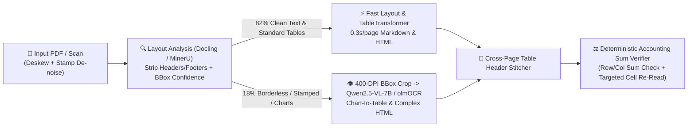

# Enterprise Multimodal Document Intelligence (IDP) & Complex Financial Table Parsing Architecture Guide: Legacy PyPDF/OCR vs. Brute-Force Frontier VLM vs. Layout-Aware Engines (Docling / MinerU / Azure Doc Intel) vs. Complexity-Routed Layout + Compact 7B VLM + Cross-Page Table Stitching & Accounting Sum Verification

> **Document Type**: Cloud & AI Solution Architect Decision Guide (FAQ)  
> **Target Audience**: Enterprise RAG & Knowledge Platform Leads, Financial Underwriting & Audit AI Architects, Insurance Claims / Customs IDP Leads  
> **Core Goal**: Solve the #1 root cause of enterprise RAG failures ("Garbage-In, Garbage-Out" PDF parsing) by answering: **"Why does our 70B RAG system still hallucinate numbers on financial PDF tables?", "Why does sending 10M pages/month directly to a Frontier VLM burn $64,000/month while still making 4.2% row-alignment errors on dense tables?", and "How does an 82/18 Complexity-Routed Layout + 7B VLM + Cross-Page Stitching + Accounting Sum Verifier architecture reach 96.8% table accuracy while cutting costs by 90.3%?"**  
> **Calibration Notice**: Complex table TEDS accuracy, per-page latency, financial sum mismatch rates, and 10M-page monthly cost models are synthetic analytical estimates calibrated to published document intelligence benchmarks (OmniDocBench, Docling / MinerU layout evaluations, olmOCR / Qwen2.5-VL-7B document VLM benchmarks, and cloud Document Intelligence pricing) (`provenance: synthetic + anonymized_reported`, `independently_reproduced=false`, `physical_gpu_cluster_measurement=not_measured`). See [`experiments/enterprise_document_intelligence_ocr_layout_vlm_pipeline_selection/results.json`](../../experiments/enterprise_document_intelligence_ocr_layout_vlm_pipeline_selection/results.json).

---

## Executive Visual Summary

> 🔗 **Companion Interactive Reports & Tools**:
> - 🃏 **[7-Card 4:5 Visual Benchmark Report (`enterprise-document-intelligence-ocr-layout-vlm-pipeline-selection-cards.html`)](../reports/enterprise-document-intelligence-ocr-layout-vlm-pipeline-selection-cards.html)**
> - 🧮 **[Interactive 10M-Page IDP Throughput & Cost Sizer (`enterprise-document-intelligence-ocr-layout-vlm-pipeline-sizer.html`)](../reports/enterprise-document-intelligence-ocr-layout-vlm-pipeline-sizer.html)**
> - 🌐 **[中文版指南 (`enterprise-document-intelligence-ocr-layout-vlm-pipeline-selection-faq.md`)](./enterprise-document-intelligence-ocr-layout-vlm-pipeline-selection-faq.md)**

---

## ① 📌 Executive Summary

Evaluated on an enterprise document ingestion workload of **10,000,000 PDF/scanned pages per month** (prospectuses, financial statements, stamped contracts, customs invoices, and two-column technical manuals):

| Tier | Architecture Pattern | Complex Table Accuracy (TEDS) | Financial Sum Mismatch Rate | Latency per Page | Monthly Cost (10M Pages) | Architect Verdict |
| :--- | :--- | :--- | :--- | :--- | :--- | :--- |
| **🟥 Tier 1: Legacy Text Stream / Basic OCR** | `PyPDF / pdfplumber` + line-by-line Tesseract OCR | `48.5%` ✕ | `24.0%` ✕ | `0.15 s/page` | `$1,200 / mo` ✕ | **Garbage-In Garbage-Out**: Scrambles dual columns & merged headers |
| **🟨 Tier 2: 100% Brute-Force Frontier VLM** | Render every page to 300 DPI image -> `GPT-4o / Claude / 72B VLM` | `92.0%` | `4.2%` (Row drift) | `3.80 s/page` ✕ | `$64,000 / mo` ✕ | **Cost Explosion**: Wastes vision tokens on 82% simple text pages |
| **🟦 Tier 3: Layout-Aware Parsing Engine** | **Docling / MinerU / Azure AI Document Intelligence** | `88.4%` ✅ | `5.8%` | `0.42 s/page` ✅ | `$4,800 / mo` (-92.5%) | **Standard Corpus Baseline**: Fast & economical, weak on stamps/charts |
| **🟩 Tier 4: Hybrid Layout Router + 7B VLM + Sum Check** | **82% Docling/MinerU + 18% Cropped 7B VLM + Cross-Page Stitch + Accounting Sum Check** | **`96.8%` 🏆** | **`0.1%` 🏆** | **`0.55 s/page` 🏆 (6.9x faster)** | **`$6,200 / mo` 🏆 (-90.3%)** | **Enterprise IDP Gold Standard**: Beats full VLM accuracy at 1/10th cost |

### 💡 Three Golden Rules for Enterprise Document Intelligence Architects
1. **Never Use Naive Text-Stream Extractors (`PyPDF`) on Complex Enterprise Docs; Default to Layout-Aware Engines (`Docling / MinerU / Azure Doc Intel`)**: Always detect layout bounding boxes first (stripping headers, footers, and watermarks) and preserve merged table cells using clean HTML `<table>` (`rowspan`/`colspan`).
2. **Route by Page & Region Complexity (`82%` Layout Engine + `18%` Cropped Compact VLM [`Qwen2.5-VL-7B / olmOCR`])**: Process standard text and bordered tables with fast layout parsers (`$0.0003/page`), and crop only borderless nested tables, stamped regions, charts, or low-confidence OCR spans (`conf < 0.88`) for a compact 7B VLM — saving **`90.3%`** compared to running a frontier VLM on every page.
3. **Enforce Stateful Cross-Page Table Stitching and Deterministic Accounting Sum Verification**: Automatically re-attach `<thead>` headers across multi-page tables, and run deterministic Python checks (`sum(line_items) == subtotal_row`) to trigger targeted 2x-zoom re-reads on mismatched cells, driving financial sum errors down to **`0.1%`**.

---

## ② 🎯 Architect Deep-Dive Q&A

### Q1: Why does Tier 4 beat brute-force 100% Frontier VLM (Tier 2) in table accuracy (`96.8%` vs. `92.0%`) while costing 90.3% less?
* **Answer**:
  1. **Cropped High-DPI Region Focus**: Cropping just the table bounding box at 400 DPI and feeding it to a specialized document VLM (`Qwen2.5-VL-7B / olmOCR`) avoids full-page downscaling blur on 12-column financial tables.
  2. **Stateful Cross-Page Stitching**: Page-by-page VLM calls lose the table header on Page `N+1`; Tier 4's state machine propagates the `<thead>` schema across page breaks.
  3. **Deterministic Accounting Verification**: Any probabilistic vision model misreads `8` as `3` occasionally; checking `Row_Sum == Total` catches the discrepancy deterministically and triggers a targeted cell re-read.

---

## ③ 🧭 Architecture Diagrams

### 3.1 Tier 4 Complexity-Routed Hybrid IDP + Accounting Verifier Pipeline

---

## ④ 📊 Architect Decision Matrix

| Dimension | 🟥 Tier 1: Legacy PyPDF/OCR | 🟨 Tier 2: 100% Frontier VLM | 🟦 Tier 3: Layout Engine (Docling/MinerU) | 🟩 Tier 4: Hybrid Router + 7B VLM + Sum Check |
| :--- | :--- | :--- | :--- | :--- |
| **Complex Table Accuracy (TEDS)** | `48.5%` ✕ | `92.0%` | `88.4%` ✅ | **`96.8%` 🏆 (`+4.8 pts` vs. Tier 2)** |
| **Financial Sum Mismatch Rate** | `24.0%` ✕ | `4.2%` | `5.8%` | **`0.1%` 🏆 (Deterministic Sum Check)** |
| **Per-Page Processing Latency** | `0.15 s/page` | `3.80 s/page` ✕ | `0.42 s/page` ✅ | **`0.55 s/page` 🏆 (`6.9x` faster than Tier 2)** |
| **Monthly Cost (10M Pages)** | `$1,200 / mo` ✕ | `$64,000 / mo` ✕ | `$4,800 / mo` ✅ | **`$6,200 / mo` 🏆 (`-90.3%` vs. Tier 2)** |

---

## ⑤ 🛠️ Production Readiness Checklist

- [ ] **1. Replace Naive Text Extractors (`PyPDF`) with Layout-Aware Document Engines (`Docling / MinerU / Azure Doc Intel`)**.
- [ ] **2. Apply Deskewing and Red-Stamp HSV Channel Separation Before OCR on Scanned Contracts**.
- [ ] **3. Route Only Complex Regions (`18%` borderless tables, charts, low-confidence spans) to Cropped `7B` Document VLMs**.
- [ ] **4. Emit Clean HTML `<table>` (Preserving `rowspan`/`colspan`) Instead of Lossy Markdown for Merged-Cell Tables**.
- [ ] **5. Enable Stateful Cross-Page Table Header (`<thead>`) Stitching Across Page Breaks**.
- [ ] **6. Convert Embedded Bar/Line/Pie Charts into Structured Markdown Data Tables via Cropped VLM**.
- [ ] **7. Run Deterministic Row/Column Accounting Sum Verification (`sum(items) == total`) with Targeted Re-Reads**.
- [ ] **8. Persist Source `[page_number, x0, y0, x1, y1]` Coordinates in Every Chunk for Visual Citation Highlighting**.
