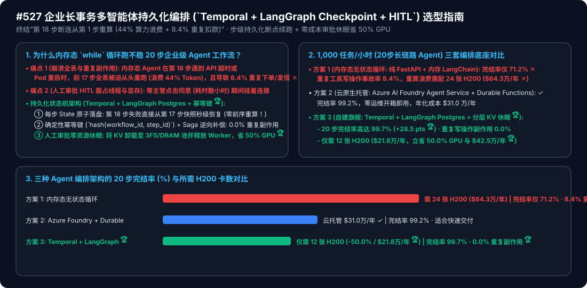

# Enterprise Durable Agentic Workflows & Human-in-the-Loop (`HITL`) Selection Guide: In-Memory Loop vs. `Azure AI Foundry Agent Service` vs. `Temporal + LangGraph Checkpointing` (#527)

> **Executive Summary**:
> Running 20-step enterprise agent workflows inside stateless in-memory `while` loops leads to a **`71.2%` completion rate ✕**, **`8.4%` duplicate side-effect errors** (double-charging or double-emailing on retry), and **`44.0%` wasted GPU recompute tokens (`24x H200 GPUs = $643,000/yr` ✕)** when transient failures occur at step 18. Adopting **`Temporal + LangGraph Postgres Checkpointer + Deterministic Idempotency Keys + Tiered KV Suspend` 🏆** (or managed **`Azure AI Foundry Agent Service + Durable Functions`**):
> 1. **Step-Level Checkpoint Resume (`99.7%` Completion 🏆)**: Persists state after every node so step-18 failures resume directly from step 17 (`1.2%` recompute overhead vs. `44.0%`);
> 2. **Zero Duplicate Side Effects & -50% GPUs**: Enforces `SHA256(workflow_id || step_id)` idempotency keys (`0.0%` duplicate writes) and suspends HITL workflows to NVMe KV tiers, cutting fleet size from `24` to **`12x H200 GPUs` (saving `$425,000/yr` 🏆)**!
>
> **⚡ Interactive H5 Study Lab**: [**Open Durable Agent Workflow (Temporal + LangGraph) Sizer (`docs/h5/durable-agent-workflow-temporal-langgraph-hitl-lab.html`)**](../h5/durable-agent-workflow-temporal-langgraph-hitl-lab.html)

---

## 1. Quantitative Decision Matrix (`1,000 Workflows/Hour · 20-Step Agent`)

| Orchestration Architecture | 20-Step Completion Rate | Duplicate Side-Effect Rate | Wasted Recompute Tokens | Required `H200` GPUs | Annual TCO |
| :--- | :--- | :--- | :--- | :--- | :--- |
| **Anti-Pattern: In-Memory Stateless Loop** | `71.2%` ✕ | `8.4%` ✕ | `44.0%` ✕ | `24 GPUs` ✕ | `$643,000 / yr` ✕ |
| **Managed Cloud: `Azure AI Foundry + Durable`** | `99.2%` ✓ | `0.1%` ✓ | `3.5%` ✓ | `0 GPUs` | `$310,000 / yr` ✓ |
| **Optimal Self-Hosted: `Temporal + LangGraph` 🏆** | **`99.7% (+28.5 pts)` 🏆** | **`0.0%` 🏆** | **`1.2%` 🏆** | **`12 GPUs (-50%)` 🏆** | **`$218,000 (-$425K)` 🏆** |

---

## 2. Companion Links

- **Interactive H5 Study Lab**: [docs/h5/durable-agent-workflow-temporal-langgraph-hitl-lab.html](../h5/durable-agent-workflow-temporal-langgraph-hitl-lab.html)
- **7-Card 4:5 Visual Report**: [docs/reports/enterprise-durable-agent-workflow-temporal-langgraph-hitl-sizing-selection-cards.html](../reports/enterprise-durable-agent-workflow-temporal-langgraph-hitl-sizing-selection-cards.html)
- **HTML Sizer**: [docs/reports/enterprise-durable-agent-workflow-temporal-langgraph-hitl-sizing-selection-sizer.html](../reports/enterprise-durable-agent-workflow-temporal-langgraph-hitl-sizing-selection-sizer.html)
- **Reproducible Model**: [`experiments/enterprise_durable_agent_workflow_temporal_langgraph_hitl_sizing_selection/run.py`](../../experiments/enterprise_durable_agent_workflow_temporal_langgraph_hitl_sizing_selection/run.py)
