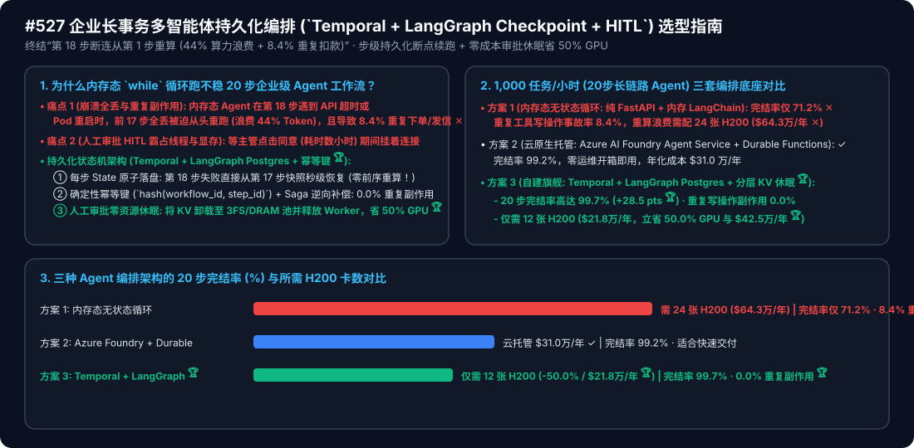

# 企业长事务多智能体持久化编排（`Durable Agentic Workflows`）与人工审批挂起（`HITL`）选型：内存态无状态循环 vs. `Azure AI Foundry Agent Service` vs. `Temporal + LangGraph Postgres Checkpoint + 幂等键` 算卡指南 (#527)

> **核心观点（Executive Summary）**：
> 在执行包含 `15–25` 个步骤的采购审批、财务尽调或自动化运维 Agent 时，用传统的 **“Python 内存 `while` 循环”** 跑生产会有两大灾难：**① 走到第 18 步若遇到外部 API 瞬断或容器重启，前 17 步记忆全丢，被迫从第 1 步重跑（白白浪费 `44.0%` GPU Token，且造成 `8.4%` 的重复扣款/重复发邮件事故 ✕）**；**② 遇到需要人类主管点击确认（`Human-in-the-Loop`，耗时数分钟至数天）的步骤时，进程挂起白白霸占工作线程与 GPU HBM 缓存**。本专题给出企业级持久化编排选型：
> 1. **云原生敏捷托管首选：`Azure AI Foundry Agent Service + Durable Functions / Logic Apps`**（20步完结率 **`99.2%`**，开箱即用）；
> 2. **大规模私有化/混合云旗舰首选：`Temporal + LangGraph Postgres Checkpointer + 确定性幂等键 + 分层 KV 休眠` 🏆**：
>    - 每完成一步节点自动将图状态持久化至 Postgres，第 18 步故障时直接从第 17 步断点原地恢复（重算浪费从 `44.0%` 压至 **`1.2%`**）；
>    - 为每个外部写操作注入确定性幂等键 $\text{IdempotencyKey} = \text{SHA256}(\text{workflow\_id} \parallel \text{step\_id})$，将重复副作用事故率从 `8.4%` 归零（**`0.0%` 🏆**），并将所需 H200 从 `24 张` 减半至 **`12 张`（立省 `50.0%` GPU 与 `$42.5 万/年` 🏆）**！
>
> **⚡ 配套交互式 H5 精读沙盘**：[**打开长事务 Agent 持久化编排 (Temporal + LangGraph) 与算卡计算器 (`docs/h5/durable-agent-workflow-temporal-langgraph-hitl-lab.html`)**](../h5/durable-agent-workflow-temporal-langgraph-hitl-lab.html)

---

## 一、 灵魂拷问：Agent 等待人工审批的 4 小时里，如何做到“零线程、零显存占用”？

### Q1：人工审批挂起（`Human-in-the-Loop Interrupt`）时，控制面与 KV 数据面如何协同休眠？
1. **控制面挂起（`Temporal Signal / LangGraph interrupt()`）**：将当前工作流状态序列化进 Postgres 后，**立即释放 Python Worker 协程**；
2. **数据面 KV 归档（`Mooncake / LMCache Tier 3 NVMe`）**：同步通知推理引擎将该会话的 KV Cache 块从 HBM/DRAM 刷入低成本 NVMe 池；当 4 小时后主管在 Teams/钉钉点击“批准”触发 Webhook Signal 时，秒级预热拉回 KV 并从断点继续执行第 19 步！

---

## 二、 1,000 任务/小时（20 步长链路 Agent）三套编排架构选型决策矩阵

| Agent 编排底座方案（`1,000 任务/小时 · 20步`） | 20步端到端完结率 | 重复工具写操作事故率 | 故障重算浪费 Token | 所需 `H200` 卡数 | 年化总成本 (`TCO`) |
| :--- | :--- | :--- | :--- | :--- | :--- |
| **反模式：内存态无状态 `while` 循环** | `71.2%` ✕ | `8.4%` ✕ (重复下单/发信) | `44.0%` ✕ | `24 张 H200` ✕ | `$643,000 / 年` ✕ |
| **云原生托管：`Azure AI Foundry Agent + Durable`** | `99.2%` ✓ | `0.1%` ✓ | `3.5%` ✓ | `0 张 (托管服务)` | `$310,000 / 年` ✓ |
| **自建旗舰：`Temporal + LangGraph Checkpoint + 幂等键` 🏆** | **`99.7% (+28.5 pts)` 🏆** | **`0.0%` 🏆** | **`1.2%` 🏆** | **`12 张 H200 (-50%)` 🏆** | **`$218,000 (-$42.5万)` 🏆** |

---

## 三、 延伸阅读与配套工具

- **交互式 H5 精学沙盘**：[docs/h5/durable-agent-workflow-temporal-langgraph-hitl-lab.html](../h5/durable-agent-workflow-temporal-langgraph-hitl-lab.html)
- **7-Card 4:5 视觉评测卡片**：[docs/reports/enterprise-durable-agent-workflow-temporal-langgraph-hitl-sizing-selection-cards.html](../reports/enterprise-durable-agent-workflow-temporal-langgraph-hitl-sizing-selection-cards.html)
- **交互式 Sizer 测算器**：[docs/reports/enterprise-durable-agent-workflow-temporal-langgraph-hitl-sizing-selection-sizer.html](../reports/enterprise-durable-agent-workflow-temporal-langgraph-hitl-sizing-selection-sizer.html)
- **可复现实验模型**：[`experiments/enterprise_durable_agent_workflow_temporal_langgraph_hitl_sizing_selection/run.py`](../../experiments/enterprise_durable_agent_workflow_temporal_langgraph_hitl_sizing_selection/run.py)
