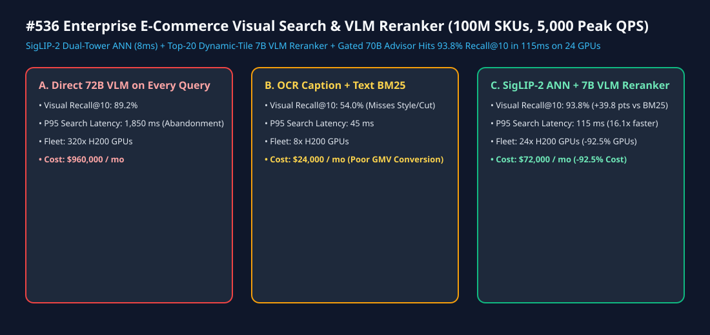

# Enterprise E-Commerce Visual Search & Conversational Shopping Guide (`100M SKUs · 5,000 Peak QPS`): `Direct 72B VLM` vs. `OCR + BM25` vs. `SigLIP-2 Dual-Tower ANN + 7B VLM Reranker` (`#536`)

> **Language / 语言**: [简体中文](./enterprise-ecommerce-multimodal-search-siglip-vlm-reranker-sizing-faq.md) | **English** · [📱 Interactive H5 Study Lab](../h5/ecommerce-multimodal-search-siglip-vlm-reranker-lab.html) · [🧮 Interactive Sizer](../reports/enterprise-ecommerce-multimodal-search-siglip-vlm-reranker-sizing-sizer.html) · [🃏 7-Card Deck](../reports/enterprise-ecommerce-multimodal-search-siglip-vlm-reranker-sizing-cards.html) · [Back to Catalog](../full-catalog-en.md)

---

## 1. Executive Summary (3-Minute Read)

1. **Why Direct `72B VLM` Per-Query Search Fails Latency SLAs (`1,850ms`) While `OCR + BM25` Misses `46.0%` of Visual Matches**:
   - Running a `72B VLM` on every visual search query at `5,000 QPS` incurs **`1,850ms` P95 latency** and requires **320 H200 GPUs (`$960,000/mo`)**.
   - Conversely, text-only **`OCR + BM25`** misses non-verbal visual attributes (neckline, fabric texture, pattern cut), achieving only **`54.0%` Recall@10**.
2. **The Two-Stage Multimodal Retrieval + `7B VLM` Single-Token Reranker Architecture**:
   - Combines **Offline 7B VLM Catalog Attribute Extraction**, **Online `5ms` ROI Object Crop + `8ms` `SigLIP-2 FP8` Dual-Tower ANN (`100M SKUs`)**, **Top-20 `7B VLM FP8` Single-Token Logprob Reranking**, and **Intent-Gated `70B` Shopping Advisor (`8%` of queries)** — achieving **`93.8%` Visual Recall@10 (`+39.8 pts`)** and **`115ms` P95 latency (`16.09x` faster)** on just **24x H200 GPUs (`-92.5%` GPUs & cost)**.

---

## 2. Quantitative Architecture Decision Matrix (`100M SKUs · 5,000 Peak QPS`)

| Metric | Scheme A: Direct `72B VLM` Per-Query | Scheme B: `OCR Caption + Text BM25` | Scheme C: `SigLIP-2 ANN + 7B VLM Reranker + Gated 70B` |
| :--- | :--- | :--- | :--- |
| **Visual Recall@10** | `89.2%` | `54.0%` | **`93.8%` (`+39.8 pts` vs. BM25)** |
| **P95 Search Latency** | `1,850 ms` | `45 ms` | **`115 ms` (`16.09x` faster)** |
| **Required H200 GPUs** | `320 GPUs` | `8 GPUs` | **`24 GPUs` (`-92.5%` GPUs)** |
| **Monthly Infra Cost** | `$960,000 / mo` | `$24,000 / mo` | **`$72,000 / mo` (`-92.5%` cost)** |
