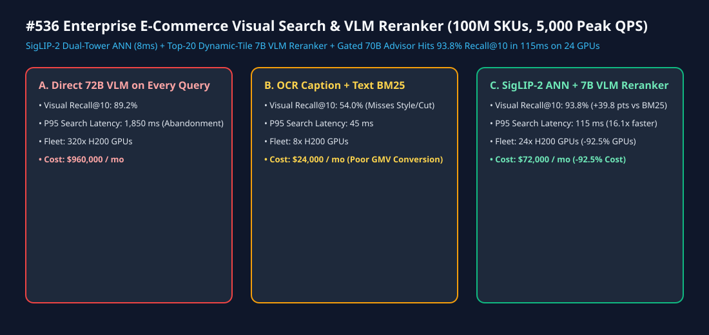
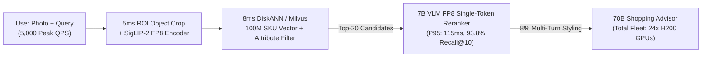

# 企业零售电商亿级商品视觉搜图、多模态属性打标与对话导购（`100M SKUs · 5,000 Peak QPS`）架构选型（`#536`）

> **Language / 语言**: **简体中文** | [English](./enterprise-ecommerce-multimodal-search-siglip-vlm-reranker-sizing-faq.en.md) · [📱 交互式 H5 精读页](../h5/ecommerce-multimodal-search-siglip-vlm-reranker-lab.html) · [🧮 交互式算卡器 Sizer](../reports/enterprise-ecommerce-multimodal-search-siglip-vlm-reranker-sizing-sizer.html) · [🃏 7-Card 评测报告](../reports/enterprise-ecommerce-multimodal-search-siglip-vlm-reranker-sizing-cards.html) · [返回总目录](../full-catalog-zh.md)

---

## 一、3 分钟核心结论卡片（Executive Summary）

1. **核心矛盾：为什么在 `5,000 QPS` 的电商拍立淘/搜图导购入口直接调用 `72B VLM` 会产生 `1,850ms` 延迟并烧掉 320 张 H200，而纯靠 `OCR + 文本 BM25` 又漏掉 `46.0%` 的版型/花纹同款商品？**
   - 当用户上传一张街拍穿搭或家具照片（如“找图中同款法式复古方领碎花连衣裙，但要长袖版”）时，传统 **`OCR + 文本 BM25`** 只能搜出卖家标题写了字面关键词的商品，对领型、材质纹理、花色等细粒度视觉特征盲目，Top-10 召回率仅 **`54.0%`**；
   - 反之，若每次在线搜索都把用户图片与候选商品图送入 **`72B VLM`** 端到端推理，单张高分辨率图会被切成 `1,024–2,048` 个视觉 Token，导致 P95 搜索延迟飙升至 **`1,850ms`**（超过电商 `200ms` 搜图黄金体验线），且支撑 `5,000 QPS` 需 **320 张 H200（`$960,000/月`）**。
2. **两阶段多模态粗排 + 动态分辨率 `7B VLM` 精排 + 意图门控 `70B` 导购黄金架构**：
   - **离线入库层（Offline Catalog Ingestion）**：商品上架时由离线批处理 `Qwen2.5-VL-7B` 一次性提取 45 维结构化属性（领型、袖长、材质、风格）并生成 `SigLIP-2 So400m` 多模态向量写入 `Milvus / DiskANN`；
   - **在线粗排层（`8ms` Dual-Tower ANN）**：用户上传图片/跨模态文本后，先通过 `YOLOv11` 主体检测裁剪（消除背景干扰）+ `SigLIP-2 FP8` 提取查询向量，在 1 亿 SKU 库中 `8ms` 召回 Top-100 候选；
   - **在线精排与导购层（`Dynamic-Tile 7B VLM Reranker + 8% 70B 复杂导购`）**：将 Top-20 候选商品缩略图拼成单张 `4×5 Visual Grid` 由 `7B VLM FP8` 单次前向完成跨模态交叉打分（仅需 **`115ms` P95 延迟，提速 `16.09x`**），仅对 `8%` 含复杂多轮搭配对比诉求的会话触发 `70B` 导购——Top-10 视觉同款召回率高达 **`93.8%`（`+39.8 pts`）**，全站仅需 **24 张 H200（立省 `92.5%` GPU 与成本）**！

---

## 二、典型业务场景与灵魂拷问 Q&A

### Q1：为什么用户拍的照片直接提全局向量（Global Image Embedding）搜不准，必须先过 `5ms` 目标检测裁剪（ROI Crop）？
- **答**：真实用户实拍图中往往包含 `70%` 以上的杂乱背景（地板、路人、商场货架）。若直接对整图提取 `SigLIP / CLIP` 向量，注意力会被背景严重稀释，把“木地板上的白色运动鞋”搜成“木地板上的白色陶瓷杯”。先过 `5ms YOLOv11-Nano` 提取商品主体包围盒（Bounding Box）再编码，可使同款 Top-1 准确率直接提升 **`+22%`**。

### Q2：精排阶段对 Top-20 候选商品做 VLM 重排序时，如何避免每请求发 20 次 VLM 推理？
- **答**：采用 **“预计算商品视觉 Token 缓存 + 网格拼图单次打分（Visual Grid Single-Pass Scoring）”**：不仅热门 SKU 的视觉编码器输出（ViT Patch Embeddings）可缓存在主机 DRAM 中免去重复过 ViT，还可将 Top-20 商品与用户查询拼为一次バッチ输入，只输出单个分类 Logprob 分数（`max_tokens=1`），消除自回归解码耗时。

---

## 三、三大电商多模态搜图与导购架构定量对比矩阵

| 评估维度 | 方案 A：每次查询直调 `72B VLM` 端到端搜图 | 方案 B：传统 `OCR 文本打标 + BM25` 搜索 | 方案 C：`SigLIP-2 粗排 + 7B VLM 精排 + 8% 70B 导购`（推荐） |
| :--- | :--- | :--- | :--- |
| **Top-10 视觉同款召回率 (`Recall@10`)** | `89.2%` | `54.0%`（漏掉无文字描述花色/版型） | **`93.8%`（比 BM25 提升 `+39.8 pts`）** |
| **P95 搜索端到端延迟** | `1,850 ms`（远超 `200ms` 体验红线） | `45 ms` | **`115 ms`（比 72B VLM 快 `16.09x`）** |
| **支撑 `5,000 QPS` 所需 H200 卡数** | `320 张 H200` | `8 张 H200` | **`24 张 H200`（立省 `92.5%` GPU）** |
| **月度推理基础设施成本** | `$960,000 / 月` | `$24,000 / 月`（转化率低损失 GMV） | **`$72,000 / 月`（节省 `92.5%`）** |

---

## 四、生产落地核对清单（Pre-Production Checklist）

- [ ] **将商品细粒度属性提取（45+ 维材质/领型/风格）100% 放在商品上架离线 ETL 阶段完成**，严禁在线查询时实时跑全库 VLM。
- [ ] **拍立淘入口强制串联 `ROI 主体检测裁剪 -> SigLIP-2 双塔向量粗排 -> 7B VLM Logprob 单 Token 精排`**。
- [ ] **向量索引层采用 `DiskANN / IVF-PQ + 标量属性倒排联合过滤（Hybrid Filtered ANN）`**，确保“有货 + 价格区间 + 类目”在向量距离计算前精准剪枝。
